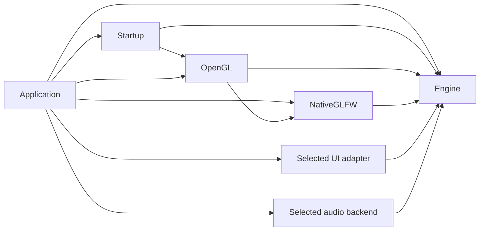

# Engine and integration modules

Cheryl uses one shared `Cheryl::Engine` and independently selected integration
libraries. Each owner declares its sources, public includes, dependencies and tests.
The root selects the assembly. The [module index](../../projects/modules/README.md)
maps owners to Engine contracts and links their APIs; [build options](building.md#configuration-options)
control selection.

Engine has no reverse dependency on an integration. Logging, memory, workers,
events, assets and utilities remain within the one Engine library. Platform owners
implement display/window/input contracts, graphics owners implement rendering and
resources, UI owners consume neutral contracts, and audio owners implement playback.
The optional Linux Debug terminal owns process output/viewer behavior outside the
runtime adapter graph. Its Engine support attachment accepts a module callback;
an absent implementation leaves application startup unchanged.

The public [Startup module](../modules/startup.md), `Cheryl::Startup`, supplies
standard application bootstrap and privately integrates configured backends.
`Cheryl::OpenGL::Startup` is a compatibility interface over Startup/OpenGL rather
than another runtime library. CLI11 remains the explicit public option frontend;
Engine and OpenGL do not depend back on Startup.

The optional [Workers module](../modules/workers.md), `Cheryl::Workers`, groups
configuration loading and topology integration with independent JSON/hwloc
features. Core pool execution/scheduling remains in Engine. Its capability-specific
`Cheryl::WorkerTopology::Hwloc` and `Cheryl::WorkerTopology::Json` compatibility
names refer to the same selected implementation. Private support belongs inside
its owning binary; configurable build policy alone is not a public module.



## Adapter contracts

Use [Interfaces and Adapters](../architecture/interfaces-adapters.md) to find the
required runtime interfaces, optional capabilities, existing implementations and
replacement dependencies. [Assembling the Engine](../architecture/assembling-engine.md)
explains how factories connect them. This guide covers creating and composing the
module that owns an implementation.

### SDL3 scaffold

`CHERYL_BUILD_NATIVE_SDL3=ON` adds the source-only
`Cheryl::NativeSDL3::Scaffold` interface target from
[`platform/native-sdl3`](../../projects/modules/platform/native-sdl3).
The option defaults to `OFF`. Its
[`cheryl/backends/native-sdl3.h`](../../projects/modules/platform/native-sdl3/include/cheryl/backends/native-sdl3.h)
includes the existing Engine contracts and forward-declares
`CE::Platform::SDL3::Window`, `DisplaySystem` and `InputSystem`.

The scaffold has no runtime implementations, SDL3 dependency discovery or startup
factory. It is not registered as an SDK component or a selectable application
backend. Native GLFW remains the implemented platform integration. SDL3 runtime
implementation, OpenGL/startup selection and GLFW deprecation policy remain
future work.

## Module boundary criteria

A separate module is justified when it gives an application a concrete choice or
isolation benefit: omitting a dependency, selecting an alternative implementation,
or testing an external integration independently. A directory, internal interface
or small caller count does not by itself justify a library boundary. Cheryl keeps
one shared `Cheryl::Engine`.

Keep the selected Native GLFW, whole OpenGL and independent TGUI/RmlUi owners
cohesive unless a consumer demonstrates a benefit from another boundary. Native
input depends on a live window; dividing display and input splits that coupled
lifetime. OpenGL's context interface permits another window integration within its
owner and does not itself justify context/bridge libraries.

Before introducing another library target, record:

1. the concrete omit/replace/test benefit;
2. the engine contract the owner implements;
3. dependencies that become optional or isolated;
4. lifetime/dependency direction and how cycles are avoided;
5. test ownership and the smallest independent consumer proving the boundary;
6. compatibility consequences for current consumers.

If those points do not identify a real benefit, keep the code inside the existing
owner. Logging, memory, workers, events, general utilities and similar internal
facilities remain engine organization unless a consumer demonstrates otherwise.
Evaluate architectural interfaces by their contract rather than deleting them
because they have few callers.

## Select an assembly

The root defaults to Startup, Workers, Native GLFW, OpenGL, TGUI, RmlUi and miniaudio; the demo is
opt-in. UI and audio selection is independent of platform/graphics selection.
OpenGL requires Native GLFW; the demo also requires native input. For Engine alone,
disable every module, including Startup/Workers, as shown in the
[engine-only configuration](building.md#engine-only-configuration).
On Linux GNU/Clang this includes `CHERYL_BUILD_DEBUG_TERMINAL_LINUX=OFF`.
The root automatically links the selected terminal interface to its demo/shared
test entry point and the source `Cheryl::Cheryl` facade. External applications can
also select it individually through `Cheryl::DebugTerminal::Linux`. Its configuration
policy and standalone probes are in the
[owner guide](../../projects/modules/platform/debug-terminal-linux/README.md).

Applications link public targets, for example:

```cmake
target_link_libraries(game PRIVATE Cheryl::Engine Cheryl::NativeGLFW Cheryl::OpenGL)
```

Alternatively, link `Cheryl::Cheryl` to select the complete configured assembly,
including its selected public capabilities:

```cmake
target_link_libraries(game PRIVATE Cheryl::Cheryl)
```

This facade is an interface target over the existing libraries. Its source assembly
includes configured diagnostic support; the installed SDK omits the source-only
Linux Debug terminal and its support attachment.

Both source and installed SDK consumers can then include `<cheryl/cheryl.h>` for
the public API of their linked assembly. `<cheryl/engine.h>` stays neutral;
`<cheryl/modules.h>` and `<cheryl/support.h>` expose the linked module and support
groups. Per-owner umbrellas live under `cheryl/modules/` and `cheryl/support/`, so
these APIs appear under the same `cheryl/` include prefix in IDE completion.
The [consumer guide](consuming-engine.md#dependencies-and-headers) describes the
include layout and source-versus-SDK workflows.

Linking Engine alone supplies neutral contracts. Targets propagate public include
roots, C++23, logging policy, module feature definitions and dependency requirements;
raw archive consumers must supply their complete link closure. Headers alone do
not select a backend or add its libraries. Concrete classes remain available through
granular owner headers, such as `cheryl/backends/native-glfw.h`.

`CHERYL_NATIVE_INPUT=OFF` omits Gainput and the default-input factory overload.
`CHERYL_NATIVE_NULL_PLATFORM=ON` configures an owned GLFW without X11/Wayland;
a supplied GLFW target keeps its host settings. The [build guide](building.md)
owns their configuration and dependency details.

Bundled compiled dependencies have one Cheryl binary owner: Engine owns logging,
font/text and image implementations; Native GLFW owns GLFW/Gainput/HID; OpenGL
owns GLAD; each UI module owns its toolkit implementation and exports its native
authoring API. Startup owns selected integration glue and Workers owns optional
topology/configuration adaptation. Header/template usage such as GLM, CTTI and
CLI11 remains explicitly public. See [dependency contracts](consuming-engine.md#dependencies-and-headers).

Selection preserves owner lifetimes: input detaches while its window is live,
resources retire before context destruction, and runtime shutdown settles workers
and recycles frames before game/adapter cleanup.

## Standalone modules

Standalone entry points locate the enclosing checkout's shared helpers and Engine
automatically. Set an absolute `CHERYL_REPOSITORY_ROOT` when selecting another
checkout. Each owner reuses a supplied `Cheryl::Engine` or adds Engine from that
root. OpenGL also reuses `Cheryl::NativeGLFW` or requires
`CHERYL_NATIVE_GLFW_SOURCE`. Bootstrapping suppresses other owners, demo and Engine
tests in a local variable scope, without rewriting a host's cache.

This builds only the OpenGL owner and its dependencies:

```sh
(
  set -e
  cd "$(git rev-parse --show-toplevel)"
  cmake -S projects/modules/graphics/opengl -B build/opengl-module -G Ninja \
    -DCMAKE_BUILD_TYPE=Release \
    -DCHERYL_REPOSITORY_ROOT="$PWD" \
    -DCHERYL_NATIVE_GLFW_SOURCE="$PWD/projects/modules/platform/native-glfw"
  cmake --build build/opengl-module --target module_opengl --parallel
)
```

Other module directories are standalone source entry points too. Module-local
checks use `CHERYL_BUILD_TESTS=ON` without enabling Engine's broader suites.
Hosts own their root `enable_testing()` policy. Independent consumers use the
owner's `tests/consumer/` entry point. Prebuilt selected owners are also available
through the [installed SDK](consuming-engine.md#prebuilt-development-sdks), which
uses the same public aliases and its producer's compiled configuration.

Adding a source module beside a supplied SDK leaves the SDK's `Cheryl::Cheryl`
selection unchanged. Link that source module's target explicitly alongside the
SDK facade; its public feature definition enables its umbrella in the same include.

## Add a module

Resolve the boundary criteria above before adding a target. Then:

1. Create an owner under `projects/modules/<role>/<name>/` with `include/`, `src/`
   and `tests/`. Keep public contracts under `include/cheryl/`; implementation
   helpers and SDK details stay private where the API permits it. Add one
   owner-local `include/cheryl/modules/<name>.h` umbrella that includes its public
   contracts and excludes `internals/`. Support libraries use the corresponding
   `include/cheryl/support/` location. Include the owner umbrella from its selected
   group in `cheryl/modules.h` or `cheryl/support.h`.
2. Copy [Module.cmake.in](../../cmake/templates/Module.cmake.in) into the owner's
   `CMakeLists.txt`. Replace `MODULE_NAME`, the uppercase `MODULE_ID` and public
   `MODULE_ALIAS`. `cheryl_prepare_module()` reuses or bootstraps Engine; pass
   `REQUIRES_NATIVE` only when Native GLFW is a real prerequisite.
3. Declare shared metadata using the same ID in the files below. Add SDK discovery
   inside the selected owner, reusing compatible supplied targets before owned
   sources. Publish required header dependencies with `PUBLIC`; keep private
   implementation dependencies `PRIVATE`. Call
   `cheryl_register_public_component(target FEATURE CHERYL_HAS_<ID>)` from
   [CherylPublicHeaders.cmake](../../cmake/CherylPublicHeaders.cmake) to register
   the owner's public feature definition and add its target to `Cheryl::Cheryl`.
   Use that same feature definition to guard its group umbrella include. Do not
   rewrite supplied targets/cache.
4. Declare a root selection with `cheryl_option(name description default_value)`
   in [CherylOptions.cmake](../../cmake/CherylOptions.cmake), and conditionally add
   the owner in the root [CMakeLists.txt](../../CMakeLists.txt). No other module
   should select this owner implicitly.
5. Add owner-local behavior suites and an independent consumer with first-include
   probes. Keep cross-owner cases in `projects/tests/`. Document the public alias,
   dependency selection, lifetime/thread requirements and capability limits in the
   owner's README, and add it to the module index.

| Metadata file | Module declaration |
| --- | --- |
| [CherylVersions.cmake](../../cmake/CherylVersions.cmake) | `VERSION_PROJECT_MODULE_<ID>` |
| [CherylTargets.cmake](../../cmake/CherylTargets.cmake) | `TARGET_LIB_MODULE_<ID>` and test target identities |
| [CherylOutputs.cmake](../../cmake/CherylOutputs.cmake) | `OUTPUT_LIB_MODULE_<ID>` and runner artifact names |
| [CherylLinkage.cmake](../../cmake/CherylLinkage.cmake) | Scoped `LINKAGE_PUBLIC_*` / `LINKAGE_PRIVATE_*` requirements |

Declaration files reload metadata into the caller's scope; helper definitions are
guarded. Load helpers before declaring a standalone project so versions and target
names are available. The template collects only its owner's `src/*.cpp` with
`CONFIGURE_DEPENDS`, making source additions/removals trigger regeneration. Keep
conditional implementations, generated sources and tests in their own selections.

[CherylTests.cmake](../../cmake/CherylTests.cmake) creates an owner aggregate with
`cheryl_add_test_aggregate(... OWNER)`; set `CHERYL_TEST_AGGREGATE` before adding
focused suites through `cheryl_add_test_suite`. Suites compile cases once into
object targets reused by focused, owner and assembly runners. Keep test hooks on
case targets so applications do not inherit them. [Test selection](testing.md)
covers runner options; [architecture validation](architecture-validation.md)
covers isolated graphs, supplied-target reuse and native acceptance.

UI-specific font, alpha, input and publication requirements are in
[Writing a UI adapter](ui-adapters.md).
