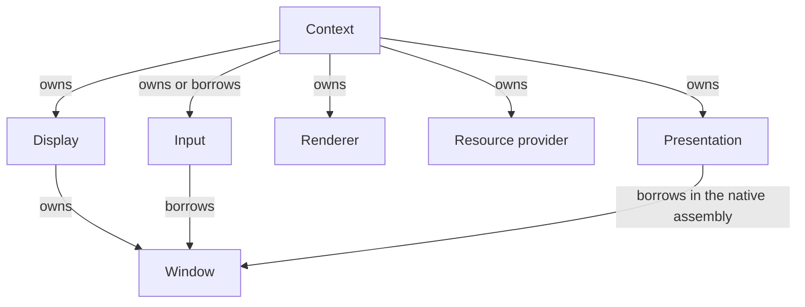

(interfaces-and-adapters)=
# Integration contracts

Use this catalogue when implementing or replacing an integration. A runtime
context needs five compatible adapters: display, input, presentation, renderer
and resource provider. Display supplies the window contract as well. These are
interface obligations, not a requirement for five libraries. The
[Engine Systems overview](../engine-systems/index.md) explains their relationships.

## Runtime adapters

The runtime uses this adapter graph; the implementation tables below name the
existing modules and each interface's obligations.

| Contract | Existing implementation | Obligations and detailed contract |
| --- | --- | --- |
| {cpp:class}`CE::Platform::DisplaySystem` | `CE::Platform::GLFW::DisplaySystem` | Own windows, expose monitor inventory and scale, create/select a compatible active window; document borrowed inventory freshness. [Display ownership](../runtime/display-and-window-contract.md); [Native GLFW](../modules/native-glfw.md); [platform replacement and current OpenGL coupling](#replacing-a-platform-integration). |
| {cpp:class}`CE::Platform::Window` | `CE::Platform::GLFW::Window` | Report logical size, drawable pixels, mode and close state; implement resize/mode/cursor operations and surface deferred native failures. The display owns the window. [Sizes, modes and observation](../runtime/display-and-window-contract.md#sizes-modes-and-observation); [native callback failures](../runtime/failure-reporting.md#native-callbacks). |
| {cpp:class}`CE::Input::System` | `CE::Platform::GLFW::InputSystem` | Attach/detach from a live window, identify devices, normalize standard controls to Engine IDs, own bindings and publish complete polls. Declare Events, Text and focus support; latch supported capture/routing before collection. [Input adapter publication](../runtime/input-state-model.md#adapter-publication); [Native GLFW](../modules/native-glfw.md). |
| {cpp:class}`CE::Rendering::PresentationSurface` | `CE::Rendering::OpenGL::GLFWContext` | Present on the platform/presentation owner while its borrowed window and graphics dependencies remain live. Backend-specific context operations extend this contract. [Context assembly](../development/consuming-engine.md#context-assembly); [OpenGL](../modules/opengl.md). |
| {cpp:class}`CE::Rendering::Renderer` | `CE::Rendering::OpenGL::Renderer` | Initialize/close graphics, consume complete ordered frames, apply viewport/camera/draw state and maintain deferred resources even without a new frame. [Frame publication](../runtime/runtime-frame-boundary.md#frame-publication-and-recycling); [native retirement](../resources/resource-residency.md#native-retirement-and-maintenance). |
| {cpp:struct}`CE::Rendering::Resources::Provider` | `CE::Rendering::OpenGL::ResourceProvider` | Upload images, alpha atlases and 2D geometry, and link executable programs. Copy transient CPU inputs; return retained immutable generations governed by one backend domain. [Publication and retirement](../resources/resource-residency.md); [OpenGL](../modules/opengl.md). |

The context owns display, presentation, renderer and resources, and either owns
or explicitly borrows input. Returned windows and context accessors borrow their
owners. Initialization, partial failure and teardown must preserve those
dependencies; follow [runtime shutdown](../runtime/runtime-frame-boundary.md#shutdown)
rather than inferring cleanup order from the interface list.

## Backend capabilities and resource implementations

| Contract | Existing implementation | Obligations and detailed contract |
| --- | --- | --- |
| {cpp:class}`CE::Rendering::OpenGL::Context` | `CE::Rendering::OpenGL::GLFWContext` | A platform using Cheryl's OpenGL renderer supplies current-context acquisition/release, currentness checks, procedure lookup and presentation. The current implementation is `GLFWContext`. [OpenGL bootstrap and binding](../rendering/pipelines-and-materials.md#native-bootstrap-and-binding); [OpenGL owner](../modules/opengl.md). |
| {cpp:struct}`CE::Rendering::Resources::Image`, {cpp:struct}`CE::Rendering::Geometry::Buffer2D`, {cpp:struct}`CE::Rendering::Resources::Program` | OpenGL `Texture`, `VertexArray` and `Program` | Graphics implementations supply retained images, geometry metadata/draw operations and executable-program binding. Native use requires the original live domain and owner. [Resource lifetime](../resources/resource-residency.md#native-retirement-and-maintenance); [draw and material binding](../rendering/pipelines-and-materials.md#independent-binding). |
| {cpp:class}`CE::Rendering::Resources::Pipeline` | `CE::Rendering::OpenGL::Pipeline` | A graphics backend retains its executable and immutable pipeline definition; playback applies the declared fixed state and parameter bindings. `Material` is an Engine-owned value retaining that pipeline. [Pipelines and materials](../rendering/pipelines-and-materials.md); [manual construction](../rendering/pipelines-and-materials.md#manual-material-construction). |
| {cpp:class}`CE::Rendering::Sampling::Sampler` | `CE::Rendering::OpenGL::Sampler` | Optional `Provider::create_sampler()` capability. Preserve immutable filtering/wrap choices independently of image contents and expose effective anisotropy. Unsupported creation rejects. [Immutable sampling](../rendering/pipelines-and-materials.md#immutable-sampling). |
| {cpp:struct}`CE::Assets::Shaders::Builder` | OpenGL resource provider | Optional provider-owned shader/material recipe capability. Validate on CPU, then build complete candidates on the provider's loading owner. `shader_asset_builder()` returns a borrowed pointer or null. [Shader/material definitions](../assets/asset-manifests.md#shadermaterial-definitions); [publication and retry](../assets/asset-loading.md#publication-and-retry). |
| {cpp:class}`CE::Workers::TopologyProvider` | Workers hwloc provider | Optional native topology/affinity integration. Return owned eligible-CPU/core/cache observations, bind only the calling thread and read back its actual mask; support concurrent pool workers. [Topology providers](../runtime/worker-execution.md#topology-providers-and-capacity); [Workers module](../modules/workers.md). |

Colored-geometry upload is another optional provider operation; unsupported
layouts reject rather than silently dropping color. Input State is always
available, while Events, Text and focus have explicit support queries. Optional
capabilities must remain observable to consumers; implementing the base interface
does not promise every extension.

## Integrations alongside the runtime

| Integration and obligations |
| --- |
| Audio {cpp:class}`CE::Audio::System` and {cpp:class}`CE::Audio::Voice`: synchronized playback/control, an independent output clock, maintenance and safe closed handles. The application owns output lifetime. [Audio ownership](../runtime/audio.md); [miniaudio](../modules/miniaudio.md). |
| UI toolkit Consume neutral input records/focus, copied dimensions, CPU font/image services and immutable resource/frame publication. Each toolkit owns its session and native authoring API; there is no common Engine widget/session base to implement. [UI bridge responsibilities](../development/ui-adapters.md#bridge-responsibilities); [TGUI](../modules/tgui.md), [RmlUi](../modules/rmlui.md). |
| Queued event delivery {cpp:type}`CE::Events::EventBus::Delivery` and {cpp:type}`CE::Events::EventBus::ErrorHandler`: own accepted work without inline execution, preserve a listener's FIFO stream and report failure/cancellation. Supplied adapters target platform, simulation or a worker stream. [Queued delivery](../runtime/event-delivery.md#optional-queued-delivery); [worker cancellation](../runtime/event-delivery.md#worker-stream-acceptance-and-cancellation). |
| Startup/configuration Compose compatible adapters and validate configuration before the runtime session. Startup integrates selected backends; worker JSON loading supplies configuration rather than another executor. [Startup](../modules/startup.md), [Workers](../modules/workers.md); [source/SDK composition](../development/consuming-engine.md). |
| Process output attachment Supply the optional Debug terminal support callback and own its native viewer/process lifetime. This source-only attachment sits outside the context adapter graph. [Linux Debug terminal](../modules/debug-terminal-linux.md); [logging output](../runtime/logging.md#native-output-terminal). |

## Replacing a platform integration

For an SDL3 replacement, the platform work maps to `DisplaySystem`, `Window` and
`Input::System`. Keeping Cheryl's OpenGL renderer also requires an OpenGL
`Context` bridge and compatible resource lifetime. The current OpenGL target and
startup factory select Native GLFW explicitly; a new platform therefore needs
composition/build selection changes as well as interface implementations.
[Application composition](../development/consuming-engine.md#context-assembly),
the [OpenGL owner](../modules/opengl.md) and the [Startup guide](../modules/startup.md)
describe that current coupling.

Keyboard, mouse-button and gamepad enums belong to Engine and are accepted
directly by bindings; see
[control identities and binding tokens](../runtime/input-state-model.md#control-identities-and-binding-tokens).
A replacement normalizes its native codes to those standard control IDs before
binding evaluation. It must also fulfill polling, capture, routing and native
failure contracts, and state which device capabilities it supports. Backend
selection still determines available devices and observations.

## Implement and connect a replacement

1. Select the responsibilities you are replacing in the catalogue. Keep the
   portable interfaces in Engine and the concrete implementation in its module.
2. Use the implementation column above to identify cooperating owners. Replace
   or bridge every affected domain before creating a runtime context.
3. Implement the required operations and report optional capabilities explicitly.
   Unsupported requests reject instead of silently losing behavior.
4. Assemble the components through a factory, preserving their ownership and
   initialization dependencies. Use the existing module's independent consumer
   and the architecture validation procedures as conformance examples.

[Source and SDK integration](../development/consuming-engine.md) explains application
factories and public targets; [Module authoring](../development/modules.md) covers
target registration and independent owners. Validate the replacement with
[independent consumers and header probes](../development/architecture-validation.md#independent-consumers-and-header-probes).
Runtime-owned and application-owned objects follow
[ownership and cleanup](ownership-cleanup.md).
