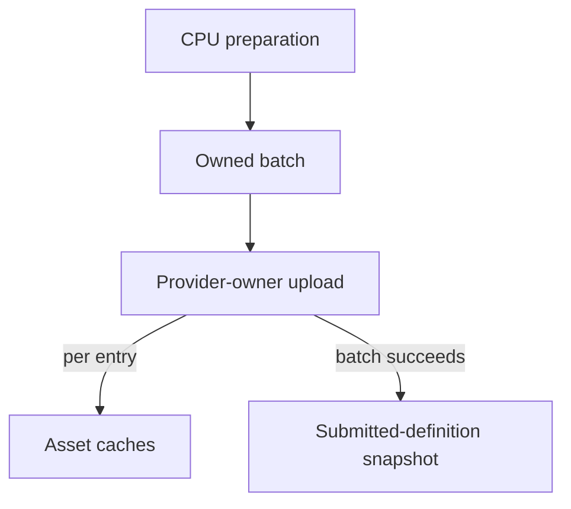
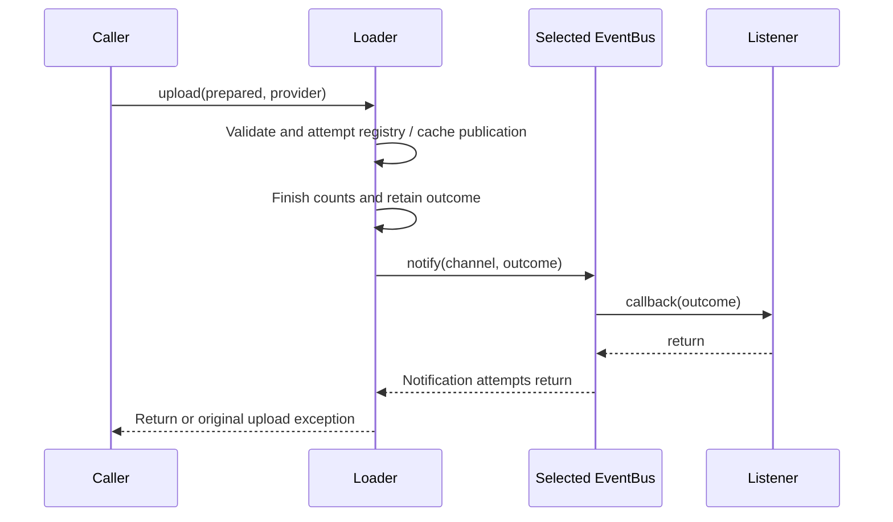

# Asset loading

`CE::Assets::Manifests::Reader` parses graphics manifests 2.0 into CPU-only
sprite/tileset definitions and shader/material recipes. An owned
`CE::Assets::Loading::Loader` keeps one immutable root:
preparation selects indexed documents, decodes owned RGBA pixels and snapshots
shader source bytes without a provider; `upload()` constructs resources and
publishes retained metadata on the provider's loading thread.



Preparation and upload have different failure boundaries: preparation publishes
no resources, while an upload can leave earlier cache entries published. The
last successful metadata snapshot remains available until another batch succeeds.

## Runtime entry point

Start with the self-contained [First Game asset root](../getting-started/first-game.md#init-load-assets-and-create-the-actor).
Here `asset_root` names your copy of that directory and `engine` is the initialized
runtime context. Include `<cheryl/core/resources/asset-management/asset-loader.h>`,
`<cheryl/core/resources/asset-management/sprite-mgr.h>` and `<stdexcept>`.
During platform-owned game initialization, load the root with its provider:

```cpp
CE::Assets::Loading::Loader loader(asset_root);
loader.publish_events_to(engine.events().publisher());
loader.load_assets(engine.resources());
auto actor = CE::Assets::Sprites::Manager::get().get_asset("first-game", "actor");
if (!actor)
    throw std::runtime_error("The actor sprite is required");
auto documents = loader.manifests(); // shared_ptr<const vector<CE::Assets::Manifests::Graphics>>
```

The expected key is `first-game:actor`; the handle retains the image, cell geometry
and compatible default material. Continue with [sprite submission](../getting-started/first-game.md#prepare-a-frame-publish-the-actors-current-appearance)
to display it. Optional repository artwork needs the separate
[package installation](catalog.md) and [focused index selection](catalog.md#load-only-installed-packages)
described in the catalog; loading the entire repository root can select absent images.

Each asset family owns its definitions, retained values and cache API. Sprite and
tileset managers expose `load()` for definitions; the image manager exposes
`load()` for paths and `upload()` for decoded pixels. Their inherited `get_asset()`
and `clear_assets()` retain the shared cache contract. The loader's
`load_assets()` remains the complete-root preparation/upload convenience path.
The [value guide](asset-values-and-playback.md#api-domains) maps the family names.

The example routes optional [upload settlement notifications](#upload-settlement-notifications)
to the Context bus. The First Game, tutorial and demo loaders use this setup.
Standalone loaders select their own route, or leave notification routing empty.

Each preparation scans again. Only exact `graphics-manifests.json` indexes select
documents; schemas and unlisted JSON are not parsed. Index, texture and shader
references resolve from the enclosing `graphics/` directory, and asset keys use
`namespace:name`. `prepare()` selects every discovered index and decodes referenced
images plus standalone PNGs below the root, deduplicated in sorted order.
`prepare_graphics(indexes)` selects explicit indexes relative to the Loader root
(or supplied absolute paths), decoding only their referenced images. A shader-only
selection decodes no images. Cross-document
IDs and every grid's bounds are checked against those exact decoded dimensions
before any upload. Upload consumes the owned pixels without reopening image files.
Pixels are four-channel RGBA in the decoder's default top-to-bottom row order.
OpenGL reverses those rows in transient upload storage to match the atlas
geometry's upward-positive UV coordinates; the supplied pixels remain unchanged.
The separate stb alpha-atlas path preserves its baked row/UV convention.

Shader sources resolve through exact registered paths, including when basenames
repeat. Preparation owns the bytes, so upload does not reopen shader files either.
Program/material kinds, references and asset selections are checked within the
selected batch; an unrelated cached material cannot satisfy a missing selection.
`register_files()` performs discovery/publication of unmanaged paths only, without
opening JSON, decoding images or requiring a provider.

Preparation can use a tracked context worker group. Own both the loader and its
`CE::Assets::Loading::Prepared` value through the platform handoff; simulation only retrieves ready
futures, and never blocks on CPU preparation or GPU upload:

```cpp
auto workers = engine.make_worker_group();
auto platform = engine.platform_dispatcher().submission();
auto loader = std::make_shared<CE::Assets::Loading::Loader>("assets");
loader->publish_events_to(engine.events().publisher());
auto preparing = workers.submit([loader, platform] {
    auto prepared = loader->prepare();
    return platform.submit(
        [loader, prepared = std::move(prepared)](CE::Runtime::Context& owner) mutable {
            loader->upload(std::move(prepared), owner.resources());
            return loader->manifests();
        }
    );
});
// A later update: only after preparing.wait_for(0s) reports ready, get the
// returned upload future. Check that future's readiness before reading metadata.
```

Retain the preparation future as game state. Also keep the upload future and the
last accepted metadata snapshot between updates; include `<chrono>` and `<future>`:

```cpp
using Metadata = decltype(loader->manifests());
std::future<Metadata> uploading;
Metadata published_definitions = loader->manifests();
```

During later `update()` calls:

```cpp
if (preparing.valid() && preparing.wait_for(std::chrono::seconds{0}) == std::future_status::ready)
    uploading = preparing.get();
if (uploading.valid() && uploading.wait_for(std::chrono::seconds{0}) == std::future_status::ready)
    published_definitions = uploading.get();
```

The first `get()` transfers the platform-upload future; the second adopts the
successful metadata snapshot. Exceptions reach the update's selected failure
policy and leave the prior snapshot unchanged. Retrieve the required new asset
handles before making application state depend on that content. Ordinary loading
preserves existing keys; this sequence does not turn it into image/sprite hot reload.
Start another batch only after both futures are invalid, keeping one batch pending.

An owned root or injected shared root supplies physical capacity; this group
belongs to the context shutdown domain. Accepted CPU jobs finish while the
platform dispatcher remains available. Any final unexecuted upload is cancelled
before resource teardown, so its future reports failure instead of hanging.
Use platform submission endpoints rather than borrowed dispatcher pointers.

[Threads and Data Flow](../architecture/threads-data-flow.md#prepare-and-publish-a-replacement)
explains this handoff across systems. Keep CPU inputs and upload dependencies
alive through completion or cancellation instead of blocking their execution owner.

## Publication and retry

`CE::Assets::Loading::Prepared` owns decoded pixels, shader bytes and definitions, with no provider or native
handles. Preparation failure changes no caches or published metadata. Upload
consumes the supplied value on the provider's loading owner; moving it into a
request transfers that ownership. Retry needs a fresh preparation or a preserved
copy. Pending platform requests can cancel before execution under the
[dispatcher contract](../runtime/thread-dispatch.md); executing uploads have no
rollback or mid-batch cancellation contract.

Each created cache entry can become visible before the next entry is created.
Upload failure preserves completed entries and the last successful metadata
snapshot. Allocation of that final snapshot can fail even after all entries exist.
Retry skips existing keys rather than replacing them, so published manifests
describe submitted definitions rather than an atomic view of current caches.
Changed files under the same keys do not provide hot reload. Readers retain old
metadata snapshots after another upload or loader destruction.

Upload checks the optional provider-owned `shader_asset_builder()` capability,
then publishes programs/materials before images and sprite/tileset resources.
Providers without that capability reject selected shader recipes explicitly.
`CE::Assets::Shaders::Manager` retains each recipe together with its executable generation;
material construction uses the retained program generation even when an ordinary
load preserves an existing program. Asset selections retain their material handle.

`upload(prepared, provider, true)` explicitly replaces shader generations only.
Each candidate is complete before publication; failure preserves that key's old
generation, while earlier successful replacements remain published. Existing
assets and frames keep their old handles rather than automatically rebinding.
`shader_manifests()` and `manifests()` describe the last successful submitted
definitions, not an atomic cache snapshot. `diagnostics()` reports the last attempt,
including partial publications/replacements. There is no watch-based reload or
whole-batch rollback.

`load_assets(provider)` is the synchronous prepare/upload convenience path.
Construct separate loaders for separate roots. Legacy `Loader::get(root)` remains
available but rejects a different root after its first initialization; `get()` only
retrieves an already-initialized singleton.

## Catalogue changes

Use a manager's `catalogue()` source when a resource browser, dependency cache or
reload coordinator needs current keys and later committed changes. It supplies
CPU-only snapshots and optional seeded watches. Each catalogue has a checked
identity and revision; a key's generation is source-unique and increasing, so
generation numbers for one key can have gaps.

The channel is typed by both asset namespace and exact key type:
`CE::Assets::Cache::asset_catalogue_changed_event<AssetType, Key>` carries
`AssetCatalogueChanged<AssetType, Key>`. Image/program/material caches use path
keys; indexed shader, sprite and tileset caches use their string identities.
Neither all managers nor all keys are flattened into one string namespace.

| Change | Committed meaning |
| --- | --- |
| `Published` | An absent exact key acquired a complete generation. |
| `Replaced` | An existing key acquired a fresh complete generation; `previous` identifies the old one. |
| `Reset` | Explicit `clear_assets()` cleared the catalogue, including an already empty one. No key/current generation is supplied. |

Cache hits are silent. Changes stage only after cache and derived metadata commit,
then notify outside cache locks after retired asset owners release. Each payload
owns its key and previous/current generation metadata, without owning the asset.
Listener failure cannot turn a successful reload into a claim that the old entry
was preserved. Earlier entries can still commit before a later batch failure;
there is no multi-key transaction or automatic relinking of old frames/materials.

Runtime routes its resource provider to `engine.events()` before game loading.
For standalone use, call `provider.publish_events_to(bus.publisher())` before
manager loading. A retained catalogue source can explicitly override that route
with `source.publish_events_to(...)`. Already staged records keep their original
destination. Without an active route or local watch, commits maintain generation
metadata without preparing observation payloads.

For a platform-owned loading tool, include
`<cheryl/core/resources/asset-management/texture-mgr.h>`. With the initialized
`engine` and `loader` from the entry point above:

```cpp
auto& images = CE::Assets::Images::Manager::get();
auto source = images.catalogue();
std::uint64_t observed_revision = 0;
auto watch = source.watch(
    [&observed_revision](const CE::Assets::Cache::CatalogueObservation<
        CE::Rendering::Resources::Image, std::filesystem::path>& observation) {
        observed_revision = observation.seed ? observation.seed->revision : observation.change->revision;
    }
);
loader.load_assets(engine.resources());
auto current = source.snapshot();
// Inspect current.entries/revision; reconcile this snapshot if an observation was lost.
watch.reset(); // Before the borrowed counter goes away.
```

The seed contains current exact keys and generations before `watch()` returns;
delayed changes at or below its revision are filtered. Later callbacks run on the
source drainer, possibly another producer thread, serialized for that watch.
The move-only `Watch` detaches on reset/destruction and acknowledges an entered
callback, with safe self-reset. Seed failure propagates and removes the watch;
later observer failure is isolated. Use a bus listener with
[simulation delivery](../runtime/event-delivery.md#optional-queued-delivery)
when updating simulation-owned gameplay or UI from platform commits.

`manager.asset_snapshot(exact_key)` selects a strong asset handle, optional
generation metadata and catalogue revision under the same lock. Missing keys
have no handle/generation. This is exact-key lookup rather than a manager's
convenience alias policy. Old selections retain old handles. A generation's
separate `graphics_domain` token describes its native provenance; an empty token
explicitly means unsupported/unbound provenance. Catalogue revision does not
authorize native use. See [graphics domains](../resources/resource-residency.md#graphics-domain-observation).

### Bounded delivery and teardown

Commits automatically start an ordered, nonrecursive drain. It retains at most
64 observations and attempts at most 64 per call. Reentrant commits can join the
current drain within that budget; call `source.publish_notifications()` or make
a later commit to service residual work. Overflow drops the oldest observation.
Payload-preparation failure also leaves the cache commit intact. Snapshots and
attempted events expose cumulative loss and first/last lost revisions; the range
can contain delivered revisions. A bus failure gets no automatic retry.

Snapshots reconcile current keys/generations, not retired history. Store
destruction closes its retained source without a Reset callback. Provider
destruction silently clears its global caches and advances their revisions;
those manager sources can later serve another provider. Actual graphics-domain
invalidation uses the runtime's cache-eviction consumer and emits explicit Reset
observations. Destructors never invoke catalogue listeners.

This per-key family is separate from the aggregate upload result below. A batch
of 10,000 assets still has one `AssetUploadSettled`; configured catalogue observers
can additionally receive its real new/replaced key commits.

## Upload settlement notifications

Subscribe to `CE::Assets::Loading::asset_upload_settled_event` to observe an
executed upload attempt. Its `CE::Assets::Loading::AssetUploadSettled` payload is
one owned aggregate: uploading a batch of 10,000 assets has one attempt outcome.
Use the existing loader header and `<optional>` for this platform-owned example,
with an initialized `engine` Context and the `asset_root` above:

```cpp
CE::Assets::Loading::Loader loader(asset_root);
loader.publish_events_to(engine.events().publisher());
std::optional<CE::Assets::Loading::AssetUploadSettled> latest_upload;
const auto upload_listener = engine.events().register_listener(
    CE::Assets::Loading::asset_upload_settled_event,
    [source = loader.source_id(), &latest_upload](const CE::Assets::Loading::AssetUploadSettled& event) {
        if (event.source == source)
            latest_upload = event;
    }
);
try {
    loader.load_assets(engine.resources());
} catch (...) {
    engine.events().unregister_and_wait(upload_listener);
    throw;
}
engine.events().unregister_and_wait(upload_listener);
```

The source filter selects this loader when others share the bus. After successful
loading, `latest_upload` records `UploadOutcome::Succeeded` and its counts.
Both paths remove the listener before the borrowed variable goes away. Retain a
registration for longer-lived monitoring and remove it before its target dies.
Register before the attempts of interest; upload events have no replay.



Notification follows completion bookkeeping, outside loader/cache locks, on the
loading owner. Direct return, the original exception, or a platform request's
future remains authoritative. The enclosing request future may still be unready
inside this callback; inspect it later from update rather than waiting here.
For simulation-owned game/UI state, choose
[simulation delivery](../runtime/event-delivery.md#optional-queued-delivery) and
keep that target alive through listener removal.

### Attempt identity and failed effects

`source` is the loader's unique nonzero identity. `attempt` is a distinct nonzero
execution identity for every admitted `upload()` call; retrying a preserved
`Prepared` batch creates another attempt while keeping `counts.batch` as its
diagnostic correlation. `counts.provider` identifies the selected provider.
`observed_at` is the loading owner's steady-clock completion observation.
The payload owns its counts and original `std::exception_ptr failure`, which is
empty on success and can be rethrown to inspect a failed attempt.

`UploadOutcome` describes the available knowledge of effects:

| Outcome | Meaning |
| --- | --- |
| `Succeeded` | Upload and retained metadata publication completed. |
| `FailedBeforeEffects` | Failure preceded every operation that could publish registry/cache effects. |
| `Partial` | Valid publication/replacement counters prove that at least one cache effect committed before failure. |
| `EffectsUnknown` | A mutating operation was entered, but the observations cannot establish all committed effects. |

`counts.images_completed` includes cache hits. `counts.publications` and
`counts.replacements` cover typed caches only, and their deltas require
`counts.publication_count_available`. File registration can change before an
image fails while these counts remain zero; that failure is `EffectsUnknown`.
None of the failed outcomes promises rollback or an unchanged file registry.
The [publication and retry contract](#publication-and-retry) still applies.

Preparation, validation in `load_assets()` before it reaches `upload()`, and
requests cancelled before execution emit no settlement event. Rejected attempts
that cannot start also emit none. Observer failures use isolated `notify()`
reporting and do not turn successful uploads into failures or replace an original
upload exception.

### Routing and reentrant publication

Configure `publish_events_to()` on the loading owner while the loader is idle
and its pending outcomes are drained. Its
[weak publisher](../runtime/event-delivery.md#weak-publishing-handles) allows the
loader to outlive the bus; an empty or expired route discards observations.

`upload()` automatically attempts `publish_pending_events()` after settling.
Each drain selects the outcomes pending at entry. If a listener performs another
upload on this owner, that new outcome waits for the next upload or explicit
drain, preserving fanout order without recursive notification. At most 64
outcomes may be pending. Staging/overflow failures are independently reported
and preserve the direct upload result. Drain any wanted pending observations
before destroying the loader; destruction never invokes listeners.

## Resources and application bootstrap

The generic loader loads indexed shaders/materials, images, sprites and tilesets.
Fonts use the separate [configured font service](text-layout.md#configure-fonts-once),
whose default is embedded when the application supplies no configuration. The
[file/font discovery guide](file-and-font-discovery.md) defines candidate selection,
index freshness and the legacy font cache's default/collection-face policy. The demo selects
`graphics/shaders/graphics-manifests.json` and retrieves `main:text` and `main:images`
from `CE::Assets::Shaders::Manager::find_material()`, including with `--full-assets`. F5 prepares that same index
and requests explicit replacement. The demo adopts its pair only after both
replacements succeed; failed reload preserves its previous application pair even
if the shared catalogue has published an earlier candidate. Fonts remain outside
the graphics manifest contract. Manual material builders remain supported; the
[rendering guide](../rendering/pipelines-and-materials.md#manual-material-construction)
shows direct typed construction. TGUI and RmlUi use
[automatic provider-owned defaults](../rendering/pipelines-and-materials.md#default-ui-materials)
and accept compatible material handles from indexed recipes as optional overrides.

`CE::Rendering::Resources::Provider::create_image()` accepts
`CE::Assets::Images::Decoded` RGBA pixels.
`upload_geometry(span<const CE::Rendering::Geometry::Vertex2D>, topology)` copies the transient view before
returning. The older shared-pointer/count overload keeps its CPU owner only through
that upload. Atlas cells use independent four-vertex strips; images and glyphs use
six-vertex triangle quads. Backend handles never retain these CPU buffers. OpenGL
checks dimension, byte-count, vertex-count, and draw-range limits before use.

## Typed manifest data and consumers

Engine definition types retain grid origins, frame sizes, spacing, pivots, views,
orientations, timed clips and facings, animated tile targets, Wang terrain metadata,
weighted variants, and neighbor-mask lookup tables.
`CE::Assets::Sprites::Asset::definition()` and
`CE::Assets::Tilesets::Asset::definition()` expose them after construction. Entity-owned
`CE::Assets::Sprites::Animation` already advances timed clips and publishes resolved cells; the
cached sprite has no mutable playback cursor. Tile-map neighbor selection and
application meanings for views/orientations remain gameplay work.
The [asset value and playback contract](asset-values-and-playback.md) defines direct
construction limits, borrowed metadata, lookup failure and submission ownership.

Use `CE::Assets::Manifests::Reader::load(file)` or `parse(stream, source)` for document-only tools.
Use the owning focused runners or `all-tests` for regressions;
[architecture validation](../development/architecture-validation.md) describes
selection and coverage limits.
