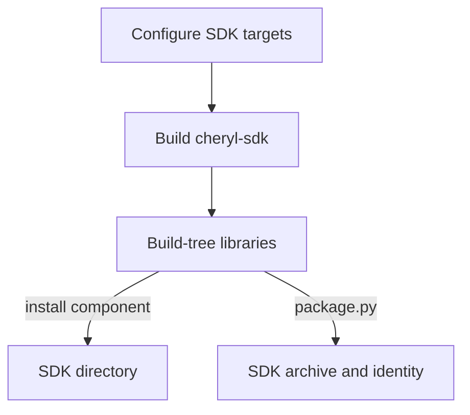

(configuring-and-building-cheryl)=
# Build engine and SDKs

Use CMake 3.28 or newer, Ninja and a C++23 compiler/standard library with
`std::format`. Initialize the pinned submodules as described in
[setup](../../../README.md#setup). Build-tree consumers use the same dependencies;
link Cheryl targets instead of copying include and link settings. Prebuilt consumers
use the [SDK import targets](consuming-engine.md#prebuilt-development-sdks).

## Choose the artifact

Configuration selects available targets; an explicit build, install or packaging
command produces the artifact you need. A library build leaves headers in their
source directories. SDK installation collects them into one redistributable
`include/` tree alongside the compiled libraries and CMake import targets.

For SDK production, building, installing and archiving are separate operations:



| Artifact | Trigger | Result |
| --- | --- | --- |
| HTML manual and C++ reference | Follow [Documentation tooling](documentation.md) for direct generation or the CMake documentation targets. | `docs/site/generation/generated/html/index.html` and linked pages. |
| Engine library | Build `cengine`; see [engine-only configuration](#engine-only-configuration). | Versioned Engine library in the build root, plus required dependency artifacts; see [library linkage](#library-linkage). |
| Selected SDK libraries | Enable `CHERYL_BUILD_SDK`, then build `cheryl-sdk`. | Engine, selected modules/support and their owned dependencies in the build tree. |
| Redistributable SDK directory | Build `cheryl-sdk`, then install the `CherylSDK` component. | One prefix containing `include/`, libraries, CMake package files and licenses. |
| SDK archive with manifest/checksum | Run `.github/ci/package.py` after building `cheryl-sdk`. | Linux `.tar.gz` or Windows `.zip`, `SDK-MANIFEST.json` and `SHA256SUMS`. |

The [SDK commands](#development-sdk-builds) below cover building, installing and
archiving separately. Source consumers do not need to produce an SDK first; linking
`Cheryl::Cheryl` supplies the configured assembly's public include directories and
dependencies for `<cheryl/cheryl.h>`. Leave `CHERYL_BUILD_SDK=OFF` when building an
application from source unless you also want to produce an SDK. This interface
target links the existing libraries; there is no additional combined library
archive. See
[Source and SDK integration](consuming-engine.md) for source and prebuilt integration.

### Build documentation

[Documentation tooling](documentation.md) owns generation commands, prerequisites,
tool selection and output options. Its [CMake entry points](documentation.md#cmake-entry-points)
provide `docs` for incremental generation and `docs-clean` for full regeneration
without compiling the engine. Enable `CHERYL_BUILD_DOCS` to expose these targets
in an engine build, or use the documentation-only project to avoid engine
configuration and dependencies.

## Configuration options

Pass settings as `-DNAME=value`. These defaults apply to a fresh root configuration;
existing build directories and IDE profiles retain their cache. All Cheryl-owned
option definitions and defaults live in
[`cmake/CherylOptions.cmake`](../../../cmake/CherylOptions.cmake). Component and
standalone entry points select which options to declare; optional backend and
dependency-source settings may appear only when their component is selected.

| Option | Default | Effect |
| --- | --- | --- |
| `CHERYL_BUILD_STARTUP` | `ON` | Selects the public application-bootstrap module. |
| `CHERYL_STARTUP_OPENGL` | Follows selected OpenGL availability | Includes private configured OpenGL integration in Startup; does not create another startup binary. |
| `CHERYL_BUILD_WORKERS` | `ON` | Makes the optional worker configuration/topology module available when a feature is selected. |
| `CHERYL_BUILD_NATIVE_GLFW` | `ON` | Selects GLFW display/windows and optional input. |
| `CHERYL_BUILD_NATIVE_SDL3` | `OFF` | Adds the source-only [SDL3 scaffold](modules.md#sdl3-scaffold); no runtime adapter or SDK component. |
| `CHERYL_BUILD_DEBUG_TERMINAL_LINUX` | Single-configuration Linux GNU/Clang with `CMAKE_BUILD_TYPE=Debug`: `ON`; otherwise: `OFF` | Includes the optional Linux output terminal in consuming applications/test runners. Explicit `ON` includes it in every configuration built from that directory. |
| `CHERYL_DEBUG_TERMINAL_EMULATOR` | `auto` | Linux module launcher selection: `auto`, `konsole` or `xterm`. |
| `CHERYL_BUILD_OPENGL` | `ON` | Selects the complete OpenGL backend; requires Native GLFW. |
| `CHERYL_BUILD_UI_TGUI` | `ON` | Selects TGUI independently of platform/graphics. |
| `CHERYL_BUILD_UI_RMLUI` | `ON` | Selects RmlUi independently; can coexist with TGUI. |
| `CHERYL_BUILD_AUDIO_MINIAUDIO` | `ON` | Selects miniaudio decoding, output and streaming. |
| `CHERYL_BUILD_DEMO` | `OFF` | Adds `demo` with Native GLFW, OpenGL and native input selected. |
| `CHERYL_BUILD_FIRST_GAME` | `OFF` | Adds the maintained `first-game` walkthrough application with Native GLFW, OpenGL and native input selected. |
| `CHERYL_BUILD_TUTORIAL_GAME` | `OFF` | Adds `tutorial-game` with reusable controllers, Characters, player join/leave, patrol and a TGUI HUD; requires Startup/OpenGL, native input and TGUI. |
| `CHERYL_BUILD_DOCS` | `ON` | Adds the optional `docs-tools`, `docs` and `docs-clean` targets; tools are selected when these targets run. |
| `CHERYL_BUILD_TESTS` | `OFF` | Adds focused tests and explicitly buildable acceptance/aggregate runners. |
| `CHERYL_BUILD_ALL_TESTS` | `OFF` | Includes aggregates in the default build and CTest; requires tests. |
| `CHERYL_BUILD_ACCEPTANCE_TESTS` | `OFF` | Includes acceptance runners in the default build; requires tests. |
| `CHERYL_BUILD_CONSUMER_TESTS` | `OFF` | Adds selected owners' consumers and first-include probes independently of GoogleTest. |
| `CHERYL_BUILD_WORKER_TOPOLOGY_HWLOC` | `ON` | Selects optional runtime topology discovery and thread binding through hwloc. |
| `CHERYL_BUILD_WORKER_TOPOLOGY_JSON` | `ON` | Selects the versioned worker settings loader independently of hwloc. |
| `CHERYL_BUILD_SDK` | `ON` | Adds the `cheryl-sdk` build target and `CherylSDK` install/export component for selected libraries, headers and dependencies. |
| `CHERYL_BUILD_SHARED_LIBS` | `ON` | Builds Engine, Startup and selected compiled modules as separate shared libraries; external dependency linkage follows the per-library policy below. |
| `CHERYL_NATIVE_INPUT` | `ON` | Includes Gainput-backed input in Native GLFW. |
| `CHERYL_NATIVE_NULL_PLATFORM` | `OFF` | Configures an owned GLFW without X11/Wayland. Disable native input to omit Gainput/X11. |
| `CHERYL_LOG_PROFILE` | `auto` | Selects `developer`, `support` or `release`; `auto` follows the build configuration. |
| `CHERYL_LOG_COMPILED_MASK` | Empty | Overrides compiled severity bits (`0`–`63`); see [logging policy](../runtime/logging.md#compile-policy). |
| `WARN` | `OFF` | Adds `-Wall`. |

A supplied GLFW target keeps its host's settings. Null-platform OpenGL still needs
OpenGL development/link libraries and does not supply the windowed demo.
Cheryl disables documentation generation for its owned GLFW dependency, so ordinary
engine configuration does not probe Doxygen for GLFW's manual.
Standalone modules default their local `CHERYL_BUILD_TESTS` to `OFF`; the
[module guide](modules.md#standalone-modules) covers their composition.

### Build configurations

Keep different configurations in separate directories. This block builds Debug;
substitute `RelWithDebInfo`/`build/support` or `Release`/`build/release` as needed:

```sh
(
  set -e
  cd "$(git rev-parse --show-toplevel)"
  cmake -S . -B build/debug -G Ninja -DCMAKE_BUILD_TYPE=Debug \
    -DCHERYL_BUILD_DEMO=ON
  cmake --build build/debug --target demo --parallel
)
```

This Linux example uses installed shared development packages. Windows uses the
prepared dependency arguments below. Non-MSVC Debug enables AddressSanitizer and
UndefinedBehaviorSanitizer. Automatic
logging selects developer in Debug, support in RelWithDebInfo and release otherwise.
All translation units sharing Cheryl headers must use the same compiled logging
definitions; runtime levels cannot restore stripped severities.

Executables and archives use the configured build root. Windows adds `.exe` to
executables. Multi-configuration generators require `--config Release` for builds
and `-C Release` for CTest, with executables normally in `Release/`.
Target and artifact declarations are centralized in
[CherylTargets.cmake](../../../cmake/CherylTargets.cmake) and
[CherylOutputs.cmake](../../../cmake/CherylOutputs.cmake).

### Library linkage

Cheryl Engine, Startup and compiled modules default to separate shared libraries. Set
`-DCHERYL_BUILD_SHARED_LIBS=OFF` during configuration for static libraries;
the same public CMake targets work with either selection. `BUILD_SHARED_LIBS` alone
does not select Cheryl's linkage. Keep static/shared builds and SDK prefixes separate.
External libraries keep the same linkage in ordinary builds and SDK builds,
including when Cheryl itself is static; see the per-library policy below.
Private support contributes to its owner rather than creating a public runtime
binary. The Linux terminal's `main` wrapper and argument/startup attachment remain
static; its viewer is an executable.

Artifact names use the component versions in
[CherylVersions.cmake](../../../cmake/CherylVersions.cmake). For Engine 4.0.0:

| Platform | Static | Shared |
| --- | --- | --- |
| Linux | `libcheryl-engine-4.0.0.a` | `libcheryl-engine.so.4.0.0`, with SONAME/linker symlinks. |
| Windows/MSVC | `cheryl-engine-4.0.0.lib` | `cheryl-engine-4.0.0.dll` and its `.lib` import library. |

Link CMake targets to obtain the correct artifact and import/export definitions.
Shared applications also need the matching libraries at runtime; see
[SDK runtime paths](consuming-engine.md#prebuilt-development-sdks).

### Engine-only configuration

This omits GLFW, Gainput, OpenGL, GLAD, UI toolkits and miniaudio. Engine still needs
its text dependencies:

```sh
(
  set -e
  cd "$(git rev-parse --show-toplevel)"
  cmake -S . -B build/engine-only -G Ninja -DCMAKE_BUILD_TYPE=Release \
    -DCHERYL_BUILD_STARTUP=OFF -DCHERYL_STARTUP_OPENGL=OFF -DCHERYL_BUILD_WORKERS=OFF \
    -DCHERYL_BUILD_NATIVE_GLFW=OFF -DCHERYL_BUILD_OPENGL=OFF \
    -DCHERYL_BUILD_DEBUG_TERMINAL_LINUX=OFF \
    -DCHERYL_BUILD_UI_TGUI=OFF -DCHERYL_BUILD_UI_RMLUI=OFF \
    -DCHERYL_BUILD_AUDIO_MINIAUDIO=OFF \
    -DCHERYL_BUILD_WORKER_TOPOLOGY_HWLOC=OFF -DCHERYL_BUILD_WORKER_TOPOLOGY_JSON=OFF \
    -DCHERYL_BUILD_DEMO=OFF -DCHERYL_BUILD_TESTS=OFF \
    -DCHERYL_BUILD_DOCS=OFF -DCHERYL_BUILD_SDK=OFF
  cmake --build build/engine-only --target cengine --parallel
)
```

## Dependency and toolchain settings

Dependency linkage is selected per library, independently of SDK installation and
`CHERYL_BUILD_SHARED_LIBS`. Supplied targets retain their host settings and must
satisfy the same policy; incompatible targets fail configuration.

| Library | Linkage | Ownership and deployment |
| --- | --- | --- |
| FreeType, HarfBuzz | Shared | Private Engine implementation. Source builds use Linux development packages or prepared Windows DLLs/import libraries; both SDK linkages package the selected native runtimes/imports. |
| ICU | Shared; system-provided on Windows | Linux source builds use `uc`, `i18n` and `data`; SDKs package those selected libraries. Windows uses the OS C API from `icu.dll`; Windows 10 version 1903 or later and a Windows SDK containing `icu.h`/`icu.lib` are required. |
| GLFW | Shared | Native GLFW owns its integration; the owned source build supplies one shared GLFW runtime. |
| HIDAPI | Shared when HID is enabled | Reuse a compatible package or build the pinned source. Gainput remains embedded in Native GLFW. |
| TGUI, RmlUi Core | Shared | Reviewed custom builds expose native authoring APIs. Private callbacks reach Engine services through their Cheryl adapters; the toolkit libraries do not link Engine. |
| hwloc 2.5+ (2.x) | Shared when selected | Private Workers implementation; disable `CHERYL_BUILD_WORKER_TOPOLOGY_HWLOC` to omit discovery and linkage. |
| OpenGL and native platform libraries | System shared | Use the host's graphics driver and OS libraries. Generated GLAD is embedded in the Cheryl OpenGL owner. |
| spdlog, Gainput, miniaudio, GLAD, stb | Embedded | Each compiled implementation has one Cheryl owner; shared owners require position-independent archive inputs. |
| Backward support | Embedded headers/bootstrap, selected shared diagnostics | Engine owns crash initialization. SDKs package selected non-system Linux diagnostic/compression dependencies; Windows dbghelp/psapi remain OS requirements. |
| GLM, CTTI, CLI11 | Headers/templates | Public target usage requirements remain explicit; CLI11 belongs to Startup. JSON stays private to its consuming implementations. |

Microsoft documents the [Windows ICU C API and combined 1903+ runtime](https://learn.microsoft.com/en-us/windows/win32/intl/international-components-for-unicode--icu-).
Cheryl uses that C API directly; the OS supplies `icu.dll` and the Windows SDK
supplies `icu.h` and `icu.lib`.

Linux development can configure directly against installed shared development
packages; no vcpkg toolchain is required. Windows does not provide FreeType,
HarfBuzz, GLFW, HIDAPI, UI toolkits or hwloc as OS libraries. Prepare the external
font libraries and optional hwloc/HIDAPI with the helper below. The same helper
also provides an optional pinned Linux dependency prefix:

```sh
(
  set -e
  cd "$(git rev-parse --show-toplevel)"
  python3 tools/dependencies/prepare.py --native \
    --vcpkg-root "$PWD/build/tools/vcpkg" --installed-dir "$PWD/build/dependencies"
)
```

Use `--without-hwloc` when omitting that feature. Omit `--native` when the selected
native input does not need HIDAPI. `--jobs` is optional; user-run preparation
otherwise uses normal available parallelism. The helper checks the pinned vcpkg
revision without rewriting a supplied checkout and records the dependency
identity in its installed root. It prints the selected shared prefix and toolchain;
use those with CMake. This optional prefix example selects Linux x64:

```sh
(
  set -e
  cd "$(git rev-parse --show-toplevel)"
  cmake -S . -B build/release -G Ninja -DCMAKE_BUILD_TYPE=Release \
    -DCMAKE_TOOLCHAIN_FILE="$PWD/build/tools/vcpkg/scripts/buildsystems/vcpkg.cmake" \
    -DVCPKG_INSTALLED_DIR="$PWD/build/dependencies" -DVCPKG_TARGET_TRIPLET=x64-linux-dynamic \
    -DVCPKG_MANIFEST_DIR="$PWD/.github/ci" -DVCPKG_MANIFEST_INSTALL=OFF \
    -DCMAKE_PROJECT_INCLUDE="$PWD/tools/dependencies/prepared.cmake"
)
```

Run that configuration after preparation. The toolchain
resolves the prepared shared font/layout packages;
`prepared.cmake` supplies prepared hwloc and Windows HID targets when selected.
Existing compatible targets take precedence. For Windows x64, replace the triplet
with `x64-windows` and add
`-DCMAKE_MSVC_RUNTIME_LIBRARY='MultiThreaded$<$<CONFIG:Debug>:Debug>DLL'`.
Use a matching prepared target triplet for other architectures and cross builds.

| Setting | Purpose |
| --- | --- |
| `GLFW_BUILD_WAYLAND=OFF` | Uses bundled GLFW's X11 backend on Linux without Wayland development tools. |
| `GAINPUT_ENABLE_HID=OFF` | Omits Gainput's HID support and HIDAPI discovery/fetch on Linux; this is the Linux default. Windows forces that backend and uses shared HIDAPI. Use the [current Linux joystick path](../modules/native-glfw.md#controller-backend-limits) while HID integration remains unresolved. |
| `Python_EXECUTABLE=/path/to/python` | Selects GLAD's interpreter; Jinja2 must be installed in it. |
| `CMAKE_POLICY_VERSION_MINIMUM=3.5` | Allows pinned legacy dependency files to configure with CMake 4 when needed. |
| `CHERYL_REPOSITORY_ROOT=/path/to/cheryl-engine` | Explicitly selects the checkout providing shared helpers and Engine bootstrapping for standalone modules/consumers; entry points otherwise locate their enclosing checkout. |
| `CHERYL_NATIVE_GLFW_SOURCE=/path/to/native-glfw` | Supplies Native GLFW to standalone OpenGL when its target is absent. |
| `CHERYL_TGUI_SOURCE`, `TGUI_DIR` | Selects a TGUI 1.13.0 source tree or verified shared package with custom Engine font/image services and the private decoder ABI. |
| `CHERYL_RMLUI_SOURCE`, `RmlUi_DIR` | Selects a RmlUi 6.3 source tree or verified shared package using Engine font services, the private rasterizer ABI and the required [placeholder correction](../modules/rmlui.md#placeholder-dependency-contract). |
| `CHERYL_MINIAUDIO_SOURCE` | Overrides pinned miniaudio source; a supplied miniaudio target takes precedence. |
| `CHERYL_RMLUI_TEST_FONT=/path/to/font.ttf` | Supplies a real font fixture when the selected SDK's sample font is unavailable. |
| `CHERYL_HWLOC_TARGET=existing_target` | Supplies a compatible hwloc 2.5+ (2.x) target when worker discovery/binding is selected; otherwise discovery checks supported config targets and pkg-config. |

Modules reuse compatible supplied dependency targets where supported. Their owner
guides document selection order and feature requirements. Owned source dependencies
are pinned in [.gitmodules](../../../.gitmodules); initialize the recorded revisions.
HID-enabled selection first reuses a target or installed package; Linux also
checks pkg-config, preferring hidraw unless configured otherwise. If none is
available, configuration fetches HIDAPI 0.15.0 and needs network access or a
prepared FetchContent cache. UI dependency selection performs no download.

The selected Startup module reuses `CLI11::CLI11` or adds pinned `extern/cli11`.
Its private OpenGL integration is selected by `CHERYL_STARTUP_OPENGL`;
`Cheryl::OpenGL::Startup` remains a compatibility interface over the same binary.
Plain Engine/OpenGL targets do not acquire CLI11 usage requirements. See
[application startup](consuming-engine.md#command-line-startup).

The terminal module adds a separate optional startup target and linker entry hook;
plain Engine links neither. Its default is calculated when the option first enters
the CMake cache; changing `CMAKE_BUILD_TYPE` later retains the cached selection.
Set `CHERYL_BUILD_DEBUG_TERMINAL_LINUX=ON` or `OFF` explicitly when changing it.
Multi-configuration generators default to `OFF`; explicit `ON` includes the terminal
in every configuration. Standalone terminal-module consumers also set this option
explicitly.

Included Debug builds display automatically; other configurations require
`--debug-terminal`. `--no-debug-terminal` disables display. Display requires a
desktop and supported emulator; missing prerequisites fall back to inherited output.
Headless Debug and test discovery create no viewer. See the
[Linux terminal guide](../modules/debug-terminal-linux.md)
for output/report separation and lifetime policy. `ON` is a build inclusion option,
not a request to display a Release window automatically.

## System dependencies

Install development headers and link libraries as well as runtime libraries.
Package names vary by operating system.

| Requirement | Selection | Notes |
| --- | --- | --- |
| Threads | Engine | Discovered through `Threads::Threads`. |
| Python 3.11+ | Documentation targets (enabled by default) | Required during configuration; Doxygen/Sphinx are selected when documentation targets run. |
| Shared hwloc 2.5+ (2.x) | Workers hwloc feature (selected by default) | Runtime CPU/core/cache discovery and binding; omitted configurations do not discover or link it. |
| Shared FreeType and HarfBuzz | Engine | Font inspection/rasterization and shaping; required with UI disabled too. |
| ICU | Engine | Linux shared `uc`/`i18n`/`data` development packages; Windows 10 1903+ supplies the runtime and the Windows SDK supplies the C API headers/import library. |
| X11 and extensions | GLFW X11 / native Linux input | GLFW checks XRandR, Xinerama, XKB, Xcursor, XInput and X Shape headers. Gainput input also needs X11. |
| Wayland, xkbcommon, `wayland-scanner` | Bundled GLFW Wayland | Linux GLFW enables X11 and Wayland by default. Disable Wayland for an X11-only build. |
| OpenGL | OpenGL module | Headers/link libraries; native execution also needs a usable driver/display. |
| Python and Jinja2 | GLAD generation | Jinja2 must be available in CMake's selected interpreter. |
| Engine font/image services | TGUI / RmlUi | Toolkit adapters share Engine implementation instead of embedding another font/decoder copy. |
| libudev / libusb / Iconv | Linux hidapi | Source requirements depend on the selected HID backend. SDKs package selected non-system runtimes; libudev remains a host requirement. |
| Konsole or xterm | Linux output terminal at runtime | A desktop is needed for display; neither is an Engine build dependency. |
| libdw, libbfd, or libdwarf/libelf | Backward, optional | Improve trace source/symbol resolution. Selected non-system diagnostic libraries and their runtime closure are packaged in SDKs. |
| `patchelf` | Linux SDK installation/packaging | Gives each packaged native shared library an origin-relative runtime path; an ordinary source-library build does not require it. |

Engine source dependencies include GLM, CTTI, spdlog, Backward, STB and JSON.
Integration SDKs belong to their modules; GoogleTest is test-only. See
[consumer usage requirements](consuming-engine.md#dependencies-and-headers) and the
[module index](../../../projects/modules/README.md) for dependency ownership.

## Troubleshooting

| Symptom | Next step |
| --- | --- |
| Selected dependency directory is empty | Initialize the pinned submodules. |
| A selected target is missing in CLion | Change the cached option and reload CMake. |
| An old profile requires static FreeType/HarfBuzz | Reload with the current dependency policy and use a fresh build directory for a profile retaining a static toolchain/triplet. Ordinary Linux shared packages are supported. |
| Python cannot import `jinja2` | Install it in the selected interpreter or set `Python_EXECUTABLE`. |
| GLFW cannot find Wayland tools/libraries | Install the requirements or set `GLFW_BUILD_WAYLAND=OFF`. |
| CMake 4 rejects an old dependency policy | Set `CMAKE_POLICY_VERSION_MINIMUM=3.5`. |
| Supplied RmlUi Core lacks the placeholder-correction declaration | Use Cheryl-owned source or declare the correction on the verified dependency's Core target according to the [dependency contract](../modules/rmlui.md#placeholder-dependency-contract). |
| Standard C++ headers cannot find `math.h` or `stdlib.h` | Inspect stale compiler discovery before editing includes; see [recovery](#standard-headers-in-an-existing-build). |

Successful configuration/build does not establish native platform coverage. The
[Testing and validation](testing.md) and [Component and SDK checks](architecture-validation.md)
describe the relevant checks and prerequisites.

Documentation has separate [tooling](documentation.md) that
does not configure or compile the engine. The docs-only CMake project exposes
the same targets without graphics or native development dependencies.

### Standard headers in an existing build

An existing CMake/CLion profile can retain failed C++ compiler ABI discovery. Check
whether generated `CMakeCXXCompiler.cmake` records
`CMAKE_CXX_ABI_COMPILED FALSE` and empty implicit include directories. This can turn
the X11 dependency's `/usr/include` into an explicit `-isystem` argument;
GCC can then fail to resolve `math.h` or `stdlib.h` through `#include_next` in
C++ standard headers.

Refresh compiler discovery and regenerate the build files while preserving the
profile/toolchain settings. CMake normally filters its
[detected implicit include directories](https://cmake.org/cmake/help/latest/variable/CMAKE_LANG_IMPLICIT_INCLUDE_DIRECTORIES.html)
from explicit compiler arguments. Reload CMake in CLion after repairing an existing
build externally. Preserve intended profile/toolchain/cache settings when resetting
generated discovery metadata or creating a fresh build directory.

## Optional worker support

`CHERYL_BUILD_WORKERS=ON` with a selected feature adds `module_workers`
(`Cheryl::Workers`). `CHERYL_BUILD_WORKER_TOPOLOGY_HWLOC` and
`CHERYL_BUILD_WORKER_TOPOLOGY_JSON` independently select its capabilities; both
default to `ON`. The capability-specific legacy target names refer to that same
implementation. A plain Engine consumer can omit Workers. Selecting both features
also registers the explicitly buildable `example_worker_topology` shared-pool composition example.
The [worker guide](../runtime/worker-execution.md) owns provider lifetime, placement
policies, capacity and configuration semantics.

hwloc selection reuses an explicit or compatible existing target, then an installed
config package or pkg-config SDK. Missing/incompatible selection fails clearly;
there is no implicit SDK download/install. Cross builds require a supplied target
SDK or target-rooted pkg-config settings (`PKG_CONFIG_LIBDIR` and
`PKG_CONFIG_SYSROOT_DIR`); do not resolve host libraries accidentally. Discovery
occurs when the application creates its provider, never through `lstopo` at configure
time. Builds do not bake host CPU/cache layout into artifacts or add `-march=native`.
CPU vendor is not a CMake selection.

## Development SDK builds

SDK export is enabled by default and packages the same libraries used in ordinary
development. Select the modules and optional features to distribute with the
normal build options; omitting hwloc, for example, needs no separate SDK mode.
Embedded dependencies remain inside shared Cheryl owners; static Cheryl SDKs
retain their embedded archive closure for final linking. Both linkages package
selected non-system shared runtimes and their transitive runtime dependencies.
These include FreeType, HarfBuzz, Linux ICU, selected hwloc/HIDAPI, GLFW and the
reviewed UI toolkits. Windows also supplies the corresponding native import
libraries; Windows ICU remains an operating-system dependency.

Linux installation requires `patchelf`: copied native libraries use `$ORIGIN` to
find their packaged neighbors, and SONAME aliases stay within the SDK. Platform
and compiler runtimes remain external; see the
[consumer deployment requirements](consuming-engine.md#prebuilt-development-sdks).
`CHERYL_SDK_NATIVE_PREFIX` can supply dependency license notices; the vcpkg
toolchain derives it automatically. Use a clean checkout with submodules at their
recorded revisions for reproducible archives. The packager records the source
commit and verifies recursive submodule HEADs against its gitlinks.

Use a single-configuration Ninja build and select the modules/helpers to distribute.
With [shared development packages](#dependency-and-toolchain-settings), this Linux
configuration builds the default modules, including Startup and Workers,
without building the demo or tests:

```sh
(
  set -e
  cd "$(git rev-parse --show-toplevel)"
  cmake -S . -B build/sdk -G Ninja \
    -DCMAKE_BUILD_TYPE=Release -DCMAKE_POLICY_VERSION_MINIMUM=3.5 \
    -DCMAKE_INSTALL_LIBDIR=lib -DCHERYL_BUILD_SDK=ON \
    -DCHERYL_BUILD_DEMO=OFF -DCHERYL_BUILD_TESTS=OFF \
    -DCHERYL_BUILD_DEBUG_TERMINAL_LINUX=OFF \
    -DGAINPUT_ENABLE_HID=OFF -DGLFW_BUILD_WAYLAND=OFF
  cmake --build build/sdk --target cheryl-sdk --parallel
)
```

`cheryl-sdk` builds the selected libraries and their dependencies. It does not
copy headers, install a directory or create an archive. HID-enabled native input
embeds Gainput and links shared HIDAPI. SDK installation packages selected
non-system HID dependencies, including libusb when required; libudev remains a
host requirement. Static Cheryl SDKs carry the same native imports plus their
embedded archive closure. This packaging support does not change the
[Linux controller limitations](../modules/native-glfw.md#controller-backend-limits).
To collect the libraries and redistributable headers into a local SDK prefix after
that build:

```sh
(
  set -e
  cd "$(git rev-parse --show-toplevel)"
  cmake --install build/sdk --component CherylSDK --prefix "$PWD/build/sdk-prefix"
)
```

The prefix contains `include/`, `lib/`, `lib/cmake/Cheryl/` and `share/licenses/`
with the configuration above. Windows may also install runtime libraries under
`bin/`. The install command does not compile missing libraries; run the build step
first. Consumers use `find_package(Cheryl 4 CONFIG REQUIRED)` with this prefix in
`CMAKE_PREFIX_PATH`; see [SDK consumption](consuming-engine.md#prebuilt-development-sdks).

For a complete distributable archive, use Python 3.12 or newer:

```sh
(
  set -e
  cd "$(git rev-parse --show-toplevel)"
  python3 .github/ci/package.py --build-dir build/sdk --output build/packages
)
```

`package.py` performs its own temporary install of only the `CherylSDK` component,
creates a Linux `.tar.gz` or Windows `.zip` under `build/packages/`, and writes
`SHA256SUMS` plus `SDK-MANIFEST.json` there. You can skip the direct install command
when you only need an archive. SDK installation records each shared runtime and
whether the SDK supplies it or the platform must supply it. A static Cheryl SDK
still needs the shared native libraries selected by the same per-library policy.
Archive names include the Cheryl version from
[CherylVersions.cmake](../../../cmake/CherylVersions.cmake), platform/distribution,
architecture, compiler/version, configuration and commit ID.
They also include `static` or `shared`; `SDK-MANIFEST.json` records that linkage,
enabled component versions and the exact Engine artifact paths. Linux archives
preserve relative SONAME symlinks within the SDK; broken or escaping links are rejected.

CI uses Linux distribution development packages and prepares Windows shared native
dependencies with `x64-windows` and the DLL CRT. `CHERYL_SDK_NATIVE_PREFIX` can select
a prepared prefix for license notices during configuration. Debug dependency trees, tools and applications
are omitted. Platform
system libraries remain external. Neither package contains the demo or C/C++ implementation translation
units; public and inline/template headers remain included. The selected libraries
are already compiled. See [SDK consumption](consuming-engine.md#prebuilt-development-sdks)
for ABI, logging and runtime-library requirements.

## GitHub CI and SDK artifacts

[CI and SDK collection](ci.md) describes the hosted build matrix, installed-consumer
checks, artifact collection, cache maintenance and Windows coverage limits. Use
this build guide for local configuration and SDK production; use the CI guide to
operate or investigate those workflows.
