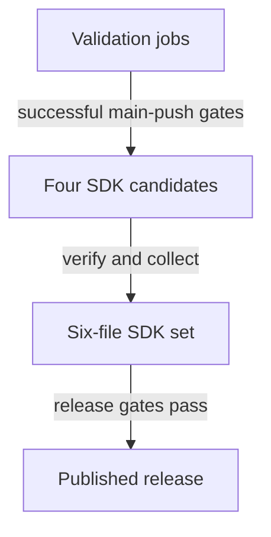

(ci-and-sdk-artifacts)=
# CI and SDK collection

Use the hosted workflows to validate selected compositions, collect prebuilt SDKs,
publish eligible releases and maintain build caches. [Build engine and SDKs](building.md) owns local configuration
and SDK production; [Testing and validation](testing.md) owns runner and fixture choices.

## GitHub CI and SDK artifacts

Successful validation, SDK collection and release publication have separate gates:

[ci.yml](../../../.github/workflows/ci.yml) validates pushes to `develop`/`main`, pull
requests targeting either branch and manual dispatches. Each job checks out recorded
recursive submodules. Actions use commit pins; Windows uses the manifest's pinned
vcpkg baseline. Builds use Ninja and available CPU parallelism.

| Job | Host/compiler/configuration | Selection |
| --- | --- | --- |
| `linux-gcc-hwloc` | Ubuntu 24.04 x64, GCC 14 Release | Headless Engine, hwloc and JSON. |
| `linux-gcc-neutral` | Ubuntu 24.04 x64, GCC 14 Release | Headless Engine and JSON, hwloc omitted. |
| `linux-clang-debug` | Ubuntu 24.04 x64, Clang 18 Debug | Headless Engine, hwloc/JSON, ASan/UBSan. |
| `windows-msvc-hwloc` | Windows 2025 x64, MSVC RelWithDebInfo | Headless Engine and hwloc/JSON with vcpkg native libraries. |
| `linux-modules` | Ubuntu 24.04 x64, GCC 14 Release | Native GLFW/input, OpenGL, TGUI, RmlUi, miniaudio, hwloc/JSON and SDK. |
| `windows-modules` | Windows 2025 x64, MSVC RelWithDebInfo | The same selected modules/helpers and SDK, with bundled native dependencies. |
| `linux-modules-shared` | Ubuntu 24.04 x64, GCC 14 Release | The modules/SDK composition with shared Cheryl libraries and owned dependencies. |
| `windows-modules-shared` | Windows 2025 x64, MSVC RelWithDebInfo | The shared modules/SDK composition, including DLL runtime discovery. |

The `windows-dependencies` job prepares one pinned vcpkg installation for the
Windows jobs and passes it through a one-day workflow artifact. The downstream
headless, static-module and shared-module jobs consume that same preparation.

[run.py](../../../.github/ci/run.py) configures explicit owners/options/build targets,
runs each focused owner prefix once and executes independent consumers. CI runs
its build and test phases separately so compilation and execution have distinct
results. Modules
jobs compile the demo for composition coverage but never launch or package it.
Linux jobs provide TrueType/CFF allocation fixtures. Missing fixtures and
platform-specific skips are reported as unaccepted coverage. Native OpenGL, native
hwloc binding acceptance, actual audio devices, desktop/controller QA and the
Debug terminal remain separate from this focused CI selection.

Modules jobs package and verify an extracted SDK on every validation run.
[verify_sdk.py](../../../.github/ci/verify_sdk.py) checks the checksum and absence of
producer paths, then builds independent consumers/header probes using only installed
Cheryl libraries. Test fixture sources/fonts come from the checkout; Cheryl and
module implementation sources are not rebuilt. Use a fresh consumer build/extraction
directory for each verification. See
[repeating SDK checks](architecture-validation.md#installed-sdk-consumers).

Successful main-push modules jobs retain four static/shared Linux/Windows SDK
candidates for three days. After the headless, Linux-module and Windows jobs
succeed, the `sdk` job verifies those candidates and assembles this set:

| Output | Contents |
| --- | --- |
| `cheryl-SDK-v<version>-linux.tar.gz` | Shared Linux SDK. |
| `cheryl-SDK-v<version>-windows.zip` | Shared Windows SDK. |
| `cheryl-SDK-v<version>-static.tar.gz` | Static Linux and Windows SDKs under `linux/` and `windows/`, with a platform-selecting CMake entry point. |
| `cheryl-src-v<version>.tar.gz` | Source and recorded recursive submodules, with `SOURCE-MANIFEST.json`. |
| `SDK-MANIFESTS.json` | Maps the four SDK candidates to their archive, prefix and original manifest, and records source identity. |
| `SHA256SUMS` | Checksums for the four archives and aggregate manifest. |

The six files are retained as `cheryl-development-sdks-<full-commit>` for 90 days.
Test/configuration reports are retained for 14 days. There is no demo package.
SDK collection is skipped on PR, `develop` and manual runs. Its first hosted
main-push acceptance remains tracked by
[TR20](../../testing-requests.md#tr20-automated-main-push-sdk-collection); the
implemented workflow alone does not establish that hosted acceptance.

### Release publication

The separate `release` job consumes the checked six-file artifact. Publication is
enabled only for a `main` push in `cppcooper/cheryl-engine`, after SDK assembly.
[release.py](../../../.github/ci/release.py) requires all of these gates:

1. The project version is explicitly `x.y.0` in CMake. Exactly one merged PR from
   this repository's `develop` to `main` has title `Release x.y.0` matching it.
2. The checked revision is that PR's ordinary two-parent merge commit; its second
   parent is the PR's develop head. Squash/rebase merges do not qualify.
3. The revision remains current `main`, and the latest documentation workflow
   attempt for the same revision completes **Documentation checks** successfully.
   The publisher waits up to ten minutes; Read the Docs publication is a separate
   workflow and is not this gate.
4. All archives, source/submodule identities, manifests and checksums validate.
   Locally marked validation packages are not publishable release inputs.

The publisher creates `v<version>` only when absent or already pointing to the
same revision. It creates a draft stable release with generated notes, uploads
and verifies the complete asset set, rechecks `main`, then publishes. An already
published exact match is unchanged. Conflicting tags or assets fail rather than
being moved or overwritten. Workflow concurrency serializes release publication.
These are current automation rules; a successful local assembly does not prove
GitHub permissions, artifact collection or hosted publication.

### Actions cache retention

Compiler and dependency caches speed up subsequent CI runs. They are separate
from the SDK and diagnostic artifacts above, and from each other:

| Cache | Key family | Contents and ownership |
| --- | --- | --- |
| Compiler results | `ccache-v3` | Compiler-family main, develop and PR layers, described below. |
| X: build dependencies | `build-deps-v2` | Separate main/develop submodule Git data and Windows vcpkg package archives/downloads. PRs read their base branch's X. |
| Y: Actions environment | `actions-env-cache-v2` | Shared tools, Linux package downloads, Python wheels/downloads and prepared documentation tools, published by main. |

Compiler caches are pooled by compatible compiler family: `linux-gcc14` shares
headless/module/static/shared results, `linux-clang18` owns the Clang configuration,
and `windows-msvc` shares the Windows profiles. OS and architecture also identify
the family. Each family has these logical layers:

| Build | Readable layers | Published destination |
| --- | --- | --- |
| `main` | Main baseline A | A |
| `develop` | A + develop additions B | B |
| PR targeting `develop` | A + B + PR additions C | C |
| PR targeting `main` | A + C | C |

[restore-compiler-cache](../../../.github/actions/restore-compiler-cache/action.yml)
restores available layers as separate read-only ccache storage.
[compiler_cache.py](../../../.github/ci/compiler_cache.py) gives each build job a
fresh writable delta, checks its restored current layer and then its parents,
and keeps statistics outside archived data. Parent hits stay in their original
layers. Each non-cancelled initialized worker can retain a validated, deduplicated
delta as a one-day artifact even if a later build or test step fails; retaining
cache results does not accept that failed job.

The separate `compiler-cache` job restores the latest family layers and merges
all available worker deltas into the current layer. It validates incoming
archives before merging, preserves distinct lookup metadata, removes compiled
results already present in parents and trims the current layer to 1 GiB. Only a
changed layer is saved, using a new run-specific key because Actions caches are
immutable. An empty-layer marker records an initialized empty result. This
single publisher avoids competing matrix jobs replacing one another's additions.
When a family has no current v3 snapshot, it can import the earlier per-profile
v2 layers once; the initialized v3 snapshot supersedes that migration path.

This hierarchy requires `main` to be GitHub's default branch. A PR can read its
own cache, its base branch's cache and the default branch's cache; a PR targeting
`main` cannot read `develop`'s cache. Manual feature-branch builds use their own
writable layer and the main baseline. These are
[GitHub cache scope restrictions](https://docs.github.com/en/actions/reference/workflows-and-actions/dependency-caching#restrictions-for-accessing-a-cache).
Missing parents cause normal cache misses until their builds populate them.

Cache X's source key hashes `.gitmodules` and the recorded submodule commits.
Updating a submodule selects a new source snapshot automatically; an older X can
seed Git objects before checkout fetches the requested commits. The binary
component follows the vcpkg manifest and runner image, with vcpkg validating each
package's binary compatibility when using a fallback snapshot. Vendored libraries
remain ordinary CMake targets and reuse their compiler results through ccache.
Only main/develop push and manual runs publish X; PRs fetch or build missing
dependencies locally.

To update Y, change package/tool selections in
[environment.json](../../../.github/ci/environment.json), generator packages in
[requirements-modules.txt](../../../.github/ci/requirements-modules.txt), or the
documentation tool manifests. Bump `cache_version` from `2` to `3` when revising
the Actions environment or forcing a refresh; this changes the family to
`actions-env-cache-v3`. Environment inputs are also hashed so package changes
cannot silently reuse a mismatched key. Y has separate immutable components for
each OS/architecture, runner image and environment composition. Resolved Linux
package versions, Python ABI and tool manifests further identify their payloads;
submodule commits and run IDs do not affect Y.

Every branch restores Y, while only trusted main push/manual runs publish it.
Develop and PR changes to the environment install normally on a cache miss;
main publishes the updated Y after those changes reach it. Package installers
still run on each fresh runner; cached downloads avoid fetching the same packages
again. Documentation tooling is prepared and cached before document generation,
so a later documentation failure does not discard the prepared environment.

[cache-maintenance.yml](../../../.github/workflows/cache-maintenance.yml) runs after
the build or documentation workflow finishes and daily at 04:23 UTC. It removes
caches belonging to closed pull requests, keeps the newest mutable compiler and
dependency snapshot per branch, configuration and cache version, and trims older caches
toward an 8 GiB repository budget. Active workflow refs and caches created or
accessed within the last 15 minutes are protected. After removing redundant
snapshots, budget eviction removes ordinary old caches first, then the latest
open-PR compiler/dependency snapshots, then develop snapshots, and finally main
snapshots. Known default-branch tooling caches have the same priority as develop
layers. Each tier uses oldest access first. The newest X source snapshot per
branch and runner receives that branch's priority; older submodule pins remain
ordinary eviction candidates. Old-format compiler snapshots lose their branch
priority once the same branch and compiler family has a v3 replacement.
These priorities preserve useful branch caches where space allows; the budget
can still require evicting a current layer. The budget is a target: concurrent
uploads and protected caches can temporarily keep usage above it.
Cleanup deletes cached build inputs, without deleting SDK artifacts or changing
build results; an evicted cache is regenerated when next needed.

To inspect or apply cleanup, open **Actions → Maintain Actions caches → Run
workflow** after this workflow has reached the repository's default branch.
Leave **dry_run** enabled to preview cache IDs, keys, refs, sizes and deletion
reasons. Optionally enter a closed PR number in **closed_pr** to restrict the
operation to that PR's caches. Review the run's report, then dispatch again with
**dry_run** disabled to apply the current plan. Automatic runs apply cleanup;
they execute the default branch's script without loading PR code, artifacts or
cached executables.

GitHub also [expires unused caches and evicts old entries at its storage
limit](https://docs.github.com/en/actions/reference/workflows-and-actions/dependency-caching#usage-limits-and-eviction-policy).
The maintenance policy removes redundant snapshots before that limit causes
frequent replacement of useful caches.

### Hosted Windows coverage limits

The Windows profiles leave these focused cases unaccepted:

| Cases | Missing prerequisite and next action |
| --- | --- |
| `font_bake.real_nested_allocation_scope`, `font_bake.real_cff_alloc_failure` | The workflow supplies the bundled TrueType face but no CFF OpenType fixture on Windows. Supply `CHERYL_STB_ALLOCATION_CFF` with a suitable face, retain the TrueType fixture for nested scopes, and rerun these cases on hosted Windows. |
| `logging.config_reopen` | The test needs a temporary directory on the checkout's filesystem root so it can use a relative log path. Configure the hosted Windows temporary directory on that drive, then rerun the case. |

The [font fixture requirements](architecture-validation.md#native-and-fixture-checks)
define suitable faces. A green job does not accept these skipped cases; successful
local MSVC/Wine checks do not replace the missing hosted execution. These limits
are separate from SDK collection and desktop/GPU/device acceptance.
