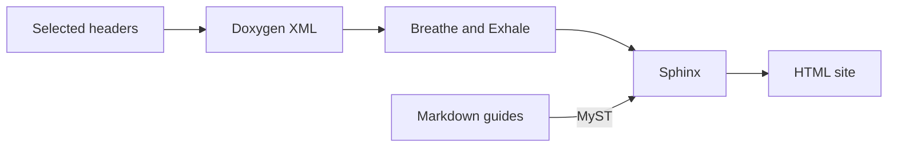
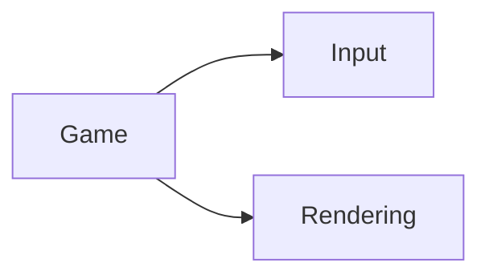

(generating-documentation)=
# Documentation tooling

The manual and C++ reference share one generation command. Doxygen extracts the
selected public headers to XML; Breathe and Exhale turn that XML into Sphinx pages,
and MyST includes the Markdown guides. Documentation generation does not configure
or compile the engine. Header selection comes from the public-root inventory in
[build.py](../generation/build.py), plus explicitly listed support headers. The
public exception types in `projects/engine/include/internals/exceptions.h` are
one such explicit owner; this does not make all `internals/` declarations public.



The generated artifact is an HTML site rooted at
`docs/site/generation/generated/html/index.html`, containing both the manual and API
reference. For an explicit CMake artifact target, use
[`docs` in the docs-only project](#cmake-entry-points); the repository-root
[`generate-docs.sh`](../../../generate-docs.sh) script provides the direct command.
Both update documentation incrementally by default; `docs-clean` or
`./generate-docs.sh --clean` requests full regeneration. Enabling
`CHERYL_BUILD_DOCS` makes the same targets available in an engine build;
documentation is never part of the default build.

```{toctree}
:hidden:
:titlesonly:

Publishing documentation <publishing-documentation>
```

## Generate locally

Use a Git checkout and Python 3.11 or newer with the standard `venv` module. You
do not need to install Sphinx, Doxygen or pip manually. The first fallback setup
needs network access to PyPI and the official Doxygen release assets, and a writable
user cache. The shell entry point requires Bash and selects `python3`, falling
back to `python`; set `CHERYL_DOCS_PYTHON` to choose another interpreter. Run this
block from any directory inside the checkout; the subshell preserves your starting
directory:

```sh
(
  set -e
  cd "$(git rev-parse --show-toplevel)"
  ./generate-docs.sh
)
```

The HTML entry point is `docs/site/generation/generated/html/index.html`. To view
Mermaid diagrams, serve the generated directory over HTTP so the browser can load
its JavaScript modules. From the checkout root, run:

```sh
python3 -m http.server 8080 --bind 127.0.0.1 --directory docs/site/generation/generated/html
```

Open [the local site](http://127.0.0.1:8080/). On Windows, use `python` instead of
`python3`. Opening an HTML file directly still shows the diagram source as text;
use HTTP for rendered diagrams. The output directory also contains Doxygen XML,
Sphinx doctrees and `sphinx-warnings.log`.
`--output /path/to/output` selects another
output root outside the authored documentation, or another directory beneath
`docs/site/generation/generated/`; its `api/`, `pycache/`, `.api-previous/` and
`.xml-previous/` directories are reserved.
The generated tree is ignored by Git. Edit the declaring
headers or authored guides, then regenerate. Generation is serialized within a
checkout because all output profiles share the generated API source directory.

The script locates the repository independently of the current directory. You
can also invoke `/path/to/cheryl-engine/generate-docs.sh` from elsewhere. It
preserves that working directory, so relative `--output` and `--cache-dir` paths
resolve from where you invoke it. Use `--help` for the available generation and
tool-selection options. `--extract-only` generates only Doxygen XML; `--output`
and `--doxygen` select an output root and explicit Doxygen executable.

The Python entry point remains supported, including on Windows without Bash:
invoke `python docs/site/generation/build.py` from the checkout root, or use its
absolute path from another directory. It accepts the same generation flags and
selects tools through bootstrap. Tool-only `status` and `setup` operations remain
available through `docs/site/generation/bootstrap.py`; the shell script handles
documentation generation.

The generation scripts, Sphinx configuration, extensions, styles, templates and
dependency manifests live under `docs/site/generation/`. Sphinx reads the authored
pages from `docs/site/` using that separate configuration directory. Generated API
sources live under `docs/site/generation/generated/api/`; Python bytecode defaults to
`docs/site/generation/generated/pycache/`. The other generation files are excluded from
the published manual's source discovery.

All authored manual prose, including module references, lives under `docs/site/`.
The module READMEs beside the code are relative symlinks to those references;
generation reads the central regular files directly. Plans, status, pending
acceptance and agent guidance remain outside the Sphinx source root. Relative
links to those repository-only files become versioned repository links in HTML.

The generator treats Sphinx warnings and unresolved references as errors, then
checks the public-header inventory, private-member exclusion, local links and
fragments, case-insensitive filename collisions, and source objects at the checked
revision. Successful extraction does not establish that every declaration has
useful prose, examples or a complete contract. Review public comments and the
[API index](../api/index.md) separately.

Ordinary inline code in the manual and API prose links automatically when its name
identifies one published declaration. This includes qualified names, unique short
names, template types, calls such as `CE::Text::Rendering::prepare(shaped, raster_options)`,
and qualified member assignments. The displayed code stays unchanged. Call
arguments are expressions, so they do not select an overload: ambiguous names,
unknown names and private implementation details stay plain code. Code blocks,
declaration signatures and existing links are left alone. Explicit C++ roles remain
available when a specific overload is needed. The linker builds one lookup from
Sphinx's declaration inventory, then checks inline literals without reparsing
headers or XML for each reference.
The build log reports its indexing and linking time for serial Sphinx builds.

Public API comments can link back to a manual contract with a checked guide marker,
for example `@see [Rendering guide](cheryl-guide:rendering/pipelines-and-materials)`.
The target is the site docname without `.md`; an optional `#fragment` must name a
real heading anchor. The generator resolves it for the generated reference and
checks the result. Keep detailed declaration contracts in the declaring header
and workflows in the manual; link between them instead of copying either.

Derived pages link to the declaring base for inherited interfaces. Public nested
types have their own pages rather than repeated declarations in the outer class.
The reference adds Doxygen's `final`, `[[nodiscard]]` and template constraints as
declaration notes, and includes concept definitions. Each declaration page links
to its header at the recorded source revision. Consult that header for the full C++
declaration.

### Diagrams

Write Mermaid directly in an ordinary Markdown code fence:

````markdown

````

State and sequence diagrams use the same fence with `stateDiagram-v2` or
`sequenceDiagram` as the first line. In dependency maps, point arrows from the
consumer toward what it uses and leave them unlabeled; the surrounding prose
owns precise contracts. Add
`accTitle:` and `accDescr:` for an accessible title and description.

MyST passes these fences to `sphinxcontrib-mermaid`, installed through the normal
locked Python documentation requirements. The extension leaves diagram text in
the HTML and Mermaid renders it in the browser. Its pinned JavaScript modules
ship with the site, including the module chunks and upstream license under
`generation/static/vendor/mermaid-11.12.1/`. `UPSTREAM.json` records the source and
archive integrity for updates; preserve the corresponding chunks and license.
Readers need JavaScript, but no CDN or rendering service.

Generation uses the extension's `raw` output mode. It needs no Graphviz, Node,
Mermaid CLI or diagram-specific CI step. Preview changed diagrams in a browser:
successful Sphinx generation alone does not validate Mermaid syntax.

Engine Systems shares its curated sources with the
[Diagram explorer](../engine-systems/diagram-explorer.md). Reuse a view in a guide
with its stable diagram ID:

````markdown
```{engine-diagram} rendering-focus-sprite
```
````

The sources live in `engine-systems/diagrams/*.mmd`. The neighboring
`catalog.json` owns view questions, notes, symbol identities and source evidence.
Keep its node order and arrow endpoints aligned with the Mermaid source; the
generator checks that contract before publishing. Ordinary generation includes
the explorer, Mermaid downloads and public API links. It renders selected views
in the browser using the same pinned Mermaid modules as the manual; no rendered
SVG inventory or separate preview deployment is needed.

Application views can add an `operations` mapping from a node key to its selected
public methods. Keep these choices specific to the view: usually one to three
entry points per type, with value types left as values. Each entry records the
qualified declaration name, short display label, source file/line, purpose and
`role` (`call` or `override`). Use the declaring base type for inherited methods.
Include the corresponding signatures beneath the owning type in Mermaid,
omitting parameter names when their types are shown; label checks reject stale
metadata. Wrapping markup may change whitespace, but must
preserve type spelling, including template arguments. Mark override groups
**Implement hooks** to distinguish engine callbacks from application calls. The
explorer adds method search, source links and unambiguous API links without
changing the type's identity or adding operation details to the internal and
focused views.

Write labels as `method(arguments): QualifiedResultType`. Include relevant
Engine argument and result types, including public aliases and types without
their own box. Keep argument names in catalog labels for the inspector, and
omit those names from Mermaid when their types are shown. Preserve the declaration's
direct `const`, pointer and reference qualifiers. Omit defaults, the leading `CE::`, and primitive or
`std::` type spellings. Retain names for scalar and library-only arguments;
include template parameter types where they clarify generic arguments. A
missing result suffix does not imply `void`: scalar and
library-only results are abridged too. Use `[]` for collections, with short
markers such as `[shared]`, `[unique]`, `[future]` or `[borrowed]` where hiding a
library wrapper would otherwise obscure ownership, asynchronous completion or
borrowing. The API reference remains the complete signature.

A view can declare `namespace`, such as `"Input"`, to omit that prefix from
its Mermaid labels. Keep nested namespaces (`Actions::Context`) and other
namespaces (`Runtime::Context`) explicit. The explorer states this local scope
beside the view question; retain it in the Mermaid accessibility description
too. Keep catalog symbol and method labels fully qualified for the inspector,
search and API links. Preserve a local prefix when shortening it would collide
with another Engine namespace, such as `Text::Rendering` or `Input::Events`.
Label validation applies the same namespace and parameter-name abbreviations.
Mixed views such as diagnostics and utilities keep their namespaces explicit.

For a named free-function box, use the view's `operation_labels` mapping from
its existing node key to the typed label. Keep the global symbol identity and
other views' labels unchanged. Apply the same parameter-name and namespace
abbreviations in the Mermaid source; its
validation also ignores wrapping whitespace while preserving template types.

Connect selected methods to their public Engine argument and result types when
those types are shown in the application view. Record signature evidence with
the exact selected declaration name in `member` and `kind: accepts` or
`kind: returns`. The explorer uses these records for each method's **Accepts**
and **Returns** links and the arrow's method explanation. Use explicit parameter
types in method labels even when that type has no box in the selected view.
Add another type box only when it clarifies an essential application boundary;
the views remain selective rather than duplicating the complete API inventory.

### Incremental rebuilds and full regeneration

The first generation performs the complete extraction and site build. Existing
output created before incremental support also needs one complete generation to
establish its cache state; the normal command handles this automatically.
When relocating the documentation source root, create fresh output and doctrees
at the new default path. Retain any older output still being viewed; reusable
tool installations remain in the shared cache.
Later runs reuse completed stages:

- Editing a guide reuses Doxygen XML, unchanged API pages and Sphinx doctrees.
  Sphinx rebuilds the affected pages. CSS/template changes rewrite HTML using
  the cached doctrees and update the site assets.
- Changing page titles, navigation ownership, captions or table-of-contents depth
  rewrites every HTML page so cached sidebars and breadcrumbs stay consistent.
  This uses Sphinx's parsed navigation and retains unchanged doctrees.
- Editing public headers reruns Doxygen and rebuilds affected reference pages;
  a changed XML file inventory starts a fresh Sphinx build.
- Changes to generation tools or configuration can
  invalidate reuse and require a full rebuild.

Each run retains the warning, link, API-inventory and source-revision checks.
A Sphinx failure preserves successful Doxygen extraction but requires fresh
rendering on retry. A later link or source-revision check failure preserves both
completed stages; fixing the cause and rerunning still performs all checks.
Cached rendering does not mean the output passed validation. Tool-installation
caches are separate from generated-site caches and survive clean generation.

Use `--jobs 4` to let Sphinx read and write documents with up to four workers.
The default is one; the count must be a positive integer. This selects rendering
parallelism without changing the generated content or validation requirements.

The log explains why XML or Sphinx output needs regeneration and reports the
time spent extracting, rendering and checking. `Generating fresh Sphinx output`
means the saved environment is being replaced; Sphinx then reports every guide
and generated API page as added. A changed Git revision refreshes repository
links and revision footers in retained HTML; it does not by itself discard the
parsed-page cache. `Navigation changed` reports a site-wide HTML rewrite using
that cache.

Authored guides and included examples use Sphinx's normal modification-time
tracking. If an external tool changes their contents while preserving or
backdating timestamps, request a clean generation.

To force full extraction and site generation:

```sh
(
  set -e
  cd "$(git rev-parse --show-toplevel)"
  ./generate-docs.sh --clean
)
```

`--extract-only` still limits the command to Doxygen XML; combine it with `--clean`
when you need fresh extraction without generating HTML. CI and Read the Docs use
`--clean` explicitly so publication does not depend on a previous generated site.

## Tool selection and reuse

[bootstrap.py](../generation/bootstrap.py) prefers a compatible installed
Doxygen and the Python packages in the invoking interpreter. Newer versions are
allowed for local work. Python selection checks the complete installed dependency
closure, version constraints, Python requirements and imports, rather than only
the five direct package versions.

| Tool | Minimum installed version |
| --- | --- |
| Doxygen | 1.18.0 |
| Sphinx | 8.2.3 |
| Breathe | 4.36.0 |
| Exhale | 0.3.7 |
| MyST Parser | 5.1.0 |
| Sphinx RTD Theme | 3.1.0 |

If installed tools do not qualify, bootstrap selects the exact versions in
[requirements.txt](../generation/requirements.txt) and
[native-tools.json](../generation/native-tools.json). Python fallback uses an
isolated virtual environment, a pinned pip wheel and hash-checked binary wheels;
it does not install into the invoking interpreter. Doxygen fallback uses a
hash-checked official archive. A healthy cached environment is validated and
reused without running an installer.

The default shared cache is `cheryl-engine/docs-tools` beneath the platform's
user cache: `$XDG_CACHE_HOME` or `~/.cache` on Linux, `~/Library/Caches` on macOS,
and `%LOCALAPPDATA%` on Windows. Python cache identity includes the interpreter,
platform and requirements hash; native cache identity includes the archive hash.
Locks and readiness markers prevent concurrent setup from reusing a partial
installation. An interrupted setup is repaired on the next invocation.

Pinned Doxygen archives are provided for Linux x86_64, Windows x86_64, and macOS
x86_64/arm64. Other hosts need a compatible installed Doxygen; Python fallback
also requires matching binary wheels. The pinned Python lock has wheel metadata
coverage for CPython 3.11–3.14 on these platforms. Linux fallback has been exercised;
Windows and macOS native setup still require execution acceptance.

Bootstrap's `status` reports tool readiness without installing anything; `setup`
prepares tools without generating documentation. The shell script's
`--force-pinned` selects the locked tools. Combine it with `--clean` for the full
generation used by CI and Read the Docs:

```sh
(
  set -e
  cd "$(git rev-parse --show-toplevel)"
  ./generate-docs.sh --force-pinned --clean
)
```

Set `CHERYL_DOCS_CACHE_DIR` or pass `./generate-docs.sh --cache-dir /path/to/cache`
to choose another shared cache. `CHERYL_DOCS_PYTHON=/path/to/python` selects the
script's interpreter; the Python and CMake entry points also support explicit
interpreter selection. `./generate-docs.sh --doxygen /path/to/doxygen` supplies an
executable that must meet the minimum and takes precedence over automatic native
tool selection. Keep local overrides out of publication configuration.

## CMake entry points

The docs-only project needs CMake 3.28 or newer and Ninja in addition to Python.
It enables no compiler languages and does not discover engine dependencies:

```sh
(
  set -e
  cd "$(git rev-parse --show-toplevel)"
  cmake -S docs/site/generation -B docs/site/generation/generated/cmake -G Ninja
  cmake --build docs/site/generation/generated/cmake --target docs
)
```

This incrementally updates `docs/site/generation/generated/html/index.html`. Select
`docs-clean` instead of `docs` in the build command to force full regeneration.
The optional `docs-tools` target prepares tools; both generation targets also
select them, so running `docs-tools` first is unnecessary. None of these targets
belongs to the default build.

If the docs-only source project moves, configure a fresh build directory for its
new location. An existing CMake cache records the previous source directory.

To add documentation to an existing root engine build, reconfigure that same build
directory and explicitly select the target:

```sh
(
  set -e
  cd "$(git rev-parse --show-toplevel)"
  cmake -S . -B build/debug -G Ninja -DCHERYL_BUILD_DOCS=ON
  cmake --build build/debug --target docs
)
```

Use your existing build directory in place of `build/debug`; its other cached
settings are retained. The root project still has its usual compiler and dependency
requirements; use the [building guide](building.md) for an initial engine
configuration. Building `docs` or `docs-clean` runs documentation generation
without compiling the engine. Both CMake entry points expose
`CHERYL_DOCS_PYTHON`, `CHERYL_DOCS_CACHE_DIR` and `CHERYL_DOCS_FORCE_PINNED`:

```sh
(
  set -e
  cd "$(git rev-parse --show-toplevel)"
  cmake -S docs/site/generation -B docs/site/generation/generated/cmake -G Ninja \
    -DCHERYL_DOCS_PYTHON=/path/to/python \
    -DCHERYL_DOCS_CACHE_DIR=/path/to/shared-cache \
    -DCHERYL_DOCS_FORCE_PINNED=ON
  cmake --build docs/site/generation/generated/cmake --target docs
)
```

## Troubleshooting

| Symptom | Next action |
| --- | --- |
| First setup cannot download or write its environment | Check network access and the selected shared-cache permissions. `python3 docs/site/generation/bootstrap.py status` reports readiness without installing; use `--cache-dir` for a writable location and rerun setup/generation there. |
| A Sphinx warning, missing symbol or bad fragment stops generation | Inspect the selected output root's `sphinx-warnings.log` and the declaring header/guide. Repair the target or comment; do not accept an older HTML file as the current successful result. |
| API output appears stale after changing extraction rules or tools | Use [full regeneration](#incremental-rebuilds-and-full-regeneration) after correcting the inputs. Ordinary public-header edits already invalidate extraction; changing unrelated output paths is not a substitute. |
| Generation waits while another invocation is running | All output profiles share generated API sources and a checkout lock. Let the active invocation finish, then rerun; use a separate checkout for independent concurrent generation. |
| CMake retains the old docs source directory | Configure a fresh docs-only build directory for `docs/site/generation`; preserve any active build/output instead of repurposing its cache. |

## Refreshing the pinned tools

Treat a tool upgrade as a coherent change to the fallback environment, rather than
changing one direct version and accepting whatever an installer resolves:

1. Resolve the full dependency closure from official PyPI release metadata,
   including platform and Python markers. Pin every required package and the
   installer; include SHA-256 hashes for the accepted wheel variants. Keep binary
   wheels required, and verify Python requirements and wheel availability across
   the supported Python/platform combinations.
2. Update `native-tools.json` when changing Doxygen or the pinned pip wheel. Obtain
   archive URLs and digests from the [official Doxygen releases](https://github.com/doxygen/doxygen/releases)
   and [PyPI](https://pypi.org/), and keep platform mappings explicit. Update the
   bootstrap minima only when the supported local baseline changes; fallback pins
   and minimum installed versions serve different purposes.
3. With execution authorized, generate using `--force-pinned`, check the output,
   and confirm warm-cache reuse. Review API signatures and public/private scope
   when changing Doxygen, Breathe or Exhale. A new requirements hash selects a new
   cache identity; old caches do not need to be overwritten.

## Publish the generated site

The [publishing guide](publishing-documentation.md) owns account setup, version
policy, stable promotion and hosted recovery. Local generation and link checks
prepare the artifact; they do not publish a website.
