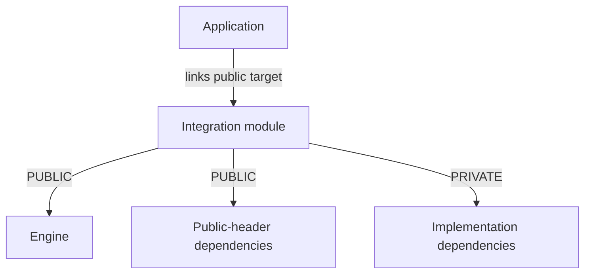

(engine-and-integration-modules)=
# Module authoring

Cheryl uses one owning `Cheryl::Engine` library and independently selected integration
libraries. Each owner declares its sources, public includes, dependencies and tests.
The root selects the assembly. The [module index](../../../projects/modules/README.md)
maps owners to Engine contracts and links their APIs; [build options](building.md#configuration-options)
control selection.

Engine has no reverse dependency on an integration. Logging, memory, workers,
events, assets and utilities remain within the one Engine library. Platform owners
implement display/window/input contracts, graphics owners implement rendering and
resources, UI owners consume neutral contracts, and audio owners implement playback.
The optional Linux Debug terminal owns process output/viewer behavior outside the
runtime adapter graph. Its Engine support attachment accepts a module callback;
an absent implementation leaves application startup unchanged.

The public [Startup module](../modules/startup.md), `Cheryl::Startup`, supplies
standard application bootstrap and privately integrates configured backends.
`Cheryl::OpenGL::Startup` is a compatibility interface over Startup/OpenGL rather
than another runtime library. CLI11 remains the explicit public option frontend;
Engine and OpenGL do not depend back on Startup.

An integration's public target carries its required Engine and header usage.
Dependency arrows point from the consumer to what it needs:



The optional [Workers module](../modules/workers.md), `Cheryl::Workers`, groups
configuration loading and topology integration with independent JSON/hwloc
features. Core pool execution/scheduling remains in Engine. Its capability-specific
`Cheryl::WorkerTopology::Hwloc` and `Cheryl::WorkerTopology::Json` compatibility
names refer to the same selected implementation. Private support belongs inside
its owning binary; configurable build policy alone is not a public module.

| Owner | Dependency direction |
| --- | --- |
| Application | Links Engine and its selected integrations. |
| Startup | Uses Engine and privately integrates the configured OpenGL path. |
| Native GLFW | Implements Engine platform/input contracts. |
| OpenGL | Uses Engine contracts and the selected Native GLFW integration. |
| TGUI / RmlUi | Consume Engine input/rendering/font contracts; their public APIs do not require OpenGL or Native GLFW. |
| miniaudio | Implements Engine audio contracts independently of the window/graphics path. |

```{toctree}
:hidden:
:maxdepth: 1

Integration contracts <../architecture/interfaces-adapters>
UI adapter authoring <ui-adapters>
```

## Adapter contracts

Use [Integration contracts](../architecture/interfaces-adapters.md) to find the
required runtime interfaces, optional capabilities, existing implementations and
replacement dependencies. [Context assembly](consuming-engine.md#context-assembly)
explains how application factories connect compatible implementations. This guide
covers creating and composing the module that owns an implementation.

### SDL3 scaffold

`CHERYL_BUILD_NATIVE_SDL3=ON` adds the source-only
`Cheryl::NativeSDL3::Scaffold` interface target from
[`platform/native-sdl3`](../../../projects/modules/platform/native-sdl3).
The option defaults to `OFF`. Its
[`cheryl/backends/native-sdl3.h`](../../../projects/modules/platform/native-sdl3/include/cheryl/backends/native-sdl3.h)
includes the existing Engine contracts and forward-declares
`CE::Platform::SDL3::Window`, `DisplaySystem` and `InputSystem`.

The scaffold has no runtime implementations, SDL3 dependency discovery or startup
factory. It is not registered as an SDK component or a selectable application
backend. Native GLFW remains the implemented platform integration. SDL3 runtime
implementation, OpenGL/startup selection and GLFW deprecation policy remain
future work.

## Module boundary criteria

A separate module is justified when it gives an application a concrete choice or
isolation benefit: omitting a dependency, selecting an alternative implementation,
or testing an external integration independently. A directory, internal interface
or small caller count does not by itself justify a library boundary. Cheryl keeps
one `Cheryl::Engine` owner with selectable static/shared linkage.

Keep the selected Native GLFW, whole OpenGL and independent TGUI/RmlUi owners
cohesive unless a consumer demonstrates a benefit from another boundary. Native
input depends on a live window; dividing display and input splits that coupled
lifetime. OpenGL's context interface permits another window integration within its
owner and does not itself justify context/bridge libraries.

Before introducing another library target, record:

1. the concrete omit/replace/test benefit;
2. the engine contract the owner implements;
3. dependencies that become optional or isolated;
4. lifetime/dependency direction and how cycles are avoided;
5. test ownership and the smallest independent consumer proving the boundary;
6. compatibility consequences for current consumers.

If those points do not identify a real benefit, keep the code inside the existing
owner. Logging, memory, workers, events, general utilities and similar internal
facilities remain engine organization unless a consumer demonstrates otherwise.
Evaluate architectural interfaces by their contract rather than deleting them
because they have few callers.

## Select an assembly

Application module selection, public targets, aggregate headers and deployment are
owned by [Source and SDK integration](consuming-engine.md). Use the
[module catalogue](../modules/index.md) to choose capabilities, the
[granular composition path](consuming-engine.md#granular-composition) to select
individual targets, and [Dependencies and headers](consuming-engine.md#dependencies-and-headers)
for public/private dependency requirements. The [build guide](building.md)
owns root configuration options and dependency preparation.

Each compiled dependency has one owning Cheryl binary: Engine owns logging,
font/text and image implementations; Native GLFW owns GLFW/Gainput/HID; OpenGL
owns GLAD; each UI module owns its toolkit implementation and exports its native
authoring API. Startup owns selected integration glue and Workers owns optional
topology/configuration adaptation. Header/template usage such as GLM, CTTI and
CLI11 remains explicitly public. Preserve those boundaries when adding an owner.

## Standalone modules

Standalone entry points locate the enclosing checkout's shared helpers and Engine
automatically. Set an absolute `CHERYL_REPOSITORY_ROOT` when selecting another
checkout. Each owner reuses a supplied `Cheryl::Engine` or adds Engine from that
root. OpenGL also reuses `Cheryl::NativeGLFW` or requires
`CHERYL_NATIVE_GLFW_SOURCE`. Bootstrapping suppresses other owners, demo and Engine
tests in a local variable scope, without rewriting a host's cache.

This builds only the OpenGL owner and its dependencies:

```sh
(
  set -e
  cd "$(git rev-parse --show-toplevel)"
  cmake -S projects/modules/graphics/opengl -B build/opengl-module -G Ninja \
    -DCMAKE_BUILD_TYPE=Release \
    -DCHERYL_REPOSITORY_ROOT="$PWD" \
    -DCHERYL_NATIVE_GLFW_SOURCE="$PWD/projects/modules/platform/native-glfw"
  cmake --build build/opengl-module --target module_opengl --parallel
)
```

Other module directories are standalone source entry points too. Module-local
checks use `CHERYL_BUILD_TESTS=ON` without enabling Engine's broader suites.
Hosts own their root `enable_testing()` policy. Independent consumers use the
owner's `tests/consumer/` entry point. Prebuilt selected owners are also available
through the [installed SDK](consuming-engine.md#prebuilt-development-sdks), which
uses the same public aliases and its producer's compiled configuration.

Adding a source module beside a supplied SDK leaves the SDK's `Cheryl::Cheryl`
selection unchanged. Link that source module's target explicitly alongside the
SDK facade; its public feature definition enables its umbrella in the same include.

## Add a module

Resolve the boundary criteria above before adding a target. Then:

1. Create an owner under `projects/modules/<role>/<name>/` with `include/`, `src/`
   and `tests/`. Keep public contracts under `include/cheryl/`; implementation
   helpers and SDK details stay private where the API permits it. Add one
   owner-local `include/cheryl/modules/<name>.h` umbrella that includes its public
   contracts and excludes `internals/`. Support libraries use the corresponding
   `include/cheryl/support/` location. Include the owner umbrella from its selected
   group in `cheryl/modules.h` or `cheryl/support.h`.
2. Declare the owner using the [linkage-aware scaffold below](#library-scaffold).
   [Module.cmake.in](../../../cmake/templates/Module.cmake.in) supplies the basic
   source/test structure, but currently fixes `STATIC` and omits the library
   configuration helper. Apply the linkage/export steps below rather than copying
   it unchanged. `cheryl_prepare_module()` reuses or bootstraps Engine; pass
   `REQUIRES_NATIVE` only when Native GLFW is a real prerequisite.
3. Declare shared metadata using the same ID in the files below. Add SDK discovery
   inside the selected owner, reusing compatible supplied targets before owned
   sources. Publish required header dependencies with `PUBLIC`; keep private
   implementation dependencies `PRIVATE`. Call
   `cheryl_register_public_component(target FEATURE CHERYL_HAS_<ID>)` from
   [CherylPublicHeaders.cmake](../../../cmake/CherylPublicHeaders.cmake) to register
   the owner's public feature definition and make the component available.
   Selection through `cheryl_select_public_component(target)` then adds it to an
   owned `Cheryl::Cheryl` assembly. Use the feature definition to guard its group
   umbrella include. Do not rewrite supplied targets/cache.
4. Declare a root selection with `cheryl_option(name description default_value)`
   in [CherylOptions.cmake](../../../cmake/CherylOptions.cmake), and conditionally add
   the owner in the root [CMakeLists.txt](../../../CMakeLists.txt), including its
   `cheryl_select_public_component` call. No unrelated module should select this
   owner implicitly. For SDK distribution, explicitly add its target declaration,
   public-header root and feature metadata to
   [CherylSdk.cmake](../../../cmake/CherylSdk.cmake); component registration alone
   does not install or export a new owner. Update packaging component/version
   metadata and the installed consumer alongside that export.
5. Add owner-local behavior suites and an independent consumer with first-include
   probes. Keep cross-owner cases in `projects/tests/`. Document the public alias,
   dependency selection, lifetime/thread requirements and capability limits in the
   module's page under `docs/site/modules/`, and add it to the relevant site
   navigation. Make the owner's `README.md` a relative symlink to that page.
   Register the public include root in the explicit inventory in
   [build.py](../generation/build.py) and add the owner's visibility decorator to
   `PREDEFINED` in [Doxyfile.in](../generation/Doxyfile.in). Extraction does not
   follow includes into unselected roots. Check the generated API as described in
   [Documentation tooling](documentation.md).

| Metadata file | Module declaration |
| --- | --- |
| [CherylVersions.cmake](../../../cmake/CherylVersions.cmake) | `VERSION_PROJECT_MODULE_<ID>` |
| [CherylTargets.cmake](../../../cmake/CherylTargets.cmake) | `TARGET_LIB_MODULE_<ID>` and test target identities |
| [CherylOutputs.cmake](../../../cmake/CherylOutputs.cmake) | `OUTPUT_LIB_MODULE_<ID>` and runner artifact names |
| [CherylLinkage.cmake](../../../cmake/CherylLinkage.cmake) | Scoped `LINKAGE_PUBLIC_*` / `LINKAGE_PRIVATE_*` requirements |

Declaration files reload metadata into the caller's scope; helper definitions are
guarded. Load helpers before declaring a standalone project so versions and target
names are available. The template collects only its owner's `src/*.cpp` with
`CONFIGURE_DEPENDS`, making source additions/removals trigger regeneration. Keep
conditional implementations, generated sources and tests in their own selections.

### Library scaffold

This example uses an illustrative `EXAMPLE` metadata ID and `Cheryl::Example`
alias. Declare its version, target, output and linkage variables in the metadata
files above first. From `projects/modules/<role>/<name>/CMakeLists.txt`:

```cmake
cmake_minimum_required(VERSION 3.28)
include("${CMAKE_CURRENT_LIST_DIR}/../../../../cmake/CherylModules.cmake")
if(CMAKE_SOURCE_DIR STREQUAL CMAKE_CURRENT_SOURCE_DIR)
    project(cheryl_example_module VERSION ${VERSION_PROJECT_MODULE_EXAMPLE} LANGUAGES CXX)
endif()
if(TARGET Cheryl::Example)
    return()
endif()
cheryl_configure_module_options()
cheryl_prepare_module()

file(GLOB_RECURSE example_sources CONFIGURE_DEPENDS "${CMAKE_CURRENT_SOURCE_DIR}/src/*.cpp")
add_library(${TARGET_LIB_MODULE_EXAMPLE} ${CHERYL_LIBRARY_TYPE} ${example_sources})
add_library(Cheryl::Example ALIAS ${TARGET_LIB_MODULE_EXAMPLE})
cheryl_register_public_component(${TARGET_LIB_MODULE_EXAMPLE} FEATURE CHERYL_HAS_EXAMPLE)
set_target_properties(${TARGET_LIB_MODULE_EXAMPLE} PROPERTIES
    VERSION "${VERSION_PROJECT_MODULE_EXAMPLE}"
    OUTPUT_NAME "${OUTPUT_LIB_MODULE_EXAMPLE}"
    ARCHIVE_OUTPUT_DIRECTORY "${CHERYL_BUILD_ROOT}")
cheryl_configure_library(${TARGET_LIB_MODULE_EXAMPLE} EXAMPLE)
target_include_directories(${TARGET_LIB_MODULE_EXAMPLE} PUBLIC
    "$<BUILD_INTERFACE:${CMAKE_CURRENT_SOURCE_DIR}/include>")
target_link_libraries(${TARGET_LIB_MODULE_EXAMPLE}
    PUBLIC ${LINKAGE_PUBLIC_LIB_MODULE_EXAMPLE}
    PRIVATE ${LINKAGE_PRIVATE_LIB_MODULE_EXAMPLE})

if(CMAKE_SOURCE_DIR STREQUAL CMAKE_CURRENT_SOURCE_DIR)
    cheryl_select_public_component(${TARGET_LIB_MODULE_EXAMPLE})
endif()
if(CHERYL_BUILD_TESTS)
    enable_testing()
    add_subdirectory(tests)
endif()
if(CHERYL_BUILD_CONSUMER_TESTS)
    add_subdirectory(tests/consumer)
endif()
```

`LINKAGE_PUBLIC_LIB_MODULE_EXAMPLE` includes `Cheryl::Engine` and any dependencies
used by public headers; private implementation libraries belong in the private
list. Register external implementation dependencies through the existing
`cheryl_private_dependency` / `cheryl_shared_dependency` helpers so ownership,
static link closure and SDK runtime collection remain visible to their owners.
See the [OpenGL CMake owner](../../../projects/modules/graphics/opengl/CMakeLists.txt)
for a complete current implementation with dependency discovery and test hooks.

`CHERYL_LIBRARY_TYPE` follows `CHERYL_BUILD_SHARED_LIBS`.
`cheryl_configure_library(target EXAMPLE)` sets the producer's
`CE_BUILDING_EXAMPLE`, propagates `CE_EXAMPLE_STATIC` for static consumers, and
configures shared visibility, output paths, versioning and runtime paths. A shared
Cheryl module requires a shared Engine; the helper rejects a static Engine below
it. Do not replace this policy with `BUILD_SHARED_LIBS` or hand-written import flags.

### Public symbol exports

Give compiled public methods/functions their owning component's decorator.
`CE_API` belongs to Engine; exporting a module with it would assign the symbol to
the wrong DLL. Existing owner decorators live in
[export.h](../../../projects/engine/include/cheryl/export.h). A new owner can
provide an export header using the same policy:

```cpp
#pragma once
#include <cheryl/export.h>

#if defined(CE_EXAMPLE_STATIC)
#define CE_EXAMPLE_API
#elif defined(CE_BUILDING_EXAMPLE)
#define CE_EXAMPLE_API CE_DETAIL_EXPORT
#else
#define CE_EXAMPLE_API CE_DETAIL_IMPORT
#endif
```

Use `CE_EXAMPLE_API` on the compiled public functions the owner implements.
Public types whose separately exported methods require cross-library RTTI use
`CE_TYPE_API`; it preserves type visibility on supported ELF compilers and does
not replace the method decorator. Header-only templates need their definitions
available to consumers. Let the CMake target supply static/import/export flags,
and check both linkages through the owner's independent consumer.

[CherylTests.cmake](../../../cmake/CherylTests.cmake) creates an owner aggregate with
`cheryl_add_test_aggregate(... OWNER)`; set `CHERYL_TEST_AGGREGATE` before adding
focused suites through `cheryl_add_test_suite`. Suites compile cases once into
object targets reused by focused, owner and assembly runners. Keep test hooks on
case targets so applications do not inherit them. [Test selection](testing.md)
covers runner options; [architecture validation](architecture-validation.md)
covers isolated graphs, supplied-target reuse and native acceptance.

UI-specific font, alpha, input and publication requirements are in
[Writing a UI adapter](ui-adapters.md).
