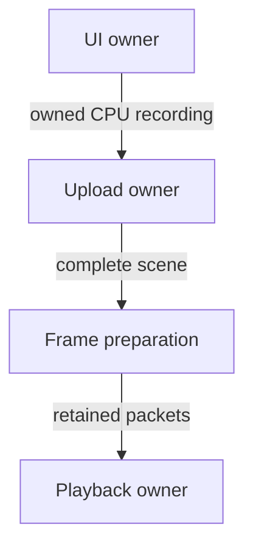

(writing-a-ui-adapter)=
# Write a UI adapter

A UI adapter is an optional module that translates a toolkit into Cheryl's
existing input, render and resource contracts. The toolkit owns its widgets,
documents, styling and layout. Engine does not include toolkit headers or select
an adapter. The [TGUI](../modules/tgui.md) and
[RmlUi](../modules/rmlui.md) modules provide independent
examples under `CE::UI::TGUI` and `CE::UI::RmlUi`. Their public classes are
toolkit-specific, not requirements for other adapters.

An unknown future toolkit should require an additional adapter module without
introducing its concepts into Engine. Dear ImGui remains a developer/debug tooling
candidate; it does not define player-facing widget architecture.

## Module and application ownership

Give the adapter one library target, `include/`, `src/` and owner-local `tests/`.
Link its public target to `Cheryl::Engine` and select toolkit linkage according to
that library's convention. The current TGUI and RmlUi integrations use shared
toolkit libraries and expose their native authoring headers/API through the
adapter target. Keep Engine-dependent service implementations in the adapter;
private versioned callbacks let the toolkit call those services without linking
another Engine copy when Cheryl itself is static. Follow the
[module guide](modules.md) for supplied targets, standalone composition and
dependency selection. Configure only an explicitly selected dependency; ordinary
CMake configuration does not download it or change a host's toolkit settings.

Keep gameplay state in ordinary application models. A toolkit-specific view owns
native UI objects, reads those models and returns application actions. The game
chooses its adapters, presentation order and input recipients. Adapters do not
depend on each other or define a common widget hierarchy or `iUiSystem`. A shared
runtime abstraction requires evidence from actual implementations.

Before implementing another adapter, select its toolkit/version and map concrete
requirements to Engine's contracts. Resolve font ownership, resource publication,
material construction, lifecycle and unavailable platform services before dependent
code grows. Any required direct graphics/native access is an Engine contract gap;
resolve the smallest demonstrated seam first.

## Bridge responsibilities

| Toolkit need | Cheryl contract | Adapter responsibility |
| --- | --- | --- |
| Draw geometry and clipping | [Render submission](../rendering/pipelines-and-materials.md) | Record ordered, owned colored triangles and logical rectangular clips. Match the toolkit's alpha convention to the supplied material. |
| Images and font atlases | [Immutable resource publication](../resources/resource-residency.md#immutable-resource-publication) | Copy CPU pixels into immutable generations; publish provider-owned resources on the platform owner. Resolve font ownership and sampling before exposing textures. |
| Font selection and loaded data | [Engine font service](../text/index.md) | Consume the configured default/catalogue and explicit retained `Font` handles; translate byte/index/style ownership into native toolkit fonts. |
| Keyboard, pointer and text | [Input records and focus](../runtime/input-state-model.md) | Translate portable identities and committed text without native input APIs, invented characters or modification of another reader's records. |
| Time, size and OS services | [Selected views](../runtime/display-and-window-contract.md#committed-window-and-simulation-views), [service phases](../runtime/runtime-frame-boundary.md#runtime-service-phases) and capability reporting | Offer explicit owner attachments for automatic sizing/time while preserving manual use; report unavailable clipboard, cursor and IME services. |
| Queued upload and retained playback | [Thread dispatch](../runtime/thread-dispatch.md) and [native retirement](../resources/resource-residency.md#native-retirement-and-maintenance) | Send owned preparation through platform submission and retain complete published scenes through replacement and teardown. |

Adapters request [built-in 2D materials](../rendering/pipelines-and-materials.md#default-ui-materials)
through the provider-owned `CE::Assets::Shaders::Builder`, selecting the toolkit's
alpha convention. Engine owns the generic profiles; each graphics backend owns
its shader sources, bindings and construction. OpenGL embeds those sources, so
applications need no UI shader files or native material builder. This uses the
existing provider capability without a dependency from the adapter to OpenGL.

Applications may pass compatible material handles loaded from JSON or constructed
manually as explicit overrides. The adapter validates vertex layout, topology,
alpha/depth/culling state, projection semantic and texture parameters. It does not
create OpenGL pipelines or query a native context. Unsupported providers reject
default construction while explicit compatible overrides remain usable. Engine
owns the loaded font bytes and face selection; native atlas/effect behavior stays
with the toolkit. An atlas follows the same CPU-copy and resource-publication boundary.

The context-aware sessions import `Context::fonts()` once and establish native
default inheritance. Explicit `Font` handles select registered families through
session helpers without source-path extraction. Preserve actual face indices and
style metadata when registering memory with a toolkit, and retain that memory
until native shutdown. Use the service's ordered `fallbacks()` snapshot for a
toolkit with global glyph fallback; importing every catalogue family as a fallback
would make specialty fonts affect unrelated text. Reconfiguration does not rebind
existing sessions. A standalone input-only constructor remains available.

Expanded triangles suffice for the current adapters. Indexing, batching and draw
sorting require their own consumer need; preserve authored world/HUD/overlay order.
The initial resource scope is one window/provider domain with immutable replacement.
Mutable texture updates, multiple domains and dynamic atlas policies need explicit
publication/lifetime contracts before exposure. The
[display/window scale contract](../runtime/display-and-window-contract.md#scale-and-ui-capabilities)
uses copied dimensions and explicit font scaling
within each adapter's supported scope.

The independent implementations differ where their toolkits differ:

| Concern | TGUI | RmlUi |
| --- | --- | --- |
| Authoring | Native GUI/widgets; optional typed numeric placement and resizing. | Native context/documents; RML and RCSS layout, including percentage bounds and flex. |
| Alpha | Straight vertex/image RGBA and `StraightAlpha` materials. | Premultiplied output and `PremultipliedAlpha` materials; file images convert once. |
| Fonts | Configured Engine default/catalogue; retained face indices, real bold faces and glyph fallback through a custom backend. Native italic style uses geometry; explicit `FontStyle` selects an italic face. | Configured Engine default/catalogue; retained byte/index/style registration under native RCSS family names and the configured common glyph fallback chain. |
| Sampling | Each draw retains nearest/linear smoothing independently of pixels; UI samplers clamp, with no mipmaps or anisotropy. | Existing image upload defaults; repeating UV/effect extensions reject. |
| Toolkit lifetime | One guarded process-global backend. | One guarded Core initialization with contexts and interfaces. |

Existing Engine contracts cover both initial scopes. Their CPU recordings and
uploaders remain toolkit-owned implementations; matching names do not justify a
common widget or session API. The application chooses presentation order and may
override default materials for each view.

Unsupported renderer features need an explicit scope and failure/capability
contract. Rectangular clipping does not establish arbitrary masks, filters,
offscreen targets or mutable texture updates. Add a generic engine facility only
when an implemented consumer demonstrates the requirement.

## Update, publication and shutdown

Record on the UI owner, upload on the provider owner, and publish complete values.
Frame preparation runs on simulation/UI; graphics upload and playback run on
platform in the runtime's native assembly.



1. On platform, prepare the resource upload endpoint. Default materials are
   created lazily on that owner during the first nonempty upload.
2. Configure Engine fonts before consumers. On simulation/UI, create the toolkit
   session from the Engine context, then native presentation objects.
   Keep all toolkit calls on that owner, including font and layout changes.
3. Size/time may follow initialized owner sources through required attachments,
   or be supplied manually. Context-aware TGUI/RmlUi sessions opt in with
   `automatic_view`/`automatic_time`; defaults remain manual. Preserve the whole
   input stream as an explicit application call. Logical UI coordinates and
   framebuffer pixels remain distinct; zero drawable dimensions produce an empty recording.
4. Record owned CPU draw data, then submit it for platform upload, optionally
   supplying retained custom material handles. Borrowed toolkit vertices, pixel
   pointers, widgets and documents do not cross that queue boundary.
5. Adopt a replacement only when complete. A pending or failed replacement leaves
   the current scene usable. Bound outstanding replacements instead of queuing a
   new upload every tick.
6. Frame preparation appends retained draw packets in application order and does
   not read live toolkit objects. Resource handles remain valid while an older
   frame is retained.
7. Stop/join the UI owner, release application-held toolkit objects, then destroy
   its context and global interfaces. A final transfer to platform is serial and
   quiescent. Retained Cheryl frames own resources independently of toolkit state.

Follow the [attachment contract](../runtime/event-delivery.md#observe-a-change-or-participate-in-an-operation)
for required integration. Apply a view seed before exposing a ready consumer,
acknowledge detach before releasing toolkit state, and propagate required apply
failures. A manual sizing call validates before detaching automatic mode.
Automatic step clocks have no replay and reject simultaneous manual advancement;
keep input/preemption and scene adoption ordering explicit. A queued observation
of the same payload is not a replacement for required owner participation.

## Routing and unavailable services

`CE::Input::Capture` and `CE::Input::Routing` are neutral protocols shared by
gameplay, tools and UI consumers. The toolkit adapter owns widget behavior and
uses these protocols rather than defining another input system. Use
`CE::Input::Capture::Channel::Events` for ordered physical input and acquire
`CE::Input::Capture::Channel::Text` while a consumer requests text focus. Focus
targets and epochs select keyboard/text delivery; a later lease can preempt an earlier one. Drain already collected
poll-latched records before releasing a preempted lease. Observe modifier releases
even when the corresponding keyboard record is not selected for widget delivery.

Give each session the complete tick batch once and hold its entry focus epoch
through delivery. Use the session's `before_record` callback for application focus
and visibility controls before each native event; its return selects pointer
delivery for that record. New leases affect future polls, while collected records
retain their earlier targets/epochs. A sequence of one-record calls changes the
preemption boundary and can discard an earlier owner's still-pending text.

Use the pointer coordinates recorded with each button or scroll event. A current
cursor sample must not relocate an earlier click. Pointer delivery is explicitly
selected by the application; keyboard focus alone does not imply pointer capture,
modal arbitration or controller navigation. Gameplay controller input can continue
while an adapter owns keyboard focus.

Unavailable clipboard support must not cause cut/paste shortcuts to delete text.
Committed Unicode characters do not establish IME composition, shaping or
grapheme-aware editing. Keep those capabilities explicit rather than synthesizing
them from physical key presses.

## Acceptance

Keep implementation checks with their module. Use controlled input/window/render
and memory-resource implementations to exercise recording, immutable replacement,
failure, routing and queued sequential/concurrent lifetime behavior. Engine tests
exercise its contracts with cheap dummy implementations.

Configure an independent consumer and public-header probes separately; a root
build cannot establish standalone composition or dependency isolation. Check
native appearance, resizing/DPI, hit positions, editing and shutdown with the
selected renderer as a separate acceptance step. Passing controlled checks does
not establish physical driver or compositor behavior.

For two adapters, give them different focus targets, feed the same immutable
record stream and select pointer recipients explicitly. Verify preemption without
record consumption or stale-lease interference, ordered retained passes, and
resources surviving either toolkit's teardown. Keep shared functionality in
Engine only when these independent implementations demonstrate its purpose.

The repository's [coexistence suite](../../../projects/tests/ui-coexist/CMakeLists.txt)
owns that cross-project proof. The [demo](../../../projects/apps/demo/README.md)
selects either adapter or both and supplies separate focus controls. Each module's
standalone consumer and implementation checks remain independent.

The [demo interaction guide](../../../projects/apps/demo/README.md#interaction-checks)
owns native observations and selected-platform limits. A new backend, platform or
supplied package needs its own applicable proof.

## Repeating Linux root validation

Reuse `build/testing-native-ui` when its source, toolchain and configuration match.
This Linux Release selection compiles both adapters, their consumers/probes, the
coexistence suite, Startup with OpenGL integration and the UI-enabled demo with Cheryl-owned
TGUI/RmlUi dependencies. It uses GLFW/X11/OpenGL with HID disabled. Initialize the
pinned dependencies from the [build guide](building.md); RmlUi cases also require
the SDK sample font or an explicit `CHERYL_RMLUI_TEST_FONT`. The executed consumers
and controlled cases require no display or audio device.

Build needed targets together and select each owner/coexistence case once. These
commands preserve the caller's working directory; narrow the selection when only
one owner is affected. A matching compiled build can be reused without rebuilding.

```sh
(
  set -e
  cd "$(git rev-parse --show-toplevel)"
  cmake -S . -B build/testing-native-ui -G Ninja \
    -DCMAKE_BUILD_TYPE=Release -DCMAKE_POLICY_VERSION_MINIMUM=3.5 \
    -DCHERYL_BUILD_SHARED_LIBS=OFF \
    -DCMAKE_EXPORT_COMPILE_COMMANDS=ON -DCMAKE_CXX_SCAN_FOR_MODULES=OFF \
    -DCMAKE_GTEST_DISCOVER_TESTS_DISCOVERY_MODE=PRE_TEST \
    -DCHERYL_LOG_PROFILE=developer \
    -DCHERYL_BUILD_NATIVE_GLFW=ON -DCHERYL_BUILD_OPENGL=ON \
    -DCHERYL_NATIVE_INPUT=ON -DCHERYL_NATIVE_NULL_PLATFORM=OFF \
    -DGAINPUT_ENABLE_HID=OFF -DGLFW_BUILD_X11=ON -DGLFW_BUILD_WAYLAND=OFF \
    -DCHERYL_BUILD_UI_TGUI=ON -DCHERYL_BUILD_UI_RMLUI=ON \
    -DCHERYL_TGUI_SOURCE="$PWD/extern/tgui" \
    -DCHERYL_RMLUI_SOURCE="$PWD/extern/rmlui" \
    -DCHERYL_BUILD_AUDIO_MINIAUDIO=OFF -DCHERYL_BUILD_DEMO=ON \
    -DCHERYL_BUILD_TESTS=ON -DCHERYL_BUILD_CONSUMER_TESTS=ON \
    -DCHERYL_BUILD_ALL_TESTS=OFF -DCHERYL_BUILD_ACCEPTANCE_TESTS=OFF
  cmake --build build/testing-native-ui --parallel --target \
    demo tests-ui-tgui tests-ui-rmlui tests-ui-coexist \
    consumer-module-ui-tgui consumer-module-ui-rmlui
  ./build/testing-native-ui/cheryl-ui-tgui-consumer
  ./build/testing-native-ui/cheryl-ui-rmlui-consumer
  ctest --test-dir build/testing-native-ui --parallel "$(nproc)" --output-on-failure \
    --no-tests=error -R '^(tests-ui-(tgui|rmlui)\.|tests-ui-coexist\.)'
)
```

Inspect the compile inventory when the RmlUi correction changes: Core must compile
the generated `rmlui-fixes/WidgetTextInput.cpp` rather than the unguarded original.
The recorded root session/editing/lifetime/coexistence baseline is accepted.
The separate [Startup suite](../../../projects/modules/runtime/startup/tests/src/startup.cpp)
covers parser validation, factory forwarding and help/error paths before context
creation. Successful context/result/runtime handoff, the `before_record` overload
and placeholder hit-testing still need dedicated regressions in the
[owning checklist](../../planning/short-term/README.md#startup-and-ui-follow-up);
CPU and adapter fixtures cover registered weight/style selection and face indices;
automatic discovery's numeric-weight boundary cases remain in the
[font-selection plan](../../planning/short-term/README.md#font-selection-regressions). These checks do not
establish native visual correctness of distinct authored style faces.
Corrected supplied RmlUi targets/packages require an independent consuming host
and declaration/rejection checks under the
[module contract](../modules/rmlui.md#placeholder-dependency-contract).
Owned-source success does not establish those supplied paths or standalone
composition. Native startup, focus, placeholder hit-testing, layout and shutdown
observations are accepted in the selected Linux root composition. The
[demo guide](../../../projects/apps/demo/README.md#startup-and-ui-validation) retains
the reusable native procedure. Builtin Unicode and sample artwork keep their own
coverage limits there; dedicated deterministic cases and supplied dependencies
remain outside that native baseline.

Current sampling, retained-frame and positioned-text acceptance is recorded with
its reusable procedure in [Component and SDK checks](architecture-validation.md#sampling-and-positioned-text).
Keep that evidence separate from supplied-toolkit composition, distinct authored
font-face appearance and other desktop/material-failure observations. The
[testing queue](../../testing-requests.md) retains the outstanding observations;
an earlier native baseline does not establish a later changed path.
