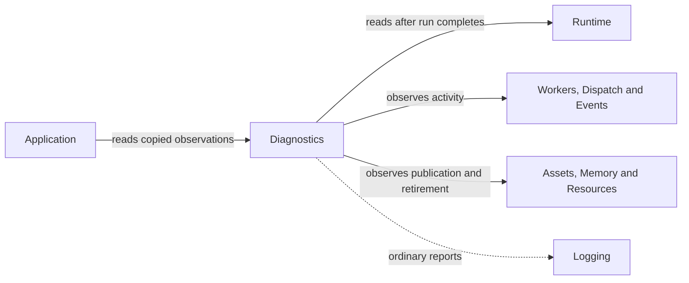

# Diagnostics

## Purpose

Diagnostics exposes operational observations: session counts, queue activity,
resource retirement, worker policy, asset publication and memory bookkeeping.
It helps correlate a failure without changing the owning operation's semantics.

## Interface

Types below are in `CE::Diagnostics` unless another namespace is shown.

### Types and observations

| API and purpose |
| --- |
| {cpp:type}`DomainId <CE::Diagnostics::DomainId>`<br>Correlate one process-local owner through `diagnostic_id()` or snapshot domain fields. [Domain identities](../runtime/subsystem-diagnostics.md). |
| {cpp:struct}`CE::Runtime::RuntimeStats`<br>Inspect completed-session update, poll, frame and pressure counts. [Runtime statistics](../runtime/subsystem-diagnostics.md#runtime-statistics). |
| {cpp:struct}`CE::Workers::GroupStatus`, {cpp:struct}`DispatchStats <CE::Diagnostics::DispatchStats>`<br>Observe CPU work, queue activity and reported policy behavior. [Worker statistics](../runtime/subsystem-diagnostics.md#worker-statistics); [dispatcher statistics](../runtime/subsystem-diagnostics.md#dispatcher-statistics). |
| {cpp:struct}`CE::Events::EventStats`<br>Observe registration, dispatch and delivery activity. [Event statistics](../runtime/subsystem-diagnostics.md#event-statistics). |
| {cpp:struct}`CE::Assets::Loading::UploadStats`, {cpp:struct}`CE::Memory::Stats`<br>Inspect asset publication and synchronized CPU allocation bookkeeping. [Asset diagnostics](../runtime/subsystem-diagnostics.md#asset-diagnostics); [memory statistics](../runtime/subsystem-diagnostics.md#memory-statistics). |

### Observation boundaries

| Observation | Purpose and details |
| --- | --- |
| `GameRuntime::diagnostics()` | Owned completed-session counts after synchronization with run completion; live sampling rejects. [Runtime statistics](../runtime/subsystem-diagnostics.md#runtime-statistics). |
| Queue/group status | Activity at the snapshot boundary; an empty queue does not prove detached work finished. [Worker](../runtime/subsystem-diagnostics.md#worker-statistics) and [dispatcher](../runtime/subsystem-diagnostics.md#dispatcher-statistics) limits. |
| Resource retirement statistics | Tracked native resources and retirement/collection activity in one backend domain. [Native resource statistics](../runtime/subsystem-diagnostics.md#native-resource-statistics). |
| Explicit diagnostic report | A bounded operational summary outside sensitive locks/native callbacks; required emergency failure output has a separate path. [Failure reporting](../runtime/failure-reporting.md#emergency-reporting); [validation limits](../runtime/subsystem-diagnostics.md#validation-and-limits). |

## Usage



Diagnostics names owner-specific snapshot APIs. Each query follows its owner's
observation rules.

### Uses

Observers read snapshots under each owner's synchronization and observation
limits. Ordinary summaries use Logging; bounded emergency output preserves
required failure context independently.

| Types | Systems |
| --- | --- |
| {cpp:struct}`CE::Runtime::RuntimeStats`<br>{cpp:struct}`CE::Workers::GroupStatus`<br>{cpp:struct}`CE::Diagnostics::DispatchStats`<br>{cpp:struct}`CE::Events::EventStats`<br>{cpp:struct}`CE::Assets::Loading::UploadStats`<br>{cpp:struct}`CE::Memory::Stats`<br>{cpp:class}`CE::Logging::Logger` | [Runtime](runtime.md)<br>[Workers](workers.md)<br>[Dispatch](dispatch.md)<br>[Events](events.md)<br>[Assets](assets.md)<br>[Memory](memory.md)<br>[Resources](resources.md)<br>[Logging](logging.md) |

### Used by

Subsystem owners use domain identities and expose counters for applications,
hosts and developers. Acceptance needs observations of the selected behavior;
quiet, skipped or unselected paths do not establish it.

| Types | Systems |
| --- | --- |
| {cpp:class}`CE::Runtime::GameRuntime`<br>{cpp:class}`CE::Workers::Pool`<br>{cpp:class}`CE::Events::EventBus`<br>{cpp:struct}`CE::Rendering::Resources::Provider`<br>{cpp:struct}`CE::Assets::Cache::Store`<br>{cpp:struct}`CE::Memory::Manager` | [Runtime](runtime.md)<br>[Workers](workers.md)<br>[Dispatch](dispatch.md)<br>[Events](events.md)<br>[Assets](assets.md)<br>[Memory](memory.md)<br>[Resources](resources.md)<br>[Display](display.md)<br>[Rendering](rendering.md)<br>[Logging](logging.md) |

## Contracts

Counters are observations, not completion barriers, admission limits or resource
budgets. Domain IDs are monotonic process-local identities, not addresses/native
handles or durable keys; zero indicates exhaustion. Unavailable observations
must remain explicit.

`GameRuntime::diagnostics()` requires caller synchronization with run start and
return; live sampling rejects. An empty dispatcher queue does not establish that
detached work completed. Asset completion counts do not establish batch rollback
or distinguish every reused key from a newly published entry without their
documented counters.

## Lifecycle

An owner acquires its identity with construction and publishes observations at
documented boundaries. Take a completed runtime snapshot after `run()` returns
or throws, retaining the runtime through that query. Explicit reports must run
outside containing locks/native callbacks according to the subsystem contract.
Retained snapshots own their values without retaining the observed service.

## Execution

Each snapshot follows the observed owner's access rules. Reporting can allocate,
format or log, so it is not suitable for arbitrary destructor/native callback
contexts. Emergency reporting has a deliberately separate bounded contract and
must not mask the original exception.

## Integration

After synchronizing with runtime completion:

```cpp
const auto stats = runtime.diagnostics();
const auto updates = stats.updates;
const auto rendered = stats.rendered;
```

Use these values in an application report with the run outcome. Different
update/render counts are expected with independent scheduling and skipped or
superseded visual snapshots. Use the
[symptom, evidence and action table](../runtime/subsystem-diagnostics.md#investigate-a-runtime-symptom)
to decide which observation to inspect before changing a scheduling or resource policy.

## Limits and further reading

Counters do not measure cache speedups, native thread residency or unselected
hardware behavior. Read [subsystem observation limits](../runtime/subsystem-diagnostics.md),
[failure reporting](../runtime/failure-reporting.md),
[architecture acceptance limits](../development/architecture-validation.md#evidence-limits)
and [diagnostic declarations](../../../projects/engine/include/cheryl/core/diagnostics.h).
