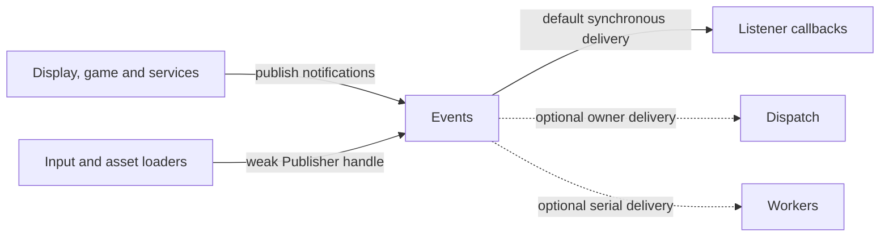

# Events

## Purpose

Events delivers notifications through persistent registrations. A bus owns
callbacks and channel identity; it does not create a thread, choose simulation
timing or automatically own the objects borrowed by those callbacks.

## Interface

Types below are in `CE::Events` unless another namespace is shown.

### Types and operations

| API and purpose |
| --- |
| {cpp:class}`EventBus <CE::Events::EventBus>`<br>Own listener registrations, dispatch, remove/wait and close acceptance. [Registrations](../runtime/event-delivery.md#registrations); [removal and shutdown](../runtime/event-delivery.md#removal-and-shutdown). |
| {cpp:class}`EventChannel <CE::Events::EventChannel>`<br>Give a copy-constructible payload exact name/type identity. [Typed channels](../runtime/event-delivery.md#typed-channels). |
| {cpp:class}`EventBus::Registration <CE::Events::EventBus::Registration>`<br>Retain an explicit removal identity; dropping it does not unregister. [Registration lifetime](../runtime/event-delivery.md#registrations). |
| {cpp:class}`EventBus::Publisher <CE::Events::EventBus::Publisher>`<br>Retain a weak notification route without retaining the bus or Context. [Publishing handles](../runtime/event-delivery.md#weak-publishing-handles). |
| {cpp:type}`EventBus::Delivery <CE::Events::EventBus::Delivery>`, {cpp:type}`EventBus::ErrorHandler <CE::Events::EventBus::ErrorHandler>`<br>Select queued execution and an independent failure sink. [Queued delivery](../runtime/event-delivery.md#optional-queued-delivery); [adapter catalogue](../architecture/interfaces-adapters.md#integrations-alongside-the-runtime). |
| {cpp:struct}`EventSystem <CE::Events::EventSystem>`<br>Access the default bus when an isolated application-owned bus is unnecessary. [Bus ownership](../runtime/event-delivery.md). |

### Delivery and cleanup choices

| Choice | Purpose and details |
| --- | --- |
| Immediate delivery | Invoke on each dispatch caller, in registration order; concurrent callers may overlap. [Immediate delivery](../runtime/event-delivery.md#immediate-delivery). |
| Platform / simulation delivery | Queue owned payloads through a saved owner endpoint; never execute inline. [Queued adapters](../runtime/event-delivery.md#optional-queued-delivery); [dispatch](../runtime/thread-dispatch.md). |
| Worker delivery | Give one listener stream serial FIFO execution over shared group capacity. [Worker streams](../runtime/event-delivery.md#worker-stream-acceptance-and-cancellation). |
| Unregister / unregister-and-wait / close | Invalidate new invocation, optionally settle entered callbacks, or close all acceptance. [Removal and shutdown](../runtime/event-delivery.md#removal-and-shutdown). |

## Usage



### Uses

Payload types define owned and borrowed values. Dispatch/Workers dependencies
belong to optional delivery adapters; the bus defaults to immediate delivery.
Diagnostics observes activity without owning queued failure handling.

| Types | Systems |
| --- | --- |
| {cpp:class}`CE::Events::EventChannel`<br>{cpp:type}`CE::Diagnostics::DomainId`<br>{cpp:class}`CE::Runtime::PlatformDispatcher::Submission`<br>{cpp:class}`CE::Runtime::SimulationDispatcher::Submission`<br>{cpp:class}`CE::Workers::Group` | [Diagnostics](diagnostics.md)<br>[Dispatch](dispatch.md)<br>[Workers](workers.md) |

### Used by

Runtime publishes views, lifecycle milestones, shutdown facts and service phases.
Input, asset catalogues/loaders, graphics domains and audio publish their owned
observations. Games also publish their own domain events. The
[engine/module event catalogue](../runtime/event-delivery.md#engine-and-module-notifications)
maps each family to its producer setup and retained state. Required view/service
integration uses [owned attachments](../runtime/event-delivery.md#observe-a-change-or-participate-in-an-operation);
queued subscriptions deliver optional observations to the selected owner.

| Types | Systems |
| --- | --- |
| {cpp:struct}`CE::Events::EventSystem`<br>{cpp:class}`CE::Platform::GLFW::Window`<br>{cpp:class}`CE::Input::System`<br>[Asset loaders](../assets/asset-loading.md#upload-settlement-notifications)<br>[Application-owned listeners](../runtime/event-delivery.md#typed-channels) | [Display](display.md)<br>[Input](input.md)<br>[Assets](assets.md) |

## Contracts

Registration persists until explicit removal or bus destruction; dropping its
identifier does not unregister. Immediate callbacks run in registration order
on each dispatch caller, and overlapping dispatches can overlap listeners.
Typed channels require the exact copy-constructible payload type.

Unregister prevents fresh invocation but a callback already entered may finish.
Use `unregister_and_wait()` before destroying a borrowed target, without holding
a lock that callback needs. Waiting from that same listener rejects. Queued
payloads own their copied values; pointees remain governed by the payload type.

## Lifecycle

Construct an owned bus or deliberately use the default. Retain registration IDs
for cleanup. Stop producers, invalidate registrations and settle entered
callbacks before destroying borrowed targets. `close()` invalidates and rejects
new work but does not wait for running callbacks. An independent queued error
sink must survive pending-ticket destruction even after its listener is removed.

## Execution

Immediate delivery is synchronous on dispatch's caller. Queued delivery owns
the work without invoking it inline, preserving each listener's FIFO stream.
Platform/simulation adapters follow those owners; copies of one worker-delivery
adapter share a serial stream. Independent listeners/targets have no global
completion order. Immediate `dispatch()` failures propagate and stop its remaining
listeners; `notify()` isolates failures and attempts later listeners. Queued
failures reach the registration-owned error sink.

## Integration

An application-owned bus can notify simulation-owned listeners synchronously:

```cpp
CE::Events::EventBus bus;
const CE::Events::EventChannel<int> score_changed{"score-changed"};
int displayed_score = 0;
auto registration = bus.register_listener(score_changed, [&](const int& value) {
    displayed_score = value;
});
bus.dispatch(score_changed, 10);
static_cast<void>(bus.unregister_and_wait(registration));
```

Here the caller supplies synchronization by performing all operations on one
owner. Choose a delivery adapter before registering when producers use other
threads.

## Limits and further reading

Channel names/RTTI form an in-process identity, not a serialization protocol.
The default bus does not provide automatic callback lifetime or UI ownership.
Read [event delivery and failure contracts](../runtime/event-delivery.md),
[thread dispatch](../runtime/thread-dispatch.md) and
[the bus interface](../../../projects/engine/include/cheryl/core/subsystems/event-bus.h).
