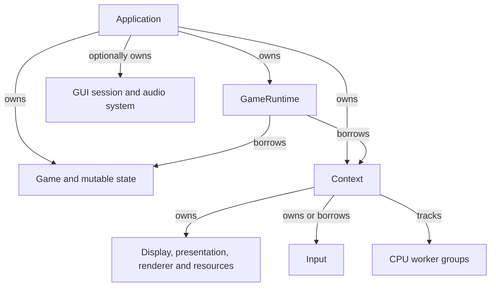

# Engine Systems

Cheryl provides the execution, input, resource and rendering boundaries around an
application-owned game. Start here after [First Game](../getting-started/first-game.md)
when you need to understand how those boundaries fit together. The detailed topic
guides remain the authority for individual operations and failure cases.

```{toctree}
:hidden:
:maxdepth: 1
:titlesonly:

Diagram explorer <diagram-explorer>
Runtime <runtime>
Display <display>
Input <input>
Assets <assets>
Resources <resources>
Rendering <rendering>
Text <text>
GUI <gui>
Audio <audio>
Events <events>
Dispatch <dispatch>
Workers <workers>
Memory <memory>
State <state>
Logging <logging>
Diagnostics <diagnostics>
Utilities <utilities>
```

## Ownership and relationships

Use the [Diagram explorer](diagram-explorer.md) to inspect subsystem relationships,
engine dependencies and application use. Select a type for its declaration and
source evidence, or compare focused views before opening a detailed guide.

The application owns its game and composes a compatible runtime context. The
context owns display, presentation, renderer and resource adapters; input can be
owned or explicitly borrowed. `GameRuntime` borrows the context and game for one
session. GUI sessions and audio systems have their own application-owned
lifetimes; they are composed alongside the runtime rather than installed into a
universal system manager.



Context-created groups share a lazily created owned pool or an application-supplied
shared pool. Input polls feed game updates; complete immutable frames feed rendering
and presentation. Asset preparation precedes resource upload and retained drawing.
Events use immediate listeners or explicitly selected queued delivery.

Owning an object, borrowing an interface, retaining an immutable result and
submitting work carry different obligations. A retained draw packet keeps its
logical resources alive; it cannot keep a destroyed graphics backend usable.
A saved submission endpoint remains safe to call after closure but rejects new
work. A borrowed window still requires its owner thread and live display.

## Execution

| Owner | Work |
| --- | --- |
| Platform/graphics caller of `run()` | Poll input, operate window/graphics, initialize/clean up the game, upload, render and present. See [runtime ownership](runtime.md#execution). |
| Simulation | Update game state and prepare complete frames on platform or one dedicated simulation thread. See [frame publication](../runtime/runtime-frame-boundary.md#frame-publication-and-recycling). |
| Worker pool | Execute accepted CPU jobs independently of simulation, without graphics access. See [worker execution](workers.md#execution). |
| Audio implementation | Advance playback on its output clock, with separately synchronized controls/maintenance. See [audio execution](audio.md#execution). |

Simulation reads copied tick input and dimensions. Rendering consumes a completed
frame instead of mutable game objects. Use [Dispatch](dispatch.md) when work must
reach a particular owner and [Workers](workers.md) for independent CPU capacity.
The [runtime lifecycle](runtime.md) supplies the shutdown order joining those
domains.

(reading-order)=
## Find a system

Use this table as a topic lookup. The tutorials supply the learning sequence;
each overview below introduces a system and routes to its detailed owner.

Each system's Usage section provides an entry diagram and concrete relationships
in its Uses and Used by tables. Arrows point from the consumer to what it uses;
dashed arrows mark optional or alternative choices. The
[Diagram explorer](diagram-explorer.md#overview-systems) adds an engine-only map,
an application map and focused views for the busiest boundaries. Application
maps show selected public methods beneath their owning types; **Implement hooks**
identifies callbacks your game supplies for the engine to invoke.

| System overview | Purpose and details |
| --- | --- |
| [Runtime](runtime.md) | Game hooks, context/session objects, execution and timing choices. [Frame lifecycle](../runtime/runtime-frame-boundary.md), [simulation timing](../runtime/simulation-timing.md). |
| [Display](display.md) | Windows, monitors, logical/pixel sizes and window modes. [Display/window ownership](../runtime/display-and-window-contract.md). |
| [Input](input.md) | Actions, keyboard/mouse/gamepad controls, capture, records and focus enums. [Control identities and tokens](../runtime/input-state-model.md#control-identities-and-binding-tokens), [input state model](../runtime/input-state-model.md). |
| [Assets](assets.md) | Loaders, caches, sprite/tile definitions and playback choices. [Loading](../assets/asset-loading.md), [manifests](../assets/asset-manifests.md), [values and playback](../assets/asset-values-and-playback.md). |
| [Resources](resources.md) | Providers, retained graphics handles and sampling choices. [Publication and retirement](../resources/resource-residency.md). |
| [Rendering](rendering.md) | Frames, cameras, draw packets, materials and fixed-state enums. [Pipelines, materials and submission](../rendering/pipelines-and-materials.md). |
| [Text](text.md) | Font selection, shaped/retained text, direction and rasterization choices. [Unicode layout](../assets/text-layout.md), [encoding and indices](../assets/text-encoding.md). |
| [GUI](gui.md) | Toolkit sessions, recordings, uploaders and reported capabilities. [GUI construction](../gui/index.md), [UI adapter contracts](../development/ui-adapters.md). |
| [Audio](audio.md) | Clips, voices, playback options and state. [Playback and ownership](../runtime/audio.md). |
| [Events](events.md) | Buses, channels, registrations and delivery choices. [Event delivery](../runtime/event-delivery.md). |
| [Dispatch](dispatch.md) | Owner queues, saved endpoints, futures and cancellation. [Thread dispatch](../runtime/thread-dispatch.md). |
| [Workers](workers.md) | Pools, groups, topology and CPU-policy enums. [Worker execution](../runtime/worker-execution.md). |
| [Memory](memory.md) | Blocks, pooled objects, reservations and release contexts. [CPU memory lifetime](../resources/resource-lifetime.md). |
| [State](state.md) | Sample tracking, synchronized publication, observation and machines. [State utility contracts](../runtime/utility-contracts.md#sampled-and-synchronized-state). |
| [Logging](logging.md) | Named loggers, severity, profiles and queue choices. [Logging configuration](../runtime/logging.md), [failure reporting](../runtime/failure-reporting.md). |
| [Diagnostics](diagnostics.md) | Copied statistics, domain IDs and observation boundaries. [Subsystem diagnostics](../runtime/subsystem-diagnostics.md). |
| [Utilities](utilities.md) | Time, bits, numeric parsing, file discovery and pointer helpers. [Utility contracts](../runtime/utility-contracts.md), [file discovery](../assets/file-and-font-discovery.md). |

## Systems and modules

These labels describe responsibilities. They do not prescribe CMake libraries,
manager singletons or one object per system. Engine defines portable contracts;
the [module guides](../modules/index.md) describe concrete implementations and
their selection. The [adapter contract catalogue](../architecture/interfaces-adapters.md)
lists required runtime interfaces, optional capabilities and cooperating
integrations, with obligations and detailed references for each. Start there
when replacing a backend; the [SDL3 scaffold](../development/modules.md#sdl3-scaffold)
establishes a source boundary for that future platform implementation.
[Ownership and Cleanup](../architecture/ownership-cleanup.md) explains retained,
borrowed and scoped lifetimes across systems; [Threads and Data Flow](../architecture/threads-data-flow.md)
helps choose the execution and publication path for work crossing those systems.
Native GLFW implements related display/input responsibilities;
OpenGL implements related rendering/resource responsibilities. Optional toolkit
and audio modules add capabilities without becoming reverse Engine dependencies.

The [API Reference](../api/index.md) describes declarations. The subject guides
explain detailed contracts; [Tutorials](../getting-started/create-a/index.md)
and the [Task index](../getting-started/how-to/index.md) connect them to game code.
