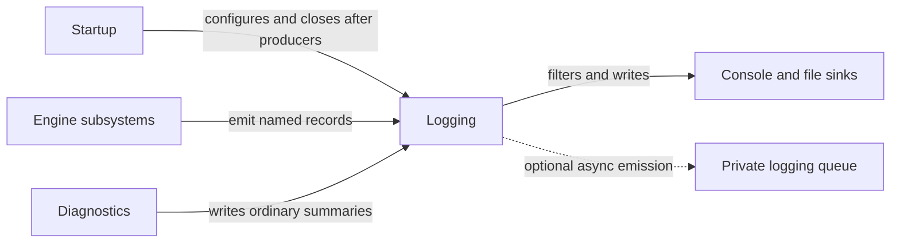

# Logging

## Purpose

Logging records operational information in named destinations with explicit
configuration, filtering and sink lifetimes. Ordinary logs support diagnosis;
required failure propagation and bounded emergency reporting remain independent.

## Interface

Types below are in `CE::Logging` unless another namespace is shown.

### Types and operations

| API and purpose |
| --- |
| {cpp:class}`Logger <CE::Logging::Logger>`, {cpp:class}`Log <CE::Logging::Log>`<br>Select a named category and initialize, emit, filter, flush, close or reopen it. [Runtime settings and ownership](../runtime/logging.md#runtime-settings-and-ownership). |
| {cpp:struct}`Config <CE::Logging::Config>`<br>Choose destinations, rotation, levels and queue overflow behavior before producers start. [Configuration and ownership](../runtime/logging.md#runtime-settings-and-ownership). |
| {cpp:struct}`FileEventHandlers <CE::Logging::FileEventHandlers>`<br>Supply scoped file-open/close callbacks while retaining borrowed targets through final closure. [Callback and reentry boundaries](../runtime/logging.md#filtering-and-failure-boundaries). |
| {cpp:struct}`QueueStats <CE::Logging::QueueStats>`<br>Observe queued/discarded work in the shared logging pool. [Queue observations](../runtime/logging.md#runtime-settings-and-ownership). |

### Levels and policy enums

| Type | Choices and details |
| --- | --- |
| {cpp:enum}`Level <CE::Logging::Level>` | `trace`, `debug`, `info`, `warn`, `err`, `critical`, `off` for runtime logger/sink thresholds. [Filtering](../runtime/logging.md#filtering-and-failure-boundaries). |
| {cpp:enum}`Profile <CE::Logging::Profile>` | `Developer`, `Support`, `Release` presets through `Config::for_logger()`. [Runtime defaults](../runtime/logging.md#runtime-settings-and-ownership). |
| {cpp:enum}`OverflowPolicy <CE::Logging::OverflowPolicy>` | `Block` waits for queue capacity; `DiscardNew` rejects/counts new work without evicting accepted items. [Queue admission](../runtime/logging.md#runtime-settings-and-ownership). |
| {cpp:enum}`Compile::LogLevel <CE::Logging::Compile::LogLevel>` | Compile-time severity bits used by logging policy; runtime thresholds cannot restore stripped calls. [Compile policy](../runtime/logging.md#compile-policy); [declarations](../../../projects/engine/include/cheryl/core/logging/compile-policy.h). |

## Usage



### Uses

Private backend machinery owns emission, rotation and console/file callbacks.
Build policy selects compiled severities; bounded failure reporting remains
available when ordinary logging is closed, stripped or degraded.

| Types | Systems |
| --- | --- |
| {cpp:struct}`CE::Logging::Config`<br>{cpp:struct}`CE::Logging::FileEventHandlers`<br>{cpp:class}`CE::State::Singleton`<br>{cpp:type}`CE::Diagnostics::DomainId` | [State](state.md)<br>[Diagnostics](diagnostics.md) |

### Used by

Applications configure categories before producers and can add names. Category
state is keyed centrally by text across libraries. Explicit engine destinations
keep their selection; `make_default()` selects Engine's private registry
default.

| Types | Systems |
| --- | --- |
| {cpp:class}`CE::Runtime::GameRuntime`<br>{cpp:class}`CE::Platform::GLFW::DisplaySystem`<br>{cpp:class}`CE::Rendering::OpenGL::Renderer`<br>{cpp:struct}`CE::Assets::Loading::Loader`<br>{cpp:struct}`CE::Memory::Manager`<br>{cpp:class}`CE::Workers::Pool` | [Runtime](runtime.md)<br>[Display](display.md)<br>[Rendering](rendering.md)<br>[Assets](assets.md)<br>[Memory](memory.md)<br>[Workers](workers.md)<br>[Diagnostics](diagnostics.md) |

## Contracts

Initialize explicitly before lazy access/writers when configuration matters.
Severity filters cannot restore code removed by compilation policy. Queue
admission, rotation and callback failures follow the configured contract;
logging is not a substitute for the operation's exception or future.

Sink callbacks must respect backend reentry guards and their documented borrowed
arguments. Do not emit ordinary logging while holding sensitive subsystem locks
or from native/noexcept failure paths that require bounded emergency reporting.

## Lifecycle

Configure the used categories before starting producers, run those producers,
stop/settle them, then flush and close logging. Close/reopen serializes state
transitions; a timed close can report an incomplete operation rather than
pretending all queued work has completed. Keep callback targets alive until the
backend has finished with them. Startup composition owns its logging lifetime
when using the supplied startup path.

## Execution

Writers may enqueue from supported producer threads. Sink callbacks run according
to synchronous/asynchronous configuration, not necessarily on simulation.
Compile/filter checks should precede costly argument construction where the
selected frontend supports that. Named logger registry state is separate from
game/thread ownership.

## Integration

The application can emit through a built-in named category after startup:

```cpp
CE::Logging::Logger<CE::Logging::Categories::engine>::info("Game initialized");
```

Select the declared category spelling from the
[logging umbrella](../../../projects/engine/include/cheryl/core/logging.h) and
configure it before producers. For a known file/console outcome, follow
[Enable useful output](../runtime/logging.md#enable-useful-output) before this
first write. If it is absent, use the
[missing-records checklist](../runtime/logging.md#investigate-missing-or-delayed-records).
The detailed guide also covers custom names, handlers, profiles and controlled shutdown.

## Limits and further reading

Logging does not promise recovery from a native failure or durable completion
merely because a write returned. Read
[configuration, emission and filtering](../runtime/logging.md),
[failure reporting](../runtime/failure-reporting.md),
[logging acceptance](../development/logging-acceptance.md) and
[the logger interface](../../../projects/engine/include/cheryl/core/logging/logger.h).
