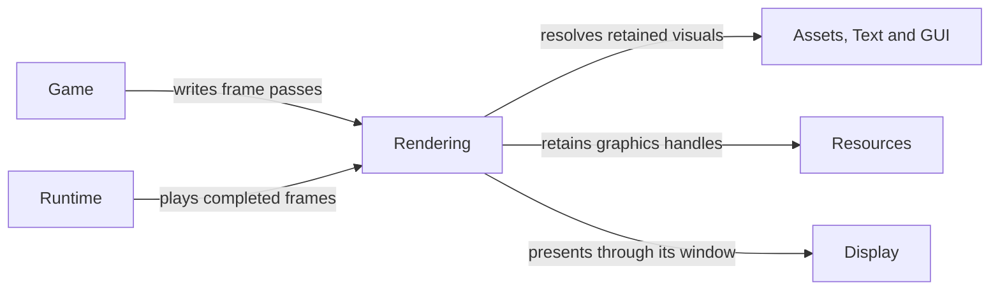

# Rendering

## Purpose

Rendering turns a completed snapshot of visual state into ordered backend draws
and presentation. The game selects what to show; the renderer consumes copied
values and retained resources without reading live simulation objects.

## Interface

Types below are in `CE::Rendering` unless another namespace is shown.

### Types and operations

| API and purpose |
| --- |
| {cpp:class}`FrameWriter <CE::Rendering::FrameWriter>`, {cpp:class}`PassWriter <CE::Rendering::PassWriter>`, {cpp:class}`Frame <CE::Rendering::Frame>`<br>Build ordered passes in a borrowed slot, then publish complete retained visual state. [Frame storage and writers](../rendering/pipelines-and-materials.md#frame-storage-and-writers); [handoff](../runtime/runtime-frame-boundary.md#frame-publication-and-recycling). |
| {cpp:struct}`DrawStyle2D <CE::Rendering::DrawStyle2D>`, {cpp:struct}`DrawPacket2D <CE::Rendering::DrawPacket2D>`<br>Resolve sprite/tile/graphic/text resources and copied placement into complete packets. [CPU submission](../rendering/pipelines-and-materials.md#cpu-submission). |
| {cpp:class}`Camera2D <CE::Rendering::Camera2D>`, {cpp:class}`Camera3D <CE::Rendering::Camera3D>`<br>Own camera state and provide matrices copied into a pass. [Camera observations](../rendering/pipelines-and-materials.md#camera-observations); [camera task](../getting-started/how-to/use-camera.md). |
| {cpp:class}`Resources::Pipeline <CE::Rendering::Resources::Pipeline>`, {cpp:class}`Resources::Material <CE::Rendering::Resources::Material>`<br>Retain executable/fixed state and resolve typed material parameters. [Parameters and ownership](../rendering/pipelines-and-materials.md#parameters-and-ownership); [manual construction](../rendering/pipelines-and-materials.md#manual-material-construction). |
| {cpp:class}`Renderer <CE::Rendering::Renderer>`, {cpp:class}`PresentationSurface <CE::Rendering::PresentationSurface>`<br>Consume completed frames and present through compatible graphics/platform adapters. [Adapter catalogue](../architecture/interfaces-adapters.md#runtime-adapters); [OpenGL owner](../modules/opengl.md). |

### Draw values and enums

| Type | Choices and details |
| --- | --- |
| {cpp:enum}`Materials::Builtin2D <CE::Rendering::Materials::Builtin2D>` | `Textured`/`TexturedStrip` supply ordinary asset defaults; `SolidColor`/`TexturedColor` supply colored UI triangles. [Default asset materials](../rendering/pipelines-and-materials.md#default-asset-materials); [default UI materials](../rendering/pipelines-and-materials.md#default-ui-materials). |
| {cpp:enum}`Pipelines::Blend <CE::Rendering::Pipelines::Blend>` | `Opaque`, `StraightAlpha`, `PremultipliedAlpha`, `Additive`; match source color/alpha convention. [Pipeline and material state](../rendering/pipelines-and-materials.md#parameters-and-ownership). |
| {cpp:enum}`Pipelines::Depth <CE::Rendering::Pipelines::Depth>`, {cpp:enum}`Pipelines::Cull <CE::Rendering::Pipelines::Cull>` | Depth comparison and face culling; camera dimensionality does not select these policies. [Fixed state and pass constraints](../rendering/pipelines-and-materials.md#parameters-and-ownership). |
| {cpp:enum}`Geometry::Layout2D <CE::Rendering::Geometry::Layout2D>`, {cpp:enum}`Geometry::Topology <CE::Rendering::Geometry::Topology>` | Match position/UV or colored vertices and triangles/triangle strips to the pipeline. [Geometry and independent binding](../rendering/pipelines-and-materials.md#independent-binding). |
| {cpp:enum}`Parameters::Type <CE::Rendering::Parameters::Type>`, {cpp:enum}`Parameters::Semantic <CE::Rendering::Parameters::Semantic>` | Declare parameter value types and custom/pass/draw semantics. [Typed parameters](../rendering/pipelines-and-materials.md#parameters-and-ownership). |
| {cpp:struct}`ClipRegion2D <CE::Rendering::ClipRegion2D>` | Logical rectangular clip retained with ordered draw state. [Rectangular clipping](../rendering/pipelines-and-materials.md#rectangular-clipping). |

## Usage



### Uses

Applications resolve assets, text and retained UI scenes into complete packets.
Resource handles and copied dimensions provide the backend inputs.

| Types | Systems |
| --- | --- |
| {cpp:struct}`CE::Assets::Sprites::Asset`<br>{cpp:struct}`CE::Assets::Tilesets::Asset`<br>{cpp:class}`CE::Text::Rendering::Generation`<br>{cpp:class}`CE::UI::TGUI::Scene`<br>{cpp:class}`CE::UI::RmlUi::Scene`<br>{cpp:class}`CE::Rendering::Resources::Material`<br>{cpp:struct}`CE::Rendering::Geometry::Buffer2D`<br>{cpp:struct}`CE::Platform::FramebufferSize` | [Assets](assets.md)<br>[Text](text.md)<br>[GUI](gui.md)<br>[Resources](resources.md)<br>[Display](display.md) |

### Used by

Game and UI preparation write retained passes; Runtime coordinates frame slots
and playback. Cameras and object transforms remain application-owned.

| Types | Systems |
| --- | --- |
| {cpp:class}`CE::Runtime::GameRuntime`<br>{cpp:struct}`CE::Game::AbstractGame`<br>[`Tutorial::Character`](../getting-started/create-a/character.md)<br>[`Tutorial::UIController`](../getting-started/create-a/ui-controller.md)<br>{cpp:class}`CE::UI::TGUI::Scene`<br>{cpp:class}`CE::UI::RmlUi::Scene` | [Runtime](runtime.md)<br>[GUI](gui.md) |

## Contracts

Frame/pass writers borrow a runtime-owned slot for one preparation call. Do not
retain them or issue native graphics operations from preparation. Draw packets
resolve resources, transforms and parameters before publication; playback does
not need the source game object or animation cursor. Pipelines supply complete
validated fixed state and material parameter bindings must match their contracts.

Camera matrices are borrowed references until copied into a pass. Camera mutation
is unsynchronized. Frame preparation can be skipped under concurrent backpressure;
advance gameplay/animation during update rather than while drawing.

## Lifecycle

Create/upload resources during platform-owned initialization or dispatched
upload work. Update camera and authoritative state on simulation. Prepare,
publish, consume and recycle frames through runtime. Recycling drops retained
packet generations on graphics; game cleanup precedes backend closure.

## Execution

Update and frame preparation share the selected simulation owner. Native draw,
presentation and retirement maintenance run on graphics. Concurrent mode
transfers complete slots; it does not grant the renderer access to mutable
simulation members. The newest completed frame may supersede an older waiting
frame without skipping authoritative game updates.

## Integration

A preparation hook begins a pass with copied camera values:

```cpp
auto pass = frame.begin_pass(camera_.projection_matrix(), camera_.view_matrix());
const CE::Rendering::Submission::Context2D context{
    pass.semantics(), pass.parameters(), pass.constraints()
};
pass.add(CE::Rendering::Submission::resolve_sprite(*sprite_, cell_, style_, context));
```

The application supplies the retained sprite and valid cell. `Context2D` inserts
the ordinary `image` binding on texture unit zero by default; use an
[explicit image override or manual binding](../rendering/pipelines-and-materials.md#cpu-submission)
only when the material needs it. An empty
`style_.material` uses the compatible material retained during loading; no
application shader setup is needed for ordinary drawing. Set a material and
custom parameters in the style when an object needs a different appearance; see
[per-object materials](../rendering/pipelines-and-materials.md#give-one-object-a-custom-material).
See [First Game](../getting-started/first-game.md#prepare-a-frame-publish-the-actors-current-appearance)
for complete initialization, transform and cleanup wiring.

## Limits and further reading

Cameras do not choose a scene policy or synchronize game state. World/entity
organization belongs to the application. Read
[pipelines, materials and submission](../rendering/pipelines-and-materials.md),
[frame ownership](../runtime/runtime-frame-boundary.md),
[resource retirement](../resources/resource-residency.md),
[camera task guide](../getting-started/how-to/use-camera.md) and
[Frame interfaces](../../../projects/engine/include/cheryl/core/rendering/render-frame.h).
