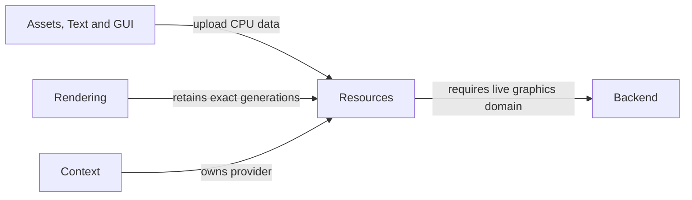

# Resources

## Purpose

Resources converts owned CPU descriptions into backend images, geometry,
programs, pipelines and materials. Retained handles let assets and completed
frames share immutable generations while the backend controls native retirement.
A native resource domain is the live backend/context lifetime that owns those
resources. A handle from that domain does not become usable in an unrelated
context merely because both contexts use the same graphics API.

## Interface

Types below are in `CE::Rendering` unless another namespace is shown.

### Types and operations

| API and purpose |
| --- |
| {cpp:struct}`Resources::Provider <CE::Rendering::Resources::Provider>`<br>Create images/font atlases, upload geometry and link programs on the selected backend owner. [Immutable publication](../resources/resource-residency.md#immutable-resource-publication); [adapter capabilities](../architecture/interfaces-adapters.md#backend-capabilities-and-resource-implementations). |
| {cpp:struct}`CE::Assets::Images::Decoded`<br>Own top-to-bottom CPU RGBA pixels returned by `Images::decode(path/bytes)`, shared with toolkit loading. [CPU preparation and upload](../assets/asset-loading.md#runtime-entry-point); [decoded image declarations](../../../projects/engine/include/cheryl/assets/resources/decoded-image.h). |
| {cpp:struct}`Resources::Image <CE::Rendering::Resources::Image>`, {cpp:struct}`Geometry::Buffer2D <CE::Rendering::Geometry::Buffer2D>`<br>Retain immutable uploaded image/geometry generations. [Native retirement](../resources/resource-residency.md#native-retirement-and-maintenance). |
| {cpp:struct}`Resources::Program <CE::Rendering::Resources::Program>`, {cpp:class}`Resources::Pipeline <CE::Rendering::Resources::Pipeline>`, {cpp:class}`Resources::Material <CE::Rendering::Resources::Material>`<br>Retain executable programs, validated fixed state and material recipes. [Pipelines and materials](../rendering/pipelines-and-materials.md). |
| {cpp:class}`Sampling::Sampler <CE::Rendering::Sampling::Sampler>`, {cpp:struct}`CE::Assets::Shaders::Builder`<br>Use optional immutable sampling and shader/material recipe capabilities. [Sampling](../rendering/pipelines-and-materials.md#immutable-sampling); [shader recipes](../assets/asset-manifests.md#shadermaterial-definitions). |

### Sampling and shader choices

| Type | Choices and details |
| --- | --- |
| {cpp:struct}`Sampling::Options <CE::Rendering::Sampling::Options>`, {cpp:enum}`Sampling::Filter <CE::Rendering::Sampling::Filter>` | Independent minification/magnification with `Nearest` or `Linear` filtering. [Immutable sampling](../rendering/pipelines-and-materials.md#immutable-sampling). |
| {cpp:enum}`Sampling::MipmapFilter <CE::Rendering::Sampling::MipmapFilter>`, {cpp:enum}`Sampling::Wrap <CE::Rendering::Sampling::Wrap>` | Mipmap `None`/`Nearest`/`Linear`; UV `ClampToEdge`/`Repeat`/`MirroredRepeat`. [Sampling and UV behavior](../rendering/pipelines-and-materials.md#immutable-sampling). |
| {cpp:enum}`Sampling::Anisotropy <CE::Rendering::Sampling::Anisotropy>` | `Disabled` or `MaximumSupported`; an unsupported maximum resolves to isotropic filtering. [Effective sampling](../rendering/pipelines-and-materials.md#immutable-sampling). |
| {cpp:enum}`CE::Assets::Shaders::Stage`, {cpp:enum}`ShaderStage <CE::Rendering::ShaderStage>` | Indexed recipes support `Vertex`/`Fragment`; the separate legacy enum classifies shader files and includes additional stages. [Shader definitions](../assets/asset-manifests.md#shadermaterial-definitions); [legacy stage declarations](../../../projects/engine/include/cheryl/enums/shader-types.h). |

## Usage



### Uses

The graphics implementation supplies a compatible live context and native
retirement domain. CPU data comes from asset, text or UI preparation; managed
CPU backing follows the separate Memory contract.

| Types | Systems |
| --- | --- |
| {cpp:struct}`CE::Assets::Images::Decoded`<br>{cpp:struct}`CE::Rendering::Geometry::Vertex2D`<br>{cpp:class}`CE::Rendering::PresentationSurface`<br>{cpp:struct}`CE::Assets::Shaders::Builder`<br>{cpp:type}`CE::Diagnostics::DomainId` | [Assets](assets.md)<br>[Rendering](rendering.md)<br>[Diagnostics](diagnostics.md) |

### Used by

Assets, materials and frames retain exact resource generations. Applications can
call provider operations directly on the correct owner; Runtime preserves
backend lifetime through accepted work and frame recycling.

| Types | Systems |
| --- | --- |
| {cpp:struct}`CE::Assets::Loading::Loader`<br>{cpp:class}`CE::Rendering::Resources::Material`<br>{cpp:struct}`CE::Rendering::DrawPacket2D`<br>{cpp:class}`CE::Text::Rendering::Generation`<br>{cpp:class}`CE::UI::TGUI::SceneUploader`<br>{cpp:class}`CE::UI::RmlUi::SceneUploader`<br>{cpp:class}`CE::Runtime::Context` | [Assets](assets.md)<br>[Rendering](rendering.md)<br>[Text](text.md)<br>[GUI](gui.md)<br>[Runtime](runtime.md) |

## Contracts

Uploads copy transient pixels/vertices before returning. Uploaded contents are
immutable: changed content requires another handle and explicit publication.
Provider ownership and current-context checks apply even when the C++ handle is
shared. A shared logical handle does not extend a closed native domain's usability.

Managers support one active provider/loading-owner domain. Publication can be
incremental and resource retirement is deferred; neither a cache lookup nor a
handle destructor promises immediate allocation/deletion on the current thread.

## Lifecycle

Initialize rendering before uploading. Keep provider/context dependencies alive
through pending requests, simulation completion and frame recycling. Drop game
handles while the backend is still live. Native shutdown collects tracked
resources and closes the domain; surviving logical handles remain safe for
destruction/CPU inspection but cannot draw through it. Partial-failure cleanup
must close remaining native state without masking the original failure.

## Execution

CPU decoding/preparation can run away from graphics. Creation/upload and native
collection obey the selected backend's graphics-owner/current-context rules.
The OpenGL implementation queues retirement from final release and collects it
on graphics; final shared-pointer release alone performs no GL operation.

## Integration

On the platform owner after graphics initialization:

```cpp
auto pixels = CE::Assets::Images::decode(image_path);
auto image = engine_.resources().create_image(pixels);
```

Both values own their contents. You may release/reuse `pixels` after the upload;
retain `image` through the material or frame that needs it. For costly decode,
prepare on a worker and send the owned result through platform dispatch instead.

## Limits and further reading

The portable provider does not promise generic in-place mutation, atomic asset
batches or residency budgets. Read the complete
[cache/publication/retirement contract](../resources/resource-residency.md),
[CPU lifetime guide](../resources/resource-lifetime.md),
[provider interface](../../../projects/engine/include/cheryl/assets/resources/resource-provider.h)
and [OpenGL owner guide](../modules/opengl.md).
