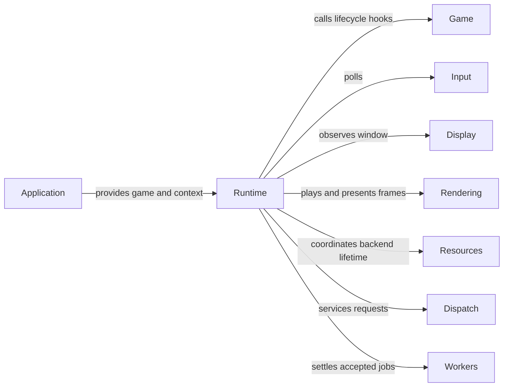

# Runtime

## Purpose

Runtime coordinates a single game session: adapter initialization, input polling,
simulation scheduling, render-frame handoff, presentation and orderly shutdown.
It runs application-defined game hooks rather than prescribing entities, scenes
or a world model.

## Interface

Types below are in `CE::Runtime` unless another namespace is shown.

### Types and operations

| API and purpose |
| --- |
| {cpp:class}`Context <CE::Runtime::Context>`<br>Own compatible adapters and obtain borrowed accessors and tracked worker groups. [Adapter catalogue](../architecture/interfaces-adapters.md); [context ownership](../runtime/worker-execution.md#context-ownership). |
| {cpp:class}`GameRuntime <CE::Runtime::GameRuntime>`<br>Borrow a game/context for one session; block in `run()` and request shutdown with `stop()`. [Runtime frame boundary](../runtime/runtime-frame-boundary.md). |
| {cpp:class}`RuntimeLifecycle <CE::Runtime::RuntimeLifecycle>`, {cpp:struct}`RuntimeLifecycleSnapshot <CE::Runtime::RuntimeLifecycleSnapshot>`<br>Read milestones and a retained terminal outcome without borrowing Runtime. [Lifecycle observation](../runtime/runtime-frame-boundary.md#lifecycle-observation). |
| {cpp:class}`ShutdownEndpoint <CE::Runtime::ShutdownEndpoint>`, {cpp:class}`ShutdownPolicy <CE::Runtime::ShutdownPolicy>`<br>Stage ordinary requests and own the single host decision policy. Stop/failure bypass negotiation. [Shutdown protocol](../runtime/runtime-frame-boundary.md#negotiable-shutdown). |
| {cpp:class}`RuntimeServices <CE::Runtime::RuntimeServices>`, {cpp:class}`ServiceAttachment <CE::Runtime::ServiceAttachment>`<br>Attach required owner work to maintenance or pre-update phases. [Service phases](../runtime/runtime-frame-boundary.md#runtime-service-phases). |
| {cpp:struct}`WindowState <CE::Runtime::WindowState>`, {cpp:struct}`SimulationView <CE::Runtime::SimulationView>`<br>Read copied selections and attach required sizing through Context sources. [Committed views](../runtime/display-and-window-contract.md#committed-window-and-simulation-views). |
| {cpp:struct}`CE::Game::AbstractGame`<br>Supply `init`, `update`, frame preparation, `quiesce` and `deinit` hooks. [Game hooks and ownership](../development/consuming-engine.md#game-hooks-and-ownership); [shutdown](../runtime/runtime-frame-boundary.md#shutdown). |
| {cpp:struct}`CE::Game::TickContext`<br>Read simulation delta, copied dimensions, immutable input and the session stop request. [Input and owner threads](../runtime/runtime-frame-boundary.md#input-and-owner-threads); [tick time](../runtime/simulation-timing.md#input-and-tick-time). |
| {cpp:class}`CE::Application::Startup`<br>Configure the supplied command-line composition path before creating the runtime. [Command-line startup](../development/consuming-engine.md#command-line-startup); [Startup module](../modules/startup.md). |

### Configuration and enums

| Type | Choices and details |
| --- | --- |
| {cpp:enum}`RunMode <CE::Runtime::RunMode>` | `Sequential` updates on platform; `Concurrent` uses a dedicated simulation thread. [Execution and frame handoff](../runtime/runtime-frame-boundary.md). |
| {cpp:struct}`ExecutionOptions <CE::Runtime::ExecutionOptions>` | Lazy owned worker capacity or an application-supplied shared pool. [Context worker ownership](../runtime/worker-execution.md#context-ownership). |
| {cpp:struct}`Simulation::TimingOptions <CE::Runtime::Simulation::TimingOptions>`, {cpp:enum}`Simulation::Mode <CE::Runtime::Simulation::Mode>` | Configure variable/fixed updates, interval and bounded recovery. [Timing defaults](../runtime/simulation-timing.md#defaults-and-pacing); [fixed steps](../runtime/simulation-timing.md#fixed-steps). |
| {cpp:enum}`Simulation::LagRecovery <CE::Runtime::Simulation::LagRecovery>`, {cpp:enum}`Simulation::UpdateKind <CE::Runtime::Simulation::UpdateKind>` | Select dropped excess lag or variable catch-up; identify the kind of the current tick. [Catch-up recovery](../runtime/simulation-timing.md#catch-up-recovery). |
| {cpp:struct}`CE::Input::PollingOptions`, {cpp:enum}`CE::Input::PollingPolicy` | Configure completed-poll backlog and spacing independently of simulation mode. [Polling backlog](../runtime/input-state-model.md#polling-backlog-and-scheduling). |

Start with sequential execution when polling, updates and rendering can share
one owner. Concurrent execution keeps platform polling/rendering separate from
a slow update, but requires copied observations and retained frame publication
instead of live adapter access from another thread. Both modes use the same
[timing choices](../runtime/simulation-timing.md#choose-a-timing-policy).

## Usage



### Uses

Runtime composes the adapters and coordinates their owners, accepted work and
shutdown.

| Types | Systems |
| --- | --- |
| {cpp:struct}`CE::Game::AbstractGame`<br>{cpp:class}`CE::Platform::DisplaySystem`<br>{cpp:class}`CE::Input::System`<br>{cpp:class}`CE::Rendering::PresentationSurface`<br>{cpp:class}`CE::Rendering::Renderer`<br>{cpp:struct}`CE::Rendering::Resources::Provider`<br>{cpp:class}`CE::Workers::Group`<br>{cpp:class}`CE::Runtime::PlatformDispatcher` | [Display](display.md)<br>[Input](input.md)<br>[Rendering](rendering.md)<br>[Resources](resources.md)<br>[Dispatch](dispatch.md)<br>[Workers](workers.md)<br>[Logging](logging.md)<br>[Diagnostics](diagnostics.md) |

### Used by

Applications construct a runtime and provide game hooks. GUI and audio
integrations cooperate with those lifecycle boundaries while keeping
application-owned lifetimes.

| Types | Systems |
| --- | --- |
| {cpp:class}`CE::Application::Startup`<br>{cpp:struct}`CE::Application::StartupResult`<br>[`Tutorial::Game`](../getting-started/create-a/character.md) | [GUI](gui.md)<br>[Audio](audio.md) |

## Contracts

A context and runtime each support one session. Borrowed game/context/input
objects must survive all use and cleanup. `init_platform()` may upload resources and
register bindings; `update()` and frame preparation must not perform graphics
operations when simulation is concurrent. A borrowed tick, frame writer or pass
writer is valid only for its hook call.
`init_simulation()` runs on the simulation owner with services and the initial
view ready, before Ready, timing and the first update. Initialization and
deinitialization hooks default to no-ops; use constructors for setup without
runtime/thread dependencies.

Input observation time and simulation delta have distinct meanings. Rendering
sees complete published snapshots. Frame preparation may be skipped when no
slot is free, so it must not advance essential game state. Hook failures stop
the session; cleanup preserves the first failure while reporting later ones.

## Lifecycle

The application constructs adapters/context before running. Runtime initializes
input and graphics, attempts `init_platform()`, then establishes the selected
simulation owner/view and calls `init_simulation()`. Each cleanup hook pairs with
its attempted initialization and must tolerate partial failure.

Shutdown stops new context-group submissions and simulation, servicing accepted
platform dependencies while simulation closes its dispatcher, calls
`deinit_simulation()` on its owner, and joins. `quiesce()` then stops external producers
and invalidates borrowed registrations without destroying dependencies still
needed by accepted work. After that work settles and retained frames recycle,
`deinit_platform()` releases game resources while adapters remain alive. Input detaches
before its window disappears; graphics then closes. An injected worker pool's
unrelated groups remain usable.

## Execution

The caller of `run()` owns platform polling and graphics operations. Sequential
mode also updates/prepares on that thread using one frame. Concurrent mode gives
updates and preparation to one simulation thread and uses three frame slots.
Tick input and window/framebuffer dimensions cross as values; accessors do not
marshal live adapter operations onto their required thread.

## Integration

A game requests graceful shutdown from its update hook:

```cpp
void update(const CE::Game::TickContext& tick) override {
    if (tick.input.button(quit_action).pressed()) {
        tick.request_stop();
        return;
    }
    // Advance application-owned state using tick.delta_seconds.
}
```

`quit_action` is an application-defined action registered during initialization.
The stop request does not interrupt the current hook; return when further work
is unnecessary. [First Game](../getting-started/first-game.md) shows the complete
main function and hook wiring.

## Limits and further reading

There is no built-in world, entity, physics or scene lifecycle. The runtime does
not automatically own toolkit sessions or audio. Read the detailed
[frame and shutdown contract](../runtime/runtime-frame-boundary.md),
[simulation timing](../runtime/simulation-timing.md),
[context assembly](../development/consuming-engine.md#context-assembly) and
[failure reporting](../runtime/failure-reporting.md). Public declarations live in
[Context](../../../projects/engine/include/cheryl/core/engine/engine-context.h),
[GameRuntime](../../../projects/engine/include/cheryl/core/game-framework/game-runtime.h)
and [AbstractGame](../../../projects/engine/include/cheryl/core/game-framework/abstract-game.h).
