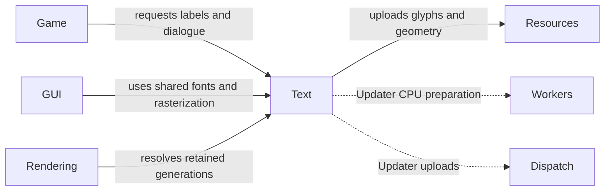

# Text

## Purpose

Text selects font data, validates/decodes text, shapes Unicode runs and prepares
drawable glyphs. Font loading, shaping, rasterization and graphics upload are
different stages with different ownership and execution requirements.

## Interface

Types below are in `CE::Text` unless another namespace is shown.

### Types and operations

| API and purpose |
| --- |
| {cpp:class}`FontService <CE::Text::FontService>`, {cpp:class}`Font <CE::Text::Font>`<br>Configure named families and a default through `Context::fonts()`, retain a resolved font, and choose/restore named group members by stable references. [Configure fonts once](../assets/text-layout.md#configure-fonts-once); [choose and save a font](../assets/text-layout.md#choose-and-save-a-font). |
| {cpp:struct}`FontSelection <CE::Text::FontSelection>`, {cpp:class}`FontCollection <CE::Text::FontCollection>`<br>Select ordered fallback fonts and retain immutable font-byte snapshots. [Font selection](../assets/text-layout.md#font-selection); [font discovery](../assets/file-and-font-discovery.md). |
| {cpp:class}`ShapedText <CE::Text::ShapedText>`, {cpp:struct}`LayoutOptions <CE::Text::LayoutOptions>`<br>Run `layout_text()` and inspect shaped lines, glyphs and source mapping. [Shaping, direction and width](../assets/text-layout.md#shaping-direction-and-width). |
| {cpp:class}`Rendering::Prepared <CE::Text::Rendering::Prepared>`, {cpp:class}`Rendering::Generation <CE::Text::Rendering::Generation>`<br>Prepare CPU glyph geometry, upload retained resources and resolve text draw packets. [Preparation and submission](../assets/text-layout.md#preparation-upload-and-retained-submission); [text task](../getting-started/how-to/update-text.md). |
| {cpp:class}`Rendering::Updater <CE::Text::Rendering::Updater>`, {cpp:struct}`Rendering::Request <CE::Text::Rendering::Request>`<br>Own asynchronous preparation/upload/adoption for changing text while retaining the last success. [Retained updates and failures](../assets/text-layout.md#retained-text-updates). |
| {cpp:class}`FontRasterizer <CE::Text::FontRasterizer>`, {cpp:struct}`FontRasterGlyph <CE::Text::FontRasterGlyph>`<br>Obtain shared CPU font metrics, raster pixels and kerning for toolkit adapters. [UI font responsibilities](../development/ui-adapters.md#bridge-responsibilities); [rasterizer declarations](../../../projects/engine/include/cheryl/text/font-rasterizer.h). |
| {cpp:struct}`Legacy::Font <CE::Text::Legacy::Font>`<br>Use the separate legacy ASCII/bitmap compatibility path. [Legacy bitmap fonts](../resources/legacy-ffont.md). |

### Sources, direction and raster values

| Type | Choices and details |
| --- | --- |
| {cpp:struct}`FontConfiguration <CE::Text::FontConfiguration>`, {cpp:struct}`FontFamily <CE::Text::FontFamily>` | Named family sources, selection groups, the application default and common fallback references. [Catalogue configuration](../assets/text-layout.md#configure-fonts-once). |
| {cpp:struct}`FontStyle <CE::Text::FontStyle>`, {cpp:struct}`FontFace <CE::Text::FontFace>` | Requested numeric weight/italic state and borrowed retained face bytes/index/style for adapters. [Retained handles and style](../assets/text-layout.md#retained-font-handles-and-style). |
| {cpp:type}`FontSource <CE::Text::FontSource>` | File, system family or string source selection; make discovery policy explicit. [Font sources and fallback](../assets/text-layout.md#font-selection). |
| {cpp:enum}`ParagraphDirection <CE::Text::ParagraphDirection>` | `Automatic`, `LeftToRight`, `RightToLeft` paragraph direction. [Shaping and bidi direction](../assets/text-layout.md#shaping-direction-and-width). |
| {cpp:struct}`SourceRange <CE::Text::SourceRange>`, {cpp:struct}`GlyphId <CE::Text::GlyphId>` | Distinguish source byte/scalar ranges from font-qualified glyph indices. [Encoding and source indices](../assets/text-encoding.md). |
| {cpp:enum}`FontSizing <CE::Text::FontSizing>`, {cpp:enum}`FontBitmapFormat <CE::Text::FontBitmapFormat>` | Raster sizing in `Pixels`/`Characters`; output `Alpha`/`PremultipliedRGBA` pixel storage. [Raster size/format declarations](../../../projects/engine/include/cheryl/text/font-rasterizer.h); [toolkit alpha conventions](../development/ui-adapters.md#bridge-responsibilities). |

## Usage



### Uses

Font discovery and CPU processing precede resource upload and draw resolution.
`Rendering::Updater` manages those boundaries for changing text. Applications can
also prepare on Workers and dispatch owned upload requests to graphics directly.

| Types | Systems |
| --- | --- |
| {cpp:class}`CE::Text::FontCollection`<br>{cpp:class}`CE::Text::FontRasterizer`<br>{cpp:struct}`CE::Rendering::Resources::Provider`<br>{cpp:class}`CE::Rendering::Resources::Material`<br>{cpp:class}`CE::Runtime::PlatformDispatcher::Submission` | [Assets](assets.md)<br>[Utilities](utilities.md)<br>[Resources](resources.md)<br>[Rendering](rendering.md)<br>[Workers](workers.md)<br>[Dispatch](dispatch.md) |

### Used by

Games draw labels, dialogue and HUD text. Toolkit adapters use font
metrics/rasterization within their own layout; the application selects which
text path to use.

| Types | Systems |
| --- | --- |
| [`FirstGame::Game`](../getting-started/first-game.md#put-text-on-screen)<br>{cpp:class}`CE::UI::TGUI::Session`<br>{cpp:class}`CE::UI::RmlUi::Session` | [Rendering](rendering.md)<br>[GUI](gui.md) |

## Contracts

The context owns its font catalogue; an unconfigured catalogue supplies the
embedded default. Named families and random selection groups use stable
application references. Font handles retain CPU snapshots independently of the
catalogue and Context. Configure before consumers: publishing another catalogue
does not rebind an existing handle or widget. Lookup does not inspect changed
source files.

Random selection runs only when requested. Restoring a saved reference reuses it
while it is available and remains in the named group; otherwise it selects a
replacement, then uses the application default or embedded fallback if no group
candidate is available. The application persists the returned reference and owns
shared object identity; runtime handles and font bytes are not save data.

Layout positions use local Y-up pixels; `pixel_height` is the font em size.
Glyph IDs are qualified by their retained font collection. Shaping clusters and
UTF-8 byte/scalar ranges are not interchangeable character indices. Layout
retains the font-byte snapshot used for later preparation, not a borrowed input
string or mutable native face.

Fallback and wrapping operate on the documented Unicode boundaries. Replacing
text produces another layout/uploaded generation; it must not mutate a
generation already retained by a frame. Upload retains a compatible default
material; explicit custom materials must match the generation's geometry.

`FontRasterizer::load()` copies font bytes; its copies share synchronized native
face state. Returned metrics/glyph pixels own their values and can survive the
rasterizer. This CPU service neither borrows a graphics provider nor makes a
toolkit's mutable atlas thread-safe.

## Lifecycle

Load selected fonts at a loading boundary, lay out text and prepare its CPU
representation. Upload after graphics initialization and retain the generation
in the game/HUD. Replace it when content changes, allowing published frames to
retain older generations. Settle upload requests and release game handles before
backend shutdown. Retained font bytes and native graphics lifetime are separate.

## Execution

Font selection/layout/preparation are CPU stages; upload follows graphics
affinity. Use owned request data across dispatch boundaries and consume completed
futures without blocking simulation. Record positions and immutable generation
handles during frame preparation.

## Integration

For a static label, run the explicit CPU preparation and upload stages on the
platform upload owner after graphics initialization. The configured default
needs no application font plumbing:

```cpp
auto font = engine_.fonts().default_font();
auto layout = CE::Text::layout_text(font, "Score: 0", {.pixel_height = 24});
auto prepared = CE::Text::Rendering::prepare(std::move(layout));
auto score = CE::Text::Rendering::upload(std::move(prepared), engine_.resources());
```

Retain `score` and resolve it using its retained material in frame preparation.
For a score or other changing label, use
[`Rendering::Updater`](../getting-started/how-to/update-text.md) to manage these
stages without adding worker futures or upload/adoption bookkeeping to the game.
It keeps the last successful generation while a replacement is pending or fails.

## Limits and further reading

Text rendering is not a full editor/IME service. Do not infer arbitrary toolkit
font compatibility or complete script acceptance from a basic label example.
Read [Unicode layout](../assets/text-layout.md),
[encoding and source indices](../assets/text-encoding.md),
[font discovery](../assets/file-and-font-discovery.md),
[legacy fonts](../resources/legacy-ffont.md),
[layout declarations](../../../projects/engine/include/cheryl/text/layout.h),
[shared rasterization operations](../../../projects/engine/include/cheryl/text/font-rasterizer.h) and
[text rendering declarations](../../../projects/engine/include/cheryl/assets/types/2d/unicode-text.h).
