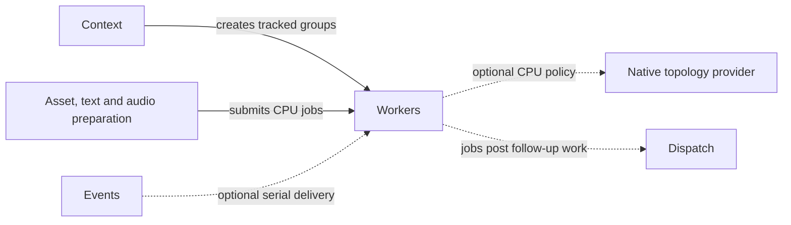

# Workers

## Purpose

Workers shares CPU execution capacity between workload groups. Groups define
admission, concurrency, relative scheduling share and optional CPU/locality
policy without creating another physical pool per workload.

## Interface

Types below are in `CE::Workers` unless another namespace is shown.

### Types and operations

| API and purpose |
| --- |
| {cpp:class}`Pool <CE::Workers::Pool>`, {cpp:struct}`PoolOptions <CE::Workers::PoolOptions>`<br>Own reusable CPU capacity, optionally informed by discovered topology. [Pool lifetime](../runtime/worker-execution.md#pool-lifetime); [capacity](../runtime/worker-execution.md#topology-providers-and-capacity). |
| {cpp:class}`Group <CE::Workers::Group>`, {cpp:struct}`GroupOptions <CE::Workers::GroupOptions>`<br>Submit owned jobs with concurrency caps, scheduling share and CPU policy; close then drain. [Jobs](../runtime/worker-execution.md#jobs); [CPU policy](../runtime/worker-execution.md#cpu-policy-and-capabilities). |
| {cpp:class}`TopologyProvider <CE::Workers::TopologyProvider>`, {cpp:struct}`Topology <CE::Workers::Topology>`<br>Supply/inspect native CPU, core and cache observations. [Topology providers](../runtime/worker-execution.md#topology-providers-and-capacity); [adapter catalogue](../architecture/interfaces-adapters.md#backend-capabilities-and-resource-implementations). |
| {cpp:struct}`Configuration <CE::Workers::Configuration>`<br>Validate typed pool/group configuration; optional Workers integration loads JSON. [Typed and JSON configuration](../runtime/worker-execution.md#typed-and-json-configuration); [Workers module](../modules/workers.md). |
| {cpp:struct}`GroupPolicy <CE::Workers::GroupPolicy>`, {cpp:struct}`GroupStatus <CE::Workers::GroupStatus>`, {cpp:struct}`Capabilities <CE::Workers::Capabilities>`<br>Compare requested/effective policy, activity and supported native behavior. [CPU policy](../runtime/worker-execution.md#cpu-policy-and-capabilities); [worker statistics](../runtime/subsystem-diagnostics.md#worker-statistics). |

### CPU policy enums

| Type | Choices and details |
| --- | --- |
| {cpp:struct}`CpuPolicy <CE::Workers::CpuPolicy>` | Explicit eligible CPU IDs, strength, locality and optional cache-domain selection. [CPU policy and capabilities](../runtime/worker-execution.md#cpu-policy-and-capabilities). |
| {cpp:enum}`PolicyStrength <CE::Workers::PolicyStrength>` | `Preferred` may report fallback; unsupported `Required` policy rejects. [Required and preferred policy](../runtime/worker-execution.md#cpu-policy-and-capabilities). |
| {cpp:enum}`LocalityPolicy <CE::Workers::LocalityPolicy>` | `Automatic`, `Reuse`, `Spread` within reported topology and binding support. [Locality selection](../runtime/worker-execution.md#cpu-policy-and-capabilities). |
| {cpp:enum}`CacheType <CE::Workers::CacheType>` | `Data`, `Instruction`, `Unified` classify discovered cache domains. [Topology snapshots](../runtime/worker-execution.md#topology-providers-and-capacity). |

## Usage



### Uses

Optional native providers supply CPU/core/cache observations and affinity
enforcement. Jobs with owner-affine follow-up can request Dispatch; the pool
itself grants CPU capacity.

| Types | Systems |
| --- | --- |
| {cpp:class}`CE::Workers::TopologyProvider`<br>{cpp:struct}`CE::Workers::Topology`<br>{cpp:struct}`CE::Workers::CpuPolicy`<br>{cpp:type}`CE::Diagnostics::DomainId` | [Diagnostics](diagnostics.md)<br>[Logging](logging.md)<br>[Dispatch](dispatch.md) |

### Used by

Runtime may own lazy capacity or retain a supplied shared pool. Applications can
schedule asset/text/audio preparation, and event delivery can use a serial
worker stream. Standalone services need no runtime session.

| Types | Systems |
| --- | --- |
| {cpp:class}`CE::Runtime::Context`<br>{cpp:type}`CE::Events::EventBus::Delivery`<br>[Application-owned job callables](../runtime/worker-execution.md#jobs) | [Runtime](runtime.md)<br>[Assets](assets.md)<br>[Text](text.md)<br>[Events](events.md)<br>[Audio](audio.md) |

## Contracts

Jobs own callables and settle futures with results/errors. FIFO selection does
not imply completion order when concurrency exceeds one. Caps limit running
jobs; weight/priority determine selection share rather than OS scheduling
priority. CPU eligibility is not reserved core ownership or guaranteed speedup.

Do not block a job on child futures from the same saturated pool. Close before
drain; drainage waits for accepted work and capture release. Same-pool drainage
and self-join reject. Required unsupported native policy rejects while preferred
policy may report fallback.

## Lifecycle

Create a pool and groups, submit owned work, close acceptance and drain before
destroying borrowed dependencies. Pool destruction closes, drains and joins;
saved group handles reject safely after pool disappearance. Thread-start failure
joins threads already created. Context-created groups close with that context;
unrelated groups in an injected shared pool remain open.

## Execution

Physical workers execute eligible groups according to scheduling policy. They
are separate from runtime's dedicated concurrent simulation thread. Graphics
work still needs platform dispatch. During runtime shutdown, accepted CPU work
settles while platform dependencies can continue making progress.

## Integration

Before context creation, select the desired physical capacity through
[`ExecutionOptions`](../runtime/worker-execution.md#context-ownership); its default
is one worker. During game initialization, retain a context-owned preparation group:

```cpp
auto preparation = engine_.make_worker_group({.max_concurrency = 2});
auto result = preparation.submit([] { return 6 * 7; });
```

Real preparation should return owned CPU data. Retain/read its future and send
completed results to platform for upload; the group's cap cannot exceed physical
pool capacity and does not create two additional threads. To permit two jobs
to run at once, the configured pool must contain at least two workers.

## Limits and further reading

No work stealing, forced termination, live pool reconfiguration or NUMA memory
placement is implied. Topology discovery does not prove a performance benefit.
Read [worker contracts and optional integration](../runtime/worker-execution.md),
[runtime shutdown](../runtime/runtime-frame-boundary.md#shutdown) and
[pool/group declarations](../../../projects/engine/include/cheryl/core/engine/worker-pool.h).
