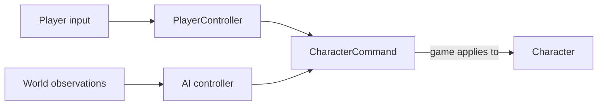

# Actor controllers and commands

An actor controller chooses what an actor should do. The actor applies that
choice to its own state. Establish that boundary before adding player input or
AI behavior, so either source can drive the same actor.

Start with [First Game](../first-game.md). This lesson creates the command value
used by [PlayerController](controller.md), [Character](character.md), and
[AIController](ai-controller.md). These are application-owned roles and classes;
Cheryl supplies input, timing, resources, and execution boundaries.



## Define the actor command

Create `character-command.h`:

```{literalinclude} ../../../../projects/apps/tutorial-game/src/character-command.h
:language: cpp
```

`horizontal` expresses movement intent: `-1` requests left, `1` requests right,
and `0` requests no movement. The Character applies speed and elapsed simulation
time. Keeping those movement rules with the Character lets different controllers
request the same action consistently.

The command owns its value. It retains no input view, actor pointer, or rendering
resource. Commands in a larger game can express other actor operations, such as
interacting or requesting an attack; the application defines their meaning.

## Choose a decision source

The following lessons implement two actor controllers:

| Source | Observations | Result |
| --- | --- | --- |
| `PlayerController` | Its own action context in the current input tick. | A `CharacterCommand` derived from the player's controls. |
| `PatrolController`, the AI example | The Character's position/speed, elapsed simulation time, and its own direction state. | The same command, derived from patrol behavior. |

The game obtains a command, then gives it to the Character. It owns the update
order and the association between a controller and an actor. Multiple actors can
share immutable appearance resources while retaining independent control and
movement state.

The `ActorController` role does not require a common C++ base class. First give
the concrete controllers a useful command contract. The later
[abstract controller discussion](abstract-controller.md) explains when a shared
invocation interface would help.

## Check the command boundary

Include `character-command.h` in the game header. In `update()`, after quit
handling, temporarily inspect these values in a debugger:

```cpp
[[maybe_unused]] const Tutorial::CharacterCommand idle{};
[[maybe_unused]] const Tutorial::CharacterCommand right{1};
[[maybe_unused]] const Tutorial::CharacterCommand left{-1};
```

Their `horizontal` values should be `0`, `1`, and `-1`. This checkpoint establishes
the value contract; it does not yet replace First Game's movement code. Remove
the temporary declarations when continuing with [Create a PlayerController](controller.md).
That lesson produces commands from real input, and [Create a Character](character.md)
makes them visible as movement.
