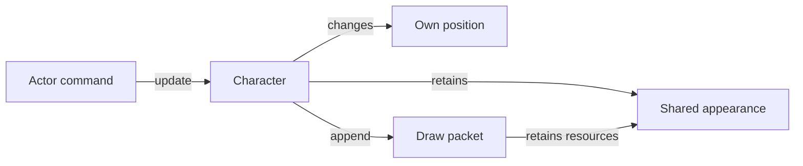

# Create a Character

A Character owns its position, movement settings and retained appearance. It
consumes the command from [Create a PlayerController](controller.md), so the same
Character class can be driven by a player or by autonomous patrol behavior.
Continue in First Game's initialization, update, frame and cleanup hooks.



## Compose state and appearance

Create `character.h`:

```{literalinclude} ../../../../projects/apps/tutorial-game/src/character.h
:language: cpp
```

The Character retains a sprite and material, together with its own position,
cell and speed. Many Characters can share the same immutable resources. The
sprite already retains a compatible default material; an object can retain that
handle or select another compatible material, such as First Game's nearest-sampled
appearance. No application material builder or asset subclass is needed.

`update()` applies a command and elapsed simulation seconds to authoritative
position. `append()` prepares a drawing instruction from the current state and
adds it to a borrowed pass. It does not call a controller, advance behavior or
issue graphics operations. The renderer later consumes retained frame packets.

This example clamps horizontal command strength to `[-1, 1]` and validates its
inputs. It supplies no collision detection, gravity, world storage or boundary
policy. Its speed uses local pixels per simulation second, independently of the
draw style's visual scale.

## Construct after loading

Include `character.h` in the game and retain a Character alongside the controller:

```cpp
std::shared_ptr<const CE::Assets::Sprites::Asset> sprite_;
std::optional<Tutorial::Character> player_;
```

Keep First Game's asset loading and `images_` appearance handle. Instead of
constructing its `actor_`, retain the loaded `sprite` and create the Character:

```cpp
sprite_ = std::move(sprite);
player_.emplace(sprite_, images_, glm::vec2(160.0f, 100.0f));
```

These calls belong in platform-owned `init()` after loading and validation. The
controller is already attached as described in the previous tutorial. The
[maintained game](../../../../projects/apps/tutorial-game/src/game.cpp) retains the
same resources for later player joins.

## Update Characters from commands

Replace First Game's Actor movement/cell block during `update()` with:

```cpp
player_->update(controller_->read(tick.input), tick.delta_seconds);
```

Keep quit handling and camera resize observation. Position changes only in
simulation; concurrent rendering can skip a visual snapshot without slowing
movement. Both direction keys held request no movement.

## Prepare the Character's appearance

During `prepare_render_frame()`, replace First Game's pass/context declarations
and old Actor draw with:

```cpp
auto world = frame.begin_pass(camera_.projection_matrix(), camera_.view_matrix());
player_->append(world);
const CE::Rendering::Submission::Context2D context{
    world.semantics(), world.parameters(), world.constraints()
};
```

The pass copies the camera matrices and retains each packet's resources and draw
values. Keep First Game's score afterward, changing its `pass.add(...)` to
`world.add(...)` to use this pass and the `context` above, until [the HUD tutorial](hud.md)
replaces its presentation. Add [animation](../how-to/animate-sprite.md) or
[camera behavior](../how-to/use-camera.md) as separate application state.

## Add an autonomous controller

[Create an AIController](ai-controller.md) supplies the complete patrol extension:
behavior state, Character observations, construction, update, drawing, and cleanup.
It produces the same command as the player controller while retaining independent
direction state. Follow that lesson to add `patrol_` and `enemy_`, or continue here
with player input alone.

## Join and leave during play

The complete update block below also includes the optional AI extension. Add
`std::optional<Tutorial::PlayerController> second_controller_;` and
`std::optional<Tutorial::Character> second_player_;` beside the first player's
members. Declare game-wide action IDs `join_{7}` and `leave_{8}` with type
`CE::Input::Actions::Id`. The IDs remain separate from each controller's local IDs.

During platform-owned `init()`, use the now-unused left/right registration slots
in First Game's `bindings_` array:

```cpp
bindings_[1] = bindings.bind_button({keyboard_, CE::Input::KeyboardKey::F2}, join_);
bindings_[2] = bindings.bind_button({keyboard_, CE::Input::KeyboardKey::F3}, leave_);
```

Here `bindings` is the existing platform binding reference. Replace the single
player update call and any patrol update with the maintained game's complete player block.
The first line imports its controller name into your `update()` scope:

```{literalinclude} ../../../../projects/apps/tutorial-game/src/game.cpp
:language: cpp
:start-after: // [players]
:end-before: // [/players]
:dedent: 8
:prepend: using Tutorial::PlayerController;
```

F2 requests a separate action context using the device ID saved during `init()`;
its mappings become visible after the next poll. F3 releases that controller and
Character. Releasing one context does not remove another player's mappings.
If both players are present, each tick reads their own action namespace before
applying commands. Keep the simple single-player update above or this extended
block, according to the application you are building. If omitting the patrol
extension, omit the final `enemy_->update(...)` line from this block too.

In `prepare_render_frame()`, after `player_->append(world)`, add:

```cpp
if (second_player_)
    second_player_->append(world);
```

The maintained [Game declaration](../../../../projects/apps/tutorial-game/src/game.h) and
[implementation](../../../../projects/apps/tutorial-game/src/game.cpp) contain the
complete fields, direct binding registrations, loading and rendering order.

## Release and observe

Replace `actor_.reset()` during `deinit()` with controller/Character cleanup:

```cpp
controller_.reset();
player_input_.reset();
player_.reset();
sprite_.reset();
```

If added, reset the second controller, second Character and `enemy_` too. Keep
First Game's direct binding removal, text and material cleanup. Reset the optional
controller before dropping its endpoint, and release resources while the graphics
backend remains alive. Published frames retain their own handles until recycling.

Observe one arrow-controlled Character and, when enabled, a second J/L player and
a patrol. Moving one player must not move the other; F3 must leave the first
controller working. Repeat in both runtime execution modes. Continue with
[Create an AIController](ai-controller.md) for autonomous behavior, then
[Create a UIController](ui-controller.md) and [a HUD](hud.md) for shared-session widgets.
