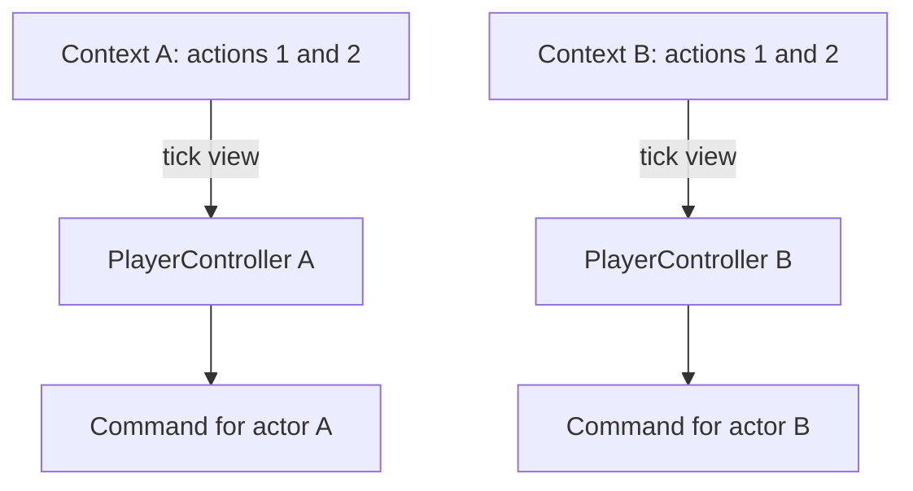

# Create a PlayerController

A PlayerController turns a player's scoped input actions into an actor command.
Start with [First Game](../first-game.md) and the
[actor-controller command contract](actor-controller.md), then build this
controller before [the Character](character.md). The maintained
[tutorial game](../../../../projects/apps/tutorial-game/README.md) implements the
complete sequence.

The application defines what a command means. Cheryl supplies action contexts,
copied tick input and lifecycle boundaries; it does not require a particular
controller class or inheritance hierarchy.

Once their contexts have been published by a poll, separate instances can read
the same local IDs without sharing action state:



## Define a command

Use `character-command.h` from [Actor controllers and commands](actor-controller.md#define-the-actor-command).
Its `horizontal` value requests left, right, or no movement. The Character applies
speed and elapsed time; an [AIController](ai-controller.md) will produce the same
command from game observations.

## Translate a player's actions

Create `player-controller.h`:

```{literalinclude} ../../../../projects/apps/tutorial-game/src/player-controller.h
:language: cpp
```

`keyboard()` creates a binding definition from a saved device identity and chosen
controls. It performs no native device query. Every controller uses local action
IDs `1` and `2`; `tick.actions(input_)` selects that controller's own action
namespace. Another player may reuse those IDs with different keys without sharing
its action state or colliding with First Game's direct quit binding.

`read()` combines the held states into a command. Both directions held cancel.
It does not move a sprite or draw; those are the Character's responsibilities.

## Initialize the first controller

In the game header, include `player-controller.h`,
`<cheryl/core/controls/input-interface.h>` and `<optional>`. Retain these members:

```cpp
CE::Input::DeviceId keyboard_ = 0;
std::optional<CE::Input::Actions::ContextSubmission> player_input_;
std::optional<Tutorial::PlayerController> controller_;
```

Keep First Game's input/binding references, native `keyboard` acquisition, and
game-wide quit/Space registrations. Remove only its direct left/right binding
registrations. After the existing `const auto keyboard = input.keyboard_id();`
line in platform-owned `init_platform()`, insert:

```cpp
keyboard_ = keyboard;
player_input_.emplace(input.action_contexts());
controller_.emplace(player_input_->attach(Tutorial::PlayerController::keyboard(keyboard_)));
```

Acquire the endpoint and native device ID on platform while input is initialized.
Retaining them lets simulation request a later player without calling
`keyboard_id()` or changing the platform-owned binding collection itself.
`attach()` validates and accepts an owned definition; installation happens at the
next input poll. Until that poll publishes the context, its tick view is empty.

## Read during update

After quit handling in `update()`, obtain the command from copied tick input:

```cpp
[[maybe_unused]] const auto command = controller_->read(tick.input);
```

At this intermediate checkpoint, inspect `command.horizontal` in a debugger:
left yields `-1`, right yields `1`, and neither or both yields `0`, after the
attachment's first input poll. `[[maybe_unused]]` permits that inspection before
the next lesson consumes the value. The old Actor will not respond to the removed
direct movement bindings; the Character lesson makes this command visible as movement.

The [Character tutorial](character.md#update-characters-from-commands) applies
this command. Keep control translation in the controller so character movement
can also accept a patrol or other application-selected source.

This player controller needs no work in frame preparation. Read it during simulation
updates, then let frame preparation copy the Character's resulting visible state.
Input capture, routed keyboard focus and controller action namespaces are
separate policies; see [input contexts](../../runtime/input-state-model.md#action-contexts).

## Join, leave and clean up

Each additional player attaches another copy of the definition, choosing its own
controls. The complete [Character integration](character.md#join-and-leave-during-play)
uses F2 to join a J/L player and F3 to remove it. Both controller objects use the
same class and local action IDs.

Destroying/resetting a controller releases its context lease. That removes its
mappings at the next poll; previously published ticks retain their state. During
`deinit_platform()`, after simulation stops, release controller handles and the saved endpoint:

```cpp
controller_.reset();
player_input_.reset();
```

Keep the existing cleanup of the game's direct bindings and graphics resources.
The input system remains alive during game cleanup. Continue with
[Create a Character](character.md) to give these commands visible behavior.
