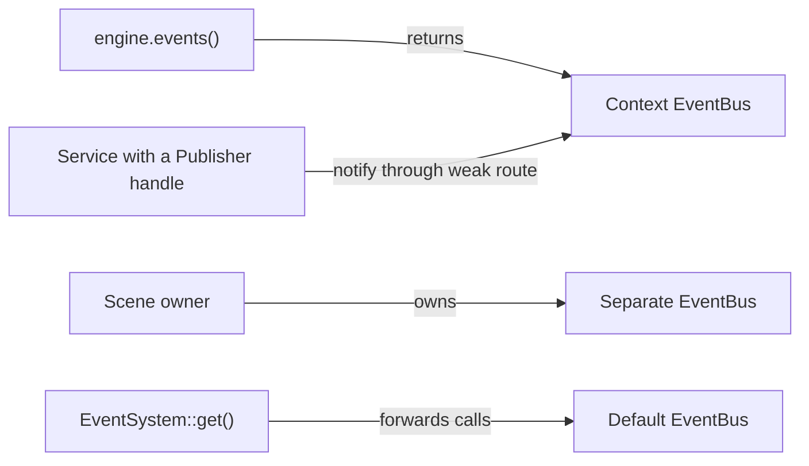
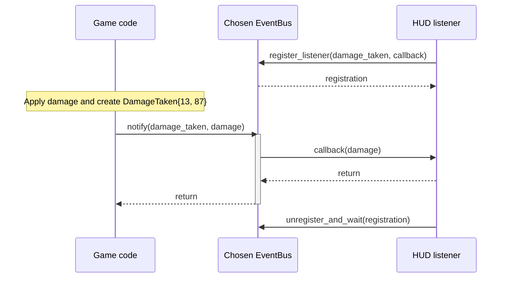
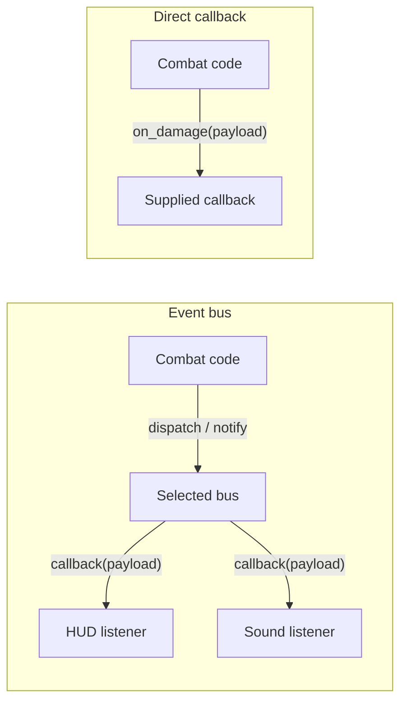

# Create an event

An event describes something that happened in your game. Four pieces work
together:

| Piece | Responsibility in this example |
| --- | --- |
| Payload: `DamageTaken` | A plain struct holding the damage amount and remaining health. Each value represents one occurrence. |
| Channel: `damage_taken` | Identifies the event kind by its name and payload type. Producers and listeners share this definition. |
| Bus: `EventBus` | Stores listener registrations and routes a published payload to callbacks registered for that channel. |
| Listener | A callback that receives `const DamageTaken&` and reacts, such as updating HUD state. |

Start with [Project setup](../project-setup.md) and the `CE::Runtime::Context`
borrowed by your game in [First Game](../first-game.md). This example applies
damage, then updates a value a HUD could display.

## Choose a bus

Your engine Context already owns a bus, available through `engine.events()`.
You can also own a separate `CE::Events::EventBus`, for example for a scene, or
use the default bus through `CE::Events::EventSystem::get()`.



`EventSystem` is a convenience wrapper around a bus. Its `register_listener()`
and `dispatch()` calls forward to that default bus. Include
`<cheryl/core/subsystems/event-system.h>` to use it; `EventSystem::get().bus()`
also gives access to the underlying bus, including `notify()`.

Each bus has its own registrations. Publishing on the Context bus reaches its
matching listeners; listeners on a separate bus do not receive that publication.
Register and publish on the same bus. A channel does not choose or own a bus.
The example below uses `engine.events()` throughout. For a direct callback
alternative, see [Call a consumer directly](#call-a-consumer-directly).

## Define the payload and channel

Create `game-events.h` in your game's source directory:

```cpp
#pragma once

#include <cheryl/core/subsystems/event-channel.h>

namespace GameEvents {
    struct DamageTaken {
        int amount;
        int health_remaining;
    };

    inline const CE::Events::EventChannel<DamageTaken> damage_taken{"game.damage-taken"};
}
```

`DamageTaken` carries the facts. `damage_taken` identifies this event by its exact
name and payload type. Include this header wherever you produce or consume it.
The payload must be copy-constructible; small value fields make ownership clear.

## Subscribe, publish and clean up

Define the payload type and channel once, then register listeners before the
occurrences they should receive. Construct a payload value each time the event
happens. Both `dispatch()` and `notify()` publish a value through the bus.



The diagram shows a successful immediate `notify()`. The producer
chooses a channel and bus; the bus finds its registered consumers. Callbacks run
inside the publication call by default, before it returns. Each callback receives
a borrowed `const DamageTaken&`.

Add this illustrative helper near the top of your game's `.cpp` file, before its
game method definitions:

```cpp
#include "game-events.h"
#include <cheryl/core/engine/engine-context.h>

bool demonstrate_damage_event(CE::Runtime::Context& engine) {
    auto& events = engine.events();
    int displayed_health = 100;

    // Listen and retain the registration for cleanup.
    const auto hud_listener = events.register_listener(
        GameEvents::damage_taken,
        [&displayed_health](const GameEvents::DamageTaken& event) {
            displayed_health = event.health_remaining;
        }
    );

    int health = 100;
    health -= 13;
    // Create one event value after applying the gameplay change.
    const GameEvents::DamageTaken damage{13, health};
    // Publish it; the bus invokes the registered HUD callback.
    events.notify(GameEvents::damage_taken, damage);

    // Stop listening before displayed_health goes away.
    events.unregister_and_wait(hud_listener);
    return displayed_health == 87;
}
```

Call `demonstrate_damage_event(engine_)` once from First Game's `init()`.
It returns `true`: health becomes `87`, and the listener copies that value into
`displayed_health` before `notify()` returns. This variable models the HUD's retained
state. The shared header defines what an event contains; creating `damage`
constructs one occurrence; `notify()` delivers it to the registered listener.

In a lasting HUD, retain the registration as a member and remove it before
destroying the state its callback borrows. Dropping the registration does not
unsubscribe. Call `unregister_and_wait()` outside that listener's own callback.
The callback's event reference is borrowed; copy any values you need later.

## Choose delivery behavior

Use `notify()` for observations of changes already applied, such as this health
update. It reports notification failures and continues attempting the remaining
listeners if an immediate callback throws. `dispatch()` instead propagates an
immediate callback exception to the publisher and stops that delivery's remaining
listeners. Neither operation rolls back gameplay state.

Both run callbacks synchronously on the publishing thread by default. Keep this
example on one owner; publishing from a worker does not automatically move a HUD
callback to simulation. For cross-thread listeners, choose an explicit
[queued delivery adapter](../../runtime/event-delivery.md#optional-queued-delivery).
See [event delivery](../../runtime/event-delivery.md) for channel identity,
failure handling and listener lifetime details.

## Give a service a publishing route

A service can keep a copy of `EventBus::Publisher` instead of borrowing the
Context. In `demonstrate_damage_event()` above, the publication line can use:

```cpp
const auto publisher = engine.events().publisher();
publisher.notify(GameEvents::damage_taken, damage);
```

The HUD registers on the same Context bus and receives the same payload.
The service chooses its route during setup; `DamageTaken` still holds only the
damage facts. A publisher does not keep the bus alive, and an empty or expired
route discards observations. See [weak publishing handles](../../runtime/event-delivery.md#weak-publishing-handles)
for closure and delivery rules.

## Use an existing engine event

Use the shared channel when Engine or a module already owns the occurrence.
The [event catalogue](../../runtime/event-delivery.md#engine-and-module-notifications)
maps runtime milestones, close requests, views, input, loading, graphics and
playback outcomes to their setup and snapshot APIs. For example, use upload
settlement for one batch outcome and catalogue changes for actual key commits.

For automatic UI sizing, use the session's `automatic_view` option or
`follow_view()` attachment. For recurring required service work, use
`engine.services()`. Those owner APIs ensure the work finishes at the right
runtime boundary; an ordinary queued observer cannot supply that guarantee.
See [observation and participation](../../runtime/event-delivery.md#observe-a-change-or-participate-in-an-operation).

These engine conveniences do not add steps to `DamageTaken`: a custom game event
still needs only its payload, channel, selected bus and listener.

## Call a consumer directly

When the game's wiring already selects a particular action, a direct function
call or an injected callback is another option:



In the direct case, the game supplies and invokes the callable and manages its
target's lifetime. A bus lets features subscribe independently by event kind
without the publisher retaining each receiver. Both styles can carry the same
plain `DamageTaken` data. `on_damage` above is an illustrative game callback;
`EventSystem` is the default-bus wrapper described earlier.

You may also encounter the older string/`std::any` event API. That is another way
to identify and type an event **on a bus**. Typed channels and legacy named
channels are separate even when their names match. Use the typed form taught
here for new events; see [named channels](../../runtime/event-delivery.md#named-channels)
for the older interface.
