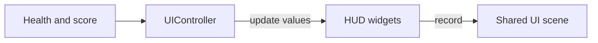

# Create a HUD with TGUI

Add a score label and health bar to the shared TGUI session established in
[Create a UIController](ui-controller.md). The game owns health/score values,
the HUD manages their widgets and layout, and the UI controller owns session
input, time, and scene publication. Menus and chat can share that same session.

Start with First Game or the Character example, then complete the UIController
lesson's module selection and game integration. This lesson replaces First Game's
direct score display. For RML document authoring, use
[Create an interactive GUI with RmlUi](../how-to/create-gui.md).

## Select TGUI

Complete [Select TGUI](ui-controller.md#select-tgui) in the UIController lesson
for the module, dependency, and link setup. The shared controller supplies the
session and upload path used below.

## Give the HUD its own class

Create `hud.h`:

```{literalinclude} ../../../../projects/apps/tutorial-game/src/hud.h
:language: cpp
```

`Hud` borrows a `Session&`. Construct it on the simulation/UI owner after the
session's initial view is set. Its native widget handles share toolkit ownership
with the GUI; the session must remain alive while they are used. The session's
lifetime stays with the UI controller and requires no `shared_ptr<Session>`.

`update(score, health)` receives only the presentation values this component
needs. It formats the score and bounds the health display to `0..100`; game rules
decide when those values change. Widgets inherit the session's configured default
font. [Configure Engine fonts](../../assets/text-layout.md#configure-fonts-once)
before creating the session when a different default is wanted.

Add widgets to the GUI before calling `set_layout()`. The label attaches its
top-left corner to the parent's top-left; the bar attaches its top-right corner
to the parent's top-right. Coordinates are logical UI units with downward-positive
Y. The bindings follow the shared view as it changes. See
[typed layout](../../modules/tgui.md#typed-layout) for proportional sizing and offsets.

## Add the HUD to the UI owner

Extend the initial `ui-controller.h` from the preceding lesson. Include `hud.h`,
retain `std::optional<Hud> hud_` after the session member, and add score/health
values with setters. After creating the session and refreshing its view in
`update()`, construct the HUD once with `hud_.emplace(*session_)`. Update it before
recording the combined scene. During final cleanup, reset `hud_` before closing
the session.

The complete controller is maintained with the tutorial game:

```{literalinclude} ../../../../projects/apps/tutorial-game/src/ui-controller.h
:language: cpp
```

This controller has one passive HUD. It feeds the complete input batch, selects
no pointer delivery, and requests no keyboard focus, so gameplay actions stay
available. Add a menu/chat component beside `hud_`, passing the same session.
Use the shared owner's [focus policy](../../gui/index.md#session-routing-and-widget-focus)
when interactive components need keyboard or pointer input. TGUI permits one
session per process; component ownership fits within that single session.

## Connect game state to the widgets

Game rules supply presentation values; the shared UI owner then records the
updated widgets as part of the whole interface:



Keep the game's `ui_` member and lifecycle calls from the UIController lesson.
Remove First Game's raw `score_` generation, font/layout/upload block, direct text
draw, and generation cleanup. Keep an application score and health value:

```cpp
int points_ = 0;
unsigned int health_ = 100;
```

After quit handling and gameplay updates, set the presentation values before the
existing `ui_->update(tick)` call:

```cpp
if (tick.input.button(next_cell_).pressed() && points_ < std::numeric_limits<int>::max())
    ++points_;
ui_->set_score(points_);
ui_->set_health(health_);
ui_->update(tick);
```

Include `<limits>` for the score bound. In First Game, Space is `next_cell_`;
the completed tutorial game calls its score action `score_`. The maintained
[game implementation](../../../../projects/apps/tutorial-game/src/game.cpp)
shows the complete controller/Character/HUD composition.

## Append the retained UI scene

The game still calls `ui_->append(frame)` after the world pass. One UI scene
contains all attached widgets and supplies its own screen projection, so camera
movement does not move the HUD. The first scene can be empty until upload finishes.
The controller retains the preceding complete scene while a replacement is pending.

### Remove a component during play

When removing a HUD during play, call `hud_->remove()` on simulation, then reset
the component and stop its creation/update branch in the enclosing owner. That
detaches only its widgets and keeps the session available to
menus, chat, and other components. Destroying a component's handles alone does not
detach widgets still owned by the GUI.

## Release and observe

Final teardown follows `ui_->close_after_quiescence()`: simulation has joined,
the controller drops component-held widget references, and session closure releases
the GUI's remaining ownership. This final path does not call live session methods
from the platform thread. The input and graphics dependencies remain alive through
runtime cleanup, including partial initialization.

Expect `Score: 0` at the top-left and a full health bar at the top-right. Space
advances the score; setting `health_` to `25` shows a quarter-full bar. Resize the
window and move the world camera: the widgets should follow their screen corners,
while gameplay keys continue to work. Check both runtime modes for input and cleanup.

The [maintained tutorial game](../../../../projects/apps/tutorial-game/README.md)
implements this shared session and widget component. For interactive widgets, use
the [TGUI demo](../../../../projects/apps/demo/src/tgui-demo.cpp). Continue with
[abstract controller interfaces](abstract-controller.md) when the game needs a
common contract for its concrete controller roles.
