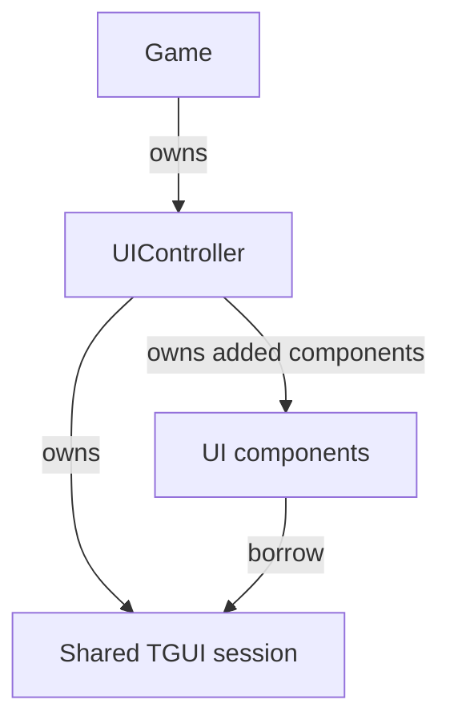

# Create a UIController

Give the game's interface one owner for its TGUI session, input policy, and
retained scene. HUD, menu, and chat components can share that session through
borrowed references. The application defines this `UIController`; game rules
continue to own values such as health and score.

Start with [First Game](../first-game.md), or continue from
[Create a Character](character.md). This lesson establishes the shared lifecycle.
[Create a HUD](hud.md) adds the first visible component.

The enclosing UI owner manages the session's lifetime. Components borrow that
session rather than creating a separate session for each panel:



## Select TGUI

Enable `CHERYL_BUILD_UI_TGUI=ON` in First Game's source configuration, or use an
SDK containing that module. In Project setup's copied CMake project, change its
local `set(CHERYL_BUILD_UI_TGUI OFF)` to `ON` before `add_subdirectory()`; those
{ref}`scoped module selections <source-module-selection>` take precedence over a
same-name command-line cache option. Add the UI link to your executable target:

```cmake
target_link_libraries(game PRIVATE Cheryl::UI::TGUI)
```

Use your target's name in place of `game`. Prepare the pinned toolkit through
[Project setup](../project-setup.md). Enabling the module does not download it.
The uploader obtains compatible default materials from the provider. OpenGL embeds
their shaders, so this example needs no additional shader or material files.

## Assign the execution owners

The session runs widget logic, callbacks, layout, and CPU scene recording on the
simulation owner. The platform owner polls native input, creates/uploads graphics
resources, and renders the retained scene. Keeping callbacks with simulation lets
them update UI intent alongside the game state they observe.

| Game hook | Owner | UI work |
| --- | --- | --- |
| `init()` | Platform, before simulation starts. | Configure fonts and construct the controller's uploader from the live provider. |
| First `update(tick)` | Simulation. | Construct the session, initialize its view, then create widgets. |
| Each `update(tick)` | Simulation. | Refresh changed view dimensions, deliver input, advance toolkit time, update components, and publish available scene replacements. |
| `prepare_render_frame(frame)` | Simulation. | Append the latest complete UI scene after the world pass. |
| `deinit()` | Platform, after simulation joins and accepted work settles. | Release component-held toolkit references, then close the session. |

In sequential mode platform and simulation use the same thread. Concurrent mode
uses a dedicated simulation thread. Creating the session on the first update
works in both modes; constructing it during `init()` would bind it to the platform
thread in concurrent mode. All live session/widget operations use its creating owner.

## Establish the shared session

Create `ui-controller.h` with this initial controller. It has no widgets yet;
keep First Game's existing direct score display until the HUD lesson replaces it.

```cpp
#pragma once

#include <cheryl/core/engine/engine-context.h>
#include <cheryl/core/game-framework/tick-context.h>
#include <cheryl/ui/tgui/scene.h>
#include <cheryl/ui/tgui/session.h>

#include <array>
#include <future>
#include <memory>
#include <optional>

namespace Tutorial {
    class UIController final {
        static constexpr CE::Input::Routing::TargetId tgui_target_ = 2;

        CE::Runtime::Context& engine_;
        CE::Runtime::PlatformDispatcher::Submission platform_;
        CE::UI::TGUI::SceneUploader uploader_;
        CE::UI::TGUI::Scene scene_;
        std::future<CE::UI::TGUI::Scene> pending_;
        std::unique_ptr<CE::UI::TGUI::Session> session_;
        std::optional<std::array<int, 4>> view_;

    public:
        explicit UIController(CE::Runtime::Context& engine)
        : engine_(engine), platform_(engine.platform_dispatcher().submission()), uploader_(engine.resources()) {}

        void update(const CE::Game::TickContext& tick) {
            if (!session_)
                session_ = std::make_unique<CE::UI::TGUI::Session>(engine_, tgui_target_);

            const std::array current_view{
                tick.logical_size.width, tick.logical_size.height,
                tick.framebuffer_size.width, tick.framebuffer_size.height
            };
            if (!view_ || *view_ != current_view) {
                session_->set_view(tick.logical_size, tick.framebuffer_size);
                view_ = current_view;
            }

            session_->handle_input(tick.input.records(), false);
            session_->update_time(tick.delta_seconds);

            static_cast<void>(CE::UI::TGUI::adopt_scene(pending_, scene_));
            if (!pending_.valid())
                pending_ = uploader_.submit(platform_, session_->record());
        }

        void append(CE::Rendering::FrameWriter& frame) const { scene_.write(frame); }

        void close_after_quiescence() {
            if (session_) {
                session_->close_after_quiescence();
                session_.reset();
            }
            scene_ = CE::UI::TGUI::Scene{};
        }
    };
}
```

`tgui_target_` identifies this entire session as a keyboard/text routing recipient.
Any nonzero `TargetId` is suitable; its numeric magnitude gives no priority. Use
distinct identities for independent recipients sharing the input system, such as
TGUI and RmlUi sessions. All menus, chat fields, and HUD widgets in this TGUI
session share its routing identity. TGUI widget focus selects the control within it.
See [session routing and widget focus](../../gui/index.md#session-routing-and-widget-focus).

The view is persistent state. Initialize it once, then refresh it when either
logical or framebuffer dimensions change. The current explicit `set_view()` API
receives copied sizes; this controller detects those changes from the runtime's
paired tick snapshot. Logical sizes drive layout/input coordinates, while pixel
sizes provide framebuffer scaling and drawable state. Checking both handles
resizing and scale changes even when only one pair changes. An unconditional
`set_view()` call each update is also valid; the method is not a time-advance hook.
Keep zero-size changes so minimization can suppress drawing.

The passive example selects no pointer delivery and requests no keyboard focus.
Feed the full input batch once for session bookkeeping, including empty batches.
The tick's input view is borrowed for this update; retain the controller and
session between calls, using each call's fresh tick.

## Connect the controller to the game

Include `ui-controller.h` in the game header and add a member:

```cpp
std::optional<Tutorial::UIController> ui_;
```

During `init()`, after graphics initialization and any font configuration:

```cpp
ui_.emplace(engine_);
```

After quit handling and gameplay changes in `update()`:

```cpp
ui_->update(tick);
```

After world draws in `prepare_render_frame()`:

```cpp
ui_->append(frame);
```

During `deinit()`, after the runtime has joined simulation and settled accepted work:

```cpp
if (ui_)
    ui_->close_after_quiescence();
ui_.reset();
```

The controller retains the latest complete uploaded scene while at most one
replacement is pending. `adopt_scene()` checks readiness without blocking;
failed uploads propagate while the preceding scene remains retained. Keep input,
the provider, and dispatch dependencies alive through runtime cleanup.

## Add interface components

Construct components after the session's initial `set_view()` call, on simulation.
Pass each a `Session&` whose lifetime covers its widgets and callbacks. The
controller drives input/time and records the whole GUI; individual components
update their own presentation. Each component should remove only its own widgets
when retired during play. Release all component-held toolkit references before
final session closure.

The next lesson adds `Hud` to this controller. Menus and chat can use the same
relationship. Keep application choices about visible panels, modal behavior,
pointer selection, and restoring widget focus in the enclosing UI owner. The
session already supplies event capture and routed keyboard/text focus leases.
For complete interactive input handling, follow the
[TGUI demo](../../../../projects/apps/demo/src/tgui-demo.cpp) and
[focus procedure](../../gui/index.md#session-routing-and-widget-focus).

## Observe the lifecycle

At this checkpoint the UI has no widgets, so its scene is empty. Inspect the
session and `view_` in a debugger during updates. The session should be created
once, and `view_` should follow logical/pixel size changes. Run both runtime modes
to exercise the owner boundary. Continue with [Create a HUD](hud.md) for visible
score and health widgets and the completed maintained controller.
