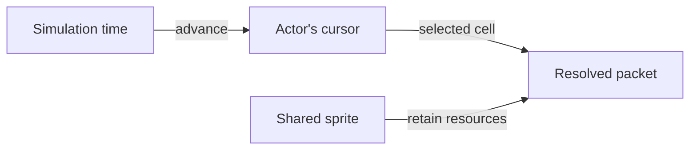

# Play sprite animation

Animation is per-instance simulation state over shared immutable sprite data.
Start from [First Game's sprite walkthrough](../first-game.md#put-a-sprite-on-screen).
Its maintained actor has two cells and deliberately has no timed clip; add a
clip in your application's copied definition before asking the asset for one.

Selecting a sprite selects an **asset and its grid**. A **cell** is one image
region in that grid. A named **clip** supplies an ordered timeline of cells,
durations and looping; an **Animation** is a mutable playback cursor over that
shared clip data. Two cells alone do not imply a timeline or automatic playback.

## Define a clip

Inside the `actor` entry in your copy of `graphics/definitions/sprites.json`, add
an `animations` member beside `grid`:

```json
"animations": {
  "blink": {
    "frames": [
      {"cell": {"index": 0}, "duration_ms": 200},
      {"cell": {"index": 1}, "duration_ms": 200}
    ],
    "loop": true
  }
}
```

This is a member fragment, not a complete manifest; retain the existing version,
namespace, texture, grid and enclosing index. Every cell must fit that grid and
every frame duration must be positive. Load the edited root on initialization.
The [manifest guide](../../assets/asset-manifests.md#animations) describes facing
profiles for more elaborate sheets.

## Create an independent cursor

Add `<chrono>` and retain this member beside First Game's `actor_` member
(`first-game.h` already includes `<optional>`):

```cpp
std::optional<CE::Assets::Sprites::Animation> animation_;
```

After constructing `actor_` in `init_platform()`:

```cpp
animation_.emplace(actor_->sprite->animation("blink"));
```

Missing or ambiguous clips throw. A separately constructed cursor for each
entity has independent progress, even when entities share the same asset.
Do not retrieve a fresh cursor in every update: that restarts playback.

### Choose a default by application convention

`sprite->animation("default")` works when the manifest defines that name, but
`default` has no special SDK meaning. Select it explicitly and retain the returned
cursor. There is no implicit first-clip selection or default-animation metadata.
The shared Invaders definitions use this convention: each two-cell enemy has
2,000 ms per frame, giving a four-second cycle at normal speed. The UFO's clip
has only one cell, so advancing it does not change its appearance.

## Advance only during update

The cursor advances with simulation time. Frame preparation reads its selected
cell and retains the sprite's resources without advancing playback again:



Replace First Game's Space-driven cell-selection block with:

```cpp
animation_->advance(std::chrono::duration<double>(tick.delta_seconds));
actor_->cell = animation_->cell();
```

Use finite nonnegative simulation elapsed time. The example follows runtime's
simulation clock, so animation responds to its selected timing policy. At an
exact boundary the next frame becomes current. Looping clips wrap; nonlooping
clips remain on their last frame. `set_frame()` selects a normalized frame and
resets time within it when explicit restart/scrubbing is needed.

### Change playback speed

Replace the unscaled `advance()` call above with this expression. Here `speed`
is an application-owned finite, nonnegative multiplier, initially `1.0`:

```cpp
animation_->advance(std::chrono::duration<double>{tick.delta_seconds * speed});
```

`std::chrono::duration<double>` stores seconds by default: braces convert the
tick's `double` seconds into the duration that `advance()` expects. With a
two-second manifest frame, speed `1` changes cells every two simulation seconds;
speed `2` changes them every second; speed `0` freezes this cursor. Ensure the
product also stays finite. Keep manifest durations positive. Multiplying elapsed
time speeds playback up; multiplying the frame interval would slow it down.

Advance each cursor once per update, then read its cell during frame preparation.
For enemies that must march in phase, let the formation own one cursor per clip
and share its selected cell, rather than starting independent clocks on spawn.
Apply speed only to the systems the game intends to accelerate; respawn, UI and
explosion timers can follow separate policies.

## Publish and release

Keep First Game's
`resolve_sprite(*actor_->sprite, actor_->cell, image_style, context)` submission.
Frame preparation copies the selected cell without advancing animation. This
keeps playback correct even when concurrent rendering skips a visual snapshot.
Add `animation_.reset()` before `actor_.reset()` in
`deinit_platform()`, retaining the game's partial-safe cleanup. Each additional animated
actor needs its own cursor, even when their sprite handles are shared.

The actor should alternate its two cells every 200 milliseconds. Two instances
created at different times should keep independent phases. A nonlooping copy
should stop at its final cell. These observations check the teaching result;
they do not replace the engine's existing regression coverage.

Read [sprite playback contracts](../../assets/asset-values-and-playback.md#sprite-playback)
and the [animation interface](../../../../projects/engine/include/cheryl/assets/types/2d/sprite.h)
for cursor ownership, facing lookup and invalid-time behavior. Tileset animation
uses a different interface; do not assume every sprite operation applies to it.
