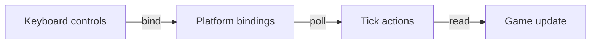

# Bind input actions

Bind physical controls once during initialization, then let game updates read
semantic actions. This task uses the Native GLFW input implementation selected
by [First Game](../first-game.md). The result is a movement/quit mapping whose
game logic does not depend on upstream device-library constants.
Use the direct path below for game-wide actions. The
[context path](#reuse-bindings-for-runtime-consumers) supports reusable controllers
whose lifetimes begin or end during play.



## Choose action and registration storage

First Game already declares these members, with `<array>` and the input headers:

```cpp
static constexpr CE::Input::Actions::Id quit_{1};
static constexpr CE::Input::Actions::Id left_{2};
static constexpr CE::Input::Actions::Id right_{3};
static constexpr CE::Input::Actions::Id next_cell_{4};
std::array<CE::Input::Actions::BindingId, 4> bindings_{};
```

An action ID identifies game meaning. A binding ID identifies one registration
for later removal; they are not interchangeable. Keep the action IDs distinct
within the direct binding namespace. Separate action contexts can reuse those
same IDs independently.

Find physical controls in the [control guide](../../runtime/input-state-model.md#control-identities-and-binding-tokens):
{cpp:enum}`CE::Input::KeyboardKey`, {cpp:enum}`CE::Input::MouseButton` and
{cpp:enum}`CE::Input::GamepadControl` are Engine enums accepted directly by
bindings. Pointer axes, scroll axes and wheel-button pulses live under
`CE::Input::MouseControl`. The guide lists their headers and how to pair each
family with its device ID.

## Register on the platform owner

Include `<cheryl/core/controls/input-interface.h>` and
`<cheryl/core/controls/button-codes.h>`, and link the selected
[Native GLFW target](../../modules/native-glfw.md) with native input enabled.
Its `init_platform()` registers these mappings after runtime initializes the input adapter:

```cpp
auto& input = engine_.input();
auto& bindings = input.bindings();
const auto keyboard = input.keyboard_id();
bindings_[0] = bindings.bind_button({keyboard, CE::Input::KeyboardKey::Escape}, quit_);
bindings_[1] = bindings.bind_button({keyboard, CE::Input::KeyboardKey::Left}, left_);
bindings_[2] = bindings.bind_button({keyboard, CE::Input::KeyboardKey::Right}, right_);
bindings_[3] = bindings.bind_button({keyboard, CE::Input::KeyboardKey::Space}, next_cell_);
```

`CE::Input::Control` converts the enum when the binding is registered. The
adapter normalizes native observations to the same Engine control IDs. Obtain
device IDs from `input`; the standard bindings require no numeric casts or
adapter-specific translation. `Unknown` is not bindable, and a named gamepad
control is reported only when the selected backend/device supports it.

## Read the tick during update

First Game checks quit and derives horizontal movement from the direct actions:

```cpp
if (tick.input.button(quit_).pressed()) {
    tick.request_stop();
    return;
}
const float direction = (tick.input.button(right_).held() ? 1.0f : 0.0f)
                      - (tick.input.button(left_).held() ? 1.0f : 0.0f);
```

Use that direction in its existing `actor_->position.x` movement calculation,
which applies speed, simulation time and framebuffer bounds. The separate
`next_cell_` action changes the actor's selected image cell.

`pressed()` reports an edge in the consumed observations; `held()` reports the
current semantic state. Runtime chooses the simulation delta independently of
poll count. For movement proportional to measured down-time within an interval,
use the documented `tick.button_simulation_seconds(action)` policy instead.

Direct bindings remain platform-owned even in concurrent runtime mode. Do not
mutate `input.bindings()` from `update()`. Use the retained context endpoint below
for runtime consumer attachment/removal, or submit other direct binding work to
platform. The tick view is borrowed for that hook.

## Remove registrations during cleanup

In `deinit_platform()`, tolerate a partially completed initialization:

```cpp
for (auto& binding : bindings_) {
    if (binding != 0) {
        static_cast<void>(engine_.input().bindings().unbind(binding));
        binding = 0;
    }
}
```

Only remove your own registrations. Runtime keeps input/window dependencies
alive through game cleanup, then detaches callbacks before destroying the window.

## Check the direct bindings

Left/right should move the actor and Escape should request ordinary runtime
shutdown. With both directions held the example cancels movement. This completes
the game-wide binding path; keep these registrations when their lifetime matches
the game. Continue below when a player or other consumer must join or leave
during play.

## Reuse bindings for runtime consumers

Instead of registering direct movement actions, attach a definition for each
consumer. Omit the direct left/right registrations while keeping First Game's
quit and Space bindings. Include
`<cheryl/core/controls/action-context.h>` and `<optional>` and add these members:

```cpp
CE::Input::DeviceId keyboard_ = 0;
std::optional<CE::Input::Actions::ContextSubmission> context_requests_;
std::optional<CE::Input::Actions::Context> first_controls_;
std::optional<CE::Input::Actions::Context> second_controls_;
```

Define this game helper using the same local `left_`/`right_` IDs declared above:

```cpp
static CE::Input::Actions::ContextDefinition movement(
    CE::Input::DeviceId device, CE::Input::KeyboardKey left, CE::Input::KeyboardKey right
) {
    CE::Input::Actions::ContextDefinition definition;
    definition.buttons.push_back({CE::Input::Actions::Chord{{{device, left}}}, left_});
    definition.buttons.push_back({CE::Input::Actions::Chord{{{device, right}}}, right_});
    return definition;
}
```

During platform-owned `init_platform()`, save the device identity and request endpoint,
then attach the first consumer:

```cpp
keyboard_ = engine_.input().keyboard_id();
context_requests_.emplace(engine_.input().action_contexts());
first_controls_.emplace(context_requests_->attach(movement(
    keyboard_, CE::Input::KeyboardKey::Left, CE::Input::KeyboardKey::Right)));
```

During simulation update, an application join/leave decision may change the second
consumer without native input access:

```cpp
if (join_requested && !second_controls_)
    second_controls_.emplace(context_requests_->attach(movement(
        keyboard_, CE::Input::KeyboardKey::J, CE::Input::KeyboardKey::L)));
if (leave_requested)
    second_controls_.reset();
```

Here `join_requested` and `leave_requested` are application-owned decisions, for
example from direct join/leave actions. Do not query `keyboard_id()` from this
simulation code; use the identity saved during initialization. Definitions are
owned values and an accepted attachment/removal takes effect at the next poll.

Read each consumer's own namespace during update. For the first actor, replace
the direct `direction` calculation with:

```cpp
const auto first = tick.input.actions(*first_controls_);
const float direction = (first.button(right_).held() ? 1.0f : 0.0f)
                      - (first.button(left_).held() ? 1.0f : 0.0f);
```

The second consumer queries `tick.input.actions(*second_controls_)` when present.
Both use the same local IDs while their states remain independent. The view
borrows the current tick; do not store it across updates. Reset both optional
contexts and the endpoint during game cleanup; context destruction requests its
own removal and needs no list of individual binding IDs.

The [Controller tutorial](../create-a/controller.md) packages the definition,
lease and command translation into a reusable class. The
[context contract](../../runtime/input-state-model.md#action-contexts) covers held
keys on attachment, delayed removal, failure and retained historical views.

With two consumer contexts, arrows should affect only the first actor and J/L
only the second. Removing the second context must leave the first working.
While an exclusive keyboard-focused editor is active, keyboard gameplay actions are
intentionally gated; mouse/controller alternatives are a separate policy.

Read [input contracts](../../runtime/input-state-model.md),
[capture and focus](../../runtime/input-state-model.md#focus-routing-and-editing-controls)
and [GUI routing](create-gui.md). Text input must use committed text records;
do not reconstruct characters from bound key actions.
