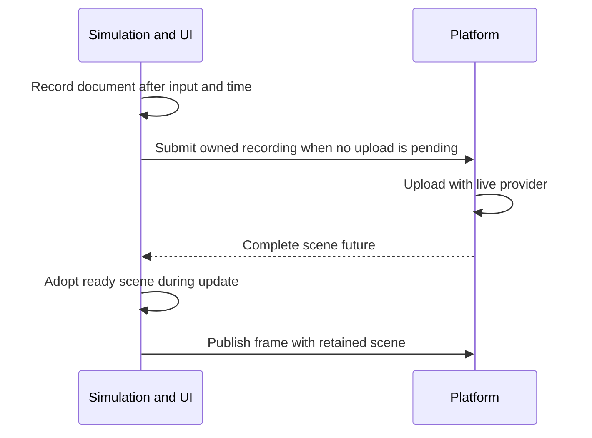

# Create an interactive GUI with RmlUi

Add a styled RML document with an editable player name and an Apply button.
Connect its event listener to game state, route keyboard/pointer input, and
publish a retained UI scene. Start with [First Game](../first-game.md).
For the C++ widget approach, [Create a HUD with TGUI](../create-a/hud.md)
uses the other UI integration.

## Select the module and prepare assets

Enable `CHERYL_BUILD_UI_RMLUI=ON` in your source configuration, or consume an
SDK containing that module. Add it to the game's existing target links:

```cmake
target_link_libraries(game PRIVATE Cheryl::UI::RmlUi)
```

Use your executable's target name in place of `game`. Prepare the pinned
dependency through [Project setup](../project-setup.md). TGUI is optional for
this guide; a game using the TGUI HUD can select both modules.

In Project setup's copied source project, change the local
`set(CHERYL_BUILD_UI_RMLUI OFF)` to `ON` before `add_subdirectory()`. The template's
{ref}`scoped module selections <source-module-selection>` take
precedence over a same-name command-line `-D` cache option.

Add these files under First Game's asset root:

```text
assets/
└── graphics/
    └── ui/
        ├── tutorial.rml
        └── tutorial.rcss
```

The session inherits the Engine font default, including its embedded safety font.
Configure application fonts once through the [font service](../../text/index.md)
when a different default is wanted. The uploader obtains compatible rendering
materials automatically. OpenGL embeds their shaders in the library, so this
interface needs no additional shader files.

The existing First Game assets are still used. RmlUi loads its documents and
styles explicitly, outside the graphics manifest loader.

## Author the document and stylesheet

Create `graphics/ui/tutorial.rml`:

```xml
<rml>
<head>
    <title>Player settings</title>
    <link type="text/rcss" href="tutorial.rcss" />
</head>
<body>
    <div id="panel">
        <h1>Player settings</h1>
        <div>Player name</div>
        <input id="name" type="text" />
        <button id="apply">Apply</button>
    </div>
</body>
</rml>
```

Create `graphics/ui/tutorial.rcss`:

```css
body {
    width: 100%; height: 100%; margin: 0;
    font-size: 18px; color: #edf2fa;
}
#panel {
    position: absolute; left: 16px; top: 16px;
    width: 65%; min-width: 280px; max-width: 420px;
    height: 200px; box-sizing: border-box; padding: 16px;
    background-color: #26394be8; overflow: hidden;
}
h1 { font-size: 24px; margin: 0 0 12px; }
input {
    display: block; width: 100%; height: 32px;
    box-sizing: border-box; padding: 6px; margin: 4px 0 12px;
    background-color: #edf2fa; color: #172532;
}
button {
    display: inline-block; padding: 7px 12px;
    background-color: #477989; color: #ffffff;
}
button:hover { background-color: #5b92a0; }
button:active { background-color: #365b6b; }
```

RML supplies native elements; RCSS supplies their layout and appearance. The
stylesheet path resolves relative to the document. Omitting `font-family` inherits
the Engine default. A registered family can be selected in RCSS or through
`session.set_font(element, selected_font)`; see the [RmlUi font contract](../../modules/rmlui.md#fonts).
UI coordinates use logical window
units with a downward-positive Y axis; the adapter handles framebuffer scaling.
The panel follows the window within its width bounds.

This example uses rectangular drawing and clipping. Check the
[RmlUi capability contract](../../modules/rmlui.md#recording-and-publication)
before adding transforms, masks or effects.

## Include the UI interfaces

Add these includes to the appropriate game header/source files:

```cpp
#include <cheryl/core/controls/button-codes.h>
#include <cheryl/core/engine/engine-context.h>
#include <cheryl/core/game-framework/tick-context.h>
#include <cheryl/ui/rmlui/scene.h>
#include <cheryl/ui/rmlui/session.h>

#include <RmlUi/Core/ElementDocument.h>
#include <RmlUi/Core/Elements/ElementFormControlInput.h>
#include <RmlUi/Core/EventListener.h>

#include <filesystem>
#include <future>
#include <memory>
#include <optional>
#include <stdexcept>
#include <string>
#include <utility>
#include <variant>
```

## Retain application state and an event listener

Define this small listener before the game class in its header. It records an
intent for the update hook to consume:

```cpp
class ApplyListener final : public Rml::EventListener {
    bool& requested_;

public:
    explicit ApplyListener(bool& requested) : requested_(requested) {}
    void ProcessEvent(Rml::Event&) override { requested_ = true; }
};
```

Add these game members after First Game's `engine_` and `asset_root_` members:

```cpp
CE::Runtime::PlatformDispatcher::Submission ui_platform_{engine_.platform_dispatcher().submission()};
std::optional<CE::UI::RmlUi::SceneUploader> ui_uploader_;
CE::UI::RmlUi::Scene ui_scene_;
std::future<CE::UI::RmlUi::Scene> ui_pending_;
std::unique_ptr<CE::UI::RmlUi::Session> ui_;
Rml::ElementDocument* document_ = nullptr;
Rml::Element* apply_button_ = nullptr;
Rml::ElementFormControlInput* field_ = nullptr;
std::string player_name_;
bool apply_requested_ = false;
bool ignore_quit_until_release_ = false;
std::unique_ptr<ApplyListener> apply_listener_;
```

The session owns the document and elements. Their pointers are borrowed aliases;
the application owns the listener and detaches it before closing the session.
Keep native objects after the session in member declaration order.

During platform-owned `init()`, after graphics initialization:

```cpp
ui_uploader_.emplace(engine_.resources());
```

The uploader belongs to the resource provider's platform owner. Upload work
uses owned recordings and creates defaults lazily on that platform owner; live
document operations stay on the UI owner.

## Load the document on the first update

Create the session on the owner that will update its UI. In concurrent mode
that is simulation, so run this block in `update()` after quit handling:

```cpp
if (!ui_) {
    constexpr CE::Input::Routing::TargetId rmlui_target = 7;
    ui_ = std::make_unique<CE::UI::RmlUi::Session>(engine_, rmlui_target);
    ui_->set_view(tick.logical_size, tick.framebuffer_size);
    const auto source = (asset_root_ / "graphics/ui/tutorial.rml").u8string();
    document_ = ui_->context().LoadDocument(Rml::String(source.begin(), source.end()));
    if (!document_)
        throw std::runtime_error("Cannot load the UI document");
    apply_button_ = document_->GetElementById("apply");
    field_ = dynamic_cast<Rml::ElementFormControlInput*>(document_->GetElementById("name"));
    if (!apply_button_ || !field_)
        throw std::runtime_error("The UI document requires an Apply button and a text input");
    apply_listener_ = std::make_unique<ApplyListener>(apply_requested_);
    apply_button_->AddEventListener("click", apply_listener_.get());
    document_->Show(Rml::ModalFlag::None, Rml::FocusFlag::None);
    ui_->request_keyboard_focus();
    if (!field_->Focus()) {
        ui_->release_keyboard_focus();
        throw std::runtime_error("Cannot focus the UI field");
    }
} else
    ui_->set_view(tick.logical_size, tick.framebuffer_size);
```

`rmlui_target` identifies the whole session as an Engine keyboard/text recipient.
Its nonzero numeric value has no priority. Choose distinct targets for independent
recipients sharing the input system, such as TGUI and RmlUi sessions. Documents
and fields within this session share its target and use native element focus.
See [session routing and widget focus](../../gui/index.md#session-routing-and-widget-focus).
RmlUi permits one session owning Core's process globals; add more documents to that
session when extending the interface.

This example refreshes the copied view each update. The view persists, so calling
`set_view()` initially and whenever either logical or framebuffer dimensions change
is sufficient. Keep zero-size and scale changes as well as ordinary window resizing.

The session imports the configured Engine fonts and retains their bytes through
Core shutdown. Showing a document,
focusing its field and acquiring routed keyboard focus are distinct operations.
Routing requests affect later platform polls; already captured text keeps its
original target and epoch.

## Feed records and control focus

At the beginning of `update()`, replace First Game's quit check with:

```cpp
if (tick.input.button(quit_).pressed() && !ignore_quit_until_release_) {
    tick.request_stop();
    return;
}
```

After creating/updating the session, feed the complete ordered record batch:

```cpp
ui_->handle_input(tick.input.records(), true, [&](const CE::Input::Events::Record& record) {
    const auto* button = std::get_if<CE::Input::Events::Button>(&record.data);
    if (button && record.device_kind == CE::Input::DeviceKind::Keyboard) {
        if (button->key == CE::Input::KeyboardKey::Escape) {
            if (button->phase == CE::Input::Events::ButtonPhase::Press && ui_->owns_keyboard_focus()) {
                ignore_quit_until_release_ = true;
                ui_->release_keyboard_focus();
            } else if (button->phase == CE::Input::Events::ButtonPhase::Release)
                ignore_quit_until_release_ = false;
        } else if (button->key == CE::Input::KeyboardKey::F2 &&
                   button->phase == CE::Input::Events::ButtonPhase::Press) {
            ui_->request_keyboard_focus();
            if (!field_->Focus(true)) {
                ui_->release_keyboard_focus();
                throw std::runtime_error("Cannot focus the UI field");
            }
        }
    }
    return true;
});
ui_->update_time(tick.delta_seconds);
if (std::exchange(apply_requested_, false)) {
    player_name_ = field_->GetValue();
    field_->SetValue("Applied");
}
```

The listener runs on this UI owner. Apply copies the edited value into
game-owned `player_name_`; changing the field to `Applied` confirms the action.
Application text should go through native text/value setters. `SetInnerRML()`
parses markup, so escape user text before inserting it as RML.

The `true` values explicitly select pointer delivery for this visible interface.
A game must choose hit testing and gameplay pointer ownership separately;
keyboard focus does not gate mouse gameplay. Feed the whole batch once,
including releases used for modifier tracking.

Escape releases editing and F2 restores it. While exclusive focus is active,
First Game's keyboard movement and quit actions are gated. Ending focus can
resume a held key as a semantic press, so the quit check stays before record
handling and its guard remains set through the releasing Escape's physical key
release. A later Escape press can quit. The session keeps the entry epoch for
the entire batch; the callback does not relabel existing records.

## Upload without queue growth and publish

The application retains the previous complete scene while one replacement is
pending. Only the owned recording crosses from the live UI to graphics:



At the end of update:

```cpp
static_cast<void>(CE::UI::RmlUi::adopt_scene(ui_pending_, ui_scene_));
if (!ui_pending_.valid())
    ui_pending_ = ui_uploader_->submit(ui_platform_, ui_->record());
```

Adoption does not wait on pending work. Keep the previous complete scene while
one replacement waits; only owned recording data crosses to graphics.
Ready upload errors propagate here through runtime's normal failure cleanup.
The maintained demo instead catches them to report the error and keep its last
complete scene.

The defaults preserve RmlUi's premultiplied alpha convention. To use custom
shaders, load compatible materials from JSON and pass their handles through the
optional [`Materials` override](../../rendering/pipelines-and-materials.md#custom-ui-materials).

After your world/HUD passes in `prepare_render_frame()`:

```cpp
ui_scene_.write(frame);
```

This appends retained draw packets using the scene's screen projection. The
first scene can be empty until upload completes. Later document edits cannot
alter resources already retained by an earlier published frame.

## Connect the hooks

The integration uses these hook positions; keep the existing game hooks and
insert each fragment into them:

| Hook | Order |
| --- | --- |
| `init()` on platform | Keep graphics/asset initialization; construct `ui_uploader_` afterward. |
| `update()` on simulation | Check guarded quit; create or resize the session; feed the full input batch; advance toolkit time and apply listener intent; run the game's remaining updates; adopt/upload a scene last. |
| `prepare_render_frame()` on simulation | Keep the world/HUD draws, then call `ui_scene_.write(frame)`. |
| `deinit()` on platform | Detach the listener and close the session as below, then finish the game's other cleanup. |

## Close after UI quiescence

In `deinit()`, after simulation has joined and accepted dependencies have settled:

```cpp
if (apply_button_ && apply_listener_)
    apply_button_->RemoveEventListener("click", apply_listener_.get());
apply_listener_.reset();
apply_button_ = nullptr;
field_ = nullptr;
document_ = nullptr;
if (ui_) {
    ui_->close_after_quiescence();
    ui_.reset();
}
ui_scene_ = CE::UI::RmlUi::Scene{};
ui_uploader_.reset();
```

Keep the game's other partial-safe cleanup. The listener must detach and die
while Core is still alive. Drop application-held document/element/resource
references before session closure; the session releases its documents. Retained
Cheryl scenes can outlive the toolkit while their graphics domain remains live.

Expect a styled panel with a focused field. Type a name and click Apply; the
game value should receive that name and the field should show `Applied`.
Check arrows, Backspace, Escape releasing editing, F2 restoring it, and a later
Escape quitting gameplay. Resize the window and check both runtime modes.
Clipboard, cursor and IME services retain the reported capability limits.

The [maintained RmlUi demo](../../../../projects/apps/demo/src/rmlui-demo.cpp)
demonstrates native document loading, listeners, hit testing and recoverable
uploads; it uses [its own RML document](../../../../assets/graphics/ui/demo.rml).
The `tutorial-game` executable uses the TGUI HUD and does not implement this
RmlUi example. Read [RmlUi contracts](../../modules/rmlui.md),
[GUI construction](../../gui/index.md) and
[focus routing](../../runtime/input-state-model.md#focus-routing-and-editing-controls)
for the underlying boundaries.
