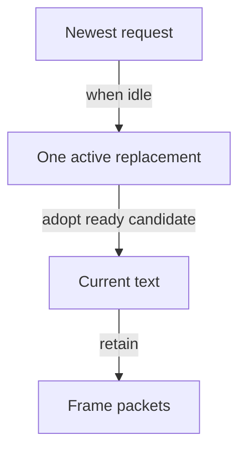

# Display and update text

Extend [First Game's text walkthrough](../first-game.md#put-text-on-screen)
with a score that changes during play. `CE::Text::Rendering::Updater` retains the
last complete text while preparing its replacement on a tracked CPU worker and
uploading through the platform dispatcher. The application supplies content and
layout; the updater manages pending work and adoption.

## Retain an updater

Include `<cheryl/text/text-updater.h>`, `<format>` and `<limits>`.
Replace First Game's `score_` generation member with:

```cpp
std::optional<CE::Text::Rendering::Updater> score_;
int points_ = 0;
```

During platform-owned `init()`, replace its font/layout/upload block with:

```cpp
score_.emplace(engine_, CE::Text::Rendering::Request{
    .text = "Score: 0",
    .layout = {.pixel_height = 24},
});
```

This constructor uploads the initial generation synchronously, so `current()`
is available immediately. It captures the engine's configured default font;
no application font file or material setup is required. Configure fonts before
constructing consumers. Set `Request::font` to a retained registered font when
this label needs an override.

The optional remains empty if construction fails. The constructor uses the
context's tracked worker group and saved platform endpoint; the game needs no
dispatcher member, future, or worker-management code.

## Supply the desired content

The updater keeps one active replacement and only the newest desired request.
The current complete text stays available while that replacement is prepared:



After First Game's gameplay updates, let Space also increment the score:

```cpp
if (tick.input.button(next_cell_).pressed() && points_ < std::numeric_limits<int>::max())
    ++points_;
score_->request({
    .text = std::format("Score: {}", points_),
    .layout = {.pixel_height = 24},
});
score_->update();
```

`request()` owns the string, font, layout/raster options and optional material.
Repeating the same request submits no work. `update()` advances completed stages
without waiting; call it each simulation update even when the score is unchanged.
It returns whether a replacement was adopted.

At most one replacement is active and one newest desired request is retained.
If `10` is uploading while requests advance through `11` to `12`, the updater
adopts `10`, then prepares `12`. It keeps drawing the previous complete result
through preparation and upload. For longer content, set `layout.maximum_width`
to the available local width and submit the changed width when the view resizes.

## Choose a failure policy

An asynchronous preparation or upload failure leaves `current()` unchanged.
`failure()` exposes its stage, exception and request revision. Report an event
once using that revision if your game continues running. A failure can belong to
an older active request while a newer desired request proceeds.

An unchanged failed request is not retried automatically. After correcting a
transient problem, call:

```cpp
score_->retry();
```

Then continue calling `update()`. A distinct request proceeds normally. Call
`retry()` in response to your application's retry decision, rather than on every
update. To use the runtime's normal stop-and-cleanup policy instead, rethrow a
reported failure with `std::rethrow_exception(failure->error)`.

## Publish in screen coordinates and release

Replace First Game's text submission with:

```cpp
CE::Rendering::DrawStyle2D style;
style.model_matrix =
    glm::translate(glm::mat4(1.0f), glm::vec3(24.0f, static_cast<float>(camera_.framebuffer_size().height) - 48.0f, 0.0f));
pass.add(CE::Rendering::Submission::resolve_text(*score_->current(), style, context));
```

Here `context` is the pass's `Context2D`, which inserts atlas images automatically,
as in [First Game's pass setup](../first-game.md#understand-what-a-draw-needs).
The generation retains its compatible material. Published frames retain their
resources when the updater adopts a new generation.

For a scrolling world, use
[First Game's separate screen pass](../first-game.md#keep-text-in-screen-coordinates)
instead of sharing the world camera. During `deinit()`, after runtime has settled
accepted work and recycled frames:

```cpp
score_.reset();
```

The updater never makes a worker wait for graphics, and its jobs own their
request data rather than borrowing the game. Keep graphics dependencies alive
through cleanup. An updater constructed without an initial request starts with
an empty `current()`; check that handle before drawing until the first result
is adopted.

The score should start at zero, remain visible during replacement, and keep its
screen placement during resizing and world movement. Check both runtime modes.
The [maintained demo](../../../../projects/apps/demo/src/demo-game.cpp) uses this
updater for its changing direct-text HUD.

[Create a HUD with TGUI](../create-a/hud.md) builds score and health widgets;
[the RmlUi GUI guide](create-gui.md) covers documents and interactive editing.
Read [the updater contract](../../assets/text-layout.md#retained-text-updates),
[Unicode layout](../../assets/text-layout.md),
[encoding/source indices](../../assets/text-encoding.md) and
[resource publication](../../resources/resource-residency.md) for detailed limits.
