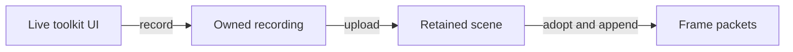

(gui-construction)=
# GUI

Cheryl integrates existing UI toolkits with its ordered input and retained
rendering contracts. The application owns the session and interface objects;
the toolkit supplies widgets or documents. A text score drawn directly through
the rendering system is useful HUD content, but interactive UI also needs
widget construction, input routing, focus and a publication path.

```{toctree}
:hidden:
:maxdepth: 1
:titlesonly:

Create an interactive GUI with RmlUi <../getting-started/how-to/create-gui>
TGUI reference <../modules/tgui>
RmlUi reference <../modules/rmlui>
```

## Choose an interface

| Integration | Application authors | Guide |
| --- | --- | --- |
| TGUI | Native C++ widgets and layouts through the session's `gui()` object. | [Create a UIController](../getting-started/create-a/ui-controller.md), then [a HUD](../getting-started/create-a/hud.md); [TGUI contracts](../modules/tgui.md) |
| RmlUi | Native contexts, RML documents and RCSS styles through a document session. | [Create an interactive GUI](../getting-started/how-to/create-gui.md); [RmlUi contracts](../modules/rmlui.md) |

Neither integration provides a common widget API. Select one according to the
application's authoring needs. Both convert ordered Engine input and publish
retained scenes; Engine headers do not import either toolkit.

## Construct widgets on the UI owner

Create the session before toolkit objects, on the thread that will own its UI
updates. In concurrent runtime mode that is the simulation thread, so create it
on the first update rather than during platform-owned game initialization.
Construct the scene uploader from the resource provider during platform-owned
`init()`. It obtains default rendering materials automatically during upload.

The session executes widget logic, callbacks, layout, and CPU recording. Native
event polling, graphics uploads, and scene playback remain on platform. The
[UIController tutorial](../getting-started/create-a/ui-controller.md#assign-the-execution-owners)
shows that division across initialization, updates, frame preparation, and cleanup.
Components such as HUD, menu, and chat borrow the enclosing owner's session;
the owner drives shared input/time and publishes their combined scene.

Construct either session with the Engine context and a distinct nonzero focus
target, for example `CE::UI::TGUI::Session(engine, tgui_target)`, with a named
`constexpr CE::Input::Routing::TargetId tgui_target = 2;`. It obtains input and the
configured Engine font catalogue/default. Configure `engine.fonts()` before
creating consumers; no separate toolkit font-file registration is needed for the
default interface. A native button and edit field are ordinary toolkit objects:

```cpp
auto button = tgui::Button::create("Apply");
button->setSize({120, 32});
button->setPosition({16, 16});
button->onPress([this] { apply_requested_ = true; });
session_->gui().add(button);

auto field = tgui::EditBox::create();
field->setSize({240, 32});
field->setPosition({16, 60});
field->setDefaultText("Type a name");
session_->gui().add(field);
```

This fragment belongs to an application class retaining `session_` and the
callback's target state. Include the toolkit's Button/EditBox headers and link
the selected UI target. It creates an interactive interface; upload/publication
is still required before it appears on screen. The maintained
[TGUI demo](../../../projects/apps/demo/src/tgui-demo.cpp) supplies the complete
widget and scene wiring.

## Select fonts

The context default inherits through native containers/documents and individual
elements can choose a different family. Both adapters accept the same retained
`CE::Text::Font` handle used by direct text:

```cpp
auto selected = engine.fonts().choose_random("books");
// TGUI:
tgui_session.set_font(book_label, selected);
// RmlUi:
rmlui_session.set_font(*book_element, selected);
```

This uses the `books` group from [catalogue configuration](../assets/text-layout.md#configure-fonts-once);
configure it before creating the sessions. An unknown group returns the default,
so matching the configured name matters even if text still appears.
Choose during application initialization/restoration, then save
`selected.reference()` in the shared book data. Rendering reuses the handle and
does not reroll. The [font service](../text/index.md) owns lookup, restoration and
fallback; native widget/document styles still own size, color, weight and italics.
The [TGUI font contract](../modules/tgui.md#fonts) and
[RmlUi font contract](../modules/rmlui.md#fonts) describe toolkit-specific style
and naming constraints. Standalone sessions and explicit native loading remain
available.

## Route input and focus explicitly

Initialize the session's view from `tick.logical_size` and `tick.framebuffer_size`,
then refresh it when either pair changes. The view persists; calling `set_view()`
every update is a convenience, and the [UIController example](../getting-started/create-a/ui-controller.md#establish-the-shared-session)
shows change detection using the copied dimensions. Keep logical and framebuffer
changes, including zero extents, so layout, input mapping, scale, and drawable
state remain current. Do not read the live window on simulation. Feed the
complete `tick.input.records()` batch once, with an explicit decision about
which UI receives pointer input. Do not prefilter away modifier releases.

Use the enclosing UI owner's policy to request or release the session's keyboard
focus. Exclusive focus withholds keyboard gameplay actions while text is directed
to the UI; pointer selection is a separate application choice. Requests affect later
polls, so pending records retain the focus epoch under which they were captured.
Session `before_record` callbacks support ordered application controls without
rewriting that entry epoch.

Ending exclusive focus resumes currently held keyboard controls on the next poll.
If Escape both releases an editor and quits gameplay, suppress that release gesture
until its physical key release has been processed. The [GUI task](../getting-started/how-to/create-gui.md#feed-records-and-control-focus)
shows the application guard.

Advance toolkit time, apply game-state changes on the UI owner, then record the
scene. A widget callback may update simulation-owned intent such as
`apply_requested_`; graphics operations belong to the platform owner. Do not run
a toolkit's independent main loop over Cheryl's runtime.

## Session routing and widget focus

The constructor's `target` is an application-chosen identity for the whole session.
Any nonzero `TargetId` is suitable, and larger values have no priority. For example,
TGUI can use `2` and RmlUi `3` when both share one input system. The latest focus
publication wins; records retain the target and request epoch of their input poll.
Each session filters keyboard/text delivery to its own requested target/epoch.

Within one TGUI session, HUD, menu, and chat share that target. Native widget focus
selects which control receives keyboard/text. The application decides which panels
are visible or modal and which widget regains focus when a panel closes.

Using the field and button from the construction example, the following blocks
illustrate separate UI actions. When entering a field, acquire session focus if
needed, then focus the native widget:

```cpp
if (!session_->owns_keyboard_focus())
    session_->request_keyboard_focus();
field->setFocused(true);
```

When moving from a chat field to a menu control within the same session, retain
the session's focus lease and select the new widget:

```cpp
button->setFocused(true);
```

Closing the menu can restore `field->setFocused(true)` if chat remains active.
When the whole TGUI interface relinquishes keyboard input to gameplay:

```cpp
session_->release_keyboard_focus();
```

Release also unfocuses the session's widgets. A component closing while another
needs input should transfer widget focus through the enclosing UI policy. Native
RmlUi element focus uses the same two-level relationship with its session lease.
Pointer delivery remains an independent decision passed to `handle_input()`.
The [TGUI demo](../../../projects/apps/demo/src/tgui-demo.cpp) and
[RmlUi task](../getting-started/how-to/create-gui.md#feed-records-and-control-focus)
show ordered application controls and complete input-batch handling.

## Publish and clean up

Each toolkit adapter follows these publication roles while keeping its own
session and authoring API. Live widget or document objects stay with the UI owner.



Recording creates owned CPU scene data. Send upload work to the platform through
its dispatcher, consume completed results without blocking simulation, and
append the latest uploaded scene to a prepared frame. Both integrations support
`uploader.submit(platform, session.record())`; their default materials are created
lazily on the provider owner. OpenGL embeds the shaders, so the UI needs no
application material builder or additional shader assets. The optional third
argument accepts [custom material handles](../rendering/pipelines-and-materials.md#custom-ui-materials).
Each frame retains its published resources; later UI edits must not mutate an
earlier frame's data.

After simulation joins, release application-held widget, document, font and
texture references before session teardown. `close_after_quiescence()` permits
final closure on platform after the UI owner has stopped. Keep input and upload
dependencies alive until accepted work settles. Do not destroy the toolkit while
callbacks or UI operations can still run.

## Continue

Use [the UIController tutorial](../getting-started/create-a/ui-controller.md) for
shared session ownership, [the HUD tutorial](../getting-started/create-a/hud.md)
for a widget component, [the RmlUi GUI task](../getting-started/how-to/create-gui.md) for document
authoring and editing, [GUI system relationships](../engine-systems/gui.md) for
ownership,
and [input focus contracts](../runtime/input-state-model.md#focus-routing-and-editing-controls)
for routing detail. Clipboard, cursor, composition and other services depend on
reported integration capabilities; a text field does not imply a complete IME
or editor service. See [UI adapter authoring](../development/ui-adapters.md) when
implementing a different toolkit bridge.
