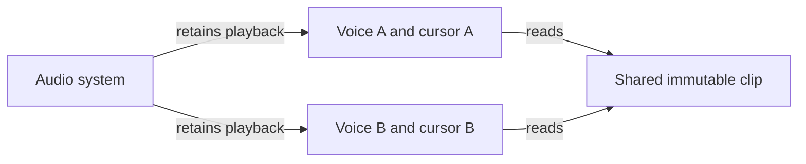
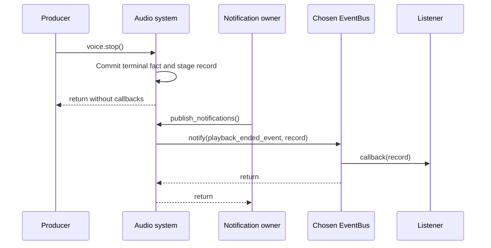

# Audio ownership and playback

Use this reference to manage independent playback, voice controls and output
shutdown. For a first sound, follow
[miniaudio preparation and output](../modules/miniaudio.md#preparation-and-output):
link `Cheryl::Audio::Miniaudio`, create an application-owned system, prepare a clip and
call `play()`. This page defines the lifetime and failure rules around that sequence.

The public [audio contracts](../../../projects/engine/include/cheryl/audio.h) belong
to Engine and contain no SDK, device or graphics types. Applications own an audio
system independently of `CE::Runtime::Context` and compose a selected audio module through
its public CMake target. Engine has no reverse dependency on that module.

## Clips and voices

`CE::Audio::Clip::from_samples` takes owned interleaved float PCM, with mono/stereo
channels and a sample rate between 8 and 192 kHz. Data is nonempty, frames are
complete, and every sample is finite. The nominal sample range is `[-1, 1]`;
storage does not clamp samples or change their rate. Copies share immutable
storage. Moving preserves the original valid snapshot. Clip creation does not
open a device. Its frame count and duration describe source audio, independently
of a mixer's output rate.

`CE::Audio::System::play` creates a voice with an independent cursor. Voices can share
a clip without sharing playback progress. `stream` opens file-backed playback for
music; the file must remain available until playback ends. Decode and initial file
opening are synchronous preparation operations, so applications perform them at
loading boundaries or dispatch owned decode requests through their worker groups.

Voice and master volumes are normalized linear gains in `[0, 1]`, with zero as
mute. Invalid/non-finite gains throw. Multiple voices are mixed; overlapping loud
sources can exceed nominal PCM amplitude and applications manage their mix levels.

| Operation/state | Behavior |
| --- | --- |
| Initial playback | Starts immediately, or starts `Paused` when requested. |
| `pause` | Pauses a playing voice and preserves progress. |
| `resume` | Resumes a paused voice; other live states are unchanged. |
| `stop` | Leaves the voice `Stopped` until explicit restart. |
| Natural end | Reports `Finished`; explicit restart is required. |
| `restart` | Requests source frame zero and starts playback. |
| `set_looping` | Changes the loop policy without restarting stopped/finished playback. |
| System closure | Surviving handles report `Closed`; their controls throw. |

Snapshots copy playback state, volume, loop policy and known source duration.
Backends supporting outcomes also supply system/voice identity, generation and
an immutable optional terminal fact as described below.
They are observations, not an atomic freeze of native playback. Live decoder
cursors are outside the initial API; reading them concurrently with mixing needs
additional synchronization. No game callback runs on the mixing thread.

## Playback outcomes

`CE::Audio::playback_ended_event` reports one logical terminal outcome for each
admitted playback generation. The miniaudio backend implements it; other audio
systems can leave this optional extension unsupported. Its plain `PlaybackEnded`
payload owns checked system/voice identity, generation, terminal reason/sequence/
observation time and cumulative loss information. It retains no Voice or native
objects. Voice identity stays stable across restart; a successful restart admits
the next generation and clears only that new generation's terminal fact.

| Terminal reason | Selection |
| --- | --- |
| `Completed` | Native EOF was observed before another terminal operation. |
| `Stopped` | Stop succeeded, including when a restart stops the old voice but cannot start its replacement. |
| `Replaced` | A new generation successfully replaced unfinished playback. |
| `OutputClosed` | Output closed before another terminal outcome was observed. |
| `Reclaimed` | Maintenance reclaimed an unreferenced inactive generation, such as paused playback. |

Failed initial play/stream admits no generation and fabricates no outcome.
Replacement preparation failure preserves the old generation. Failure to stop
it admits no successor. After a successful old stop, a failed replacement start
ends the old generation as Stopped unless Completed was already observed.
Successful restart marks an unfinished predecessor Replaced. Pause/resume and
loop iterations do not create terminal outcomes.

Terminal facts never change within a generation: observing EOF before stop or
close preserves Completed. `set_looping()` cannot resurrect completed playback.
After output closes, `VoiceSnapshot.state` reports Closed while its terminal
reason remains available. These are owner-observed logical outcomes rather than
sample-accurate claims about a mixer race.

### Publish on an explicit owner

Call `audio->publish_events_to(bus.publisher())` to choose a weak route and
designate the calling thread as notification owner. The backend stages terminal
records under its audio mutex, and `publish_notifications()` invokes listeners
outside that mutex on the designated owner. Neither controls, close, maintenance
nor the mixer invoke game listeners directly. Without prior configuration, the
first pump designates its caller; an empty route discards publication attempts.
Route changes require that same owner outside an active pump.

Each pump observes completion even for externally retained voices and drains
only through its entry sequence cutoff. A listener's newly staged outcomes wait
for a later pump; recursive pumping rejects. The source reserves terminal-counter
capacity before native effects so admitted unfinished generations can still end
during noexcept close. Observation storage is a separate bound: miniaudio defaults
to 1,024 preallocated records, configurable when opening output. Overflow drops
the oldest pending record rather than rejecting playback or waiting for observers.

`notification_snapshot()` exposes source sequence, closure, capacity, pending
count and loss count/range. System ID zero means unsupported; unsupported default
routing/pump operations throw. A retained Voice's current-generation snapshot
recovers its terminal fact after a gap. Neither snapshot recovers superseded
generation history. Each retained record gets one publication attempt; bus/queue
failure has no automatic retry or exactly-once delivery guarantee.

## Lifetime and scheduling

Controls, submissions, snapshots and maintenance are synchronized across
application producers. Their order follows control admission, rather than a
deterministic simulation clock. Device playback progresses on its own clock
without render or simulation admission. Offline processing is explicitly selected;
an unavailable native device must not silently produce inaudible success.

The system retains active playback after the application releases its voice
handle. Call `maintain` regularly to reclaim completed/stopped/paused voices that
have no application handles. Maintenance does not advance playback. Discarded
looping voices remain active until system closure; retain their handles when they
need individual control.

Create the system before playback. Settle all producers before destroying it.
`close` is idempotent, stops output, retires native voices before their mixer/device,
and leaves surviving handles safe. A system cannot reopen; construct another
system for a new session. Audio need not share the graphics owner's thread, and
this contract does not add audio to the runtime's existing adapter teardown.

For final observations, settle producers, call `close()`, then
`publish_notifications()` on the designated owner before releasing subscriptions
and the system. Publication remains allowed after close; destruction only cleans
up and discards unpublished records. The optional
[runtime notification pump](../modules/miniaudio.md#runtime-notification-pump)
does not transfer audio lifetime or producer settlement to Runtime.

## Backends and limits

The [miniaudio module](../modules/miniaudio.md) supplies CPU
decode, explicit device/offline output and streamed playback. Its independent
consumer provides native observation without a game, window or graphics module.
Linux root-assembly native stereo output and sustained WAV streaming are accepted;
the module guide owns reusable validation and compressed-stream, composition and
platform coverage limits.

World, entity and collision organization belongs
to the game or its application-selected modules. FMOD is a later optional backend;
Studio authoring formats/capabilities require a separate contract.
