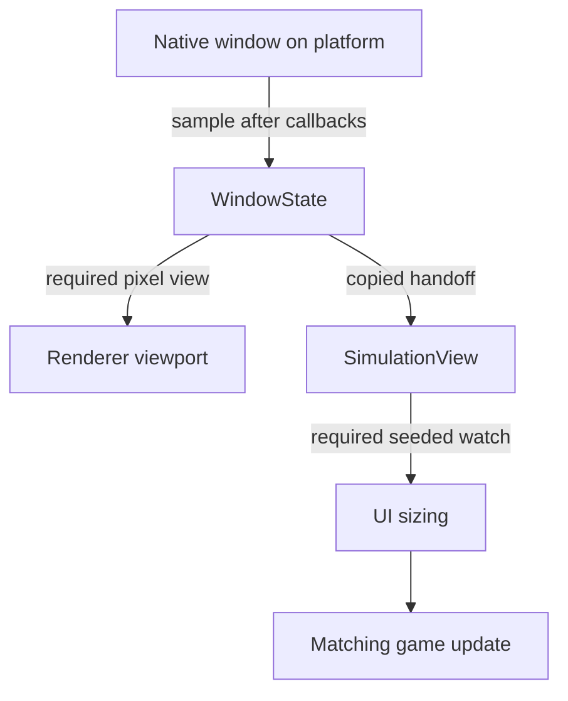

# Display and window ownership

The display owns its windows and monitor inventory. Applications borrow window
pointers and monitor references; copying a `CE::Platform::Monitor` retains its value, not its
native monitor or display owner. The neutral contracts are
[CE::Platform::DisplaySystem](../../../projects/engine/include/cheryl/core/display/display-system-interface.h),
[CE::Platform::Window](../../../projects/engine/include/cheryl/core/display/window-interface.h) and
[CE::Platform::Monitor](../../../projects/engine/include/cheryl/core/display/monitor.h).

Access native display/window state, create/mutate windows and perform teardown on
the platform owner. Window size getters do not synchronize cross-thread access.
Simulation and render workers receive copied logical/framebuffer dimensions through
the [runtime handoff](runtime-frame-boundary.md), rather than querying a live window.
Graphics context binding, presentation and resource domains belong to the selected
graphics owner.

## Native GLFW inventory and selection

[CE::Platform::GLFW::DisplaySystem](../../../projects/modules/platform/native-glfw/include/cheryl/core/display/display-system.h)
shares GLFW initialization lifetime with other live displays and owns every window
it creates. Its windows are destroyed before its GLFW lifetime share is released;
the final display terminates GLFW. Input adapters detach while their window is live,
and graphics resources/context users finish before window/display destruction.
The [native input lifetime](../modules/native-glfw.md#input-lifetime-and-mapping)
also requires the original Windows notification window to outlive its initialized
adapter.

Construction captures available monitor video modes once, with the primary monitor
first. Construction fails without a primary video mode or monitor inventory.
`monitors()`, `primary_monitor()` and `monitor_count()` describe that fixed inventory;
the returned references remain display-owned. IDs are generated inventory identities,
not native handles or persistent physical-monitor identifiers. Copies from the same
inventory retain their IDs; unknown IDs fail `content_scale()` and window creation.

There is no runtime monitor hotplug refresh or native-handle rebinding. Monitor
topology must remain stable while using this inventory: removal can invalidate its
native handles, and video-mode changes do not update captured dimensions. Hotplug
support needs an explicit refresh, identity and existing-window rebinding contract
before consumers rely on it.

`create_window()` returns a borrowed pointer owned until display destruction;
callers do not delete it. Dimensions are positive logical coordinates. Invalid
monitor IDs/modes, allocation failures and failed native creation propagate.
Omitting dimensions uses the captured monitor size; omitting or passing an empty
title uses a generated title. Successful creation does not make the window active.

`active_window()` is initially `nullptr`. `activate_window()` accepts the first owned
window and repeated selection of that window. It rejects a foreign window or replacing
the selected one. Selection does not make a graphics context current or establish
renderer/resource-domain switching.
Multiple active rendering windows and selection switching are
[deferred extensions](../../planning/long-term/README.md#multiple-active-rendering-windows).

## Sizes, modes and observation

| Observation | Units and freshness |
| --- | --- |
| `CE::Platform::Monitor::width/height` | Captured video-mode dimensions; native GLFW does not refresh them. |
| `logical_size()` | Cached logical window coordinates, updated by native size callbacks and explicit resize/mode queries. |
| `framebuffer_size()` | Cached drawable pixels, independently updated by framebuffer callbacks and explicit queries. Zero dimensions can describe an unavailable drawable. |
| `content_scale(monitor)` | Current GLFW X/Y monitor scale for an inventory ID; this leaves its dimensions unchanged. |

Pump native events on platform before relying on new callback observations. Logical
and framebuffer dimensions can differ; use valid positive sizes for pixel mapping
and avoid division/render submission while the drawable is unavailable.
`CE::Platform::Dimensions<int>` describes logical dimensions, while
`CE::Platform::FramebufferSize` describes drawable pixels.

Choose the initial mode or a supported transition using the Native GLFW behavior
below. Mode names alone do not imply a desktop-sized borderless window.

| Mode | Native GLFW consequence |
| --- | --- |
| `NORMAL` | Restore saved windowed placement and decorations. |
| `BORDERLESS` | Use saved windowed placement without decorations; retain its extent. |
| `FULLSCREEN` | Attach the selected monitor at its captured dimensions and queried refresh rate. |

`resize()` requests positive logical dimensions and queries the resulting logical
and pixel sizes. The platform may accept different dimensions. `set_mode()` restores
saved windowed placement for `CE::Platform::WindowMode::NORMAL`, uses it without decorations for `BORDERLESS`,
and attaches the chosen monitor at its captured dimensions for `FULLSCREEN`. Native
fullscreen switching uses the monitor's queried refresh rate. Mode changes then
query the resulting sizes. Borderless mode preserves the saved windowed extent;
it does not itself select a desktop-sized extent.
`mode()` reflects the selected mode and can already have changed when a transition
reports a listener failure.

A changed framebuffer size publishes `CE::Platform::WindowResized` on the canonical typed
`CE::Platform::window_resized_event` channel. Native GLFW first dispatches the legacy named
`"window-resized"` notification, then the typed channel, using the same saved size
observation. A logical size change alone does not establish a framebuffer-size
event. Nested resize delivery can interleave these channels; each payload keeps its
own observation even if another listener changes the window again. Queued callbacks
do not have a completion order across channels.

The event contains copied pixel dimensions and a borrowed window pointer. Queued
delivery does not extend window lifetime or permit dereferencing it on another
owner. Deferred consumers retain the dimensions and use their normal runtime and
registration lifetime. The [event-delivery contract](event-delivery.md#typed-channels)
defines channel identity, payload ownership and optional owner delivery.

Native callback failures follow the
[failure-reporting contract](failure-reporting.md). Explicit resize/mode operations
consume earlier callback failures and can propagate listener failures after native
state/dimensions change. A synchronous legacy-dispatch failure prevents the typed
offer for that observation; typed listener failures use the same native callback
boundary. Earlier deliveries and native state changes are not rolled back. `should_close()`
also consumes deferred callback failure before reading the close flag. Cached size
getters do not consume that failure.

## Committed window and simulation views

Use `engine.window_state()` for the runtime's copied platform selection and
`engine.simulation_view()` for the dimensions selected by simulation. These
sources, declared in `<cheryl/core/engine/view-state.h>`, avoid borrowing a live
window across owners. Their synchronized `snapshot()` results can be retained;
checked source/session identities and revisions distinguish new selections.
`initialized` is false before the first selection and `closed` becomes true
when runtime closes the source. Closure does not fabricate a resize or focus event.

`WindowState` contains logical size, framebuffer pixels, observation time and
optional native focus. `Window::focused()` defaults to unknown; Native GLFW
supplies the sampled native value. Input keyboard-routing focus is a separate
concept. The first selection establishes a baseline. Later logical, pixel or
supported focus changes advance the window revision.

Simulation selects copied dimensions before each actual update and carries that
selection in `TickContext`. Its view revision changes only for a new size pair,
not a focus-only window change. `window_revision` records the originating window
selection when that view commits; it need not equal the latest focus-only
revision. Required view callbacks finish before dependent work. The renderer
uses a required platform watch for the initial viewport and later pixel changes;
UI sessions can [follow simulation view](../modules/tgui.md#automatic-view-and-time).

For optional observation, register `CE::Runtime::window_state_changed_event` or
`simulation_view_changed_event` on the Context bus. Both payloads own previous/
current values. A bus subscription has no seed. A source's `watch()` instead
requires its initialized owner, invokes a protected `seed=true` callback before
returning, and returns an owned `ViewAttachment`. A required application failure
propagates and prevents dependent work; it is not hidden as an optional listener
failure. [Observation versus participation](event-delivery.md#observe-a-change-or-participate-in-an-operation)
explains these choices and cleanup.

The legacy `WindowResized` producer and its named-then-typed failure ordering
remain as described above. Runtime samples the final live state rather than
using a potentially older nested raw payload. A listener that mutates the native
window is sampled again at a later safe platform pass; runtime does not recursively
drain view changes, and it avoids rendering with a stale selected native view.
Native callback freshness is still poll-gated: a full input backlog can delay
new close, resize or focus observations. Maintenance phases add no extra GLFW pump.

## Native close intent

Native GLFW implements `supports_close_intent()` and
`consume_close_intent()`. Consumption observes and clears its sticky close flag,
so rejecting one close request does not poison later polling. A later native
close can create a fresh request. Other window adapters default to unsupported
and keep the boolean `should_close()` contract.

Runtime publishes an owned `CE::Platform::WindowCloseRequested` through
`window_close_requested_event`, with context/session, window-source and intent
identity plus observation time. It carries no window pointer or decision
capability. The runtime's required main-window bridge enters the
[shutdown request protocol](runtime-frame-boundary.md#negotiable-shutdown), even
if optional observation fails. Native input backlog can delay observing the
intent; host endpoint requests remain independently serviced.

With no policy, close requests retain the ordinary accept-and-shutdown behavior.
An installed negotiable policy requires a consumable window. Explicit
`NativeClosePolicy::Force` allows host-only negotiation with a boolean adapter
while retaining unconditional native close. Native callback failures still use
the failure boundary above and can force runtime shutdown.

## Scale and UI capabilities

A monitor scale query neither establishes per-window scale nor reports scale-change
events. A window can move between monitors independently of its original snapshot.
Use copied logical/framebuffer sizes for current pixel mapping and an explicit font
scale within the adapter's supported scope.

`hide_cursor()` selects hidden or normal cursor visibility. Pointer capture, locked
relative motion, cursor shapes, clipboard and IME need their own capability contracts.
The current [UI capability boundaries](../development/ui-adapters.md#routing-and-unavailable-services)
describe what adapters expose and what further consumer requirements must settle.
