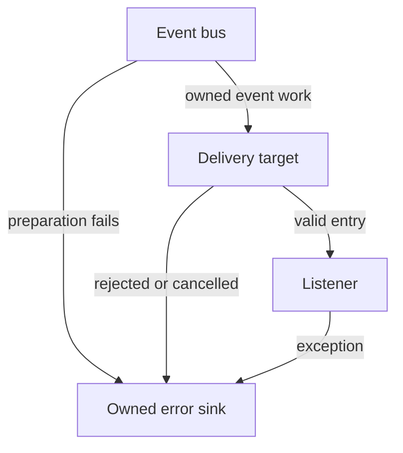

# Event buses and persistent registration

Use a typed channel to notify registered consumers about an occurrence. Game code
can use its `CE::Runtime::Context::events()` bus; publishers and listeners must use
the same bus. [Create an event](../getting-started/create-a/event.md) walks through
a game notification. Own a `CE::Events::EventBus` to isolate a subsystem's channels
and lifetime, or use `CE::Events::EventSystem::get()` for the global default bus. Include
`<cheryl/core/subsystems/event-bus.h>`.

The example below records level `3` synchronously in `last_level`, then removes
its listener before the borrowed variable goes away. Registrations persist until
explicit removal or bus closure; dropping an ID does not unregister a callback.

## Typed channels

`CE::Events::EventChannel<Payload>` owns an exact channel name. Its name plus its unqualified,
copy-constructible payload type identify a channel within each bus. Equivalent
name/type values share registrations, independent of token lifetime; another
payload type with the same name is a separate channel. Legacy string/`std::any`
channels retain their application-defined type contract and are separate from typed
channels. Type identity is in-process; names and RTTI are not a serialized protocol.

```cpp
CE::Events::EventBus local_bus;
struct LevelLoaded {
    int level;
};
const CE::Events::EventChannel<LevelLoaded> loaded{"level-loaded"};
int last_level = 0;
auto id = local_bus.register_listener(loaded, [&](const LevelLoaded& event) {
    last_level = event.level;
});
local_bus.dispatch(loaded, LevelLoaded{3});
local_bus.unregister_and_wait(id);
```

Typed submission requires the exact payload type rather than implicit numeric or
other conversions. It copies an lvalue or constructs from an rvalue into an owned
payload before dispatch; even `std::any` can be a typed payload without flattening
its contents. Each listener receives the existing invocation-owned payload copy
through a borrowed `const Payload&`. Copy it for retained use, and keep pointees
alive according to Payload's own ownership. A checked erased-type lookup precedes
the typed callback; inconsistent internal payloads throw `bad_any_cast` instead of
reaching that callback. Public named producers cannot target a typed channel.

Persistent registration, snapshot order, invalidation, waits, close and optional
delivery use the same listener machinery as named channels. `CE::Events::EventSystem`
forwards registration and `dispatch()` to its default bus. With `dispatch()`,
initial typed-payload construction failures reach the producer before the registry
dispatch begins. Per-listener queued copying, callback/target failures and
cancellation still belong to the registered error sink;
invalidation waits protect the callback's borrowed target, not that error sink's
independent lifetime through pending-ticket destruction. No typed API chooses a
thread or changes worker-stream ordering.

`CE::Platform::window_resized_event` in `core/display/window-interface.h` is the canonical
typed channel for `CE::Platform::WindowResized`. Native GLFW explicitly publishes both it and the
legacy named `"window-resized"` notification; this producer bridge does not make
generic named and typed channels equivalent. Register with the typed channel to
receive a checked `const CE::Platform::WindowResized&`, optionally selecting platform or simulation
delivery as below. Its dimensions are copied, while its window pointer remains
borrowed and cannot be dereferenced on simulation. The
[display/window contract](display-and-window-contract.md#sizes-modes-and-observation)
defines observation, ordering and native failure behavior.

## Registrations

Registration is persistent. The bus strongly owns its callback until explicit
unregister or bus destruction; throwing away `id` does not remove it. Identifiers
include bus identity, so an ID from a different bus cannot remove a local listener.

## Immediate delivery

Immediate delivery runs on the publisher's thread, in registration order within
that publication. Overlapping producers can overlap callbacks; immediate listeners
must be safe on each producer thread. Nested publication is synchronous and
completes inside the outer callback. With `dispatch()`, an immediate exception
propagates to the caller and stops the remaining listeners in that dispatch.

The registry lock is released before callbacks run. Registration during dispatch
joins the next snapshot, not the already detached one. String channel names and
`std::any` payload typing retain their current application-level contract.

### Observations with notify

Use typed `EventBus::notify(channel, payload)` for observations of changes already
applied. It contains notification failures and attempts each remaining valid
listener after an immediate listener fails. It still uses immediate delivery by
default. Neither publication operation rolls back the producer's state.

An optional third `ErrorHandler` receives payload preparation, closed-bus,
snapshot and immediate-listener failures synchronously outside bus locks. This
sink must not recursively notify through the same bus. An empty or throwing sink
uses independent emergency reporting. Queued listeners retain their own
registration-owned error sinks and delivery lifetimes.

### Weak publishing handles

Give a service `bus.publisher()` when it needs to publish observations without
retaining the bus or Context. `CE::Events::EventBus::Publisher` is a copyable
route to that same registry. The payload and channel remain plain data; the
producer stores the route and calls `notify()`.

Using `local_bus`, `loaded` and `last_level` from the typed-channel example:

```cpp
const auto publisher = local_bus.publisher();
const auto route_id = local_bus.register_listener(loaded, [&](const LevelLoaded& event) {
    last_level = event.level;
});
publisher.notify(loaded, LevelLoaded{4});
local_bus.unregister_and_wait(route_id);
```

`last_level` becomes `4` before `notify()` returns. A service may retain a copy
of `publisher` after the bus dies. An empty or expired handle silently discards
observations without copying the payload. A live handle uses the same failure
isolation, optional error handler and listener-selected delivery as bus `notify()`.
A closed bus can still have live state: `expired()` is a lifetime observation,
not a test that publication will be accepted. Closed-state notification failures
follow the usual error path.

Obtain the handle while its bus is alive. It retains neither the Context nor
objects borrowed by callbacks, so listener cleanup still requires the
[removal barrier](#removal-and-shutdown). It does not select a thread; immediate
callbacks run on the service's publishing owner.

## Observe a change or participate in an operation

A bus subscription observes an occurrence. Use the owner's attachment API when
another operation must finish before the runtime can proceed. For example,
automatic UI sizing must apply the selected simulation dimensions before the
game uses that view; a queued resize observer cannot supply that guarantee.

| Need | API | Execution and lifetime |
| --- | --- | --- |
| Observe an event | `engine.events().register_listener(channel, callback, ...)` | Immediate on the producer by default; optional queued delivery. The registration persists until explicitly removed. |
| Apply a selected window or simulation view | `engine.window_state().watch(...)`, `engine.simulation_view().watch(...)` | Required immediate callback on the initialized source owner, including a coherent seed before return. Retain the move-only `ViewAttachment`. |
| Perform recurring runtime service work | `engine.services().on_maintenance(...)`, `on_step(...)` | Required immediate platform or simulation participation. Retain the move-only `ServiceAttachment`; no seed or replay. |
| Observe a catalogue's current keys and later changes | `manager.catalogue().watch(...)` | Optional watch with a coherent seed, serialized on the catalogue drainer. Retain its move-only `Watch`; it does not gate runtime progress. |

View/service attachments acknowledge invalidation on `reset()` or destruction:
an entered callback finishes before reset returns, except safe self-detach.
Required callbacks are attempted before dependent work; a required failure
propagates to the caller/runtime after the remaining required participants have
been attempted. Optional listener failures remain isolated. Attachments added
during a phase join its next occurrence. A new view watch still receives its own
initial seed immediately.

Publishing a value on a public observation channel does not select a runtime
view, run a maintenance pass or authorize shutdown. Those operations remain with
their owners. [Runtime phases](runtime-frame-boundary.md#runtime-service-phases)
and [view selection](display-and-window-contract.md#committed-window-and-simulation-views)
define the supported attachment points.

(engine-input-and-asset-notifications)=
## Engine and module notifications

These producers use plain typed payloads and weak publication routes:

| Channel and payload | Producer setup and detailed contract |
| --- | --- |
| `CE::Runtime::window_state_changed_event` / `WindowStateChanged` | Runtime selects copied logical/pixel sizes and optional native focus on platform. [Committed views](display-and-window-contract.md#committed-window-and-simulation-views). |
| `CE::Runtime::simulation_view_changed_event` / `SimulationViewChanged` | Runtime selects the view used by the following tick on simulation. UI modules offer required automatic sizing. [View following](../modules/tgui.md#automatic-view-and-time). |
| `CE::Runtime::runtime_ready_event`, `shutdown_starting_event`, `runtime_quiescing_event`, `runtime_stopped_event` | Platform milestones carry owned lifecycle snapshots; `runtime.lifecycle()` supplies retained current/terminal state. [Lifecycle observation](runtime-frame-boundary.md#lifecycle-observation). |
| `CE::Runtime::shutdown_requested_event`, `shutdown_request_cancelled_event` | Owned request facts; only the installed host policy receives decision authority. [Negotiable shutdown](runtime-frame-boundary.md#negotiable-shutdown). |
| `CE::Platform::window_close_requested_event` / `WindowCloseRequested` | A sampled main-window intent enters the runtime's required close bridge. [Native close](display-and-window-contract.md#native-close-intent). |
| `CE::Runtime::platform_maintenance_event`, `simulation_step_starting_event` | Observe actual owner service passes; required consumers attach through `engine.services()`. [Service phases](runtime-frame-boundary.md#runtime-service-phases). |
| `CE::Input::gamepad_availability_changed_event` / `CE::Input::GamepadAvailabilityChanged` | Runtime routes its input adapter to `engine.events()` at session start. Standalone adapters select their route explicitly. [Subscribe and read the current gamepad seed](input-state-model.md#gamepad-availability). |
| `CE::Assets::Loading::asset_upload_settled_event` / `CE::Assets::Loading::AssetUploadSettled` | Call `loader.publish_events_to(engine.events().publisher())` before loading. Each executed attempt produces one aggregate observation, including a batch of 10,000 assets. [Observe upload settlement](../assets/asset-loading.md#upload-settlement-notifications). |
| `CE::Assets::Cache::asset_catalogue_changed_event<AssetType, Key>` / `AssetCatalogueChanged<AssetType, Key>` | Each manager has a checked source, exact keys and retained generation metadata. Runtime configures provider routing; standalone providers/sources opt in. [Catalogue changes](../assets/asset-loading.md#catalogue-changes). |
| `CE::Rendering::graphics_domain_state_changed_event` / `GraphicsDomainStateChanged` | Actual native availability/invalidation, independent of provider facade lifetime. Runtime routes the renderer and installs cache eviction. [Graphics domains](../resources/resource-residency.md#graphics-domain-observation). |
| `CE::Audio::playback_ended_event` / `PlaybackEnded` | An application-owned audio source stages outcomes and explicitly pumps on its designated owner, optionally through maintenance. [Playback outcomes](audio.md#playback-outcomes). |

Register on the producer's chosen bus. A bus registration itself has no replay;
use the family's snapshot or seeded watch for current state. Upload settlement
remains one event per executed batch, while catalogue changes describe actual
key commits and keep cache hits silent. Neither drives automatic asset adoption.

Select [simulation delivery](#optional-queued-delivery) when a platform/loading
observation changes simulation-owned gameplay or UI state. A notification does
not establish that simulation consumed a poll, that an update completed, or that
a request future is ready. Runtime pressure remains an internal observation;
font catalogue, physical device topology and OS suspend/resume events are deferred.

## Removal and shutdown

`unregister_listener(id)` invalidates invocation entry before it returns. A
listener already running may finish. For a callback borrowing an object (for
example `[this]`), call `unregister_and_wait(id)` before destroying that object, or
unregister then call `wait_for_listener(id)`. The barrier waits only for invocations
already entered, not for queued tasks which can safely discard invalid entries.
Do not wait while holding a lock needed by the callback. Self-unregister works;
waiting from the same listener, including nested invocation, rejects instead of
deadlocking. Callback exceptions still release in-flight accounting.

`id.disconnect()` provides the same nonblocking invalidation through the saved
registration without borrowing the `EventBus` facade. It is safe after bus
destruction, but still does not wait for an entered callback. Dropping the ID
continues to leave the registration active. Owned view/service/catalogue
attachments have their separate RAII cleanup contracts described above.

`close()` invalidates all registrations and rejects subsequent registration and
dispatch. Concurrent close/removal calls serialize invalidation with registry
removal: every returning closer has closed all remaining invocation gates.
Callback captures are still released outside both locks, so their destructors may
reenter the bus. Close does not wait for running callbacks. Bus destruction closes
without blocking; callers must settle any
in-flight callbacks that borrow a bus or other target before destroying it.
Registry snapshots and invocation guards retain callback ownership as needed,
without permitting a fresh invocation after invalidation. Queued delivery is optional and described below.

## Named channels

Existing string/`std::any` channels retain their application-defined payload
contract. For those producers, the same bus accepts:

```cpp
auto named_id = local_bus.register_listener("level-loaded", callback);
local_bus.dispatch("level-loaded", payload);
local_bus.unregister_and_wait(named_id);
```

Here `callback` interprets the application's `std::any` payload. Named and typed
channels remain separate even when their text names match. Prefer the typed form
for a new channel so registration and submission agree on its payload type.

## Optional queued delivery

Queued delivery copies the event into owned work. The selected target controls
execution; the listener's registration still controls callback entry.



To change simulation-owned state from another producer, include
`<cheryl/core/engine/event-delivery.h>`, `<atomic>` and `<memory>`. With the bus,
channel and `last_level` above, and an application-owned `runtime`, register a
simulation-delivered listener before starting its producers:

```cpp
auto delivery_errors = std::make_shared<std::atomic<unsigned>>(0);
auto queued_id = local_bus.register_listener(
    loaded,
    [&](const LevelLoaded& event) { last_level = event.level; },
    CE::Events::simulation_delivery(runtime.simulation_dispatcher().submission()),
    [delivery_errors](std::exception_ptr) noexcept {
        delivery_errors->fetch_add(1, std::memory_order_relaxed);
    }
);
// A producer during the live session:
local_bus.dispatch(loaded, LevelLoaded{4});
```

The callback runs at a scheduled simulation boundary; dispatch does not wait for
its completion. Keep `last_level` on that owner and alive through listener removal. The error
sink owns its counter independently, so cancellation reporting remains valid even
when the callback's target is being removed. A production sink can retain an owned
reporting object instead; it must remain nonthrowing. During producer quiescence:

```cpp
local_bus.unregister_and_wait(queued_id);
```

This prevents new entry and waits for callbacks already running; an invalidated
queued callback may be discarded. It does not wait for every queued error ticket
to be destroyed. See [Ownership and Cleanup](../architecture/ownership-cleanup.md#shut-down-in-dependency-order)
for where this removal belongs in game shutdown, and
[Threads and Data Flow](../architecture/threads-data-flow.md#choose-how-work-is-delivered)
for choosing dispatch versus events.

Pass a delivery callable and error sink to `register_listener`. The bus accepts
only the small `bool(Work)` delivery contract, with move-owned `Work`; its header
has no dependency on dispatchers, runtime, or worker pools. A target owns deferred
work when it returns true. False or an exception rejects it without retaining it.
It must not invoke work inline or wait for it, and must provide FIFO execution for
each listener stream. Concurrent producers serialize enqueue for a given listener.
There is no global completion order between listeners or independent targets.

Queued tasks copy their payload and retain registration state. At actual execution
they enter the same invalidation handshake as immediate callbacks. Callback
exceptions, payload/task preparation failures, rejected posts, and accepted tasks later dropped by the target reach
the required error sink. Target cancellation reports `future_error/broken_promise`;
explicit unregister/close discards pending callbacks intentionally. Error sinks
receive the original preparation/target exception; such queued failures do not
also escape from dispatch. Immediate failures still propagate to the caller. Sinks
must not throw and must remain valid through pending-task destruction; a throwing
sink terminates rather than disappearing in a discarded target future.

The local delivery ticket owns the copied payload as well as rejection reporting.
If a target destroys rejected work during its offer, final payload destruction
waits until the listener's posting lock has been released. Payload destructors,
including final shared-owner deleters, may therefore dispatch again without
reentering that lock. Payload-copy failure still reports the original exception.

The completion barrier protects the listener callback's borrowed target. An error
sink is independent: prefer an owned logging/reporting handle, not the same raw
`this`. Unregister can race a delivery already being offered; that task can still
be accepted but will not enter the invalidated listener.

`CE::Events::platform_delivery(engine.platform_dispatcher().submission())` and
`CE::Events::simulation_delivery(runtime.simulation_dispatcher().submission())` are
optional composition adapters in `core/engine/event-delivery.h`. Their namespace
is `CE::Events`; this separate composition header keeps the bus
independent of `CE::Runtime` and `CE::Workers`. Their saved
endpoints reject safely after service closure. `CE::Events::worker_delivery(group)` provides one serial drain stream on the group's
shared parallel capacity. Copies of that delivery callable share FIFO execution
and completion order, including across listeners. Separate adapter construction
creates independent streams. Ordinary jobs in the group remain parallel; a pool's
FIFO selection alone does not impose completion order.

Accepted stream work drains before group completion. Group closure rejects new
stream work even when a pump is active. A failed/cancelled pump releases its
pending captures outside stream locks, letting owned event tickets report loss.
Do not block a stream callback on another callback in that same stream.

## Worker-stream acceptance and cancellation

This section is for delivery-adapter authors and concurrency reviewers. Ordinary
subscribers use the [queued adapters above](#optional-queued-delivery); they do not
implement the stream handshake or lock order themselves.

Initial pump submission is serialized with stream publication. Another producer
cannot return accepted before that submission succeeds. Closure checks share the
stream mutex with the pump's final empty-queue check. Submission failure removes
only the initiating request, and its captures leave the stream lock before error
reporting. Lock order is stream then pool; worker accounting releases the pool lock
before touching a stream or releasing callback captures.

Cancellation belongs to the submitted callable. An atomic preparing/accepted/
cancelled handshake records loss before callback entry without taking the producer's
already-held stream lock. Before publication, the producer withdraws only its own
request. After publication, unentered callable destruction abandons the stream
outside producer posting locks. This permits error-sink redispatch and capture-
destructor reentry without running another listener's cancellation under that lock.

[Validation procedures](../development/architecture-validation.md) includes controlled pump rejection,
concurrent producers, payload-copy invalidation, native-policy suppression, and
reentrant recovery. Typed identity/ownership, compile-time constraints, waits,
queued failure/error-sink lifetime and worker FIFO have additional regression
coverage. Linux/X11 typed-event and resize acceptance is complete. Remaining Windows
acceptance is shelved in the [platform plan](../../planning/long-term/platform-acceptance.md).
