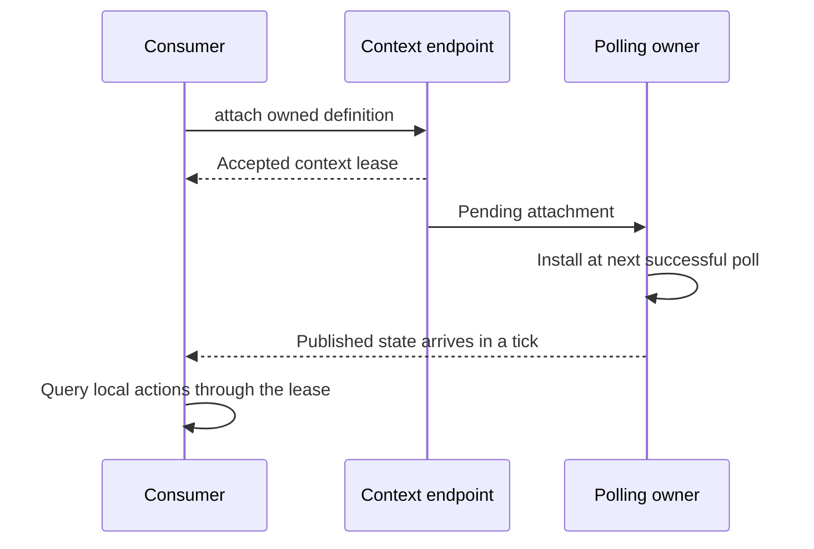
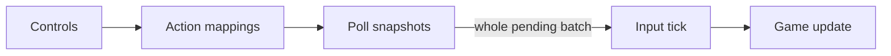
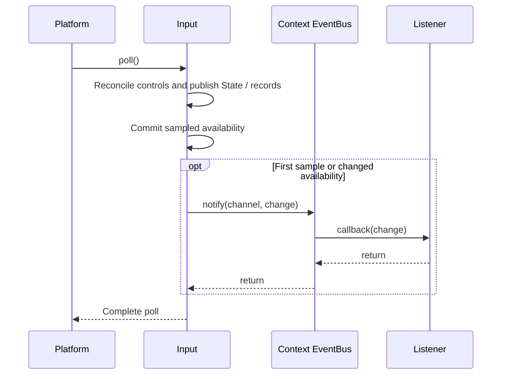

# Input actions and state

Start with [binding an application action](../getting-started/how-to/bind-input.md)
for a working input-to-update sequence. This guide defines the shared contracts
behind that sequence; custom adapters use the same action and publication model.

| Question | Contract |
| --- | --- |
| Bind one game-wide action and remove it later | [Direct bindings](#bindings) and [control identities](#control-identities-and-binding-tokens). |
| Create independent controllers during play | [Action contexts](#action-contexts), [acceptance/poll installation](#request-and-polling-boundaries) and [view lifetime](#views-and-shutdown). |
| Interpret taps, axes or a slow update | [Tick input](#tick-input) and [polling backlog](#polling-backlog-and-scheduling). |
| Receive physical events and committed text | [Ordered records and capture](#ordered-events-and-os-text). |
| Observe gamepad presence and reconnection | [Gamepad availability](#gamepad-availability). |
| Focus an editor without rerouting old records | [Focus and routing](#focus-routing-and-editing-controls). |
| Implement or host a backend | [Ownership and validation](#ownership-and-validation) and [adapter publication](#adapter-publication). |

## Bindings

`CE::Input` defines the input protocols shared by all backends, games and other
consumers. `Actions` maps physical controls into semantic state; `Events`
contains ordered physical and committed-text observations. `Capture` requests
those record channels, while `Routing` selects keyboard/text recipients. Capture
and routing serve gameplay, tools and UI without requiring a widget toolkit. The
native implementation is `CE::Platform::GLFW::InputSystem`; optional toolkit
adapters live separately under `CE::UI`. Use direct bindings for game-wide actions,
or [action contexts](#action-contexts) for independent consumers such as player
controllers that can join and leave during play.

Cheryl collects physical input on the platform thread. `CE::Input::Actions::Bindings` can map one control or a simultaneous `CE::Input::Actions::Chord` to a game-defined `CE::Input::Actions::Id`. Several button bindings for the same action combine with OR; controls inside one chord combine with AND. Axis bindings add their scaled values and can be gated by a chord. Negative scale inverts an axis, and an optional dead zone rescales the remaining input range. Within one action namespace, an action cannot be both a button and an axis while bound. A returned `CE::Input::Actions::BindingId` can remove one direct mapping; `unbind_action` removes all of its direct mappings. A physical `CE::Input::Control` stores the adapter's device ID in `device` and a Cheryl control ID in `control`.

Pass Cheryl control enums directly when registering bindings. The `context` is
the runtime context available during game initialization.

```cpp
constexpr CE::Input::Actions::Id Jump{1};
constexpr CE::Input::Actions::Id Save{2};

auto& input = context.input();
auto& bindings = input.bindings();
const auto keyboard = input.keyboard_id(); // The adapter is initialized before game init.
const auto jump_binding = bindings.bind_button({keyboard, CE::Input::KeyboardKey::Space}, Jump);
const auto save_binding = bindings.bind_button(
    CE::Input::Actions::Chord{{{keyboard, CE::Input::KeyboardKey::LeftControl},
                              {keyboard, CE::Input::KeyboardKey::S}}}, Save);
```

Include `<cheryl/core/controls/input-interface.h>` and
`<cheryl/core/controls/button-codes.h>`, and retain these registration IDs for
platform-owned cleanup. Keyboard, mouse and gamepad bindings use the same
Engine-owned control interface. Native GLFW keeps its Gainput state and native
code translation private.

## Action contexts

An `Actions::ContextDefinition` describes one consumer's button/chord and axis
bindings. Each attached context has its own action namespace: two controllers may
both use local `Actions::Id{1}` without combining their state or reserving numeric
ID ranges. Direct bindings remain in the separate namespace read by
`tick.input.button(id)` and `axis(id)`.

| Value | Responsibility |
| --- | --- |
| `Actions::ContextDefinition` | Owned reusable `buttons` and `axes` definitions. Each button pairs a chord and local action ID; each axis supplies modifier chord, physical control, local action ID and `AxisOptions`. |
| `Actions::ContextSubmission` | Copyable retained request endpoint, obtained through `input.action_contexts()` on the platform/binding owner. Producers may call `attach(definition)` from simulation or another thread. |
| `Actions::Context` | Move-only lease for one accepted attachment. Destruction or `reset()` requests removal of only this context. |
| `Actions::View` | Local action queries from `tick.input.actions(context)`. It copies the runtime namespace identity and borrows the immutable tick. |

Include `<cheryl/core/controls/action-context.h>`. Save required device IDs during
platform initialization; a definition retains their values, without borrowing or
querying a native device. Attach a reusable definition when creating a consumer,
then retain the returned lease for that consumer's lifetime. The
[binding task](../getting-started/how-to/bind-input.md#reuse-bindings-for-runtime-consumers)
shows independent consumers; [Create a PlayerController](../getting-started/create-a/controller.md)
puts the lease and local IDs inside an application class.

Device discovery remains a backend responsibility. The current Native GLFW
adapter exposes one convenience gamepad slot and
[availability observations](#gamepad-availability) for it. Action contexts support
independent consumers of supplied device IDs and separate controls on a shared
keyboard; they do not add multiple-gamepad discovery to that adapter.

### Request and polling boundaries

This successful attachment path separates request acceptance from the first
published input sample:



`attach()` validates/copies the definition before accepting it. Empty or closed
endpoints reject; invalid chords, axis scales/dead zones and conflicting action kinds
reject according to the ordinary binding rules. A truthy `Context` means its
request is accepted and still live. It does not mean a poll has installed it.

The polling owner applies accepted attachments/removals at the next poll boundary.
Before the first installed publication, local tick queries return inactive/zero
state. A newly attached context observes buttons already held, current absolute
axes and device gates; it does not inherit earlier relative deltas or another
context's edge/duration history. An already held button can therefore produce a
semantic press on attachment without a new physical event.

Reset/destruction is nonthrowing and requests removal. A detached context publishes
one release/zero sample for its previously active state, then leaves later
publications. Already published snapshots/ticks are immutable. Poll installation
or evaluation can still fail after attachment acceptance; publication preserves
the previous complete sample and pending transitions for retry. This is not a
synchronous installation acknowledgement or an atomic multi-context replacement.

To change a definition, attach another one and release the old lease according
to application policy; there is no mutable mapping API on the lease. Independent
contexts can bind the same physical controls and both receive their state. They
do not consume records or automatically give one consumer priority. Keyboard
focus gating applies to their keyboard-derived state, just as it does to direct
bindings. Context lifetime, capture channels and routed UI focus remain separate.

### Views and shutdown

During update, obtain local actions without consulting native input:

```cpp
const auto actions = tick.input.actions(controller_context);
const bool active = actions.button(local_action).held();
```

Here the application retains `controller_context` and defines `local_action` in
that controller's namespace. The view remains valid after the lease is reset,
provided its tick remains alive and unmoved. Copy `context.id()` before resetting
when a later query needs the old identity; `tick.input.actions(saved_id)` selects
it without retaining the lease. `ContextId` is a runtime namespace identity, not
a persisted control mapping or a game-assigned range of action IDs.

Handles themselves require exclusive access during move/reset/destruction. Separate
endpoints/leases support concurrent producers. Destroying input closes the saved
endpoint and invalidates live leases; later attachment rejects safely. An endpoint
or lease does not extend native input/window lifetime. Retained historical tick
views still use their copied namespace identity after closure.

## Control identities and binding tokens

Pair a control enum with the corresponding device ID in
{cpp:struct}`CE::Input::Control`. Its constructors convert the enum to a Cheryl
`ControlId`; binding calls accept that pair directly. Standard control IDs belong
to Engine, while device IDs belong to the adapter. Both are separate from a
game-defined {cpp:struct}`CE::Input::Actions::Id` and from the
{cpp:type}`CE::Input::Actions::BindingId` returned by registration.

| Control family | Purpose and details |
| --- | --- |
| Keyboard | {cpp:enum}`CE::Input::KeyboardKey`: letters, `Digit0`–`Digit9`, navigation/editing keys, `F1`–`F25`, keypad and left/right modifiers. Pair the enum directly with `keyboard_id()`. [Complete enum](../../../projects/engine/include/cheryl/core/controls/button-codes.h). |
| Mouse buttons | {cpp:enum}`CE::Input::MouseButton`: `Left`, `Right`, `Middle`, `Extra1`–`Extra5`, plus `Unknown`. Pair the enum directly with `mouse_id()`. [Complete enum](../../../projects/engine/include/cheryl/core/controls/button-codes.h). |
| Relative pointer/scroll | `CE::Input::MouseControl::DeltaX`, `DeltaY`, `ScrollX`, `ScrollY`. These are portable reserved `ControlId` constants. Pair with `mouse_id()` and bind an axis using `AxisKind::Relative`. [Constant declarations](../../../projects/engine/include/cheryl/core/controls/input-types.h); [relative observation behavior](#ordered-events-and-os-text). |
| Absolute pointer and wheel buttons | `CE::Input::MouseControl::X`, `Y`, `WheelUp`, `WheelDown`, paired with `mouse_id()`. Bind position as an absolute axis; Native GLFW reports logical cursor coordinates divided by logical window size. Wheel buttons are one-poll pulses; use relative scroll axes or records for fractional/repeated movement. [Constant declarations](../../../projects/engine/include/cheryl/core/controls/input-types.h). |
| Gamepad | {cpp:enum}`CE::Input::GamepadControl`: named buttons such as `A`, `Start`, `LeftShoulder`, `DPadUp`, and axes such as `LeftStickX`, `RightStickY`, `LeftTrigger`. Pair the enum directly with `gamepad_id()`. `A`/`B`/`X`/`Y` identify Xbox-style physical positions; printed labels may differ. [Complete enum](../../../projects/engine/include/cheryl/core/controls/button-codes.h); [controller mapping and limits](../modules/native-glfw.md#linux-controller-mapping). |

Include `<cheryl/core/controls/button-codes.h>` for all three enums and
`<cheryl/core/controls/input-types.h>` for mouse axis/wheel constants. These
Engine headers are independent of Native GLFW and `CHERYL_NATIVE_INPUT`.
Adapters normalize native observations to the same standard IDs before binding
evaluation. Application bindings need neither a translation helper nor native
library enums. An adapter can also expose raw `ControlId` extensions under its
own documented contract.

Adapter and record-processing code can use `CE::Input::control_id(enum)` to
obtain the same ID stored by `Control`. Casting an enum to an integer does not
perform that conversion. `Unknown` and out-of-range enum values convert to
`CE::Input::invalid_control`; registration rejects that ID, including in chord
modifiers, with `CE::Exceptions::invalid_args`. Passing a foreign enum, such as
a Gainput enum, directly to `Control` fails at compile time.

Keyboard letter and punctuation names identify US keyboard positions. They do
not identify the character produced under the user's layout. Read committed
characters from `Events::Text`. `Unknown` means an identity is unavailable or
inapplicable. Native GLFW can bind all named keyboard controls, including
`F20`–`F25`, without relying on Gainput's keyboard enum. A valid ID does not
establish hardware support: adapters report gamepad axes, sensors and buttons
only when their backend and the attached device provide them.

{cpp:enum}`CE::Input::AxisKind` selects `Absolute` (retain the final value) or
`Relative` (accumulate changes). Set it through
{cpp:struct}`CE::Input::Actions::AxisOptions`, alongside scale and dead zone.
Use button bindings for gamepad buttons and absolute axis bindings for sampled
sticks/triggers. Names and IDs are shared across adapters; supported controls
and physical layout remain subject to the selected controller backend.

For example, with the initialized `input` and `bindings` above, and distinct
application-defined action IDs `Fire`, `Move` and `Look`:

```cpp
const auto fire_binding = bindings.bind_button(
    {input.mouse_id(), CE::Input::MouseButton::Left}, Fire);
const auto move_binding = bindings.bind_axis(
    {input.gamepad_id(), CE::Input::GamepadControl::LeftStickX}, Move,
    {.dead_zone = 0.15f});
const auto look_binding = bindings.bind_axis(
    {input.mouse_id(), CE::Input::MouseControl::DeltaX}, Look,
    {.kind = CE::Input::AxisKind::Relative});
```

Retain each returned registration ID and unbind it on the platform owner during
cleanup, including partial initialization. Read `Move` as an absolute value and
`Look` as accumulated relative delta during update; the
[binding task](../getting-started/how-to/bind-input.md) shows that lifecycle.

## Poll snapshots

Semantic action state travels through complete observations before game code
reads it. Runtime transfers the whole accumulated poll batch at an actual update.
Independently captured ordered records travel alongside this state.



Each adapter processes its physical changes and publishes one complete poll. The GLFW adapter feeds State from key/mouse callbacks in their shared observation order, then updates Gainput and publishes the State/record pair through `publish_input()`. It mirrors key/mouse state into private Gainput devices, but ignores their notifications to prevent replay and cross-device reordering. Gamepad notifications are normalized to Engine control IDs before reaching Cheryl bindings; the adapter also reconciles the gamepad's current state for reattachment/disconnection when no delta was delivered. Readers receive a `std::shared_ptr<const CE::Input::Actions::Snapshot>` through `CE::Input::System::action_snapshot()`. The published pointer is replaced atomically; an earlier handle keeps its complete sample while later polls proceed.

## Gamepad availability

Use `CE::Input::gamepad_availability_changed_event` to observe the convenience
gamepad slot. Its `CE::Input::GamepadAvailabilityChanged` payload owns `current`
and `previous` snapshots. Native GLFW establishes initial presence on the first
complete poll and publishes subsequent availability changes; unchanged polls
stay silent. Runtime supplies its Context bus to the input adapter at session
start. Include `<cheryl/core/controls/input-interface.h>`; the payload also has its
own `<cheryl/core/controls/gamepad-availability.h>` header.



Callbacks run on the platform owner by default, after the complete poll is
available. A failed poll emits no premature availability change. `current.poll`
and `current.observed_at` identify the completed semantic poll associated with
that change. Publication does not mean simulation has consumed that poll.

### Subscribe and read the current seed

For a platform-owned observation in a game, retain these members:

```cpp
CE::Input::GamepadAvailability pad_;
CE::Events::EventBus::Registration pad_listener_;
```

During platform-owned `init_platform()`, with the game's borrowed `engine_` Context,
register first, then copy the current state. These owner operations cannot
interleave with a poll:

```cpp
pad_listener_ = engine_.events().register_listener(
    CE::Input::gamepad_availability_changed_event,
    [this](const CE::Input::GamepadAvailabilityChanged& change) {
        if (change.current.slot == pad_.slot)
            pad_ = change.current;
    }
);
pad_ = engine_.input().gamepad_availability();
```

The slot filter selects this adapter when several producers share a bus. The
seed may be unknown before the first complete poll. Remove the listener during
`deinit_platform()`, before its borrowed target is destroyed:

```cpp
engine_.events().unregister_and_wait(pad_listener_);
```

Keep this example's `pad_` on the platform owner. To update simulation-owned game
or UI state, select [simulation delivery](event-delivery.md#optional-queued-delivery)
and deliver the initial seed to that owner too. Registration and seed capture
must still run together on the platform owner; post that setup there for a late
subscriber. Reading `gamepad_availability()` alone is synchronized and returns
an independent copy, but does not attach a listener or make a cross-thread
register/read sequence coherent. Queued consumers compare revisions within the
selected source, reject older/equal revisions, and discard an old attachment's
queued observations after adopting a newer attachment's seed.

### Identity, closure and standalone adapters

| Snapshot fields | Meaning |
| --- | --- |
| `source`, `slot`, `device` | `source` identifies one attachment; `slot` stays with the adapter across reattachments. Both are nonzero once opened. `device` is the adapter-local convenience ID once `known`, not physical hardware identity. |
| `revision`, `epoch` | Revision zero is the unknown initial baseline for a source. Committed changes and explicit closure advance it. Presence after unknown/unavailable state, or a changed available device ID, advances the reconnect epoch; the epoch survives reattachment. |
| `known`, `available` | Distinguish an unobserved slot from a sampled absent/present slot. |
| `closed` | The observation source ended. Closure preserves sampled presence; it does not report a physical disconnect. |
| `poll`, `observed_at` | Correlate the last availability change to a complete poll. Explicit closure retains that poll ID and records its own close time. |

Explicit deinitialization closes the Native GLFW observation source. Destruction
does not publish callbacks. Reinitialization opens a new `source` with unknown
presence while retaining its `slot` and epoch. Reentrant changes coalesce until
the next poll publication; `previous` is the last snapshot selected for
publication, so revisions may skip. A closure requested during fanout is
published after that fanout completes.

For a standalone adapter and an application-owned `events` bus, call
`input.publish_events_to(events.publisher())` on the platform owner before
polling. Custom adapters opt in by opening the source before native effects,
staging availability before `publish_input()`, and closing it during explicit
detachment. The protected `open_gamepad_availability()`,
`stage_gamepad_availability()` and `close_gamepad_availability()` hooks provide
those steps; `discard_captured_input()` also closes it. Adapters that do not
open a source leave the default zero-source, closed snapshot.

This observes one sampled slot. [Native controller limits](../modules/native-glfw.md#controller-backend-limits)
still determine what the backend can report. Input backlog can delay sampling;
the event does not enumerate devices or recover physical transitions between polls.

## Tick input

`CE::Game::AbstractGame::update(const CE::Game::TickContext&)` runs for each selected simulation step, including steps in a bounded recovery batch. At its start the runtime consumes the entire accumulated polling backlog, leaving an empty backlog for new polls. Input never invokes updates or divides the simulation timestep. A press observed at 20 ms and a release at 80 ms of a 100 ms observation interval report 60 ms of raw down-time even when the selected fixed delta is 20 ms. `CE::Game::TickContext::delta_seconds` belongs to the simulation policy; `observed_seconds()` and raw input durations remain on the observation clock. The named `button_simulation_seconds()` helper maps observed down-time proportion onto the selected delta. [Simulation timing](simulation-timing.md) explains variable/fixed stepping, caps, and dropped time.

`CE::Input::Tick::button(id)` reports current/previous state, `pressed()` and `released()`, `press_count`, `release_count`, `held_duration`, `down_duration`, and `completed_holds`. All durations are `std::chrono::duration<double>` (seconds). `held_duration` is the age of the still-active hold, zero after release. `down_duration` is time observed down since the previous consumption. `completed_holds` contains the full duration of every hold released in this batch, including holds started in earlier cycles. Consumption clears activity, counts, completed holds, and relative movement; current buttons, active hold starts, and absolute axes persist.

State timestamps are poll observation times. Multiple semantic transitions inside one poll retain counts, but share that poll's timestamp; a same-poll tap has zero measured duration rather than an invented hardware duration. There is no threshold that erases taps. Repeated unchanged polls do not repeat edges. If a poll crosses a consumption boundary before publication, its State activity arrives in the next batch and down-time is clamped to that batch's interval; ordered records keep their original observation timestamps. `CE::Input::Accumulator::consume()` retains the last State baseline and consumption boundary; it has no simulation callback.

`CE::Input::Actions::AxisOptions::kind` defaults to `CE::Input::AxisKind::Absolute`: current position/value persists and `delta()` compares the final value with the previous consumption's value. `CE::Input::AxisKind::Relative` uses `on_delta()` and sums movement across the batch, then resets to zero. Absolute cursor coordinates and controller axes use the first contract; wheel and relative pointer movement use the second. Bindings for one action cannot mix kinds. Unbinding a held action publishes one release or zero absolute-axis sample. `CE::Input::Tick::polls()` exposes retained sample handles, but does not promise a physical event stream or reconstruct event order within a poll.

Input adapters report physical changes; bindings translate them into semantic action state. GLFW callbacks retain key and mouse-button edges plus scroll pulses, while cursor position is sampled once after the event pump. Game logic receives complete tick input at the update boundary instead of running from device callbacks on the polling thread.

Bind controls to semantic `CE::Input::Actions::Id` values and read them in `update(const CE::Game::TickContext&)`. Custom adapters call `on_button(control, held)` or `on_axis(control, value)`; Gainput's old value is not needed by the binding layer.

## Ownership and validation

Direct `CE::Input::Actions::Bindings` configuration, physical notifications, gates and publication share
one platform owner. `action_snapshot()` atomically copies a retained immutable
handle from any reader thread. Retrieve `poll_snapshot()` after the complete poll
on the platform owner, then share that handle; reading a State and complete-poll
pointer separately during publication is not a combined snapshot operation.
The initialized window is borrowed until callback detachment. Request handles keep
only capture/routing/context state, rather than extending adapter or window lifetime.
Independent handles can be requested/released across threads, with exclusive access
to each individual move-only handle.

Button chords must be nonempty. Axis scales must be finite, dead zones finite in
`[0, 1)`, and physical values/deltas finite. Values are not clamped to `[-1, 1]`;
dead-zone rescaling can apply to logical movement as well as controller values.
An empty axis modifier chord is unconditional. Publication requires nondecreasing
observation time and preserves the earlier published handle on failure; poll IDs
can skip. Mutable collection/configuration staging has no general rollback/retry
guarantee after allocation or arithmetic failure. Adapters report such failures
through their platform failure boundary rather than publishing a partial sample.

Manual `CE::Input::Tick`/accumulator consumers must provide a nonnull baseline, strictly
newer poll IDs with nondecreasing observation times, and a consumption interval
starting at/after the baseline and ending at/after its start. Samples cannot be later
than that end. These checks precede advancing the accumulator baseline. `CE::Input::Tick`
owns its handles and copied record storage; spans and filtered record views borrow
that value and must not survive its move/destruction. Missing action queries return
inactive/zero state copies. An axis kind change within one batch fails when queried;
consumption boundaries separate supported kind changes.

`CE::Input::PollingBacklog` rejects unknown policies, negative spacing and zero finite capacity.
`complete()` requires eligible capacity/spacing, a newer nonnull State and observation
time no later than completion. Its mutable staging has no allocation-failure rollback
guarantee. A full batch reports no next eligible poll; consuming it restores capacity
while retaining the existing spacing deadline.

## Polling backlog and scheduling

`CE::Runtime::GameRuntime` accepts `CE::Input::PollingOptions` independently of `CE::Runtime::RunMode`. The default `Lockstep` policy permits one completed poll between simulation consumptions. `Finite` permits `capacity` completed polls; `Unlimited` removes that limit. Every completed poll counts, even if no action changed. This implementation keeps all completed poll handles in its transport batch; State derives the useful activity from them. Capacity therefore describes observations, not the number of button transitions or retained changed samples.

`spacing` is a configurable minimum delay from the end of one poll to the beginning of the next (default 1 ms; zero permits polling as fast as the platform loop can run). Consumption reopens capacity without resetting that delay. When a finite/lockstep batch fills, the platform stops pumping input until consumption. It continues rendering and recycling frames. Pending OS events remain with the backend; one later `glfwPollEvents()` processes all waiting events. Cheryl can retain the callbacks that GLFW delivers, but cannot reconstruct transitions or hardware timestamps the backend never exposed.

The worker transfers the entire backlog under the scheduler lock before each actual update and immediately leaves an empty backlog. Both runtime modes use independently configurable variable/fixed timing; the default variable interval is approximately 16.667 ms. A cycle with no update leaves input pending. Every recovery update consumes fresh polls or persistent State without replaying edges, relative motion, Events, or Text. Sequential mode uses the same eligibility rules and may collect multiple eligible polls before a paced update, within its selected capacity; it cannot poll while update or presentation blocks its thread. `stop()` and worker completion wake the scheduler even when capacity is full.

```cpp
CE::Input::PollingOptions polling;
polling.policy = CE::Input::PollingPolicy::Finite;
polling.capacity = 8;
polling.spacing = std::chrono::milliseconds(2);
CE::Runtime::GameRuntime runtime(context, game, CE::Runtime::RunMode::Concurrent, polling);
```

## Ordered Events and OS Text

State is always collected. `CE::Input::System::capture(CE::Input::Capture::Channel::Events)` and `capture(CE::Input::Capture::Channel::Text)` return move-only `CE::Input::Capture::Lease` handles. Requests are reference-counted per channel and may be made or released from simulation; activation is latched at the next platform poll. A lease controls capture, not a private queue. Releasing one leaves other requests active and never removes records already published. Adapters declare `supports(mode)`; requesting an unsupported channel fails explicitly. A State request is harmless and does not disable other channels.

Each `CE::Input::PollSnapshot` contains its `CE::Input::Actions::Snapshot` and an independent ordered vector of `CE::Input::Events::Record`. The runtime transfers these complete polls with the same whole-batch/backpressure policy. `CE::Input::Tick::records()` exposes the concatenated read-only stream for that update. Multiple game/UI consumers may read it without consuming each other's data. The next update has only newly captured records. State flags, deduplication, or aggregation never replace the stream's only copy.

A `CE::Input::Events::Record` has a shared sequence number, observation timestamp, device ID/kind, and a variant payload: `CE::Input::Events::Button`, `CE::Input::Events::Axis`, `CE::Input::Events::Pointer`, `CE::Input::Events::Scroll`, or `CE::Input::Events::Text`. Sequence spans physical and text records, preserving their relative order. Buttons retain press/release/repeat, modifier flags, and backend key/scancode information where available. Pointer records use logical coordinates and wheel records preserve fractional X/Y offsets. GLFW callbacks are recorded before Gainput mapping; unknown key tokens still retain native/scancode information. Gamepad events describe changes between actual samples, in sample-processing order; they cannot recover intermediate physical transitions the gamepad backend did not report. Callback/sample timestamps are observation times, not hardware timestamps.

`CE::Input::Events::Button::key` and `mouse_button` identify known keyboard and mouse controls
through the neutral `CE::Input::KeyboardKey` and `CE::Input::MouseButton` enums. UI/tool consumers can
recognize editing keys, shortcuts and pointer buttons without interpreting GLFW or
Gainput constants. Letter/punctuation names refer to US keyboard positions, not
localized characters. `CE::Input::Events::Text` remains the sole committed-character source.
Native GLFW sets `button` to the normalized `ControlId` used by bindings. For a
known key or mouse button, it equals `CE::Input::control_id()` of that identity;
an unknown native control uses `CE::Input::invalid_control`.
Adapters leave unrecognized/inapplicable identities `Unknown` and retain available
native/scancode diagnostics. Numeric enum values and control IDs are not a
persisted or native-code interchange.

Mouse button and scroll records carry optional observation-time logical `position`.
Native GLFW captures it in the corresponding callback, so a first click after
capture activation and a click followed by movement retain the correct location.
Sources without that information leave it absent. Consumers requiring a click/wheel
position must reject that unsupported input or arrange an explicit source contract;
they must not substitute a later cursor sample or assume a move preceded the event.

GLFW's Unicode character callback supplies `CE::Input::Events::Text::codepoint` (one valid Unicode scalar). Characters follow OS keyboard layout and include whatever repeated committed characters the OS delivers. They are never reconstructed from physical key codes. Physical repeats remain `CE::Input::Events::ButtonPhase::Repeat` without creating repeated State presses. Text and editing controls share stream order: Backspace, Delete, arrows, Home/End, and shortcuts arrive as physical control events, not inferred characters. This backend provides committed text only; it does not expose composition/preedit, candidate selection, grapheme segmentation, clipboard editing, or a complete editor/IME contract.

The GLFW adapter also reports relative State axes under `CE::Input::MouseControl::DeltaX`, `DeltaY`, `ScrollX`, and `ScrollY`. Bind these with `CE::Input::AxisKind::Relative` and read `delta()` once per update. Relative movement is scaled and gated by the modifiers active when it arrives, then accumulated until publication; releasing a modifier or unbinding afterwards does not erase already mapped movement. A newly installed relative binding receives subsequent movement. Absolute axes still use the final sampled value and modifier state. Changing an action's axis kind requires a consumption boundary; mixing kinds in one State batch is rejected explicitly. Existing wheel-button pulse bindings remain available, while fractional/repeated wheel movement uses the relative axis or ordered scroll records.

## Adapter publication

Custom adapters use `begin_input_poll()` before collection and `publish_input()` once afterwards to publish the State/record pair. Existing State-only adapters can still publish actions directly. Adapters advertising Events/Text must publish the complete poll; a mismatched State-only publication fails rather than silently omitting captured data. `supports_focus()` separately declares routing support; an unsupported routing request fails explicitly. Focus-capable adapters call `begin_input_poll()` even when only State capture is used. A host managing GLFW pumping explicitly calls `CE::Platform::GLFW::InputSystem::begin_poll()`, pumps events, then calls `update()`. Polling, bindings, collection, and publication remain platform-thread operations; capture handles and immutable delivered data cross the thread boundary. Deinitialization detaches all callbacks and discards pending records without invalidating already delivered handles.

That begin boundary applies pending context attachment/removal before collecting
new observations. Legacy State-only binding notifications/publication start a
boundary lazily when the adapter has not explicitly begun one. Custom adapters
should use the explicit boundary for a complete focus/capture/context poll.

The [adapter catalogue](../architecture/interfaces-adapters.md) places input
alongside the display, presentation and graphics obligations of a platform
replacement. Semantic action IDs belong to the application. A replacement
adapter normalizes native codes to Engine control IDs and supplies its device
IDs; standard control names in application bindings remain the same.

## Focus, routing, and editing controls

`CE::Input::Routing::Manager` is a separate focus-request abstraction accessed through `CE::Input::System::routing()`. `focus(nonzero_target_id, policy)` returns a move-only `CE::Input::Routing::Lease`. The latest published request owns keyboard focus; atomic publication decides overlapping requests. Releasing an older lease cannot clear a newer owner, even when the same target ID is reused. Releasing the current lease clears focus without restoring older requests. `CE::Input::Routing::Lease::epoch()` identifies that particular request, and `owns_focus()` is an observation rather than a lock on ownership. Capture requests and focus leases may be held by UI objects on the simulation thread; all platform input work remains on the platform thread.

The platform latches focus at the beginning of each poll, together with capture activation. This one focus snapshot controls both keyboard State gating and record routing. Requests made during collection take effect at the next poll. `CE::Input::Events::Record::target` and `focus_epoch` retain the owner at collection time; pending input is never retroactively assigned to a new focus target. Target zero means no focused recipient. `CE::Input::Tick::records_for(target[, epoch])` exposes the ordered Text and editing-control records for a consumer, while `gameplay_events()` filters physical records allowed through to gameplay. These are non-destructive views, not platform-thread widget callbacks; the game/UI dispatches or reads them during its update. A reused ID can filter by epoch when it represents a new consumer lifetime.

`CE::Input::Routing::KeyboardPolicy::Exclusive` (default) withholds keyboard-derived semantic actions and keyboard records from gameplay while leaving mouse/controller input available. Other-device alternatives for the same action still work. `PassThrough` assigns the focused target and also permits keyboard gameplay input. `CE::Input::Actions::Bindings` implements only the general device gate, not textbox policy: it continues tracking physical keys while disabled. When focus ends, the next poll resumes currently held keys as semantic presses; physical Events do not fabricate matching hardware presses. A focus transition can therefore change State independently of a physical event.

Focusing does not activate capture. A textbox separately holds Events and Text leases, then reads its routed records in shared sequence order. `CE::Input::Events::Text` inserts committed Unicode scalars. `CE::Input::Events::Button` carries press/repeat/release and modifiers for Backspace, Delete, arrows, Home/End, and shortcuts. The widget decides editing semantics, selection, clipboard behavior, and whether a repeated control applies. Capture supplies the records without prescribing a complete text editor or calling UI objects from GLFW callbacks.

```cpp
auto events = input.capture(CE::Input::Capture::Channel::Events);
auto text = input.capture(CE::Input::Capture::Channel::Text);
auto focus = input.routing().focus(textbox_id); // Retain these handles while active.
// During update: read tick.input.records_for(textbox_id) in order.
// On blur: focus.reset(); text.reset(); events.reset();
```

The toolkit-free demo probe requests Events for F2 and Text while focused. It edits
logical Unicode scalars with Backspace/Delete, arrows and Home/End, releasing focus
with Enter/Escape. WASD is gated while controller/scroll input remains available.
Its preview uses the [Unicode text service](../assets/text-layout.md); capture and
editing remain independent of font coverage. Grapheme/bidi caret behavior and IME
need separate editing contracts.

Generic [state utilities](utility-contracts.md) are independent of input. They
define sampled state, synchronized value/revision storage, immediate observation
and transition tables, including callback and failure boundaries. `State` and
`Trigger` describe whole domains, such as enums with several values. A game can
compose machines and let a guard inspect another machine without prescribing
controllers or simulation threads.

GLFW callback work catches its first failure and reports it from `update()` instead of unwinding through the C callback stack. Runtime cleanup detaches callbacks, clears focus and pending capture, and tears down rendering after a poll/worker failure. Already delivered immutable handles remain valid. Capacity limits completed polls, not records inside one pump; an OS pump can deliver many records, all retained when their channels were active. At shutdown the runtime discards pending input after stopping/joining simulation; it does not perform an extra final update.

Validation procedures and coverage limits are in
[architecture-validation.md](../development/architecture-validation.md).
