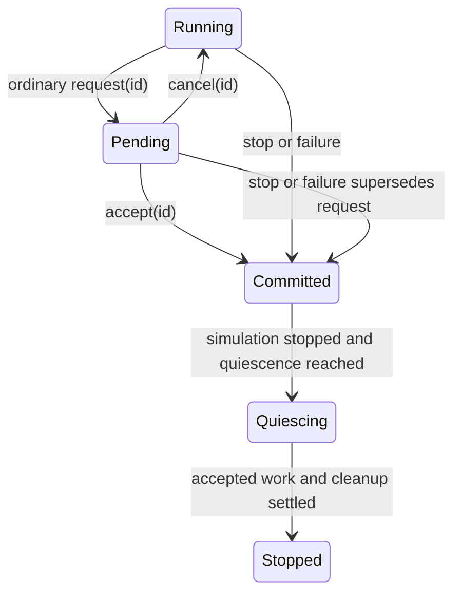
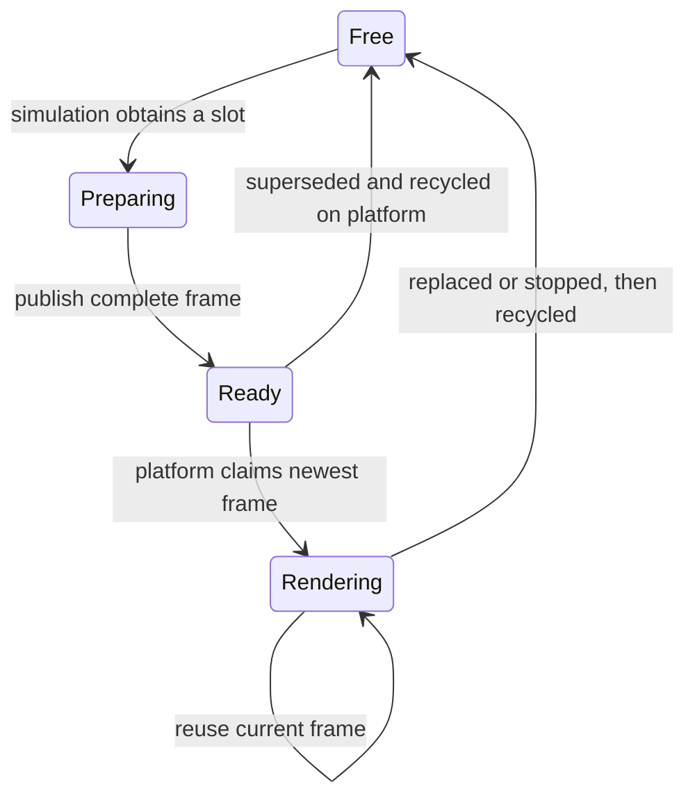
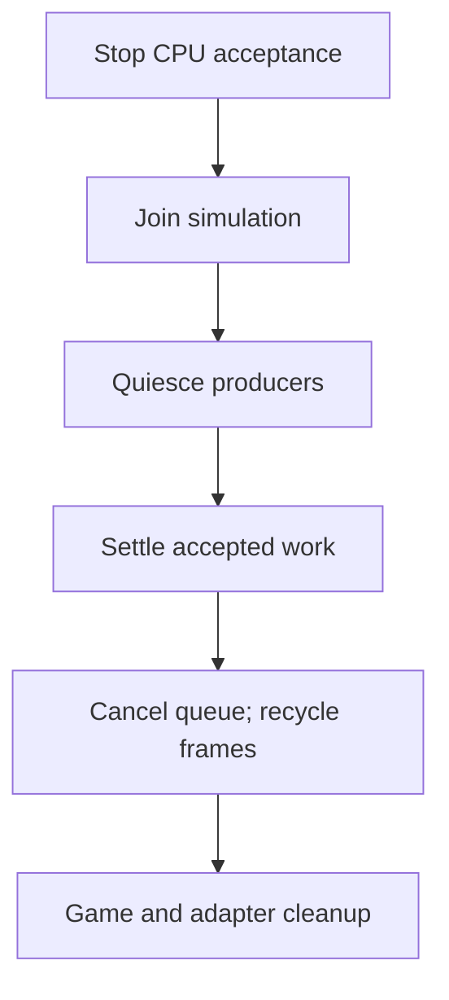

# Runtime frame boundary

Use this guide to place application work in the correct hook and to preserve
its dependencies through shutdown. Start from the runnable
[First Game](../getting-started/first-game.md) or
[assemble a context](../development/consuming-engine.md#context-assembly) first.
The sequence below applies to both runtime modes. Polling, simulation and
presentation have independent eligibility; it does not require one poll per update
or one update per rendered frame.

| Boundary | Execution owner | Value or responsibility transferred |
| --- | --- | --- |
| Initialize adapters, then `game.init()` | Platform/graphics caller of `run()` | Live input/window/graphics become available; the game registers bindings and uploads initial resources. |
| Service platform requests and eligible input polls | Platform/graphics | Owned request results, complete input polls and copied dimensions become available. |
| Drain simulation requests, transfer input, select view, run step services, call `update()` | Simulation owner | The tick uses the selected copied view. Required step participants finish before the game hook. |
| `prepare_render_frame()` after a useful update batch | Simulation owner | Copy camera/draw values and retain resources in an available frame slot; skip visual publication when no slot is free. |
| Render, present and maintain resources | Platform/graphics | Consume the newest completed frame without reading mutable game state; recycle superseded frames and deferred native resources. |
| Stop, join, quiesce, settle accepted work, recycle, `deinit()` | Coordinated shutdown, with cleanup on platform | Keep dependencies alive until accepted users finish; follow [the full shutdown order](#shutdown). |

`CE::Runtime::GameRuntime` coordinates input polling, simulation, rendering, presentation, and
shutdown. Both execution modes use the [same configurable timing policy](simulation-timing.md), with variable/fixed steps and bounded direct/hybrid recovery. The application chooses a compatible platform, graphics context,
renderer, resources, and input adapter. The renderer uses the selected context
and render target; it does not own the display system or read live game state.
The presentation surface presents a completed frame.
The GLFW/OpenGL factory accepts the game's window configuration, constructs the
display and window, and lends the window to its presentation context. The display
owns the GLFW library lifetime; renderer initialization makes the context current
and loads OpenGL entry points before game initialization uploads assets.

## Input and owner threads

Each platform poll produces a timestamped `CE::Input::Actions::Snapshot`. Each independently
scheduled `update()` consumes the complete pending batch in one `CE::Input::Tick`.
Input supplies edges, counts, and observed hold durations; it never subdivides
simulation time or schedules extra updates. Simulation
produces complete render state, which remains stable while rendering consumes it. The
renderer must never access mutable simulation objects across that boundary.
Each complete `CE::Input::PollSnapshot` carries State and independently captured ordered
Events/Text records. The runtime transfers both at the same consumption boundary;
`CE::Input::Tick::records()` retains their shared observation order. Scoped capture
requests and backend fidelity are documented in
[input-state-model.md](input-state-model.md#ordered-events-and-os-text).
Each tick also carries logical window and framebuffer dimensions sampled together
on the platform owner. Simulation uses these copied values for UI layout and pixel
scaling without reading the live window. Manually constructed ticks supply their
logical dimensions explicitly; the default is zero.
These rules also apply when simulation and rendering run sequentially. The
sequential runtime owns one reusable frame. Concurrent mode owns three slots:
one may be rendered, one may be the latest completed frame, and one may be in
preparation. Platform event polling and graphics-context use respect their
respective thread affinity.

The caller of `CE::Runtime::GameRuntime::run()` owns platform polling and the graphics context
in both modes. Sequential mode polls, updates, prepares, renders, and presents on
that thread. Concurrent mode runs only `update()` and `prepare_render_frame()` on
one simulation worker; it passes complete polling batches and framebuffer dimensions
as values instead of giving that worker access to a live window. A resize
callback runs on the platform thread and must not mutate simulation state.
`init()` runs after input and graphics initialization but before starting the
worker, so it can register bindings and load GPU assets. After the worker joins
and frames are recycled, `deinit()` runs while the graphics context is current.
The default GLFW/OpenGL factory owns its input adapter; the overload taking an
input reference borrows it through context destruction. Owned input detaches
before the window is destroyed. A runtime and its context each permit one session.
Game cleanup is paired with attempted initialization, including partial failure;
cleanup preserves the first failure while still shutting down both adapters and
reports subsequent failures with phase context. See [failure-reporting.md](failure-reporting.md)
for deferred native callback checks and the bounded emergency reporting contract.

## Runtime service phases

Use `engine.services()` to attach module work that must finish at an owner
boundary. Retain the returned `CE::Runtime::ServiceAttachment` as a member;
discarding it immediately detaches the callback. An attachment added during a
phase starts with the next phase, without replay. Registration requires the
initialized owner: platform maintenance can attach during `init()`, while
simulation step services can attach from the first `update()` in either mode.

| Phase | Ordering and payload |
| --- | --- |
| `on_maintenance(callback)` / `PlatformMaintenance` | Platform passes independent of frame/update admission, including startup waits and shutdown drainage. Carries context/session, checked pass number, observation time and `Running`, `ShutdownDrain` or `FinalCollection` reason. It does not pump native input. |
| `on_step(callback)` / `SimulationStepStarting` | After mailbox/input transfer and view selection, before the attempted game update. Carries context/session, step number, simulation delta in seconds, update kind, dropped seconds and matching view revision. |

For a platform-owned module, declare these members in its owning class:

```cpp
std::uint64_t last_maintenance_pass_ = 0;
CE::Runtime::ServiceAttachment maintenance_;
```

During initialized platform setup, with `engine` as the Context:

```cpp
maintenance_ = engine.services().on_maintenance(
    [this](const CE::Runtime::PlatformMaintenance& phase) {
        last_maintenance_pass_ = phase.pass;
        // Perform this module's bounded platform maintenance here.
    }
);
```

Include `<cheryl/core/engine/runtime-services.h>`. Reset the attachment while its
borrowed target is still alive. Reset acknowledges an entered callback, except
safe self-reset; runtime closure also invalidates attachments without invoking
callbacks from a destructor.

These are required immediate participants. The runtime attempts the remaining
participants before propagating the first failure; failed step work prevents
the dependent game update. A step callback that requests stop also prevents that
update. The step event describes an **attempt**, not a completed game hook.
Optional bus listeners use `platform_maintenance_event` or
`simulation_step_starting_event` and do not replace required attachments.

The renderer's required maintenance binding handles ordinary and shutdown-drain
passes. After frames and `game.deinit()` release their handles, `FinalCollection`
runs once, followed, when the renderer initialized successfully, by the direct final
renderer collection barrier even if a
service callback failed. This preserves native teardown ordering.
UI clocks are a [separate session opt-in](../modules/tgui.md#automatic-view-and-time).
Application-owned audio can [attach its notification pump](../modules/miniaudio.md#runtime-notification-pump)
without transferring output ownership to Runtime.

## Lifecycle observation

Register on `engine.events()` before `run()` for the milestones of interest.
The channels in `<cheryl/core/game-framework/runtime-lifecycle.h>` carry owned
`current` snapshots and publish on platform outside scheduler locks:

| Channel / payload | Meaning |
| --- | --- |
| `runtime_ready_event` / `RuntimeReady` | Adapter/game initialization, simulation owner and initial selected view are established, before the first game update. Skipped when startup fails or shutdown commits first. |
| `shutdown_starting_event` / `ShutdownStarting` | Shutdown committed once, including partial startup failure. Simulation can still be finishing its current hook. |
| `runtime_quiescing_event` / `RuntimeQuiescing` | Simulation/mailbox work has stopped and any applicable `game.quiesce()` hook has been attempted. Accepted CPU work can still be settling. |
| `runtime_stopped_event` / `RuntimeStopped` | Ordered cleanup has been attempted and the terminal outcome recorded, before `run()` returns or rethrows. A failed cleanup is not proof of successful native release. |

In concurrent mode an immediate Ready callback must not wait for simulation:
that owner is still behind the startup gate. A simulation-delivered Ready
listener can queue work for the gate's release before the first update. The
runtime continues servicing platform dependencies while simulation bootstraps.

Keep a copy of `auto lifecycle = runtime.lifecycle()` for late or post-destruction
inspection. `lifecycle.snapshot()` is synchronized and retains checked context/
session identities, sequence, stage, readiness, shutdown cause/request correlation,
initialized capabilities and terminal outcome. Terminal state includes final
session counters, the primary failure and bounded secondary failure summaries;
`secondary_failure_count` can exceed the retained summary array. Failure text owns
its storage and reports truncation. It does not borrow an exception or adapter.

Bus registration has no lifecycle replay. Snapshot sequence also advances for
request admission/cancellation, so milestone sequences need not be consecutive.
`RuntimeStage` uses `Unstarted`, `Initializing`, `Ready`, `Stopping`, `Quiescing`
and `Stopped`; pending negotiation is represented separately by the shutdown
snapshot. Lifecycle observation does not replace game hooks, joins, dispatcher
closure or accepted-work settlement.

## Negotiable shutdown

Use `runtime.shutdown().request()` for an ordinary host request that a game may
defer or cancel. It returns a `ShutdownTicket` with a checked request ID and shared
result future. Duplicates coalesce while the same request is unresolved. Requests
stage for a safe platform pass and wake it independently of input-backlog capacity.
A retained `ShutdownEndpoint` does not borrow Runtime; it rejects after closure.



With no host policy, an admitted request is accepted after the
`shutdown_requested_event` fanout returns. To show a save/quit prompt, retain one
`ShutdownPolicy` installed before `run()`. Only that policy receives a
`ShutdownDecision`; public `ShutdownRequested`/`ShutdownRequestCancelled` payloads
carry facts rather than authority. For a simulation-owned prompt, include
`<cheryl/core/engine/event-delivery.h>` and `<optional>`. Before `run()`, with an
application-owned `engine` and `runtime`:

```cpp
std::optional<CE::Runtime::ShutdownDecision> prompt_decision; // Simulation-owned during run.
auto policy = runtime.set_shutdown_policy(
    [&prompt_decision](const CE::Runtime::ShutdownRequest&, CE::Runtime::ShutdownDecision decision) {
        prompt_decision = decision;
    },
    {},
    CE::Events::simulation_delivery(runtime.simulation_dispatcher().submission())
);
```

The game's simulation-owned prompt can later call
`prompt_decision->accept()` or `cancel()` and then clear its optional. Consume the
returned boolean: it reports whether the response was still valid and staged;
the ticket settles when platform processes the decision. Keep the policy and
borrowed prompt storage alive through the session, then `policy.reset()` before
destroying that storage. An immediate policy runs on platform and must return
without waiting for simulation. Never block either needed owner on the ticket.

Pending leaves polling, simulation, presentation and platform services running.
There is no automatic policy timeout. Policy failure or withdrawal cancels an
unresolved ordinary request; a fresh request gets a new identity. Stale decisions
return false. `stop()`, `tick.request_stop()` and runtime failure bypass
negotiation, supersede pending work and start normal teardown. Ticket results
distinguish `Accepted`, `Cancelled`, `Superseded` and `Rejected`.

Native GLFW supports [consumable main-window close intent](display-and-window-contract.md#native-close-intent),
so its close button enters the same protocol. The default policy option
`NativeClosePolicy::Negotiate` requires that capability. Choose `Force` explicitly
for a boolean-only adapter: host requests remain negotiable, while native close
commits unconditionally, including while another request is pending.

## Queued preparation and stop requests

`engine.platform_dispatcher().submit(work)` transfers owned request data to the platform
thread, where graphics is current. The result is a future: inspect readiness from
`update()`, then publish the resulting handle through the next render frame. Do not
block simulation on it or capture live simulation objects in platform callbacks.
The queue drains FIFO batches before polling, including while the input backlog
is full; nested requests wait for the next batch. Futures, cancellation and saved
submission endpoints follow the [dispatcher contract](thread-dispatch.md).
Accepted dependencies settle under the [shutdown sequence](#shutdown) below.
Callbacks must preserve the session's current graphics context. Backend resource
guards reject another context even when it is selected on the correct thread.
Game code calls `tick.request_stop()` to request graceful shutdown from `update()`.
Every `CE::Game::TickContext` shares the session's `std::stop_source` with `CE::Runtime::GameRuntime::stop()`;
both entry points wake scheduler waits and are safe to repeat. The request ends
further simulation updates and uses the normal join, quiesce and cleanup sequence.
It does not interrupt the current `update()`; return early when further game work
is unnecessary. Sequential execution can still prepare and present its final
updated frame before teardown.
A copied `tick.runtime_stop` retains only stop state and remains safe after runtime
destruction; do not retain the tick itself or its borrowed input view. Manually
constructed ticks default to no runtime stop source; `request_stop()` then throws
`failed_operation`. Tests or another scheduler can supply a source explicitly.
Use the [ordinary shutdown endpoint](#negotiable-shutdown) instead when the game
must be able to defer or cancel the request.

## Frame publication and recycling

During ordinary publication, each slot follows this lifecycle. Rendering may keep
using the current complete slot while simulation prepares another; platform owns
recycling.



`CE::Game::AbstractGame::prepare_render_frame(writer)` runs on the simulation thread after
the final useful update of a bounded batch when a slot is free. If all slots are occupied, the update still
advances the simulation and only that tick's visual snapshot is skipped. The
runtime lends the game a reusable `CE::Rendering::Frame` slot through the writer. The game
fills ordered passes with copied camera values, custom pass parameters, constraints,
and resolved `CE::Rendering::DrawPacket2D` values. Asset helpers select geometry ranges and lay out
text on simulation, resolving transforms, engine semantics, custom parameters, and
image requests into owned values. Packets retain geometry and material generations;
no asset, font interface, string, animation cursor, or live entity is needed by playback.
The caller model carries placement/rotation; `CE::Rendering::DrawStyle2D::scale` also scales local
geometry and glyph offsets explicitly. The runtime publishes the complete slot without
copying it and prevents further mutation while the renderer consumes it.

Recycling a superseded or shutdown slot clears only the active passes' draw
packets and pass parameters, releasing their resource handles on the graphics thread while its context
is current. The platform retains its latest complete slot between publications. Recycling keeps pass objects and draw-vector capacity for later ticks. One
slot suffices when update and render are sequential; concurrent update/render
need at least two. A third permits a completed frame to wait while one is being
written and one is being rendered.
Text strings may still allocate, and the final release of a GPU-backed handle
must occur on the graphics thread or through backend-managed deferred destruction.

At each concurrent render handoff, platform claims the newest completed slot.
If simulation supersedes a waiting frame, platform recycles that older slot before
lending it out again. Rendering consumes authored packet order and complete
validated pipeline state. The [render contract](../rendering/pipelines-and-materials.md)
owns packet resolution and writer rules; [asset playback](../assets/asset-values-and-playback.md)
and [Unicode text](../assets/text-layout.md) resolve their values before publication.

Polling admission and fresh-batch consumption follow the
[input contract](input-state-model.md#polling-backlog-and-scheduling). Frame
preparation occurs once after a bounded update batch under the
[timing policy](simulation-timing.md). Retirement maintenance runs independently
of new frames under the [residency contract](../resources/resource-residency.md#native-retirement-and-maintenance).
The [demo guide](../../../projects/apps/demo/README.md) owns its options, controls and
application bootstrap.

## Shutdown

While joining simulation and settling accepted CPU work, platform keeps servicing
dependencies. The remaining phases preserve their owners through cleanup:



Stopping closes context CPU-group acceptance and stops simulation. Simulation
cancels its pending dispatcher work on its owner before publishing completion;
initialization failure before owner binding cancels on the initializing thread.
Platform keeps pumping accepted dependencies while joining simulation, so an
accepted callback awaiting platform work cannot strand it in a blocking join.

After simulation joins, `game.quiesce()` stops external producers and invalidates
borrowed event registrations while their targets/resources remain alive. Do not
block this hook on work that still needs platform dispatch. It pairs with attempted
game initialization, including partial startup. Accepted CPU work then settles
while platform continues servicing dependencies; bounded 1 ms shutdown waits
observe completion without borrowed runtime wake callbacks in workers. Only
context-created groups close; an injected pool's unrelated groups remain open.
An owned root joins before game/resource cleanup.

Remaining platform requests cancel, all retained frames recycle on graphics,
and `game.deinit()` runs before input and graphics shutdown. Preserve the first
failure while completing cleanup; report later failures with phase context through
[failure reporting](failure-reporting.md). Owned input detaches before window
destruction, and the context must outlive its renderer. External logical handles
follow the [native lifetime contract](../resources/resource-residency.md): they can
survive for destruction/CPU inspection but cannot draw through a closed domain.
