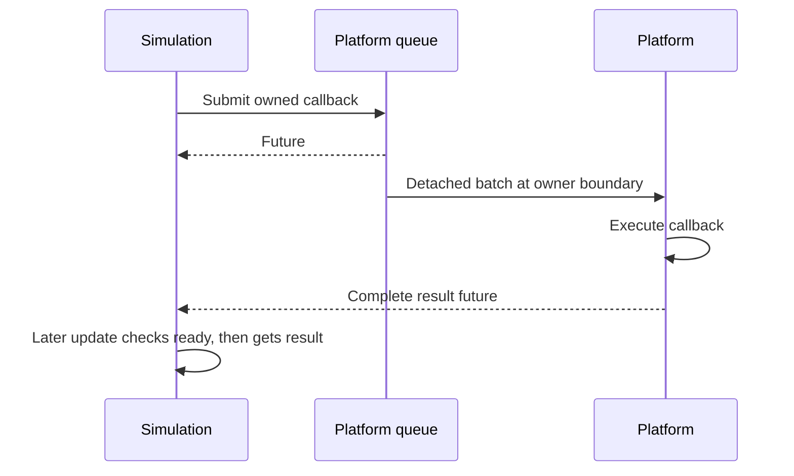

# Thread dispatch

Use owner dispatch when work needs the platform/graphics or simulation thread.
Retain a submission endpoint, submit owned inputs, then check the returned future
from a later update. For changing drawable text, prefer the Engine
[text updater](../getting-started/how-to/update-text.md), which already manages
preparation, upload and adoption. Use the primitives here for other operations
that need a specific owner.

`CE::Runtime::PlatformDispatcher` accepts owned `work(CE::Runtime::Context&)`
and runs it on the platform/graphics owner. `CE::Runtime::SimulationDispatcher`
accepts owned `work()` and runs it on the simulation owner. Both return futures and expose a copyable `submission()`
endpoint. Saved endpoints contain no borrowed service pointer and reject with
`CE::Exceptions::failed_operation` before opening, after closing, and after
service destruction.

These owner queues belong to `CE::Runtime`, which coordinates a game session and
its thread-affine adapters. Generic CPU jobs use the independently owned
[`CE::Workers` pools and groups](worker-execution.md). The runtime owns queue
opening, draining, and closing. Initialization can submit simulation work before
a concurrent worker starts; that worker binds execution
ownership before draining. Sequential mode binds the calling thread instead.
A failed initialization may close the still-unbound simulation dispatcher on the
platform because simulation ownership was never established.

## Submit and adopt a result

Submission queues owned work; adoption belongs to a later update after readiness
has been observed. Neither submission nor destroying a future runs the callback
on the producer.



This fragment belongs in a game that already retains `engine_`, its runtime
context. It makes one explicit live-window observation; ordinary layout should
use `tick.framebuffer_size` instead. Include
`<cheryl/core/engine/engine-context.h>`,
`<cheryl/core/display/window-interface.h>`, `<chrono>`, `<exception>`, `<future>`
and `<optional>`.

Store these members with the game:

```cpp
std::optional<CE::Runtime::PlatformDispatcher::Submission> platform_requests_;
std::future<CE::Platform::FramebufferSize> pending_size_;
CE::Platform::FramebufferSize last_size_{};
std::exception_ptr size_failure_;
bool request_live_size_ = true;
```

During platform-owned `init_platform()`, save the endpoint:

```cpp
platform_requests_.emplace(engine_.platform_dispatcher().submission());
```

During `update()`, submit once and adopt only a ready result:

```cpp
if (request_live_size_ && !pending_size_.valid()) {
    request_live_size_ = false;
    try {
        pending_size_ = platform_requests_->submit([](CE::Runtime::Context& owner) {
            return owner.window().framebuffer_size();
        });
    } catch (...) {
        size_failure_ = std::current_exception(); // Rejected before acceptance.
    }
}
if (pending_size_.valid() &&
    pending_size_.wait_for(std::chrono::seconds{0}) == std::future_status::ready) {
    try {
        last_size_ = pending_size_.get();
        size_failure_ = nullptr;
    } catch (...) {
        size_failure_ = std::current_exception(); // Callback failure or cancellation.
    }
}
```

After adoption, `last_size_` contains the platform window's copied observation at
callback execution. The callback captures no game pointer. A failure leaves the
last successful size intact and is retained in `size_failure_` for the game's
reporting policy; it does not trigger an automatic retry. Set `request_live_size_`
again only when another observation is wanted. `get()` consumes the future even
when it throws.

Retain the game members through runtime shutdown and release them in `deinit_platform()`;
[shutdown settles or cancels accepted requests](runtime-frame-boundary.md#shutdown)
before that hook. Releasing a future by itself does not cancel submitted work.
For a producer that outlives a service facade, retain its own endpoint copy and
handle rejection after closure.

## Queue and future contract

Each drain detaches one FIFO batch. New posts, including posts by callbacks in the
batch, wait until a later drain. The owner never executes a submission inline,
and recursive draining does not consume reentrant posts. Queue mutexes protect
only state transfer; callbacks and cancelled capture destructors run without them.
The enqueue mutex defines order between overlapping producers, not their start
or completion times in other execution domains.

Submission owns callback captures. Borrowed captures must remain alive through
completion or cancellation. Exceptions from accepted work reach its future;
unexecuted work is cancelled by promise destruction (`broken_promise`). Do not
wait on a future from the thread required to complete it. Wake callbacks own their
scheduler state so an enqueue racing closure can safely finish its notification.

Callable arguments are decay-owned by submission. Copy endpoints for independent
producers and retain them through their calls; they do not extend runtime/adapter
lifetime. Reference captures and reference-valued results still borrow their targets.
`has_pending()` observes queued tasks only, so false does not establish that a detached
batch has finished or that acceptance has closed. Diagnostics are owned observations,
not completion barriers. Use the returned future and runtime lifecycle for completion.

Event delivery adapters in `CE::Events` use these saved endpoints through a
callable. `CE::Events::EventBus` remains independent of both dispatcher types; the
adapters belong to composition code. See [event-delivery.md](event-delivery.md).

## Simulation boundary

`runtime.simulation_dispatcher().submit(work)` accepts work after runtime
initialization opens the queue. Obtain `submission()` when a longer-lived adapter
needs to save the endpoint. At every scheduled update, the runtime drains one
simulation batch, checks stop, then transfers the entire available polling
backlog immediately before `game.update()`. No input observations are removed
merely because mailbox work ran. There is no total ordering between independent
input and mailbox producers.

In concurrent mode submission notifies the shared scheduler but does not advance
the scheduled update deadline. Delivery occurs at the next scheduled simulation
boundary; posting must not create an early simulation tick.
`CE::Runtime::Simulation::TimingOptions` configures that cadence independently of
polling. In sequential mode the same boundary runs on the calling thread. Owner callbacks execute without the scheduler lock, permitting `stop()`
and further platform/simulation submissions.

The runtime's [shutdown sequence](runtime-frame-boundary.md#shutdown) coordinates
queue cancellation, simulation joining, producer quiescence and accepted CPU/platform
dependencies. Keep callback targets alive through that sequence; do not wait on work
requiring the current owner. Saved endpoints reject after closure without extending
adapter lifetime.
