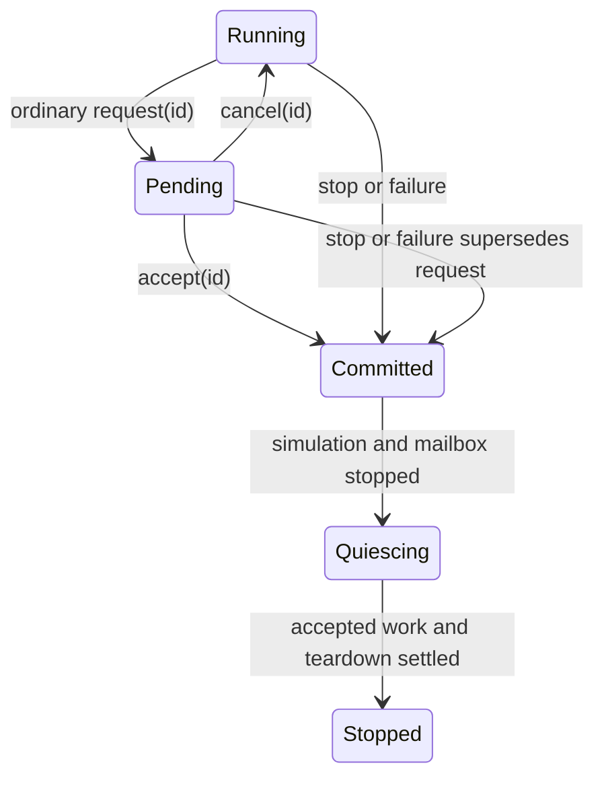

# Engine and module event design assessment

**Reviewed:** 2026-10-18. **Source:** `ccf514018faa9a5c5f0750c21c0da321c0f82e96`.

This assessment recommends **18 new event contract families grounded in existing
engine/module responsibilities, four further families requiring new native
capabilities, and retention of the existing resize contract**. The
[23-row catalogue](event-catalogue.csv) records producers, consumers, payloads,
delivery, prerequisites, replacement consequences and acceptance for each.
Names and API sketches below are proposals. None is implemented by this report.

| Group | New selected contracts |
| --- | --- |
| Runtime lifecycle | RuntimeReady; ShutdownRequested; ShutdownRequestCancelled; ShutdownStarting; RuntimeQuiescing; RuntimeStopped. |
| Runtime/module integration | SimulationViewCommitted; SimulationStepStarting; PlatformMaintenance; RuntimePressureChanged. |
| Device | WindowStateChanged; WindowCloseRequested; GamepadAvailabilityChanged. |
| Resource | AssetCatalogueChanged; AssetUploadSettled; FontCatalogueChanged. |
| Audio | PlaybackEnded. |
| Graphics | GraphicsDomainStateChanged. |

The additional capability-dependent families are DisplayTopologyChanged,
InputDeviceTopologyChanged, AudioOutputStateChanged and PlatformLifecycleChanged.
WindowResized remains the compatibility contract. These are semantic families,
not a requirement that every family be represented by one payload class.

The main architectural changes are a negotiable shutdown controller, documented
module lifecycle and service phases, a coherent window observation projected into
simulation, and committed resource/playback observations. Event publication is
worthwhile where it lets another component react without repeatedly wiring the
same integration through every application. An internal engine consumer is enough;
an implemented subscriber is not required to justify a useful extension contract.

This is the design successor to the [re-audit](re-audit.md). The
[initial audit](report.md), its inventory, and the re-audit's recommendations
retain their reviewed baselines. This assessment supersedes their selection and
proposed integration decisions; it does not rewrite their historical evidence.
No engine, module, application, test implementation or published documentation
changes accompany this assessment.

## 1. Strategy and admission test

Start with responsibilities and caller outcomes, then trace who owns the state,
operation result, execution boundary and teardown. Searching for words such as
“changed,” “callback” or “finished” is a discovery aid, not an admission rule.
Inspect each candidate from four directions:

1. **Producer:** What fact or coordination boundary can the engine/module
   truthfully establish? When is it committed, including failure and partial
   initialization? Who has authority to make the decision?
2. **Consumer:** What useful reaction could an engine component, independently
   attached module, interchangeable module or host perform? Is repeated caller
   forwarding or polling an avoidable integration burden?
3. **Existing protocol:** Does an ordered input stream, owned result, synchronous
   return, immutable frame or lifetime barrier already provide the necessary
   communication? Would dispatch add independent observation or improve module
   attachment, rather than merely duplicate that protocol?
4. **Consequences:** Can identity, ownership, ordering, errors, shutdown progress,
   overload and compatibility be specified? What code should move, what should
   remain, and what capability must be added first?

Admit a candidate when its useful communication and producer authority survive
that examination. A missing capability is a design dependency, not automatically
a rejection. Conversely, an imaginable listener does not make every setter a
useful general event. Prefer one coherent state contract over separate notices
for every field when consumers need the combined state.

Three kinds of publication are useful here:

| Kind | Meaning | Examples |
| --- | --- | --- |
| Committed fact | An authoritative state/result has changed; listeners observe owned data. | Window state, asset catalogue, playback termination. |
| Request fact | An intention is pending; a separate explicit authority decides it. | Native close intent and runtime shutdown request. |
| Coordination phase | Independently attached modules need a documented owner boundary at which to service their responsibilities. | Simulation step and platform maintenance. |

A periodic phase can deserve an event. Its justification is independent module
integration, not the mere passage of a frame. Keep `game.update`, render-frame
ownership and ordered UI input processing as their current dedicated protocols.

### Categories, support and delivery are separate

| Category | Meaning | Selected contracts |
| --- | --- | --- |
| System | Runtime lifecycle, selected simulation state and module coordination. | Lifecycle six, view, step, maintenance, pressure. |
| Device | Native window and input/output device observations. | Window state/close, sampled gamepad availability; future topology/output. |
| Resource | Shared catalogue commits and loading outcomes. | Assets, uploads, fonts. |
| Audio | Logical playback outcomes. | Playback ended. |
| Graphics | Native graphics-domain usability. | Domain available/unavailable. |

These are vocabulary and discovery groups, not separate buses. Put supported
channel declarations and payloads near their owning portable interfaces; backend
implementations publish them. A System event consumed by TGUI, RmlUi, a renderer
or another independently supplied module is a **documented module contract**.
Internal observations can remain code-discoverable without a public support
promise. `RuntimePressureChanged` starts in that category because its diagnostic
thresholds are implementation policy. Its internal status does not prohibit
subscription or future promotion.

Eligible delivery is **immediate, platform and simulation**. Worker delivery is
excluded throughout. A worker can stage an observation for its publication owner;
that does not require worker delivery to listeners.

## 2. Shared contract decisions

### Context and source ownership

Expose a typed notification endpoint from the runtime Context, conceptually
`context.events()`, with explicit endpoint injection for standalone services.
Services that work without Context, such as audio and resource loaders, retain
that independence: they can own a source and accept a publication endpoint rather
than acquiring a hidden runtime singleton. Keep the existing global EventSystem
as a compatibility path for legacy events, not the new source of engine identity.
Do not add category buses, generic broker routing or persistent replay.

Each producer exposes a small current-state source where reconciliation is useful.
Give it checked opaque source identity, a session/generation where needed, and a
monotonic source sequence. Event sequence, catalogue revision and object generation
are distinct: a family can describe several objects within one source. No raw
address is a portable device, voice, window or catalogue identity. Do not reuse
existing Diagnostics fields as semantic identities without checked validity,
exhaustion and a matching ownership policy. Their allocator returns zero on
exhaustion; it can back a checked opaque source ID that rejects zero. No second
allocator is required.
[diagnostic allocator](../../projects/engine/src/internal/diagnostics.cpp#L7).

Allocate identities and reserve revision capacity before admitting a mutation
that depends on them. Exhaustion must reject admission before effects, or move an
already active source into an explicit terminal/error condition; never wrap and
alias another object. Reserve terminal state capacity when creating sources that
must close without allocation. Do not add these fields to every engine object;
only the selected publication owners need them.

The Context notification domain and error sinks must outlive runtime-owned
queues, adapter teardown and `RuntimeStopped`. Closing one service must not close
a shared bus. Native domains can disappear while copied observations and source
snapshots remain safe to inspect.

### Publication, ordering and late attachment

Commit/stage records under the producer's synchronization, then invoke listeners
outside its locks and outside native callbacks. A source drains nonrecursively.
If listener A causes revision 2 while revision 1 is being delivered, listener B
must not receive revision 2 recursively ahead of revision 1. Complete revision 1's
attempted fanout before revision 2 begins; surviving deliveries preserve source
order per subscription. Detach, overflow or delivery failure can omit a record.
Merely unlocking before dispatch
does not provide this guarantee. The current bus permits nested dispatch.
[dispatch and callback entry](../../projects/engine/src/core/subsystems/event-bus.cpp#L66).

A pump detaches a bounded batch or captures an upper sequence cutoff. Records
created by callbacks wait for the next safe drain, so listeners cannot create an
endless synchronous producer loop. Shutdown decisions are likewise staged until
the current request publication unwinds. Do not promise total ordering across
independent sources or that querying current state returns the historical payload
revision; state may already be newer.

A proposed `watch` operation registers and seeds a current snapshot on the source
owner as one serialized operation. Cross-owner callers post that attachment to
the owner; they do not perform a racy “query, then subscribe.” Queued consumers
ignore older/equal revisions after applying their seed. A seed describes current
state and is distinguishable from a historical transition. A new step listener
never receives a past delta. This is source-specific state observation, not EventBus
replay. Revisions and documented coalescing permit recovery from missed state
notifications; they do not recover discarded transition history.
For synchronized services that commit from other permitted callers, registration
and seed capture share the commit lock; invoke the seed outside that lock on the
designated publication owner, before its later queued revisions.

Payloads own their data or retain immutable snapshots. They contain no borrowed
TickContext input, game/native pointers or mutable cancellation flags. Retaining
resource handles in a queued payload can extend GPU/native lifetime; catalogue
facts therefore normally identify generations, while explicit font catalogue
snapshots retain immutable fonts by design. Document that difference.

### Failure isolation and required module bindings

Keep existing `dispatch` behavior compatible. It currently stops immediate fanout
at the first thrown callback; catching around the whole call leaves later
listeners uncalled. Add a distinct isolated notification operation, provisionally
`notify`, which attempts all selected immediate listeners and reports failures
individually. Queued modes retain their independent nonthrowing error sinks.
[bus invocation](../../projects/engine/src/core/subsystems/event-bus.cpp#L161),
[queued errors and cancellation](../../projects/engine/src/core/subsystems/event-bus.cpp#L110).

Separate three policies:

- Observation failures are reported without changing a successful mutation,
  falsifying reload results, or replacing an existing primary failure.
- A failed **required binding**, such as viewport application or module time
  advance, fails the normal phase after all required bindings have been attempted.
  No game update/render that depends on that phase may proceed.
- During teardown, continue attempting cleanup and preserve the first substantive
  failure. Observation failures remain secondary diagnostics. `RuntimeStopped`
  observation cannot retroactively turn a completed run into a failed run.

Optional bus registration does not establish that a required integration exists.
The owner of a required attachment holds its subscription, validates installation
before use and records the last phase sequence it **entered**, plus any failure.
The entry gate is marked before calling the underlying operation. After isolated
notification, the owner invokes a required binding directly only if its entry
gate shows that publication never reached it. This protects mandatory progress
from listener-snapshot/payload allocation failure. Never retry a binding that
entered and threw after partial effects. Publication failure is an observation
error; required-operation failure controls normal phase progression. Successful
fallback does not need to fail a run solely because an optional observation was
lost.

Prepare the stable required-binding list transactionally at attachment time so
phase iteration does not allocate. Attachment/detachment during publication takes
effect after the active publication. Wrappers validate the source's active
publication, session and sequence; a forged or duplicate public dispatch must not
execute a required engine operation. Admission installs registration, binding and
protected target together, rolling back on failure. Explicit detach switches an
automatic UI attachment back to manual mode and acknowledges invalidation before
another owner can destroy its target.

Implement this only for the small set of selected required bindings, not a new
universal scheduler or participant consensus framework. Optional listeners cannot
assume that another listener has already run; dependencies need explicit owner
sequencing. Final resource collection remains an explicit owner barrier. Event
publication becomes the normal module coordination path without making bus
allocation or a subscriber's existence the only protection for native lifetime.

Use owned attachment helpers and explicit detach/invalidation at the correct
owner boundary. Waiting for one's own active callback is invalid; current bus
removal already detects self-wait. Deferred errors must not retain a borrowed
module target that detach can destroy. No listeners run from destructors.
[removal barriers](../../projects/engine/src/core/subsystems/event-bus.cpp#L196).

### Overload and cost

Do not claim that this bus is a durable event log. Immediate required phases have
no queued substitute; late platform/simulation delivery can be cancelled during
shutdown. Deferred state observers should opt into bounded latest-state adapters
where intermediate revisions are unnecessary. Transition observers need bounded
storage and explicit loss/error reporting. Add these policies with their source,
not a speculative general transport framework.

The new paths add subscription ownership, listener snapshots, payload copies and
potential queue amplification. Step and maintenance notifications occur frequently;
keep payloads small, use immediate listeners for required integration, and avoid
formatting/allocating rich diagnostics on every phase. No performance improvement
is claimed. Measure these paths when implemented, and do not convert per-asset or
per-frame activity indiscriminately.

## 3. Selected System contracts

### SYS01–SYS06: runtime lifecycle and shutdown

These six are public module contracts. They expose useful semantic milestones,
not every internal initialization/teardown function.

| ID | Contract | Producer commit and intended use |
| --- | --- | --- |
| SYS01 | `RuntimeReady` | Mandatory initialization, baseline view/input and execution owners are established before first update. Modules/hosts can begin session work. |
| SYS02 | `ShutdownRequested` | The engine has admitted a pending shutdown decision. UI/tooling can indicate it; the installed host policy decides. |
| SYS03 | `ShutdownRequestCancelled` | An ordinary pending decision was rejected, withdrawn or lost its decision authority. Restore pending-close UI/state. |
| SYS04 | `ShutdownStarting` | Shutdown is irrevocably committed; dependencies still exist and simulation may still run. Stop new module production where safe. |
| SYS05 | `RuntimeQuiescing` | Simulation and its mailbox have stopped; accepted CPU work has not necessarily settled. Quiesce external producers and borrowed registrations. |
| SYS06 | `RuntimeStopped` | Ordered teardown has finished, immediately before `run()` returns/throws. Hosts receive final outcome and copied statistics. |

Publish on platform. While running, Ready/Requested/Cancelled can be observed
through any eligible delivery mode, subject to queue progress. Starting, Quiescing
and Stopped require **immediate platform delivery for lifecycle participation**.
Accepting a queued subscription never guarantees it will run before shutdown.

A lifecycle envelope includes context/session identity, sequence and observation
time; request ID/reason/scope where relevant. Stopped additionally owns the final
outcome, reached-ready flag, primary failure summary, secondary cleanup failures
and copied RuntimeStats. Starting reason is not final outcome: cleanup can fail.
Starting/Quiescing also expose reached-ready and initialized-capability state so
partial-startup observers do not assume every adapter successfully initialized.
Use a bounded owned error representation or explicitly lifetime-safe retained
failure object. A snapshot retains readiness, current pending request and terminal
state for late observers.

#### Shutdown controller selected design

Current loops treat the native close flag as permission to exit; `stop()` shares
an irreversible stop source with TickContext. Those cannot express a pending
save/confirmation, cancellation, origin or stale asynchronous response.
[runtime close checks](../../projects/engine/src/core/game-framework/game-runtime.cpp#L277),
[concurrent close checks](../../projects/engine/src/core/game-framework/game-runtime.cpp#L597),
[unconditional stop](../../projects/engine/src/core/game-framework/game-runtime.cpp#L760).

Add a lifetime-safe command endpoint, conceptually
`request_shutdown(reason) -> request/result`, with one host decision authority
installed before run. Keep `stop()` and TickContext stop unconditional and
source-compatible; they still finish the current hook and enter ordered teardown.



The ordinary sequence is: admit Pending, publish Requested, deliver the explicit
decision capability to the host policy, then accept/cancel on platform using that
request ID. Observers see immutable facts; returning from notification, throwing
or mutating a shared flag does not vote. The host can compose saves/confirmation
services itself. The engine does not become the owner of application saving.

Defaults and rejection rules are part of the contract:

- Without a policy, accept automatically, preserving ordinary close behavior.
  Requested can be followed immediately by Starting after fanout unwinds; a queued
  observer must not rely on running a save unless a policy keeps the decision open.
- With a policy, keep the runtime running and servicing owners while Pending.
  There is no implicit consent timeout. Gameplay may pause through application
  policy while updates continue to service UI and dependencies.
- Duplicate ordinary requests coalesce to the pending ID. A stale response cannot
  accept a later request. Cancellation acknowledges the native intent; a subsequent
  close creates a new ID.
- Policy detachment or failed delivery cancels an ordinary pending request and
  reports the error. It does not silently accept or leave an orphaned Pending.
- Stop/failure supersedes negotiation. Starting identifies the superseded request
  when present; do not publish a cancellation that falsely implies running resumed.
- A copied command endpoint retains shared coordination state, not Runtime*. It
  rejects decisions after closure. Requests during initialization stage for a safe
  platform boundary; initialization failure takes precedence.
- Forced OS/session termination requires a separately advertised capability and
  explicit deadline policy. A request event does not promise the OS permits veto.

Correlate decisions **and delivery errors** with request ID and policy generation.
The existing queued error sink receives only an exception, so a permanent sink
that cancels whichever request is currently pending could cancel a newer request.
For this rare path, use one temporary policy listener per admitted request, with
its private decision capability and request identity captured by callback/error
sink; remove it on resolution. Public event payloads never carry that capability.
Prepare delivery state before admitting Pending. If preparation fails, reject
admission, acknowledge the consumed native intent, report failure and stay running;
do not publish a request that never existed. Stale cancellation/error callbacks
cannot affect another request.

Add a consumable native close-intent/acknowledgement capability. GLFW's sticky
flag alone will retrigger after cancellation. Keep a compatibility path for older
adapters: preserve ordinary no-policy close, but reject installing a cancellation
policy if the adapter cannot consume/reset native intent. A host can explicitly
choose a supported defer-only policy; do not silently simulate repeatable cancel
over a permanently sticky flag. Consume/reset on entry and coalesce subsequent
intent while Pending. Default main-window close maps to runtime shutdown; a future
auxiliary window does not automatically stop the engine.
[window close contract](../../projects/engine/include/cheryl/core/display/window-interface.h#L74),
[GLFW flag read](../../projects/modules/platform/native-glfw/src/core/display/window.cpp#L238).

#### Milestone placement and replacement

Sequential Ready follows successful init, initial requests, input baseline and
viewport seed. Concurrent Ready needs a new handshake: simulation binds its owner,
reports ready and waits; platform publishes Ready, then releases the first-update
gate. Simulation-delivered Ready callbacks drain before the first game update.
Thread construction alone establishes none of that. No Ready on partial init or
worker-start/bind failure. A session stopped before starting has no Ready.
Check for a committed stop before Ready even when initialization reached its last
operation; do not announce a new running-ready milestone after shutdown committed.
Always release the worker gate toward running or stopping even if observation
preparation fails. Ready is a committed fact, not an optional initialization
barrier. An immediate Ready observer must not synchronously wait for the gated
simulation owner; queued simulation observers run once it is released.
[initialization boundary](../../projects/engine/src/core/game-framework/game-runtime.cpp#L256),
[worker start](../../projects/engine/src/core/game-framework/game-runtime.cpp#L470).

Quiescing follows simulation/mailbox completion and an attempt of the application's
game.quiesce hook, before accepted-worker settlement. Attempt module quiescing even
if that hook throws. Its listeners may stop producers and invalidate borrowed
registrations, but must not wait for jobs needing platform progress. The event
proves that the hook was attempted, not that application references were released.
Keep platform dispatcher and maintenance servicing during simulation/worker waits.
Stopped belongs to an outer
session finalizer after teardown, preserving the first failure. A rejected second
run creates no second session lifecycle.
Stopped means execution ended and ordered cleanup was attempted; a failed adapter
cleanup is represented in its outcome, not a promise that every resource release
succeeded. Fatal process termination cannot promise any final notification.
[shutdown and join pumping](../../projects/engine/src/core/game-framework/game-runtime.cpp#L712),
[worker shutdown](../../projects/engine/src/core/game-framework/game-runtime.cpp#L807),
[game quiesce contract](../../projects/engine/include/cheryl/core/game-framework/abstract-game.h#L48).

**Replace** close-flag-to-immediate-exit policy and bespoke module lifecycle
forwarding through every game's hooks. **Retain** direct stop, joins, queue
closure, accepted-work barriers, game init/quiesce/deinit and final destruction.
A UI Quiescing handler cannot infer that application-held native widget references
are gone; its documented close-after-quiescence obligations still apply.
[TGUI close contract](../../projects/modules/ui/tgui/include/cheryl/ui/tgui/session.h#L95),
[RmlUi close contract](../../projects/modules/ui/rmlui/include/cheryl/ui/rmlui/session.h#L93).

### SYS07: `SimulationViewCommitted`

Public UI/module contract. Publish immediately on simulation after selecting the
logical/framebuffer pair for an actual update and before the matching game hook.
Payload: context/session, projection revision, source window identity/revision,
logical size and framebuffer pixel size. Commit only when projected fields change;
focus-only window changes need not create another simulation view revision.
Initialize this source from the safe baseline on its simulation owner before
Ready; initialization is a current-state seed, not a historical step publication.
Include that work in the concurrent ready handshake. A simulation-delivered Ready
callback can then attach a UI session and obtain the baseline before layout.

Context-created UI sessions attach through an owned current-view watch and receive
an initial seed. This replaces tutorial/demo dimension comparison and manual
`set_view` forwarding. Preserve explicit manual/standalone/custom-subview mode.
Manual operation must be an explicit mode or detach automatic sizing, not race it.
Do not invoke a simulation-owned session from platform initialization: Context
game.init currently runs before the concurrent simulation owner starts. A UI
session created there would retain that construction owner; current demos/tutorial
instead defer UI session creation to update. Automatic creation/attachment and
seeding must follow the supported simulation-owner lifecycle.
[runtime view selection](../../projects/engine/src/core/game-framework/game-runtime.cpp#L492),
[handoff](../../projects/engine/src/core/game-framework/game-runtime.cpp#L622),
[tutorial forwarding](../../projects/apps/tutorial-game/src/ui-controller.h#L38),
[TGUI Context constructor](../../projects/modules/ui/tgui/src/session.cpp#L235),
[RmlUi Context constructor](../../projects/modules/ui/rmlui/src/session.cpp#L284).

Queued raw resize is not a substitute: its timing need not match the tick's view.
The simulation projection and TickContext must come from the same copied source
snapshot, with logical/pixel values never independently torn. Preserve zero
extents. Required UI application finishes before update; failure prevents that
update, after other required bindings are attempted.

### SYS08: `SimulationStepStarting`

Public module phase, immediate on simulation. Payload owns session, step number,
delta in seconds, step kind, dropped-time amount and selected view revision.
Publish once per selected/attempted scheduled or recovery step, after view/input
selection and before
`game.update`; no publication for a cycle with no step. It contains no borrowed
input and does not replace the game update hook. Stop or a required-handler
failure can prevent the matching game hook; the phase is not evidence that an
update completed. Increment game-update counts only when that hook is entered.

Offer **explicit opt-in** automatic UI time advancement. A session attached during
a step records that step ID and begins with the next step; never replay a delta
it did not participate in. Automatic and manual advancement must not both apply.
Recheck stop after required handlers before entering game.update.

This can replace repeated UI-clock forwarding, but changing its order is material:
the TGUI demo currently processes input then time; RmlUi advances time then input,
and RmlUi Update can call user code. Opt-in preserves existing application order
until migrated deliberately. Input capture/preemption, HUD mutation and frame
recording remain explicitly ordered by the application.
[TGUI advancement](../../projects/modules/ui/tgui/src/session.cpp#L334),
[RmlUi advancement](../../projects/modules/ui/rmlui/src/session.cpp#L349),
[TGUI demo order](../../projects/apps/demo/src/tgui-demo.cpp#L229),
[RmlUi demo order](../../projects/apps/demo/src/rmlui-demo.cpp#L164).

### SYS09: `PlatformMaintenance`

Public module phase, immediate on platform at safe passes outside scheduler/native
locks. Payload owns session, pass number, observation time and reason
`Running | ShutdownDrain | FinalCollection`. No fixed frequency or elapsed-time
integration guarantee. It occurs even with no rendered frame, slow simulation or
full input capacity, and while shutdown pumps dependencies.

Install a runtime-owned required renderer attachment after initialization. Move
normal recurring `renderer.maintain_resources()` forwarding to that attachment;
keep its binding alive until final collection after frames/game references
release, then detach before backend deinitialization. Other independently attached
services, including an explicitly attached audio notification pump, can use the
same documented owner boundary without every application adding a forwarding call.
[ordinary maintenance](../../projects/engine/src/core/game-framework/game-runtime.cpp#L678),
[final collection](../../projects/engine/src/core/game-framework/game-runtime.cpp#L745),
[shutdown servicing](../../projects/engine/src/core/game-framework/game-runtime.cpp#L783).

Use the required-binding gate/fallback described above. Keep an explicit final
collection barrier after all retirement producers are quiescent; listener order
cannot prove that an earlier collector saw resources retired by a later listener.
For FinalCollection, finish module fanout first, then invoke the renderer collector
directly as that barrier. The ordinary renderer attachment defers collection for
this reason; its event entry gate must not suppress the final owner collection.
Normal required maintenance failure still fails the run. During shutdown preserve
the first failure and continue servicing dependencies. Unregister closed standalone
services before later phases; audio's final observation pump is separately allowed
after output closure. Do not turn this phase into native event pumping implicitly.

### SYS10: `RuntimePressureChanged`

Internal System observation, initially unsupported as a stable public API. Publish
transitions among the runtime's existing diagnosed lag/backpressure conditions,
including recovery, rather than every sample or log. A platform owner can publish
a coherent mask plus reason, source revision, observation time and copied relevant
counters after simulation stages its timing state. Do not call listeners while
holding the scheduler lock or from current noexcept diagnostics without contained
failure handling.

Useful consumers are engine debug overlays, module diagnostics and internal
quality adaptation. Thresholds should initially preserve current diagnostic policy,
with no claim that a capacity stall is memory exhaustion. Shutdown closes the
source; it need not manufacture a recovery transition. Keep logs and result APIs.
[timing diagnosis](../../projects/engine/src/core/game-framework/game-runtime.cpp#L152),
[platform diagnosis](../../projects/engine/src/core/game-framework/game-runtime.cpp#L189).

## 4. Selected Device contracts and window replacement

### DEV01: `WindowStateChanged`

Public portable contract. One owned state snapshot initially includes window
source/session, revision, observation time, supported/known fields, change mask,
logical size, framebuffer size and observed focus. Extend it with presentation,
scale and mode only when the adapter can truthfully observe those values. Zero
framebuffer size is not proof of iconification; framebuffer/logical ratio is not
portable UI density; unknown is not false.

Stage callback dirtiness and sample the coherent live state at a safe platform
boundary after native callbacks and failure checks, before native rendering.
“Coherent” means one selected observation, not an atomic OS transaction or a
lossless stream of every focus transient. Do not publish from every setter entry.
The current cached window mode is assigned before native operations finish;
observed/applied mode must not repeat that requested value as successful fact.
[window mutation](../../projects/modules/platform/native-glfw/src/core/display/window.cpp#L205),
[current focus sampling](../../projects/modules/platform/native-glfw/src/core/controls/input-system.cpp#L374).

A runtime-owned **required immediate renderer binding** consumes framebuffer
changes. Install/seed it at the existing post-init viewport boundary. Remove the
old seed/comparison forwarding when this binding takes responsibility; focus-only
and logical-only revisions do not call set_viewport. Do not introduce an additional
System platform-view event carrying the same committed pixels. SimulationView is
a distinct projection at a distinct owner boundary, not duplicate platform state.
If a new-state observer synchronously mutates the window again, mark observation
dirty, finish current fanout and skip native rendering until the next safe pass
selects/applies a fresh state. Do not recursively drain until a listener stops
resizing. Legacy nested resize behavior remains unchanged; it settles before the
initial safe state selection.

Generic platform/simulation observers can subscribe asynchronously. Those who
must correlate focus/device state with exact input polls need source metadata
carried through whole completed polls and applied at consumption; merely choosing
simulation delivery does not establish that alignment.

### DEV02: `WindowCloseRequested`

Public native intent contract, with source window/session, intent sequence, time
and scope/capabilities. Publish once for each consumed native close intent on the
safe platform owner. Intent is not actual window destruction or accepted shutdown.
The required default main-window bridge calls the engine shutdown controller;
ordinary subscribers cannot cancel by payload mutation. Bridge installation is
owned/validated, with direct controller submission if publication fails before
entry, so a missed optional notification does not lose the close request.

Retain native lifecycle authority and acknowledgement. Auxiliary windows can have
a different owner policy. Pair this capability with SYS02/SYS03, not a rename of
the existing boolean `should_close`.

### Important progress limit: native pumping is poll-gated

Default Lockstep permits one completed input poll. When backlog capacity fills,
runtime skips `input.poll()`, and GLFW's normal native pump lives inside that call.
Close/focus/resize can therefore wait for simulation consumption even while
platform maintenance and rendering continue. A flag query does not pump events.
[poll eligibility](../../projects/engine/src/core/controls/polling-backlog.cpp#L25),
[runtime gate](../../projects/engine/src/core/game-framework/game-runtime.cpp#L600),
[native pump](../../projects/modules/platform/native-glfw/src/core/controls/input-system.cpp#L471),
[existing saturation fixture](../../projects/engine/tests/all-tests/src/core/runtime-adapter.cpp#L2476).

Initial WindowState/Close contracts explicitly retain **sampled, poll-gated
observation with no bounded response-time promise**. Pending shutdown continues
normal runtime processing rather than suspending its service loop. Host shutdown
commands remain independent of input capacity: platform dispatcher work continues
to wake/drain the platform owner.

Do not quietly call GLFW polling from maintenance. Native callbacks also append
capture records, private keyboard/mouse vectors and semantic button transitions;
repeated pumping with blocked consumption would move pressure into hidden,
potentially unbounded staging, including State-only operation.
[capture accumulation](../../projects/engine/src/core/controls/input-capture.cpp#L70),
[private native staging](../../projects/modules/platform/native-glfw/src/core/controls/input-system.cpp#L134),
[semantic transitions](../../projects/engine/src/core/controls/input-bindings.cpp#L394).

A stronger responsive native contract requires a separate bounded pump/staging
unit. Selected direction: separate native observation from completed semantic
poll publication, preserve whole immutable polls/FIFO/capacity, bound every pending
input path, and fail visibly at a safe owner boundary on staging overflow rather
than silently dropping records or completed polls. Check overflow after each pump,
even if no semantic poll can complete. It is impossible to guarantee arbitrary
lossless input, bounded memory and endless pumping with a permanently stalled
consumer simultaneously.

Before implementing that unit, choose and specify capture/routing latch semantics
across several native pumps: keeping one logical poll open preserves one latch but
delays new routing requests; relatching each pump changes current whole-poll
meaning. Also settle spacing, focus/capture changes while saturated, callback
failure and standalone host `begin_poll → pump → update`. This is a bounded design
follow-up for a stronger capability, not a prerequisite disguised as an event that
already works. Initial events must state their present progress limit honestly.

### DEV03: `GamepadAvailabilityChanged`

Public observation of the existing **convenience slot**, not physical hotplug.
Payload owns input-source/slot identity, availability revision, connection epoch,
observation time and completed-poll correlation. Publish only after successful
reconciliation and complete poll publication, not when the diagnostic cache is
first updated. Initial watch seeds presence; later reconnect advances the slot
epoch. Adapter closure is source closure, not a fabricated physical disconnect.

This removes application monitoring for the supported slot and supports prompts,
controller configuration modules and engine diagnostics. Retain native input
reconciliation/neutralization. Do not route every button or input record through
the bus. If input-aligned module policy is needed, carry the observation with its
whole poll and publish at the selected consumption boundary, rather than emitting
the same logical event twice on different owners.
[slot creation](../../projects/modules/platform/native-glfw/src/core/controls/input-system.cpp#L330),
[availability/reconciliation](../../projects/modules/platform/native-glfw/src/core/controls/input-system.cpp#L400),
[completed publication](../../projects/modules/platform/native-glfw/src/core/controls/input-system.cpp#L458).

### COMP01: keep existing `WindowResized`

Preserve the named-then-typed legacy producer and existing error behavior. Its
payload borrows Window; it is not the new safe window snapshot. Reentrant legacy
listeners can resize again before the outer typed event arrives, and a named
listener failure can suppress typed dispatch. Never feed outer raw payloads into
the authoritative snapshot. Sample the final live state after callbacks instead.
[legacy producer](../../projects/modules/platform/native-glfw/src/core/display/window.cpp#L153),
[legacy payload](../../projects/engine/include/cheryl/core/display/window-interface.h#L30).

No production resize subscriber currently applies viewport; runtime directly does
so at initialization and comparisons. Move only those runtime paths to the new
required committed-state binding. Do not register the renderer on both streams,
and do not rebroadcast new snapshots as native callbacks. External raw listeners
retain their existing semantics and lifetime responsibility.
[existing resize acceptance sources](../../projects/modules/graphics/opengl/tests/acceptance/src/native-opengl.cpp#L2231).

## 5. Selected Resource contracts

### RES01: `AssetCatalogueChanged`

Public committed cache/catalogue observation. A source identifies one manager or
provider catalogue; payload includes exact manager key type/namespace, source
revision, new/previous generation and change kind `Published | Replaced | Reset`.
Add per-key Removed only with a real per-key removal API. This is one semantic
family, potentially typed by key, not a promise that all managers share strings.
For domain-bound generations, carry native-domain provenance separately from the
catalogue facade identity once the GFX01 portable token is available. Until then,
advertise that provenance as unsupported; consumers must not infer native usability
from a catalogue revision. Native-domain-aware invalidation depends on that token,
while ordinary per-key change observation does not.

Useful consumers include resource browsers, hot-reload coordinators, module cache
invalidation and dependency rebuild controllers. On replacement, retained old
handles remain old generations. Observers decide when/how to adopt a new one;
publication does not magically relink dependent materials or change rendered
frames. A reload group can have a correlation ID and individual commits; do not
claim atomic multi-resource replacement where the implementation does not have it.
[retained generations](../../projects/engine/include/cheryl/templates/asset-mgr.h#L36),
[multi-recipe commits](../../projects/engine/src/core/resources/asset-management/shader-asset-mgr.cpp#L65).

Add real per-key generation/revision state. Do not emit from the current metadata
callback: it also runs on cache hits, is nothrow and runs under the cache lock.
Commit/stage under lock; release retired handles and notify after unlocking using
ordered source draining. Cache hits emit no change. An explicit clear emits one
Reset with a new revision; destructor cleanup emits no callbacks. Source closure
and catalogue reset are different facts.
[publish and replace boundaries](../../projects/engine/include/cheryl/templates/asset-mgr.h#L164),
[clear/destructor](../../projects/engine/include/cheryl/templates/asset-mgr.h#L121).

Keep observer failure outside reload result handling. A successful replacement
followed by a listener failure must not return “previous preserved” when new data
is already visible. Preserve direct handles/results and existing metadata work.
Do not add one event per texture allocation or native retirement.

### RES02: `AssetUploadSettled`

Public aggregate observation for **one executed upload attempt**. Payload owns
loader/source ID, attempt/batch correlation, outcome
`Succeeded | FailedBeforeEffects | Partial | EffectsUnknown`, observed time,
counts with explicit validity and an owned failure summary. Preparation failure
and cancellation before upload execution do not produce this event; they retain
their request result/cancellation contracts. Zero uploaded counts do not prove
zero effects: registry mutation precedes cache work. Clarify known/unknown partial
effects instead of inventing a transaction rollback. Use EffectsUnknown when
publication/count bookkeeping cannot establish what committed; zero/invalid counts
must not be interpreted as FailedBeforeEffects.
[prepared batch and upload stats](../../projects/engine/include/cheryl/core/resources/asset-management/asset-loader.h#L29),
[upload completion](../../projects/engine/src/core/resources/asset-management/asset-loader.cpp#L256),
[effects before cache work](../../projects/engine/src/core/resources/asset-management/asset-loader.cpp#L302).

Shared loading UI, tooling and coordinators can observe outcomes without attaching
to every caller future. Keep the direct return/exception or retained request
future authoritative for the requester; upload itself returns void. Last-attempt
diagnostics/stats can be overwritten and remain observations, as does broadcast.
Notify after outcome capture,
outside the loader's noexcept completion bookkeeping. Batch reuse/cache hits need
not create catalogue changes. “All assets ready” and full prepare/upload pipeline
settlement would require a separate higher-level operation owner.

### RES03: `FontCatalogueChanged`

Public observation with a coherent immutable catalogue snapshot: source/revision,
named fonts, default and ordered fallbacks. Initial embedded catalogue is revision
zero; every successful explicit configure creates a new revision, even for equal
configuration values, because loaded data/snapshot identities may differ. Build
outside the lock, reserve revision and swap under it, publish after unlock. Failure
preserves the previous catalogue. Groups stay private unless a consumer needs them.
Preserve synchronized configuration from permitted caller threads: those callers
stage commits, while one designated publication owner drains notifications and
seeds watches. Unlocking a configure call must not immediately invoke a toolkit
observer on an arbitrary caller thread.

This is selected as a useful next-stage catalogue capability for font selectors,
resource tools and independently supplied catalogue consumers. It also fixes the
coherence problem of separately locked `all()`, `default_font()` and `fallbacks()`
reads. It is **not a claim that current UI supports dynamic rebinding**.
[font commits](../../projects/engine/src/text/font-service.cpp#L220),
[separate reads](../../projects/engine/src/text/font-service.cpp#L266).

Preserve configure-before-consumers usage and retained Font identity. Existing UI
sessions retain their imported catalogue. Automatic adoption would need explicit
widget/fallback policy and native-generation aliases: RmlUi currently rejects a
second retained font generation under the same logical name. Keep that work out
of the first observation unit. A catalogue event is independently useful without
silently changing existing widgets.
[current configure contract](../../projects/engine/include/cheryl/text/font-service.h#L34),
[RmlUi retained-name rule](../../projects/modules/ui/rmlui/src/session.cpp#L194),
[TGUI import](../../projects/modules/ui/tgui/src/session.cpp#L217),
[RmlUi import](../../projects/modules/ui/rmlui/src/session.cpp#L266).

## 6. Audio and Graphics contracts

### AUD01: `PlaybackEnded`

Public Audio contract for one terminal outcome per **admitted logical playback
generation**. Payload owns system/voice ID, generation, source sequence, observed
time, cumulative observation-loss count and reason
`Completed | Stopped | Replaced | OutputClosed | Reclaimed`. It holds no strong
Voice handle: application reference count currently influences reclamation.

Current natural completion is found by state inspection; maintenance scans only
unreferenced inactive entries, so retaining a Voice does not provide a general
completion callback. Stop overwrites Finished and restart replaces VoiceData.
Observe terminal state before those operations erase it.
[state inspection](../../projects/modules/audio/miniaudio/src/system.cpp#L52),
[maintenance/close](../../projects/modules/audio/miniaudio/src/system.cpp#L80),
[stop/restart](../../projects/modules/audio/miniaudio/src/system.cpp#L214).

Selected arbitration and failure defaults:

| Operation | Outcome |
| --- | --- |
| Initial play/stream fails | No admitted generation and no fabricated terminal event. |
| Stop observes native EOF first | Completed wins; later stop produces no duplicate. |
| Active/paused stop succeeds | Stopped. |
| Replacement preparation fails | Old generation preserved; no successor. |
| Stopping old playback fails | No successor; direct exception, no invented Replaced. Native partial effects remain backend-defined. |
| Old playback stops, replacement start fails | Old ends Stopped, or keeps observed Completed; no successor. |
| Replacement starts and commits | Old unfinished generation ends Replaced; admit next generation. |
| Output closes | Completed if already observed, otherwise OutputClosed for unfinished generations. |
| Unreferenced paused generation is reclaimed | Reclaimed; already terminal generations produce no duplicate. |

Prepare replacement and reserve identity/counter capacity before native effects.
Reserve terminal sequence capacity for every admitted unfinished generation; EOF
and noexcept close cannot later reject the generation's terminal transition. This
is counter-capacity accounting, independent of the bounded observation outbox.
Choose Stopped versus Replaced after replacement settles under the audio mutex.
These are observed logical outcomes, not sample-accurate claims about mixer races.
A future Failed reason requires real later-error detection, not inference from
ordinary stopped state.

Stage small terminal records under the existing mutex into a preallocated bounded
outbox. A configurable initial default of 1,024 records is an engineering starting
point to measure, not an established capacity requirement. Drop the oldest pending
observation on overflow, increment sequence/loss counters and report the lost
range/count through the nonthrowing observation sink on the designated owner.
Do not reject playback or block the audio clock because observers are behind.

A designated-owner `publish_notifications()` drains only through its entry cutoff;
callbacks creating new records wait for a later pump. `close()` stays idempotent
and noexcept, stages terminal facts without listeners, and final publication is
explicitly allowed **after close**. Recommended owner sequence:

```text
settle external producers
close audio output
publish_notifications on the designated owner
release attachments, source and system
```

The destructor only cleans up/discards unpublished observations. An explicitly
attached runtime service may pump during PlatformMaintenance, with a final pump
before its attachment is released. No arbitrary listener runs on a mixer callback
or whichever thread called play/stop.

Exactly one logical terminal state per generation does not mean exactly-once
message delivery. Each retained record gets one publication attempt; bus/queue
failure has no automatic retry. Current-state snapshots recover live generation,
closure and sequence/loss counters, not the history of retired generations. Add
checked voice ID/generation and immutable optional terminal reason to retained
Voice/source snapshots. Preserve that terminal reason through later stop/close;
restart replaces it only when a new generation commits. Existing state alone
cannot recover Completed after close overwrites it with Closed. A consumer needing
current-generation completion retains its Voice and reconciles that snapshot
after a gap. Prior superseded history remains unrecoverable; complete historical
operation results need a dedicated reliable result contract.

### GFX01: `GraphicsDomainStateChanged`

Public Graphics contract for actual native lifetime, initially only
`Available(Initialized) → Unavailable(Shutdown | Abandoned)`. Give each domain a
checked permanent ID and a retained observation token/snapshot accessible from the
portable renderer and forwarded by its provider. A replacement renderer creates a
new domain; old handles do not become usable again. First implementation need not
add a domain accessor to every image/geometry type; module caches can retain the
token used for their uploads.

This lets module caches, resource coordinators and hosts learn that native use is
prohibited even when asset facades remain retained. Provider facade destruction
is not domain shutdown. A context that is merely not current is not device loss.
[provider teardown](../../projects/engine/src/assets/resources/resource-provider.cpp#L37),
[domain lifetime](../../projects/modules/graphics/opengl/src/backends/opengl/resource-lifetime.cpp#L170).

Commit Available after mandatory renderer initialization/domain creation, but
flush it only after the complete initialization operation, including optional
native diagnostics, finishes. A reentrant listener must not deinitialize halfway
through remaining startup GL calls.
Unavailable follows actual deactivation, outside its mutex. If shutdown fails
before deactivation, emit no Unavailable. If deactivation succeeds and releasing
the context then throws, still record Unavailable(Shutdown). Later destructor
abandonment must not overwrite that already committed terminal reason.
An operation-final guard stages/publishes that committed invalidation even when
later context release fails; observers must never suppress the primary exception.
[initialization](../../projects/modules/graphics/opengl/src/backends/opengl/renderer.cpp#L83),
[shutdown before context release](../../projects/modules/graphics/opengl/src/backends/opengl/renderer.cpp#L152).

The retained token needs only two transitions and survives facade destruction for
reconciliation. Explicit owner paths can publish after commit; destructor/fallback
paths update the token and safely queue an owned terminal record without invoking
listeners. Queue failure is reported, while terminal snapshot remains authoritative.
This observes lifecycle; it does not replace ordered destruction/retirement.
Actual loss detection, recovery and resource migration remain new capability work,
not an unsupported Recovered state in this initial contract.

## 7. Four further event families with capability work

These are justified engine/module directions, not currently observable guarantees.
They belong in the catalogue with explicit prerequisites rather than being silently
omitted or presented as ready-to-wire publications.

| ID | Proposed family | Why worthwhile; required capability |
| --- | --- | --- |
| DEV04 | `DisplayTopologyChanged` | Window placement/configuration modules need coherent monitor inventory and fallback after removal. Add refreshable inventory, stable connection-instance IDs, invalidated native-handle handling and explicit refresh/selection outcomes. Current constructor-time monitor list is insufficient. |
| DEV05 | `InputDeviceTopologyChanged` | Rebinding, multi-controller and device assignment modules need real enumeration/connect/disconnect. Add portable inventory, per-connection identity, class/capability metadata and adapter support. Do not relabel the one Gainput slot as hardware hotplug. |
| DEV06 | `AudioOutputStateChanged` | Audio settings/recovery modules need output/device/route availability and loss. Add native observation and owned output state, plus a recovery policy if recovery is promised. Current initialization/close alone cannot establish physical device loss. |
| SYS11 | `PlatformLifecycleChanged` | Hosts/modules need genuine suspend/resume or session-ending intent on supporting platforms. Add OS adapters, owner marshalling, supported-transition flags and explicit forced/deadline semantics. Focus/minimize are not suspension. |

Publish owned snapshots/transitions on the designated platform/service publication
owner, then allow the same three eligible delivery modes while owners remain
alive. Terminal/deadline-sensitive work needs immediate required integration.
Display inventory currently captures native monitor handles; miniaudio output
configuration lacks a corresponding portable route/loss observation service.
[display inventory](../../projects/modules/platform/native-glfw/src/core/display/display-system.cpp#L69),
[audio initialization](../../projects/modules/audio/miniaudio/src/system.cpp#L258).

Window presentation, per-window content scale/density and truthful observed mode
extend DEV01 after their capabilities exist; they do not need three more channels.
Graphics loss/recovery extends domain semantics only with new native-domain epochs
and actual detection. Live font adoption is a separate integration capability,
not a new catalogue event. The stronger native pumping contract described above
is also separate capability work and creates no additional event family.

## 8. Integration decisions and exclusions

| Existing communication | Decision and consequence |
| --- | --- |
| Runtime native-close check → immediate exit | Replace with owned request/decision controller. Preserve unconditional stop. Adds pending/cancel state and native acknowledgement. |
| App tick dimensions → each UI session | Replace with owned SimulationView attachment; keep explicit manual views. Requires owner-safe seed and same-tick projection. |
| Runtime repeated viewport seed/comparison | Replace with required committed WindowState attachment. Single authoritative source; no simultaneous raw resize binding. |
| App delta → UI time | Offer opt-in SimulationStep attachment. Existing input/time order is an intentional migration choice. |
| Runtime recurring renderer maintenance forwarding | Replace normal path with required PlatformMaintenance attachment. Preserve explicit final collection and fallback progress. |
| App/game relay of module lifecycle | Replace notification/producer-quiescence relay where an owned attachment can express it. Keep application-held native reference release explicit. |
| App polling convenience gamepad / retained voices / shared catalogues | Add observations and state reconciliation; retain queries, handles and request-specific results. |
| Input State/Events/Text, routing/capture, UI consumption | Keep the ordered dedicated protocol. No general bus copy of key/button/text/capture records. Device observations supplement it. |
| Worker/dispatcher/text result or cancellation | Keep result/future and owner cancellation. Broadcast cannot transfer request completion authority. |
| Frame publication/retirement/native resource cleanup | Keep ownership and dependency barriers. Domain state observes validity, not proof observers released native resources. |
| Generic logging/debug callback stream | Keep existing sinks. Do not recursively route notification failure through its own bus. Pressure is a selected semantic state. |
| Animation cursor finished | Current caller-owned value cursor lacks a playback identity/owner and agreed terminal-duration semantics. A future animation service can justify its own event; adding bus state to every cursor is unwarranted now. |
| Memory/residency pressure | No current budget/sensor authority. Design that capability if required; do not infer it from runtime backlog or every allocation. |
| Saves, level changes, achievements, profile/login, gameplay/network/physics events | Application-owned or absent service responsibilities here. Do not populate the engine catalogue with them. A future real engine module can own its relevant contract. |
| Startup factories/backend callbacks | Keep synchronous ownership/result validation and native lifetime setup. They are not missing broadcast seams. |

The production module map was checked beyond the selected domains: startup,
workers, debug terminal, text, utilities and the SDL scaffold introduce no stronger
additional current candidate. This is a responsibility-based assessment of the
engine/module corpus, not a claim that every future application need is knowable.
[module map](../../projects/modules/README.md),
[startup factory contract](../../projects/modules/runtime/startup/include/cheryl/application/startup.h#L47),
[animation representation](../../projects/engine/include/cheryl/assets/types/2d/sprite.h#L24).

## 9. Coherent implementation sequence

The sequence below is a recommendation for subsequent engineering, not work
performed or authorization to implement in this assessment.

1. **Thin view integration slice:** introduce only the Context/source/owned
   attachment and isolated-notification facilities needed by DEV01 + SYS07. Add
   required-binding entry gates/fallback, coherent window observation and UI
   manual/automatic sizing. Retain COMP01. Exercise reentrancy, failure and owner
   seeding before extending the pattern. Do not build a speculative general bus
   framework for all catalogue rows first.
2. **Shutdown and lifecycle:** add native close consumption (DEV02), the single
   policy controller, six lifecycle contracts and concurrent ready handshake.
   Replace direct close-exit policy; retain cleanup barriers. Initial native
   responsiveness stays poll-gated. This is the highest-value larger unit.
3. **Module phases:** move recurring maintenance through SYS09 with explicit
   final collection; add opt-in SYS08 clocks with deliberate demo migration.
   Lifecycle and phase attachments share ownership/error rules, not policy state.
4. **Independent observations:** DEV03 and SYS10 can be small units once source
   sequencing exists. Stage simulation pressure and gamepad observations at their
   actual commit boundaries; do not retrofit the diagnostic caches as authority.
5. **Resource catalogue units:** RES01 first establishes per-key identity/commit
   observation; RES02 adds aggregate executed-upload outcome; RES03 adds coherent
   font snapshots without UI rebinding. These are separable service units.
6. **Audio and graphics:** AUD01 needs explicit pump/final-flush and bounded loss
   behavior; GFX01 needs portable retained domain identity. Neither requires
   physical device-loss recovery. They can proceed independently after the shared
   notification lifetime/error contracts are stable.
7. **Native capabilities:** implement DEV04/DEV05/DEV06/SYS11 only with their
   actual observation/identity contracts. Stronger independent native pumping and
   dynamic font adoption need the bounded decisions described above before they
   can promise stronger behavior. Do not accumulate dependent code on an assumed
   capability.

New typed declarations and source helpers affect public header/link boundaries;
adding virtual portable capabilities can affect ABI. Prefer additive capability
interfaces/default unsupported behavior where practical, explicitly migrate
in-repository adapters and inspect standalone module consumption. Keep old source
sequences working unless a caller deliberately enables automatic integration.
No deprecation/removal of legacy resize is needed for this design.

## 10. Acceptance and evidence limits

Acceptance follows observable contracts, not counts of event classes. Extend the
existing controlled adapters/owner fixtures; real native/device coverage remains
necessary for native claims. Proposed focused checks:

| Area | Required observations |
| --- | --- |
| Notification foundation | Throwing listener does not suppress later listeners; old dispatch behavior remains; required binding entered once even if delivery allocation fails; no retry after partial failure; nested revision 2 follows complete revision 1 fanout; bounded reentrant drain; self-detach and queued error lifetime. |
| Window/view | Both runtime modes; exact initial seed; logical-only/pixel-only/focus-only/zero extents; simulation TickContext matches view event; reentrant legacy resize converges to final state; legacy exceptions unchanged; no double viewport application; late/manual/standalone UI mode; owner-safe creation and detach. |
| Shutdown/lifecycle | Default accept, pending while service continues, cancel then new close ID, duplicate/stale response, policy detach/failure, stop/fault supersession, initialization request/failure, Ready gate both modes, no false Ready, Stopped final outcome/first failure, no second lifecycle for rejected run, retained endpoint safe after destruction. |
| Teardown progress | Accepted platform-dependent work finishes while pumping; queued simulation callbacks may cancel; Quiescing after simulation close; UI external references remain explicit; optional listener failure cannot prevent required cleanup/final collection; partial init cleans up. |
| Phases | Each actual/recovery step once, no-step cycles absent, late UI session starts next step, automatic/manual time exclusive, toolkit callback stop/failure checked; maintenance with no frame/full backlog/slow simulation and shutdown drain/final release. |
| Gamepad/pressure | Seed and reconnect epoch, failed poll publishes no premature availability, neutralization retained, poll correlation; lag/backpressure enter/recover and cross-owner staging; diagnostics failure does not fail gameplay. |
| Resources | Cache hit no change, retained old generation, replacement/reset and exact keys, no listener under locks, observer failure cannot falsify reload result, reentrant ordered commits, multi-recipe partial results, executed upload success/failure/partial/cancel-before-execution; coherent font snapshot and no implicit widget rebinding. |
| Playback | Retained-voice EOF observation; every terminal reason; EOF before stop; restart preparation/stop/start failure; one admitted generation/one logical outcome; paused reclaim; no native-lock callbacks; bounded overflow/gap/current-state recovery; final pump after close and no destructor callback. |
| Graphics | Available only after init; no Unavailable for pre-deactivation failure; Unavailable survives later context-release failure/destructor fallback; two-transition retained token; new renderer new ID; old resource use stays invalid; facade destruction alone does not close domain. |
| Native capability/pump work | Real removal/reconnect identities and unsupported platforms; full backlog with stalled simulation, close/focus/resize progress, bounded all-path staging, routing/capture latches and visible overflow, callback failure, standalone host pumping, forced lifecycle deadlines. |

Existing runtime source fixtures already address partial init/first failure,
stop-before-start, owner-delivered events, platform-dependent shutdown work,
thread-start failure, quiesce failure and full-backlog maintenance. They provide
places to extend; their presence is not an executed result.
[runtime fixtures](../../projects/engine/tests/all-tests/src/core/runtime-adapter.cpp#L908),
[shutdown-dependent work](../../projects/engine/tests/all-tests/src/core/runtime-adapter.cpp#L1988),
[quiesce failure](../../projects/engine/tests/all-tests/src/core/runtime-adapter.cpp#L2384).

This review used source inspection of the responsible producers, interfaces,
consumers, failure paths and relevant test fixtures, with parallel independent
lifecycle, platform/input and resource/media review. The earlier corpus screen
covered 397 tracked production C++ files; this design follows consequential owners
in depth rather than claiming line-by-line re-reading of every file. Key findings
and proposed boundaries were challenged across reviewers. Font observation is
included despite the existing static UI policy because catalogue observation has
an independent use; live UI rebinding is explicitly excluded.

Performed verification is limited to static artifact structure, local links/source
references and preservation of prior audit data against the recorded revision.
No project build, native test, device observation, benchmark or documentation
generation was run. The proposed architecture and acceptance cases remain to be
implemented and established through executable evidence in their engineering units.
